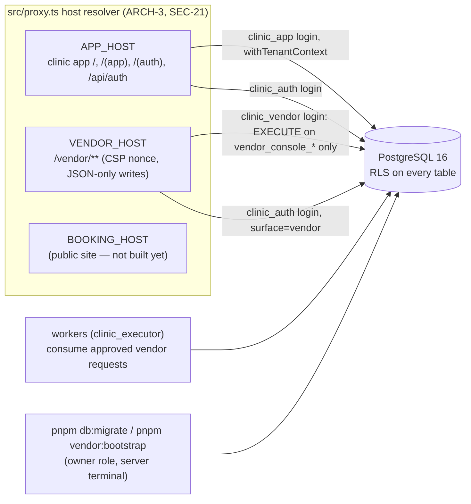

# Architecture — clinic-dashboard

Updated: 2026-11-06 (after HYG-006, HYG-007, HYG-008a and HYG-008b; M0 29/32 tasks; HYG-009–011 planned from the foundation review)
Stack: Next.js 16.4.3 (App Router, TypeScript), PostgreSQL 16 + Drizzle, Better Auth 1.7.15, Tailwind v4 + shadcn/ui, Vitest + Playwright, pnpm, Docker (Coolify target).

This file describes only what the code does today. Target design: `docs/spec/03`, `04`; decisions: `DECISIONS.md` (DEC-*), `docs/spec/DECISION-REGISTER.md`.

## Selected capabilities

| Capability | Decision | Proven operational |
|---|---|---|
| Database | PostgreSQL 16 (Compose locally, CI service) | Locally and in CI; no hosted environment yet |
| Authentication | Better Auth (email + password, TOTP) on two surfaces | Locally (browser evidence); not deployed |
| Deployment target | Docker image → Coolify on Vultr Singapore | Image builds and migrates in CI; not deployed (no staging yet, DEC-034) |

## System map

### Database roles (no BYPASSRLS anywhere; startup refuses unsafe roles — `src/db/rls/context.ts assertAppRole`)

| Role | Used by | May |
|---|---|---|
| `clinic_app` | clinic app pages, Server Actions | RLS-filtered reads/writes bound to `app.tenant_id`, `app.staff_id`, `app.roles`, branch settings (TEN-2); SECURITY DEFINER functions on an allow-list (`tests/rls/rls.test.ts`) |
| `clinic_auth` | Better Auth (both surfaces) | auth tables only (`auth_*`) |
| `clinic_vendor` | vendor console | EXECUTE on the session-token functions pinned in `tests/vendor/team.test.ts`; no table privilege |
| `clinic_operator` | support-session reads (NOLOGIN group; its logins are members of nothing else) | `support_session_bind` and SELECT through one `<table>_operator_read` policy per readable table, only inside a READ COMMITTED transaction bound with a console-issued ticket for that transaction (T-025, DEC-038) |
| `clinic_executor` | lifecycle / request workers, support expiry sweep | `vendor_request_consume*`, `tenant_lifecycle_apply_request`, `tenant_lifecycle_lock`, `support_session_expire` |
| owner (migration role) | `pnpm db:migrate`, `pnpm vendor:bootstrap` | everything; never used by the running app |

### Modules (`src/modules`)

| Module | What it owns | Task(s) |
|---|---|---|
| `org` (identity, staff, access, roles, context) | memberships, staff, roles, branches scope, invitations, sessions revocation, active context, role readers | T-007, T-029, T-030, T-031, HYG-002 |
| `audit` | hash-chained `audit_events` (one write path `audit_append`), log view | T-008 |
| `idempotency` | idempotency records / command wrapper (`src/lib/command.ts`) | T-009 |
| `events` | domain events outbox + consumer receipts | T-010 |
| `approvals` | approvals engine, Persetujuan inbox | T-011, T-015 |
| `notifications` | in-app notifications with acknowledgement | T-016 |
| `settings` | settings registry (PR-38 list), versions, approvals | T-017 |
| `catalog` | versioned catalog (PR-41, DATA-15): items and immutable versions; `catalog_publish` (commercial change active at once, clinical change waits for `catalog_clinical_review`; item locked while a review waits); commercial projection for every member, clinical content for clinical roles and editors (DEC-046); `catalog_version_reference` for later sale/booking writers (CLIN-011). Service master (PR-88, DATA-62): category, durations, online-bookable and aftercare on the version; `service_resources` and `service_staff_eligibility` written once with it; the fixed legal floor `delegation_floor` (class F); the BHP recipe through `catalog_materials_review` (pharmacist; facility head or owner as fallback); a version needing both reviews waits for both (DEC-047); `catalog_service_requirements` for booking roles; Master Layanan `/layanan`. Branch price overrides (PR-42, DEC-048): `branch_prices` keyed by item, Owner only through `branch_price_set` / `branch_price_cancel`, effective-dated in the branch's timezone; `catalog_branch_price(item, branch, at)` is the one reader of the effective price; Harga Cabang `/katalog/harga-cabang` | T-033, T-034, T-035 |
| `org/branches` | branch master (PR-2, UX-2, DATA-46): profile and licence columns on `branches`; `branch_hours`, `branch_closures`, `rooms`, `branch_devices`, `branch_services`; writers through `branch_authorize` (Owner / Admin Pusat every section, Manager the operational sections of their own branch) with audit and `BranchChanged`; `branch_is_open` in branch time for booking; pages `/pengaturan/cabang` (DEC-051) | T-036 |
| `patients` | patient registration (PR-5, DATA-13): `patients`, `contact_points`, `guardians`; the identity number sealed under the tenant data key with a blind index (DATA-8; `src/lib/keys/runtime.ts` loads the KEK ring from `KEK_FILE`, `tenant_data_keys` holds wrapped keys); `patient_register` (FO/CS), `patient_matches` (minimal projection), `patient_get` (scenario PR-1 audit); `/pasien/baru` | T-037 |
| `patients/consents` | consent ledger (PR-4, DATA-14, DATA-66): insert-only `consent_texts`, `consents` with one withdrawal per grant; writers `consent_text_publish`, `consent_grant`, `consent_withdraw` (through `runCommand`); readers `patient_consents`, `consent_active` (staff or service context), `marketing_contacts` (TEN-18, DEC-052) | T-038 |
| `patients/profile` | Profil Pasien 360° (PR-49, UX-29, DEC-056): `profileSections(role)` the role projection (clinical sections for clinical roles only), `loadProfile` (`patient_get` first, then consents), `withdrawFromProfile` (the consent must be the patient's); page `/pasien/[id]` | T-040 |
| `scheduling/rosters` | staff schedules (PR-48, DATA-16): `staff_shifts` and `staff_leave` per branch; `roster_set_week` (listed staff only), `leave_add`, `leave_cancel`; a statement-level check that one person is never in two places; readers `staff_available` and `roster_window` for booking; page `/jadwal-staf` (DEC-053) | T-043 |
| `scheduling/booking` | booking engine (PR-6, DATA-16): `appointments` and `resource_reservations` with an exclusion constraint (btree_gist); `booking_slots`, `booking_create` (runCommand), `booking_confirm`, holds released at write time; the UX-33 conflict check in the roster writers (DEC-054) | T-044 |
| `scheduling/appointments` | appointment states (PR-83): confirm, cancel, no-show, reschedule writers through `runCommand`; `appointment_live`; the calendar reader `appointments_window`; page `/jadwal` with Hari Ini, Minggu, filters and Buat Janji (DEC-055) | T-045 |
| `scheduling/lateness` | lateness release (PR-8, SET-15): off by default; when a branch sets it, late booked or confirmed appointments (yesterday and today, branch time) are released as no-show through the T-045 writer; `releaseLate` checks the go-live gate and writer roles first | T-046 |
| `visits` | visits and Hari Ini (PR-7, DATA-17, UX-6, DEC-057): `visits` (eight independent step columns, one open per patient per branch, guard), `visit_check_in` / `visit_close` (close blockers: unpaid bill, pending dispensing, pending treatment), `visits_today`; `closeBlocker`, `trackStates` (VisitTrack), page `/hari-ini` (check-in and papan redirect there) | T-047 |
| `visits/queue` | queue numbers, walk-in and paired displays (PR-71, DATA-52, NAV-8, DEC-058): `queue_tickets` (per branch per day), `queue_displays` (token hash only), `visit_walk_in`, `queue_call` / `queue_skip`, `queue_board`, `queue_patient_search`, `queue_display_pair` / `_revoke`, `queue_display_feed` (outside tenant context, numbers and rooms only); pages `/antrean` and `/layar-antrean/[token]` (outside the staff shell) | T-048 |
| `compliance` | obligations, evidence files and approvals, feature gates | T-019 |
| `vendor/staff` | vendor staff, roles, IP allowlist, maker-checker requests, `vendor_guard`, `vendor_log` | T-020 |
| `vendor/profile` | vendor profile + residency gate | T-018 |
| `vendor/lifecycle` | tenant lifecycle transitions, capabilities | T-022 |
| `vendor/tenants` | tenant creation, first-owner invitation (maker-checker) | T-023 |
| `vendor/team` | Tim Vendor invitations, state changes | HYG-003 |
| `vendor/onboarding` | onboarding grant, invitation drafts | T-024 |
| `vendor/support` | support sessions (open, extend once, end, list), bind tickets, `withSupportSession` reads, Owner end, expiry sweep; operator class per table (`support_object_kinds`), operator policies (`src/db/rls/operator.sql`); Owner approval of personal/clinical scopes and the Akses Vendor data (`scope.ts`: sessions, paginated access log with `row_found`) | T-025, T-026 |

Shared UI: `src/components/shell` (role-filtered navigation), `templates`, `visit-track`, `ui` (DESIGN.md tokens, `src/styles/tokens.css`).

### Pages

- Clinic app: Masuk / Verifikasi / Aktifkan 2FA / Terkunci / Undangan; Persetujuan; Pengaturan; Kepatuhan; Audit; Staf; Pengguna & Akses; Saya › Peran, Cabang, Klinik, Profil & Keamanan.
- Vendor console: Masuk / Verifikasi / Aktifkan 2FA; Tenant (list, Buat Tenant, detail); Tim Vendor; Keamanan Akun; Undangan Tim Vendor.
- Dev only (refused in production): `/dev/galeri`, `/dev/templat`.

## Boundaries

- **Hosts (ARCH-3, SEC-21):** `src/proxy.ts` serves each host only its own path prefixes; the vendor host adds a per-response CSP nonce, refuses Server Actions and form posts, and accepts writes only as JSON POST to its auth API and `/vendor/api/console/*`.
- **Tenant isolation (TEN-1/2/3/19):** server-resolved context, RLS on every table, `scope_map` classifies every table (test fails on a missing one); cross-tenant negative test per route/action (`tests/isolation`).
- **Two auth surfaces:** one account store; sessions marked `app` or `vendor`; a session never works on the other surface; vendor cookies `__Host-vendor.*`; TOTP mandatory for every vendor account and for the clinic roles of PR-3.
- **Vendor access into a tenant:** only through SECURITY DEFINER functions behind `vendor_guard` (active staff, TOTP + step-up, IP allowlist, role), logged in `vendor_actions` and the tenant's audit chain. Onboarding grant (configuration kinds only, T-024). Support sessions (T-025): a vendor operator opens a reasoned session (5–120 min, one extension) for declared tables; config-only scopes activate at once, personal/clinical wait for the Owner's approval (T-026: TTL from approval, never extended). Each read transaction gets a ticket committed to the tenant chain first; reads go through `clinic_operator` policies that re-check the session, operator, login and tenant on every row and record touched rows. The Owner ends a session at once; the Owner and Admin Pusat see every session with its access windows, refused binds and every record read (DEC-039).

## Threats and controls

| Boundary or component | Threat (STRIDE) | Response | Enforced in, tested by |
|---|---|---|---|
| Tenant data (clinic app) | Information disclosure across tenants | Mitigate: RLS + server-resolved context; no BYPASSRLS | `src/db/rls/context.ts`, migrations; `tests/rls`, `tests/isolation` |
| Auth surfaces | Spoofing (session reuse across app/vendor) | Mitigate: session surface check, host-only cookies | `src/auth/server.ts`; `tests/vendor/host.test.ts` |
| Staff accounts | Spoofing (weak passwords, brute force) | Mitigate: IAM-1 policy, RATE-2 lockout, TOTP for PR-3 roles | `src/auth/policy.ts`, `server.ts`; `tests/auth` |
| Vendor and operator authority | Elevation (a signed-out, demoted or de-enrolled vendor operator keeps acting after a lock wait, or keeps reading in a bound support transaction) | Mitigate (HYG-008b, DEC-043): every token-taking `vendor_console_*` entry point re-reads session, second-factor age, TOTP, staff state, address and role (`vendor_authority_recheck`) before every exit after its guard, including exception-handler exits, never inside a protected section (`vendor_console_staff_state`: on its success branch, in `vendor_staff_update_checked`); the 42501 refusal is logged in its own transaction by `withAuthorityRecheck` (`src/modules/vendor/authority.ts`) with the tenant and object resolved in the database; the operator predicate re-checks a support-capable role, TOTP, a second factor within 12 h and the binding's address on every row, and `operator_row_read` re-judges after its record insert; `clinic_operator` column grants equal `clinic_app`'s on `evidence_files`, `staff_invitations`, `evidence_approvals`; the expiry sweep re-reads each session after the tenant lock | `drizzle/0049_vendor_authority_wall_clock.sql`; `tests/rls/vendor-authority.test.ts`, `tests/db/vendor-authority-drift.test.ts` |
| Clinic authority | Elevation (an ended or demoted actor keeps acting inside an open transaction or after waiting on a lock) | Mitigate (HYG-008a, DEC-043): clinic SECURITY DEFINER writers take the tenant's `staff_access` lock first, then judge the actor on the wall clock (`tenant_actor_lock`, `VOLATILE`); `audit_append` re-checks after its audit lock; `staff_access` precedes every row lock (`setting_draft_decide`/`_cancel` fixed); `staff_invite_accept` locks `staff_access` before the invitation; `clinic_app` cannot read `evidence_approvals.seq` (decisions through `evidence_decisions()`) | `drizzle/0048_clinic_authority_wall_clock.sql`; `tests/rls/authority-clock.test.ts`, `tests/db/authority-drift.test.ts` |
| Clinic write actions | Tampering (a form rendered for one clinic, role or branch is submitted after another tab switched the shared selection) | Mitigate (HYG-009): every clinic write form posts its rendered context (`ctx_t`, `ctx_r`, `ctx_b`; `ContextFields`); the action resolves the context, then `staleContext` refuses any missing or different field before action-specific database work. The fields are an expectation only; the write runs in the resolved context. A context switch passes the session id, so a membership whose sessions were revoked cannot be switched into. | `src/modules/org/context/context.ts`, the six action files; `tests/context/stale-context.test.ts`, `tests/org/access.test.ts` |
| Second factor | Spoofing (a copied authenticator, guessed codes from an open session) | Mitigate (HYG-007, DEC-041 (1)): the TOTP secret is shown once at enrolment (`get-totp-uri` refused); new backup codes need the password and a current authenticator code; codes from an open session (step-up, enrolment completion) count toward the per-account lockout shared with sign-in (5 failures, 15 min), serialized by the `auth_two_factor` row lock; backup codes stored encrypted | `src/auth/server.ts`; `tests/auth/second-factor.test.ts` |
| Catalog clinical content (PR-41, DEC-046) | Tampering / disclosure (a clinical change published without clinical review; a stale commercial change restored by a late approval; clinical content shown to commercial roles) | Mitigate (T-033): `catalog_publish` compares the four clinical fields with the active version and routes any change through `catalog_clinical_review` (any facility head, owner only as fallback; requester ≠ approver), which a trigger applies on every approval path; the item is locked while a review waits; versions are immutable from insert; RLS shows clinical columns only to clinical roles and editors, others read `catalog_commercial()`; vendor support: versions are class 'clinical' (Owner approval first), items 'config' | 0054; `tests/catalog/catalog.test.ts`, `tests/db/catalog-drift.test.ts` |
| Service master (PR-88, DEC-047) | Elevation / disclosure (a delegation wider than the law allows; a recipe published without the pharmacist; a version active with one of two reviews; the pharmacist reading unapproved clinical text) | Mitigate (T-034): `catalog_publish` checks every eligibility row against `delegation_floor` for the version's category (a named staff member: the highest floor of their active clinical roles, wall clock), routes aftercare and eligibility through the clinical review and the recipe through `catalog_materials_review`, comparing with the active version only; the sync trigger activates only when every attached review is approved and cancels the open sibling on a rejection or withdrawal; `approval_decide` and the inbox refuse the facility head and the owner while a pharmacist other than the requester could decide; RLS gives the pharmacist no unpublished version (recipe through `catalog_review_target` only); child rows follow their version's visibility and never change; vendor support: resources 'config', eligibility 'personal' | 0055; `tests/catalog/service.test.ts`, `tests/db/service-drift.test.ts`, `tests/isolation/cases/layanan.cases.ts` |
| Branch prices (PR-42, DEC-048) | Tampering / elevation (a non-Owner, or Admin Pusat, changes a price; a backdated or rewritten price changes what was charged; a branch of another tenant) | Mitigate (T-035): only the Owner writes, through `branch_price_set` / `branch_price_cancel` under `tenant_actor_lock` (never limited by the selected branch); the item and branch must be the tenant's; effective from now up to 366 days ahead, a write "now" after the row in force; rows never change except active → cancelled before they take effect, never deleted (guard, ENABLE ALWAYS); prices ≥ Rp1; the reader returns null for another tenant's or an unknown branch and never falls back to the normal price; vendor support class 'config' | 0056; `tests/catalog/prices.test.ts`, `tests/db/prices-drift.test.ts`, `tests/isolation/cases/harga-cabang.cases.ts` |
| Patient identity (PR-5, DATA-8, DEC-050) | Information disclosure (a NIK in clear in the database, a page, an action response, a log, an event or an error; one phone exposing another patient; a cross-tenant id confirming existence) | Mitigate (T-037): the number is normalised, sealed (AES-256-GCM bound to tenant, purpose and key version) and indexed (HMAC over `<type>:<number>`) in the app; the database accepts only the sealed format and the app role cannot select those columns; a refused or paused form returns the sealed pair and a mask, verified when replayed; without the KEK a numbered registration is refused; matches show name, MRN, birth year and a masked phone only; every not-found patient id is audited in the caller's tenant and answered the same; marketing reads no patient until consents exist; patients are never deleted; vendor support class 'personal' | 0057; `tests/patients/registration.test.ts`, `tests/patients/patients-drift.test.ts`, `tests/isolation/cases/pasien-baru.cases.ts` |
| Branch master (PR-2, DEC-051) | Elevation / tampering (a Manager changing the profile, licence or services, or another branch's hours, rooms or closures; a room moved to another branch; a past closure rewritten; a non-service offered) | Mitigate (T-036): every writer locks the actor (`tenant_actor_lock`), then `branch_authorize` on the row's own branch before any other check (not-found outside the Manager's set); guards keep branches, rooms and devices undeleted, codes and branches fixed, closures added or removed only from today in branch time; services only with an active version; audit and an ids-only event per change; 36 mutations. |
| Consent ledger (PR-4, DEC-052) | Tampering / disclosure (a consent recorded against a text the patient never saw; a withdrawal rewritten or blocked; marketing reading patients without consent; a consent of another tenant) | Mitigate (T-038): the text must be the caller's, of that purpose and in force now; guards keep texts immutable and withdrawals single; withdrawal is never blocked by the lifecycle; marketing reads only `marketing_contacts()`; tenant and purpose bound by composite FK and writer checks; events and audit carry ids only; 44 mutations. |
| Staff schedules (PR-48, DEC-053) | Tampering / disclosure (a manager changing another branch's roster or leave; the past rewritten; one person booked in two branches at once; a filtered save wiping other roles; leave kind or reason, possibly health-related, shown to booking roles) | Mitigate (T-043): writers authorize the row's own branch first; guards keep the past and leave history; a statement-level overlap check under the tenant lock; saves replace listed staff only; leave readable only by writers and the staff themselves, booking roles get availability and date ranges; 53 mutations. |
| Booking (PR-6, DEC-054) | Tampering / denial (two bookings of one doctor, room or device at once; a doctor booked in two branches; an ineligible performer; a service booked where its device is missing; an expired hold blocking slots or being confirmed; a roster change orphaning a booking) | Mitigate (T-044): resources picked under the tenant lock with an exclusion constraint as the last guard; eligibility at the branch with the delegation floor; holds expire at read time and are released at write time; the roster writers refuse changes that orphan live appointments; 55 mutations. |
| Appointment states (PR-83, DEC-055) | Tampering / disclosure (a state skipped or reversed; a cancelled slot still blocking or a confirmed one freed; a reschedule half-done; a no-show marked early; patient lists exposed on the calendar) | Mitigate (T-045): a guard allowing only the listed transitions with reservations released first; one live helper everywhere; reschedule in one transaction; no-show from start + SET-15 on the database clock; the calendar returns name and MRN only and patients are searched on demand by POST; 34 mutations. |
| Tenant go-live (PR-59) | Tampering (a clinic goes live with open onboarding items, without the vendor maker-checker pair, without approved clinical evidence, or without a current processor agreement) | Mitigate (T-027, HYG-014): `tenant_lifecycle_transition` refuses onboarding → live while `tenant_go_live_blockers` is non-empty and names the first blocker, the processor agreement first (re-read at go-live: revoked, replaced or expired blocks, 0053); judged after the tenant row lock; checklist writes and branch seeding take the lifecycle lock order (staff_access, then the tenant row); go-live date = first onboarding → live (`tenant_go_live_at`) | 0051; `tests/vendor/checklist.test.ts`, `tests/db/checklist-drift.test.ts` |
| Akses Vendor (PR-60) | Tampering / spoofing (a non-Owner or another tenant decides vendor access; a forged success notice) | Mitigate (T-028): `/saya/akses-vendor` calls only the T-026/T-020 functions, which refuse non-Owners; Admin Pusat reads; a log opens only for a session in the tenant's own list; actions refuse a stale context; the result notice comes from a 60 s httpOnly cookie shown only while the subject's state agrees | `src/app/(app)/saya/akses-vendor/`; `tests/vendor/akses-vendor-actions.test.ts`, `tests/isolation/cases/akses-vendor.cases.ts` |
| Dual identity (IAM-10, DEC-044) | Elevation (an account stays vendor staff and clinic member after the clinic withdrew its approval) | Mitigate (HYG-013): `vendor_dual_identity_clinic_revoke` (Owner, under `staff_access`) stamps every clinic-approved request of the account in the tenant (kept, never deleted) and ends the account's membership there at once (sessions, duties, invitations); `vendor_dual_approved` excludes revoked requests; lock order membership row → account lock, as a membership write | 0052; `tests/vendor/dual-revoke.test.ts`, `tests/db/dual-revoke-drift.test.ts` |
| Vendor console | Elevation (vendor reading clinic data) | Mitigate: no table privilege; guard + allowlist + step-up; grant limited to configuration kinds | 0032, 0034, 0044; `tests/vendor/*` |
| Vendor actions | Repudiation | Mitigate: `vendor_actions` + tenant audit chain, append-only | 0031/0032 triggers; tests |
| Maker-checker (fees, lifecycle, first owner) | Elevation by one person | Mitigate: requester ≠ approver, consumed once | 0032, 0040; `tests/vendor` |
| Vendor host | XSS / CSRF via forms or Server Actions | Mitigate: CSP nonce, JSON-only writes, Origin check | `src/proxy.ts`, console route; `tests/vendor/host.test.ts`, `tests/platform/hosts.spec.ts` |
| Repository (public, DEC-037) | Information disclosure (secrets) | Mitigate: no secrets tracked (gitleaks 2026-11-04); accept: spec and research readable | `.gitignore`, `secrets-env` |

## Data

PostgreSQL 16, 55 migrations (`drizzle/0000`–`0054`), applied migrations immutable (`src/db/migrate.ts` refuses drift). Policy kinds in use: tenant-shared, tenant-ledger, platform (clinical and branch-scoped arrive with their modules). Encryption helpers: `src/lib/keys` (envelope encryption, KEK file). No patient data exists yet.

## Operations

- Local: `docker compose up -d postgres`, `DB_LOCAL=1 pnpm db:migrate`.
- CI (`.github/workflows/ci.yml`): typecheck, lint, migrate, tests on PostgreSQL 16, build, audit, docs:check, image build + migration from the image, digest record.
- First vendor user on a fresh server: `pnpm vendor:bootstrap` (DEC-036). Backups: pgBackRest sidecar with a restore drill (`ops/pgbackrest`).
- PostgreSQL never runs as PID 1 (HYG-005): local Compose `postgres` uses Docker's init (`init: true`, exec-form healthcheck `pg_isready -t 2`, 60 s stop grace); the CI service container runs with `--init`; the pgBackRest production image's entrypoint is `tini` (`ops/pgbackrest/Dockerfile`), so Coolify, the restore drill and restored instances are covered whatever the platform sets.

## Verification

`pnpm typecheck`, `pnpm lint`, `pnpm docs:check`, `pnpm test` (real PostgreSQL; the current count is in STATUS.md), `pnpm run build`; browser evidence specs under `tests/ui` (run on request, `RUN_UI=1`); wave gate scripts run the CI order locally plus image migration and restore drill. Integration tests each create a throwaway database through `tests/rls/harness.ts`; its `createTestDatabase` (exclusive advisory lock) and `dropTestDatabase` (shared) are the only way a test creates or drops one, so creates never run beside other database DDL on the shared cluster (HYG-006; a structural test enforces it). Vitest limits (`vitest.config.mts`): hooks 120 s (HYG-004), test bodies 30 s (HYG-006, measured on the shared machine); a test whose timing is its point sets its own limit.

## Planned changes from the foundation review (not built yet; 2026-11-05)

This section lists decided changes so the map shows where it is going. Each moves into the sections above when its task is committed.

- **Isolation gate (HYG-010):**
  - Action and job negatives must prove a refusal, not only the absence of tenant B's secrets.
  - Consumable victim state is re-seeded for the negative run.
