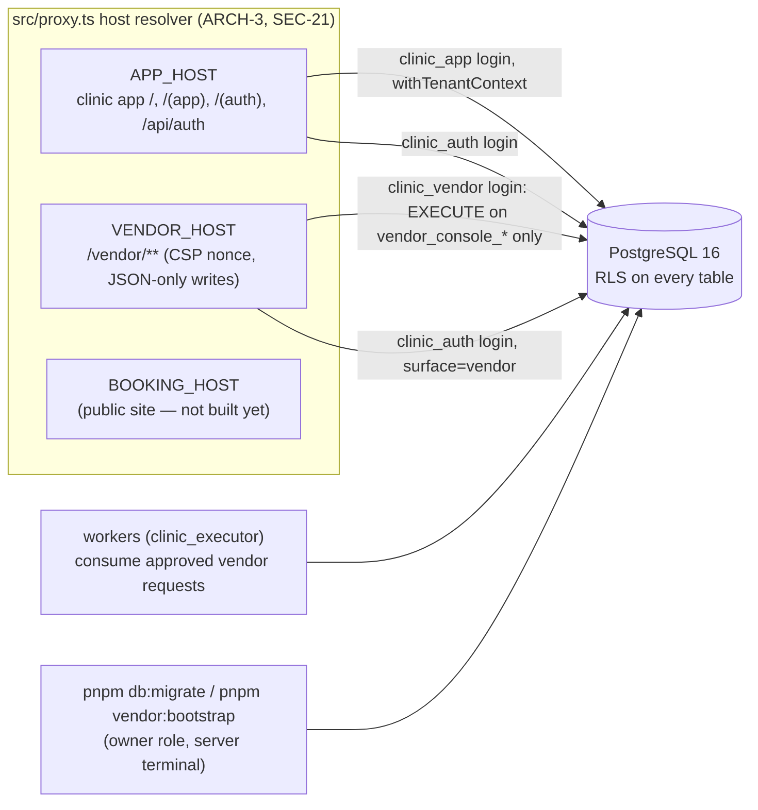

# Architecture — clinic-dashboard

Updated: 2026-11-04 (after T-026; M0 27/32 tasks + HYG-001–003)
Stack: Next.js 16.4.3 (App Router, TypeScript), PostgreSQL 16 + Drizzle, Better Auth 1.7.15, Tailwind v4 + shadcn/ui, Vitest + Playwright, pnpm, Docker (Coolify target).

This file describes only what the code does today. Target design: `docs/spec/03`, `04`; decisions: `DECISIONS.md` (DEC-*), `docs/spec/DECISION-REGISTER.md`.

## Selected capabilities

| Capability | Decision | Proven operational |
|---|---|---|
| Database | PostgreSQL 16 (Compose locally, CI service) | Locally and in CI; no hosted environment yet |
| Authentication | Better Auth (email + password, TOTP) on two surfaces | Locally (browser evidence); not deployed |
| Deployment target | Docker image → Coolify on Vultr Singapore | Image builds and migrates in CI; not deployed (no staging yet, DEC-034) |

## System map

### Database roles (no BYPASSRLS anywhere; startup refuses unsafe roles — `src/db/rls/context.ts assertAppRole`)

| Role | Used by | May |
|---|---|---|
| `clinic_app` | clinic app pages, Server Actions | RLS-filtered reads/writes bound to `app.tenant_id`, `app.staff_id`, `app.roles`, branch settings (TEN-2); SECURITY DEFINER functions on an allow-list (`tests/rls/rls.test.ts`) |
| `clinic_auth` | Better Auth (both surfaces) | auth tables only (`auth_*`) |
| `clinic_vendor` | vendor console | EXECUTE on the session-token functions pinned in `tests/vendor/team.test.ts`; no table privilege |
| `clinic_operator` | support-session reads (NOLOGIN group; its logins are members of nothing else) | `support_session_bind` and SELECT through one `<table>_operator_read` policy per readable table, only inside a READ COMMITTED transaction bound with a console-issued ticket for that transaction (T-025, DEC-038) |
| `clinic_executor` | lifecycle / request workers, support expiry sweep | `vendor_request_consume*`, `tenant_lifecycle_apply_request`, `tenant_lifecycle_lock`, `support_session_expire` |
| owner (migration role) | `pnpm db:migrate`, `pnpm vendor:bootstrap` | everything; never used by the running app |

### Modules (`src/modules`)

| Module | What it owns | Task(s) |
|---|---|---|
| `org` (identity, staff, access, roles, context) | memberships, staff, roles, branches scope, invitations, sessions revocation, active context, role readers | T-007, T-029, T-030, T-031, HYG-002 |
| `audit` | hash-chained `audit_events` (one write path `audit_append`), log view | T-008 |
| `idempotency` | idempotency records / command wrapper (`src/lib/command.ts`) | T-009 |
| `events` | domain events outbox + consumer receipts | T-010 |
| `approvals` | approvals engine, Persetujuan inbox | T-011, T-015 |
| `notifications` | in-app notifications with acknowledgement | T-016 |
| `settings` | settings registry (PR-38 list), versions, approvals | T-017 |
| `compliance` | obligations, evidence files and approvals, feature gates | T-019 |
| `vendor/staff` | vendor staff, roles, IP allowlist, maker-checker requests, `vendor_guard`, `vendor_log` | T-020 |
| `vendor/profile` | vendor profile + residency gate | T-018 |
| `vendor/lifecycle` | tenant lifecycle transitions, capabilities | T-022 |
| `vendor/tenants` | tenant creation, first-owner invitation (maker-checker) | T-023 |
| `vendor/team` | Tim Vendor invitations, state changes | HYG-003 |
| `vendor/onboarding` | onboarding grant, invitation drafts | T-024 |
| `vendor/support` | support sessions (open, extend once, end, list), bind tickets, `withSupportSession` reads, Owner end, expiry sweep; operator class per table (`support_object_kinds`), operator policies (`src/db/rls/operator.sql`); Owner approval of personal/clinical scopes and the Akses Vendor data (`scope.ts`: sessions, paginated access log with `row_found`) | T-025, T-026 |

Shared UI: `src/components/shell` (role-filtered navigation), `templates`, `visit-track`, `ui` (DESIGN.md tokens, `src/styles/tokens.css`).

### Pages

- Clinic app: Masuk / Verifikasi / Aktifkan 2FA / Terkunci / Undangan; Persetujuan; Pengaturan; Kepatuhan; Audit; Staf; Pengguna & Akses; Saya › Peran, Cabang, Klinik, Profil & Keamanan.
- Vendor console: Masuk / Verifikasi / Aktifkan 2FA; Tenant (list, Buat Tenant, detail); Tim Vendor; Keamanan Akun; Undangan Tim Vendor.
- Dev only (refused in production): `/dev/galeri`, `/dev/templat`.

## Boundaries

- **Hosts (ARCH-3, SEC-21):** `src/proxy.ts` serves each host only its own path prefixes; the vendor host adds a per-response CSP nonce, refuses Server Actions and form posts, and accepts writes only as JSON POST to its auth API and `/vendor/api/console/*`.
- **Tenant isolation (TEN-1/2/3/19):** server-resolved context, RLS on every table, `scope_map` classifies every table (test fails on a missing one); cross-tenant negative test per route/action (`tests/isolation`).
- **Two auth surfaces:** one account store; sessions marked `app` or `vendor`; a session never works on the other surface; vendor cookies `__Host-vendor.*`; TOTP mandatory for every vendor account and for the clinic roles of PR-3.
- **Vendor access into a tenant:** only through SECURITY DEFINER functions behind `vendor_guard` (active staff, TOTP + step-up, IP allowlist, role), logged in `vendor_actions` and the tenant's audit chain. Onboarding grant (configuration kinds only, T-024). Support sessions (T-025): a vendor operator opens a reasoned session (5–120 min, one extension) for declared tables; config-only scopes activate at once, personal/clinical wait for the Owner's approval (T-026: TTL from approval, never extended). Each read transaction gets a ticket committed to the tenant chain first; reads go through `clinic_operator` policies that re-check the session, operator, login and tenant on every row and record touched rows. The Owner ends a session at once; the Owner and Admin Pusat see every session with its access windows, refused binds and every record read (DEC-039).

## Threats and controls

| Boundary or component | Threat (STRIDE) | Response | Enforced in, tested by |
|---|---|---|---|
| Tenant data (clinic app) | Information disclosure across tenants | Mitigate: RLS + server-resolved context; no BYPASSRLS | `src/db/rls/context.ts`, migrations; `tests/rls`, `tests/isolation` |
| Auth surfaces | Spoofing (session reuse across app/vendor) | Mitigate: session surface check, host-only cookies | `src/auth/server.ts`; `tests/vendor/host.test.ts` |
| Staff accounts | Spoofing (weak passwords, brute force) | Mitigate: IAM-1 policy, RATE-2 lockout, TOTP for PR-3 roles | `src/auth/policy.ts`, `server.ts`; `tests/auth` |
| Vendor console | Elevation (vendor reading clinic data) | Mitigate: no table privilege; guard + allowlist + step-up; grant limited to configuration kinds | 0032, 0034, 0044; `tests/vendor/*` |
| Vendor actions | Repudiation | Mitigate: `vendor_actions` + tenant audit chain, append-only | 0031/0032 triggers; tests |
| Maker-checker (fees, lifecycle, first owner) | Elevation by one person | Mitigate: requester ≠ approver, consumed once | 0032, 0040; `tests/vendor` |
| Vendor host | XSS / CSRF via forms or Server Actions | Mitigate: CSP nonce, JSON-only writes, Origin check | `src/proxy.ts`, console route; `tests/vendor/host.test.ts`, `tests/platform/hosts.spec.ts` |
| Repository (public, DEC-037) | Information disclosure (secrets) | Mitigate: no secrets tracked (gitleaks 2026-11-04); accept: spec and research readable | `.gitignore`, `secrets-env` |

## Data

PostgreSQL 16, 45 migrations (`drizzle/0000`–`0044`), applied migrations immutable (`src/db/migrate.ts` refuses drift). Policy kinds in use: tenant-shared, tenant-ledger, platform (clinical and branch-scoped arrive with their modules). Encryption helpers: `src/lib/keys` (envelope encryption, KEK file). No patient data exists yet.

## Operations

- Local: `docker compose up -d postgres`, `DB_LOCAL=1 pnpm db:migrate`.
- CI (`.github/workflows/ci.yml`): typecheck, lint, migrate, tests on PostgreSQL 16, build, audit, docs:check, image build + migration from the image, digest record.
- First vendor user on a fresh server: `pnpm vendor:bootstrap` (DEC-036). Backups: pgBackRest sidecar with a restore drill (`ops/pgbackrest`).

## Verification

`pnpm typecheck`, `pnpm lint`, `pnpm docs:check`, `pnpm test` (718 tests, real PostgreSQL), `pnpm run build`; browser evidence specs under `tests/ui` (run on request, `RUN_UI=1`); wave gate scripts run the CI order locally plus image migration and restore drill.
