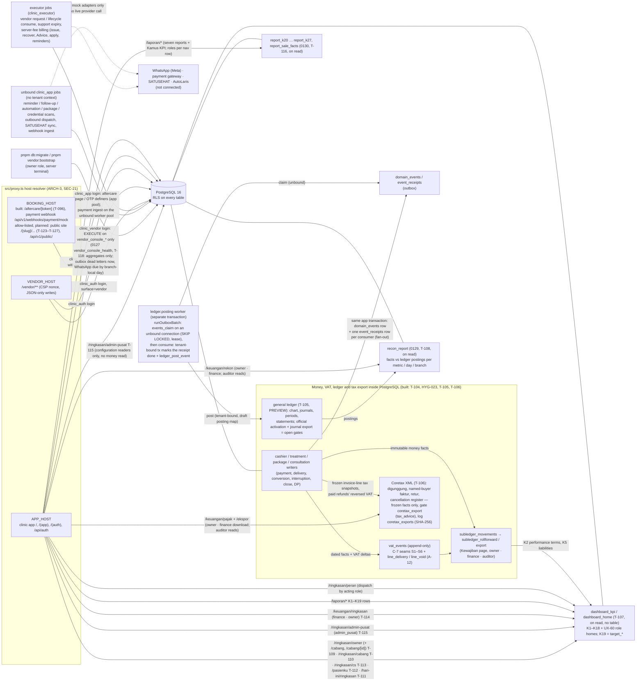

# Architecture — clinic-dashboard

Updated: 2026-11-23 (T-117 owner digest: migration 0131 `digest_runs` + digest worker functions; HYG-NAV-1/2 pages on main `dd611ac0`, CI 45143447680. Earlier: application baseline on main `b7fdd645`, CI 45068171413 — migrations through 0130 on `main`: 0127 vendor platform health (T-118 `9de482f0`), 0128 TD-31
practitioner NIK lookup (T-102 increment 4 `3f0e726e`; T-102 final acceptance still OPEN on the owner's TD-31 decision), 0129 `recon_report` (T-108 `00df0033`,
route `44a24f48`), 0130 K20–K27 report readers (T-116 `4f685eda`, wiring `68573cee`, routes `6785e0c7` / `e5670c2d`); role dashboards mounted on the T-107
readers without a migration: T-111 `/hari-ini/ringkasan` (`db08f6c4`), T-113 `/ringkasan/cs` (`f14a554f`), T-109 `/ringkasan/owner` (+ `/cabang`, `/cabang/[id]`;
`ef8e1f1d`), T-110 `/ringkasan/cabang` (`2b0d5a8c`), T-115 `/ringkasan/admin-pusat` (`82340dfa`), T-112 `/pasienku` (`353387aa`), T-114 `/keuangan/ringkasan` (`a0e04659`); T-019 register date fix
(`de832388`). Earlier: T-107 DONE `f0bd3c44`; T-106 DONE `c7f29c4e`; T-105 DONE as a PREVIEW `af295ec1` (official activation, journal export and U1–U4 open gates);
HYG-023, T-104, T-103 DONE (T-103 live payment disabled, owner activation decisions open).)
Stack (as installed): Next.js 16.4.5 (App Router, TypeScript; HYG-022), React 19.3.1, PostgreSQL 16.15 + Drizzle ORM 0.45.4, Better Auth 1.7.15,
Tailwind CSS 4.3.3 + shadcn/ui, Vitest 5.0.5 + playwright-core (browser evidence, run on request), pnpm, Docker (Coolify target).

This file describes only what the code does today. Target design: `docs/spec/03`, `04`; decisions: `DECISIONS.md` (DEC-*), `docs/spec/DECISION-REGISTER.md`.

## Selected capabilities

| Capability | Decision | Proven operational |
|---|---|---|
| Database | PostgreSQL 16 (Compose locally, CI service) | Locally and in CI; no hosted environment yet |
| Authentication | Better Auth (email + password, TOTP) on two surfaces | Locally (browser evidence); not deployed |
| Deployment target | Docker image → Coolify on Vultr Singapore | Image builds and migrates in CI; not deployed (no staging yet, DEC-034) |

## System map

The **Money** subgraph is inside the database box above it: every arrow there is SQL, not a network call. Two transaction boundaries: the
application transaction of a writer records the fact, its VAT delta and its `domain_events` row together (the fan-out trigger opens the
consumer receipts in that same transaction); posting happens later in a separate worker transaction — `runOutboxBatch`
(`src/workers/outbox.ts`) claims receipts on an unbound connection, then `consume` binds the event's tenant, marks the receipt done and runs
`ledger_post_event` (`src/modules/accounting/ledger/posting.ts`) in one tenant-bound transaction; a failure rolls both back and the lease
expires for a retry. The handler is tested on the real outbox; no scheduled worker process is deployed yet (Background jobs below).
Built: the writers record dated money facts and, at the VAT seams, a signed `vat_events` row; the sub-ledgers are computed per read from
both (T-104, DEC-115); since HYG-023 (DEC-116) a taxable line delivered before payment records its VAT at delivery (`line_delivery`), so
the VAT ledger follows A-12 (the earlier of payment or delivery) except for visit products handed before any invoice (stated limit).
Built (T-105, DEC-118): the general ledger posts the 33 TD-50 events listed in the `ledger.posting` consumer (`11` posting-trigger matrix: payments, deliveries, balance, receivables, booking DP, refunds, product returns, stock consumed / wasted / transferred, goods receipts, supplier invoices / payments / returns / credits, expenses, commission, and the domain reversals InvoiceVoided, SupplierInvoiceReversed / PaymentReversed / CreditReversed, ExpenseReversed) through the outbox consumer `ledger.posting` (one entry per source fact,
balanced at commit) under the DRAFT posting map. Not posted, by design: `StockReturned` (unconsumed issued stock returned has no GL movement,
`11` :133), the notification-only events (`ConsultationFeeRecharged`, `BookingDepositMovedToBalance`, `JournalReversed`) and the
non-posting events of `11` :136 (`PrescriptionSigned`, `MedicationDispensed`, `DiscountApproved`, `ShiftClosed`, `TaxProfileChanged`).
`GatewaySettlementReceived` has a rule but no production fact or writer — exercised by a synthetic test fact only (G-SETTLE).
`OpeningImportApplied` is not built (T-128). A domain reversal may be consumed before its original (claims skip leased rows): each reversal
posts its original from the fact first (idempotent posting key), then mirrors it, dated at the domain reversal; a treatment whose line is not final
(not issued, manual discount pending) waits and is posted at the final price when `InvoiceIssued` or the discount's `ApprovalDecided` wakes it
(two consumer subscriptions that post nothing of their own). A single treatment's entry is keyed per (execution, line): a delivered line
voided and re-billed keeps its entry, mirrored at `voided_at`, and the re-billed line posts once (Panel 2 S7-DIFF = A). A visit selection
product posts ONE coordinated ProductHandedOver entry on the exact line it was billed on (`invoice_lines.selection_item_id`, migration 0124,
set once by `invoice_issue` — tenant, branch, visit, product and exact quantity checked server-side under the visit lock, one live line per
row, immutable, never inferred or backfilled): keyed `product_handed:<dispensing>:<line>`, dated `handed_at`; handed before billing it waits
for `InvoiceIssued`; a void mirrors it at `voided_at` and the re-billed line posts once. OPEN, made visible (G-Q4 U1–U4): a selection product never billed on
a linked line, fractional selection quantities, a row billed unlinked or at an edited quantity, lines issued before 0124 post nothing (no
inference, no COGS-only split) and are COUNTED — not valued, not posted — in the Buku Besar panel "Selisih penyerahan produk"
(`ledger_handover_exceptions`, owner / finance / auditor; fractional vs not linked; hand-over day window, link state as of now): visibility,
not resolution. A linked taxable product handed before payment recognises its VAT at the hand-over (r8: `vat_line_deliver` at the linking
issue, the hand-over and the discount decision — HYG-023's mechanism; `line_delivery`), carried by its ProductHandedOver entry; the payment
takes the remainder. Unchanged existing inference (not S1's): `refund_line_delivered` (0095) and
the T-104 sub-ledger product CTE (0121) still match a visit product line by catalog item. Every entry is a preview — the books are never official in T-105 (no activation
writer: open gates G-ACT / G-RETRO), and journal export is refused unless the map version is signed AND the books are activated. Not built:
production gateway-settlement intake (G-SETTLE), official activation, SAK-specific statements.
Built (T-106, DEC-120; migration 0125; DONE `c7f29c4e`, CI 44551597530): the Coretax XML export for PKP tenants (PR-98). The documents are built in the
database from FROZEN facts only — the tax snapshot each PKP-at-issue invoice line froze at issue (`vat_base`, `vat_amount`, `tax_category`)
and paid refunds' `vat_reversed` — never from today's catalog, and never read a patient's identity (the buyer is the end consumer
`Konsumen Akhir` / NIK `0000000000000000`): DJP `RetailInvoiceBulk` (digunggung, I.A.5 / I.A.9 / I.B; stable numeric `SerialNo`; a same-month
void left out), DJP `TaxInvoiceBulk` (named-buyer faktur: no buyer tax identity is recorded, so the month's document is the structural envelope — TIN and an
empty `ListOfTaxInvoice` — downloadable and logged as a zero-row export),
DJP `OutputSpecialDocReturn` (retur: refunds paid in the month), and the clinic's own cancellation register (not a DJP format: voids of the
month, with the month an earlier-issued line was already reported in, to cancel by hand in Coretax). Gated: NPWP, PKP for the month and the
`coretax_export` feature gate (approved `tax_advice` evidence, PR-97), locked before use; a document beyond the supported ceiling (10^6 rows,
Rp10^15 DPP / PPN — exact in JavaScript) is refused by name (`bounds_exceeded`) before any total is returned or logged; every refusal and
download audited; a download is
logged in `coretax_exports` (append-only) with the SHA-256 of its exact bytes; `invoice_lines.tax_document_ref` is never written (DJP assigns
the NSFP after upload). Not built: buyer tax identity / named-buyer faktur rows, PJAP or host-to-host upload (A-08: XML first).
Built (T-107, DEC-121; migration 0126; `f0bd3c44`, CI 44610920846): dashboard read models computed on read (PR-33, Appendix A) — no table, no
stored aggregate, no refresh job. `dashboard_kpi` returns K1–K18 as fact rows (branch, local day, part, amount, source record) with the total of
the money parts, per-branch / per-part sums and the drill-down rows; K2 and K5 reuse `subledger_movements`, K19 stays `target_mine` /
`target_list` (0103). The five KPIs the PRD left open follow Panel 2's decisions (K4 ages from `invoices.issued_at`; K12's denominator
excludes cancels ≥ 24 h before the start and reschedules; K14 counts opening-hours leads with both the 15-minute and the SET-20-at-entry share
(`sla_mix` per threshold), compared losslessly; K15 is the per performer-day union of booked and executed time over the rostered work less
breaks of the branch's performers (`booking_eligible` on a service version in effect that day), leave days out; K17 owed = dated accruals + adjustments − the net actually paid, the commission_payable roll-forward).
K4 is historical: every subtraction is a dated fact up to the period end, and a cancellation no dated fact explains makes it incomplete (no
partial total).
`dashboard_home` serves the UX-60 role homes from existing facts (no new score or table).

### Hosts and routes outside the clinic pages (as built)

| Host | Built | Allow-listed but not built (planned) |
|---|---|---|
| `APP_HOST` | clinic pages under `/(app)` and `/(auth)`, `/api/auth/*`, `/api/v1/webhooks/meta` (WhatsApp webhook, T-090), `/layar-antrean/[token]` (queue display, T-048), `/dev/*` (development only; refused in production) | — |
| `BOOKING_HOST` | `/aftercare/[token]` (T-096), `/api/v1/webhooks/payment/mock` (mock payment webhook, T-073) | `/{slug}/…` public site pages and `/api/v1/public/` (T-123–T-127); the resolver already refuses everything else |
| `VENDOR_HOST` | `/vendor/**` console pages: `tenant` (list, detail, new), `onboarding` (+ checklist), `tim`, `keamanan`, `undangan/[token]`, sign-in / TOTP pages, server-fee billing `tagihan` (T-103), platform health `kesehatan` (T-118, 0127 integrated `9de482f0`), `/vendor/api/auth/[...all]` (Better Auth, surface=vendor; `src/proxy.ts` allows non-GET there except form posts) and `/vendor/api/console/[action]` (JSON writes) | `/api/v1/vendor/`; support-session console pages (the `vendor_console_support_*` functions exist and are tested; no page yet — T-129) |

### Background jobs (as built: functions and their tests; no scheduler process is deployed yet)

| Job | Login | Entry point |
|---|---|---|
| Vendor request / lifecycle consume, support expiry | `clinic_executor` | `vendor_request_consume*`, `tenant_lifecycle_apply_request`, `support_session_expire` |
| Server-fee billing: issue, recover, Advice, fee change / waiver apply, reminders | `clinic_executor` | `src/modules/vendor/billing/billing.ts` (`issue`, `recover`, `runAdvice`, `applyFeeChange`, `applyWaiver`, `reminders`) |
| Appointment reminders, follow-ups, automation, package expiry, instalment reminders, credential alerts | `clinic_app`, unbound (definers refuse a tenant-bound connection) | `runReminderScan`, `runFollowupScan`, `runAutomationScan`, `runPackageExpiryScan`, `runInstalmentReminderScan`, `runCredentialAlerts` |
| Outbound WhatsApp dispatch, SATUSEHAT sync, payment / Meta webhook ingest | `clinic_app`, unbound | `runOutboundDispatch`, `runSatusehatSync`, `src/modules/payments/worker-pool.ts` |
| Ledger posting (consumer `ledger.posting`, T-105) | `clinic_app`: claim unbound, then one tenant-bound transaction per event | `runOutboxBatch(pool, [ledgerPostingConsumer])` (`src/workers/outbox.ts`, `src/modules/accounting/ledger/posting.ts`); handler tested on the real outbox, not scheduled |
| Owner daily digest (T-117, PR-80, DEC-124; migration 0131) | `clinic_app`: claim / dispatch / delivered / complete unbound (all five TEN-2 GUCs empty); one tenant-bound, staff-less, role-less read per run | `runDigest(pool, { now, port })` (`src/modules/reporting/digest/run.ts`): `digest_claim` → `digest_facts(run, gen)` → `composeDigest` → `digest_dispatch(run, gen)` → `DigestDeliveryPort.sendEmail` (mock only) → `digest_delivered` / `digest_complete` |

Target (not built): one worker container running these on a schedule (`docs/spec/03` §pilot capacity; STATUS T-010 follow-up). Every external
provider sits behind a port with a mock adapter; no live WhatsApp, payment, SATUSEHAT or AutoLaris call exists.

### Database roles (no BYPASSRLS anywhere; startup refuses unsafe roles — `src/db/rls/context.ts assertAppRole`)

| Role | Used by | May |
|---|---|---|
| `clinic_app` | clinic app pages, Server Actions; aftercare page/OTP definers (`BOOKING_HOST`); unbound worker/webhook definers | RLS-filtered reads/writes bound to `app.tenant_id`, `app.staff_id`, `app.roles`, branch settings (TEN-2); SECURITY DEFINER functions on an allow-list (`tests/rls/rls.test.ts`) |
| `clinic_auth` | Better Auth (both surfaces) | auth tables only (`auth_*`) |
| `clinic_vendor` | vendor console | EXECUTE on the session-token functions pinned in `tests/vendor/team.test.ts`; no table privilege |
| `clinic_operator` | support-session reads (NOLOGIN group; its logins are members of nothing else) | `support_session_bind` and SELECT through one `<table>_operator_read` policy per readable table, only inside a READ COMMITTED transaction bound with a console-issued ticket for that transaction (T-025, DEC-038) |
| `clinic_executor` | lifecycle / request workers, support expiry sweep, server-fee billing jobs (T-103) | `vendor_request_consume`, `vendor_request_consume_refused`, `tenant_lifecycle_apply_request`, `tenant_lifecycle_lock`, `support_session_expire`, `vendor_billing_issue`, `_recover`, `_advice_due`, `_advice_record`, `_apply_fee_change`, `_apply_waiver`, `_reminders`, `_bayar_finish` (13 functions, from the migration grants) |
| owner (migration role) | `pnpm db:migrate`, `pnpm vendor:bootstrap` | everything; never used by the running app |

### Modules (`src/modules`)

| Module | What it owns | Task(s) |
|---|---|---|
| `org` (identity, staff, access, roles, context) | memberships, staff, roles, branches scope, invitations, sessions revocation, active context, role readers | T-007, T-029, T-030, T-031, HYG-002 |
| `audit` | hash-chained `audit_events` (one write path `audit_append`), log view | T-008 |
| `idempotency` | idempotency records / command wrapper (`src/lib/command.ts`) | T-009 |
| `events` | domain events outbox + consumer receipts | T-010 |
| `approvals` | approvals engine, Persetujuan inbox | T-011, T-015 |
| `notifications` | in-app notifications with acknowledgement | T-016 |
| `settings` | settings registry (PR-38 list), versions, approvals | T-017 |
| `catalog` | versioned catalog (PR-41, DATA-15): items and immutable versions; `catalog_publish` (commercial change active at once, clinical change waits for `catalog_clinical_review`; item locked while a review waits); commercial projection for every member, clinical content for clinical roles and editors (DEC-046); `catalog_version_reference` for later sale/booking writers (CLIN-011). Service master (PR-88, DATA-62): category, durations, online-bookable and aftercare on the version; `service_resources` and `service_staff_eligibility` written once with it; the fixed legal floor `delegation_floor` (class F); the BHP recipe through `catalog_materials_review` (pharmacist; facility head or owner as fallback); a version needing both reviews waits for both (DEC-047); `catalog_service_requirements` for booking roles; Master Layanan `/layanan`. Branch price overrides (PR-42, DEC-048): `branch_prices` keyed by item, Owner only through `branch_price_set` / `branch_price_cancel`, effective-dated in the branch's timezone; `catalog_branch_price(item, branch, at)` is the one reader of the effective price; Harga Cabang `/katalog/harga-cabang` | T-033, T-034, T-035 |
| `org/branches` | branch master (PR-2, UX-2, DATA-46): profile and licence columns on `branches`; `branch_hours`, `branch_closures`, `rooms`, `branch_devices`, `branch_services`; writers through `branch_authorize` (Owner / Admin Pusat every section, Manager the operational sections of their own branch) with audit and `BranchChanged`; `branch_is_open` in branch time for booking; pages `/pengaturan/cabang` (DEC-051) | T-036 |
| `patients` | patient registration (PR-5, DATA-13): `patients`, `contact_points`, `guardians`; the identity number sealed under the tenant data key with a blind index (DATA-8; `src/lib/keys/runtime.ts` loads the KEK ring from `KEK_FILE`, `tenant_data_keys` holds wrapped keys); `patient_register` (FO/CS), `patient_matches` (minimal projection), `patient_get` (scenario PR-1 audit); `/pasien/baru` | T-037 |
| `patients/consents` | consent ledger (PR-4, DATA-14, DATA-66): insert-only `consent_texts`, `consents` with one withdrawal per grant; writers `consent_text_publish`, `consent_grant`, `consent_withdraw` (through `runCommand`); readers `patient_consents`, `consent_active` (staff or service context), `marketing_contacts` (TEN-18, DEC-052) | T-038 |
| `patients/profile` | Profil Pasien 360° (PR-49, UX-29, DEC-056): `profileSections(role)` the role projection (clinical sections for clinical roles only), `loadProfile` (`patient_get` first, then consents), `withdrawFromProfile` (the consent must be the patient's); page `/pasien/[id]` | T-040 |
| `patients/search` | Daftar Pasien (PR-76, DEC-060): `patient_search` (13 readers, allowed-branch visits, keyset pages, counted in `patient_search_log` without text, 30/min committed `ERR_RATE_LIMITED`, hourly facility-head alert), `patient_segments` (own filters only) with `segment_save` / `segment_delete`; page `/pasien` (`_components/`) | T-041 |
| `patients/merge` | duplicate merge (PR-85, DEC-061): `patient_merges` (redirect record, undo stamp, guard against chains), `patient_canonical` / `patient_is_merged` / `patient_cluster`, `patient_merge` / `patient_unmerge` (records officer); fifteen readers and writers resolve the survivor and check overlaps over the cluster | T-042 |
| `org/licences` | clinical credentials (PR-73, IAM-4, DATA-12, DATA-54; DEC-062 folder name): `staff_credentials` (STR without branch, may be lifetime; SIP/SIPP/SIPA per branch, always expiring; never deleted, recorded fields immutable, renewals by `replaces`), `credential_alerts` (read by no app role); `credential_record` (Owner, Admin Pusat), `credential_decide` (facility head of the branch; the Owner only without another facility head; never holder, recorder or inviter), `credential_end` (suspend/revoke at once); `credential_valid(staff, branch, at)` the one validity check (verified STR + verified permit for the branch, same profession, in force in branch time) with `assertCredentialValid` → `ERR_CREDENTIAL_INVALID`; `credential_alert_scan` the daily 60/30/7 scan on an unbound worker connection (notifications to the holder and the branch facility heads); UI on `/staf` Kredensial and `/staf/[id]` |
| `clinical/intake` | BC Pendampingan (PR-9, CLIN-001–003, DATA-18): `intakes` (one per visit, BC author, draft → sent final), `intake_facts` (only new or changed facts against the patient's history across the merge cluster), `skin_observations` (chips + note, no scores); `intake_open` / `intake_save` (score, diagnosis and signing keys refused as committed audited values) / `intake_send` (visits.intake done, doctor alerted); readers `pendampingan_visits`, `pendampingan_visit`, `patient_cautions` (unverified allergy for the clinical roles); RLS by `intake_readable` (wall clock); UI `/pendampingan`, `/pendampingan/[visitId]` |
| `clinical/exam` | Lembar Pemeriksaan (PR-10, CLIN-004, CLIN-012): `examinations` (one draft per visit, doctor author; SOAP, template values, vitals, ICD-10), `intake_verifications` (doctor's confirm/correct beside the unchanged BC fact, versioned), `face_map_marks` (integer permille points, dose per `tindakan` point in micro-units), `care_plans` / `plan_items` (parallel plans, staged items, no stored price); writers `exam_open`, `exam_save`, `intake_verify`, `mark_set`/`mark_remove`, `plan_create`, `plan_item_add`/`plan_item_remove`, `plan_close` (doctor, author-only drafts); readers `pemeriksaan_visits`, `exam_sheet` (audited), `plan_options` (BC/FO/nurse/therapist projection: items and live prices only); `patient_cautions` reports verified allergies; RLS by `exam_readable` (wall clock); UI `/pemeriksaan`, `/pemeriksaan/[visitId]` |
| `clinical/records` | Signing and records (PR-13, CLIN-014, CLIN-023, PR-49, PR-3): `record_sign` (author doctor acting as Dokter, enrolled second factor, TS step-up proof) freezes the examination and writes v1 to `record_versions`; `record_correct` writes v n+1 (net delta) within 48 h, later a `record_corrections` request applied by the `record_late_correction` approval (records officer / facility head) through `record_correction_sync`; `record_get` (versions and corrections, audited); `record_copy_request` + `record_copy_data` (content-free log; PDF rendered in `pdf.ts`, no dependency); `retention_until` (last visit + 25 years); `exam_sheet` shows the current version |
| `clinical/media` | Private clinical media (PR-32, CLIN-015, CLIN-021, CLIN-026): `clinical_media` metadata (photos with SET-29 angle and pixel size from the bytes; documents; removal hides), bytes content-addressed in `clinical_media_blobs` behind `MediaStore` (database now; S3 by configuration later, ARCH-9), `media_tokens` (sha256 of a random token, ≤ 10 min, bound to staff and acting role); `media_add`/`media_remove`, `media_token_issue`/`media_token_redeem`/`media_blob_get`, `media_list`, `media_compare` (reasons, never a score); reader rule `media_readable` (wall clock; BC photos only) |
| `clinical/consent` | Procedure consent and the treatment start gate (PR-11, CLIN-005, CLIN-022, DEC-065): `procedure_consents` (versioned per plan, one active; database-generated text with its hash checked at capture; patient or guardian signature PNG in the row, hidden from grants), `procedure_consent_items` (the consented active items), `contraindication_reviews`; writers `procedure_consent_capture` / `_withdraw`, `contraindication_review`; gate `treatment_start_check` (signed examination, credentials, eligibility with supervision, contraindications, consent per stage, version and unit) with TS `assertCanStart`; readers `consent_visits`, `consent_visit`, `consent_signature`; UI `/persetujuan-tindakan`, `/persetujuan-tindakan/[visitId]` |
| `clinical/complaints` | Keluhan Klinis and Layanan (PR-43, CLIN-016, CLIN-024, DEC-066): `complaint_tasks` (kind, source, triage or category, state open / in_progress / resolved, `due_at` from `complaint_due_at` over SET-31 and the branch's working hours, set-once `escalated_at`) and insert-only `complaint_events`; RLS through `complaint_readable` (handlers of the kind at the branch); writers `complaint_flag` / `_take` / `_triage` / `_note` / `_resolve` / `_reopen` (notifications `complaint_klinis` / `complaint_layanan`); readers `complaint_list`, `complaint_get` (status-only projection for other flaggers; overdue tasks escalate on read with `complaint_overdue`), `complaint_flag_options`; UI `/keluhan`, `/keluhan/baru`, `/keluhan/[id]` | T-057 |
| `documents` | Document templates and signed medical letters (PR-74, UX-54, SET-32, DEC-067): `document_templates` (kind, letter type, active or retired) and insert-only `document_template_versions` (body with closed `{{placeholders}}`, paper, `used_at` once); `medical_letters` (draft body; signed by the author with the second factor), insert-only `medical_letter_versions`, `medical_letter_corrections` (late, through `record_late_correction`, applied by `letter_correction_sync`); writers `template_save` / `_retire`, `letter_create` / `_save` / `_sign` / `_correct`; readers `template_list`, `template_get` (sample preview), `letter_list`, `letter_get`, `letter_options`; PDF via `clinical/records/pdf.ts`; UI `/templat`, `/templat/dokumen`, `/templat/surat` | T-058 |
| `clinical/requests` | Permintaan Klinis (PR-45, UX-27, DEC-068): `clinical_requests` (addition, plan change, substitution; pending → approved / declined / cancelled once); `plan_items.request_id` / `removed_by_request_id` (the re-created `plans_guard` lets removal name the request); RLS through `request_readable`; writers `clinical_request_create` / `_decide` (applies the change to the plan, reopens the consent step when the consent no longer covers it, alerts FO with `clinical_request_approved`) / `_cancel`; readers `clinical_request_list`, `clinical_request_get`, `clinical_request_options` (BC projection without doses); price impact from `catalog_branch_price`; UI `/permintaan`, `/permintaan/baru`, `/permintaan/[id]` | T-056 |
| `inventory` | Stok (PR-17, UX-11, CLIN-019, DEC-070): `stock_items` (one per catalog material/product: use unit, vial size and opened use-by, storage, registration; unit frozen once used), `stock_batches` (branch quantity per batch; T-061 moves it into depot holdings), `opened_vials`, `stock_movements` (insert-only; every quantity change is one movement whose insert trigger sets the batch quantity; the batch guard accepts only that), `stock_levels` (SET-26 min/target), `stock_counts` / `stock_count_lines` (blind counts; `system_qty` not granted to the app). RLS `stock_item_readable` / `stock_readable` on the wall clock; writers `stock_item_save`, `stock_receive` (`stock_receive_into` for T-067), `stock_batch_hold`, `stock_vial_open`, `stock_level_set`, `stock_count_start` / `_record` / `_submit` / `_cancel`, and `approvals_stock_count_sync` (a `stock_adjustment` decision applies or closes the count); internal `stock_unfit_reason` / `stock_fefo` / `stock_assert_fit` / `stock_move` with an injectable instant for T-062/T-065; readers `stock_context`, `stock_item_list`, `stock_item_get`, `stock_card` (patient-linked movements masked for purchasing and auditor), `stock_batch_watch`, `stock_count_list`, `stock_count_get`, `stock_item_options`; UI `/stok` (role landing), `/stok/item`, `/stok/item/baru`, `/stok/item/[id]`, `/stok/kartu`, `/stok/batch`, `/stok/opname`, `/stok/opname/[id]` | T-060 |
| `inventory/depots` | Depots, batch holdings, linked transfers (PR-89, PR-17, DATA-63, DEC-071; migration 0078): `depots` (gudang/ruang/apotek per branch; one active default gudang seeded by `branches_seed_depot`; a ruang may name a treatment room), `batch_holdings` (quantity of a batch in a depot; Σ holdings = batch quantity: every movement now carries `depot_id`, `depot_balance_after` and a transfer `leg`, its insert trigger sets batch and holding, `batch_holdings_guard` accepts only that), `depot_transfers` / `depot_transfer_lines` (intra: posted at once, two linked legs per line; inter: sent → received on the destination batch of the same number and expiry, or cancelled). Writers `depot_save`, `depot_transfer`, `branch_transfer_send` / `_receive` / `_cancel`, `stock_vial_open_in`, `stock_count_start_in`; internal `stock_move_depot`, `stock_fefo_depot`, `stock_assert_fit_depot` (for T-062/T-065); the T-060 functions keep their signatures (default gudang or branch-wide); readers `depot_list`, `depot_get`, `transfer_list`, `transfer_get`; no UI yet (Gudang & Depot page comes with a UI task) | T-061 |
| `inventory/materials` | Material lifecycle (PR-16, CLIN-008, DATA-25, DEC-072; migration 0079): `stock_items.material_class` (bulk / standard / precise); `material_requests` (open visit, ruang depot, optional live plan item of the patient's cluster; moves no stock) and lines (one per item, class snapshot); one `material_issues` per request (FEFO in the source depot, picks per batch, two linked `issue` legs per batch into the room depot, a fit open vial run down); one `material_consumptions` per request (standard/precise: `consume` from the room depot on allocated batches; bulk: an estimate, no movement; 0 recorded, nothing moved); `material_returns` (pending reserves; pharmacist decides usable → `return` legs to a depot, sealed fit undamaged stock only, or waste) and `material_wastes`; per (line, batch) ledger issued − consumed − returned − wasted − pending; reconciled when every line closes and no return is pending. `stock_movements_check` now fixes leg and sign per kind. Writers `stock_item_class_set`, `material_request_create` / `_cancel`, `material_issue`, `material_consume`, `material_return_propose` / `_decide`, `material_waste`; readers `material_request_get`, `material_requests_for_visit`, `material_issue_queue`; `material_actor` keeps the active branch for room roles. No UI yet (Ruang Tindakan T-064, Siapkan & Serahkan T-065) | T-062 |
| `inventory/costing` | Moving average cost per item per branch (PR-46, A-13, BILL-26, BILL-35, DEC-073; migration 0080): the AFTER INSERT trigger `stock_movements_value` (ENABLE ALWAYS) writes one `stock_movement_values` row per movement (signed value in integer rupiah, signed uncosted units, afters) and moves the (branch, item) `stock_costs` row (quantity, value, uncosted units, last unit cost) to those afters. Costed units leave first at value × out / costed (the last costed unit takes the residue); in legs take exactly their out leg's value (intra-branch pairs leave the branch unchanged; inter-branch send/receive and cancel move the same value); a receipt takes its `stock_receipt_costs` unit cost, else the last average, else is uncosted (value 0). Guards accept a value row only for the newest movement and a cost-row change only to its newest afters. Writer `stock_receive_costed`; readers `stock_cost_list`, `stock_movement_value_list` (money roles tenant-wide, manager at the own branch). Existing movements backfilled uncosted. Also re-creates T-062's `material_consume` (fix) | T-063 |
| `treatment` | Ruang Tindakan (PR-14, PR-11, UX-9, DATA-24, DEC-074; migration 0081): `treatment_executions` (one per visit and plan item: actual performer, assistant, supervisor, room, linked material request, identity confirmed; state started ⇄ paused → finished, stage preparation → anesthesia → procedure → recovery with `stage_started_at` / `paused_at`; outcome completed | medical_stop | clinic_stop | patient_stop with a reason for stops; `counted` generated = completed or patient stop) and insert-only `treatment_execution_events` (one per transition, own command key). Writers `treatment_start` (the 0073 gate `treatment_start_check` + payment not in progress; people, room, request checked; visit treatment step in progress), `treatment_timer` (stage forward, pause, resume shifting the stage start), `treatment_finish` (consumes every issued request of the item through `material_consume` with derived keys, refused while a request is open; visit step done; clinic stop sets the FO blocker); readers `treatment_room_list`, `treatment_get` (blockers, eligible performers/supervisors, rooms, ruang depots, stock items, open vials). Events `TreatmentStarted`, `TreatmentFinished {execution_id, visit_id, plan_item_id, outcome, counted, performer_id}` — the contract for packages (T-076) and commission (M5). UI `/ruang`, `/ruang/[visitId]` | T-064 |
| `pharmacy` | Siapkan & Serahkan (PR-18, UX-10, DATA-20, DATA-26, DEC-075; migration 0082): `selections` / `selection_items` (one confirmed selection per visit; services and products; a service item links the T-062 request the pharmacist prepared), `pharmacy_recipe_items` (recipe row → stock item and quantity), `pharmacy_special_items` (insert-only), `prescriptions` / `prescription_items` (draft → signed once; SET-48 validity snapshot), `dispensings` (queued → prepared → handed or cancelled; depot, seven checks, exception note) / `dispensing_lines` (per batch, insert-only) / `labels` (one per dispensing, print count), `stock_batch_holds` (every batch hold and release with its reason). Writers `selection_confirm`, `recipe_map_set`, `special_item_add`, `selection_prepare_materials`, `prescription_create` / `_item_add` / `_item_remove` / `_sign`, `dispense_prepare`, `dispense_hand_over`, `dispense_cancel`, `label_print`; readers `pharmacy_prep_list`, `pharmacy_handover_list`, `pharmacy_dispensing_get`, `prescription_get`, `pharmacy_recall_trace`. Re-creates 0077's `stock_unfit_reason`, `stock_batches_guard`, `stock_batch_hold` (temperature_excursion; a reason for every transition). `pharmacy_visit_steps` keeps `visits.preparation` / `dispensing` in step (also from an AFTER trigger on `material_requests`), so a queued or prepared dispensing blocks closing the visit. UI `/apotek` → `/apotek/siapkan`, `/apotek/serahkan`, `/apotek/serahkan/[id]`. |
| `purchasing/suppliers` | Suppliers and supplier returns (PR-75, BILL-30, DEC-076; migration 0083): `suppliers` (tenant master), `supplier_receipts` (supplier → batch at a branch, quantity, unit cost; source `supplier_receipt` or T-067's `goods_receipt`), `supplier_returns` (supplier, depot, batch, quantity, reason, note, the `supplier_return` movement and its moving-average value), `supplier_credit_expectations` (one per return; expected → received / written_off once). Writers `supplier_save`, `supplier_receive` (over the internal `supplier_receive_into`), `supplier_return_record`; readers `supplier_list`, `supplier_get`, `supplier_return_list`, `supplier_batches`. Unit cost and return value are not granted to the app role; readers mask money for non-cost readers. No UI yet (UX-52 is T-067). |
| `purchasing/payables` | Purchase orders, goods receipts and supplier payables (PR-90, BILL-34, DEC-077; migration 0084): `purchase_orders` / `_lines` (draft → sent → received; lines per item, deactivated not deleted; unit price not granted to the app role), `goods_receipts` (header of T-066 `supplier_receipts` with source `goods_receipt`), `supplier_invoices` / `_lines` (one branch and supplier; lines per receipt at GRNI, reversed flag frees them), `supplier_payments` / `_allocations`, `supplier_credit_notes` / `_applications` (stored counters kept equal to live children by guards; reversals never delete). Writers `po_save`, `po_transition`, `goods_receipt_record`, `supplier_invoice_record`, `supplier_payment_record`, `supplier_payment_allocate`, `supplier_credit_note_record`, `supplier_credit_apply`, `supplier_credit_expectation_write_off`, `supplier_payable_reverse`; readers `purchasing_context`, `po_list`, `po_get`, `goods_receipt_list`, `payable_overview` (balances: open payable and net of unallocated payments). UI `/pembelian` (UX-52: Pemasok, PO, Penerimaan, Retur, Transfer, Utang). |
| `safety` | Logbooks and the patient-safety incident register (PR-82, DEC-078; migration 0085): `device_schedules` (calibration / maintenance interval and next due date per branch device), `logbook_entries` (insert-only: sterilization, calibration, maintenance, B3 waste handover; corrections as new entries), `logbook_due_alerts` (dedupe of the due scan; no app role reads it), `clinical_incidents` (reported → investigating → closed; guards freeze what was reported and each recorded step) and `clinical_incident_events`. Writers `device_schedule_set`, `logbook_record`, `incident_report`, `incident_handle`; worker `logbook_due_scan`; readers `logbook_overview`, `incident_list`, `incident_get`, `incident_patient_options`. UI `/logbook` (UX-9 ▸ Logbook) and `/keluhan/insiden` (UX-28 ▸ Insiden). |
| `tax` and `cashier/invoice` | Tax profile and the invoice foundation (PR-24, DEC-081; migration 0086). **Tables:** - `tax_profile_changes`: the history of NPWP, PKP and effective date; insert-only. - `invoices` and `invoice_lines`: frozen branch price, tax category and basis snapshot, the VAT split after discount, `is_pkp_at_issue`, and `vat_recognised_*` for the tax-point guard. **Writers:** `tax_profile_set` (owner; gated on approved tax advice), `invoice_open`, `invoice_issue` (minimal; T-072 extends them). **Readers:** `tax_profile_get` (profile, history, gate, 12-month turnover, warning), `invoice_get`. **Internal helpers:** `tax_local_date`, `tax_pkp_at`, `tax_vat_split`, `tax_turnover_12m`, `tax_latest_issued_date`, `invoice_line_snapshot`. **Pure policy:** `src/modules/tax/policy.ts` (mirrors the SQL). |
| `cashier/kasir` | The Kasir (PR-19, DEC-083; migration 0087). **Tables:** `receipts`, `payments` and `payment_allocations` (append-only; method, provider, account, environment and simulated flag copied onto allocations); `invoices.number`, `counter`, `void_approval_id` and `voided_at`; `dispensings.invoice_line_id` (counter sales without a visit). **Writers:** `invoice_open` and `invoice_issue` (re-created: counter flag, visit lock, numbering, counter dispensings), `payment_receive` (split tender, proportional allocation, VAT at payment), `invoice_void_request` with the `invoice_void_sync` trigger (SET-43). **Readers:** `kasir_queue`, `kasir_invoice_get`, `kasir_visit_lines`, `kasir_counter_items`, `receipt_get` (the auditor masked). **Pure mirror:** `src/modules/cashier/allocation.ts`. **UI:** `/kasir` (Siap Ditagih, Tagihan Terbuka, Jual Cepat, the tagihan with its tender sheet, Struk and its PDF). **G-Q4 S1 (T-105, migration 0124):** `invoice_lines.selection_item_id` — `invoice_issue` accepts a visit selection row per line (exact product and quantity, one live line per row, immutable); `kasir_visit_lines` returns each linkable product row's id and whether a live line bills it; Buat Tagihan sends it only while the row keeps its selected quantity (an edited row is billed unlinked, as before). |
| `payments` | The payment port and the mock adapter (PR-68, DEC-084; migration 0088). **Tables:** `payment_port_configs` (one active per tenant; the order prefix routes webhooks; the KEK version of the derived secret), `payment_charges` with `payment_charge_lines` (the split over the lines), `payment_mock_states` (the mock gateway's own state), `payment_webhook_events` (one row per received webhook with its outcome; event IDs unique among verified ones), `payment_refunds`. `payments` gains `charge_id` and `webhook_event_id`. **Writers:** `payment_port_enable`, `payment_charge_create`, `payment_charge_poll`, `payment_charge_cancel`, `payment_refund`, `simulasi_set`, the unbound `payment_webhook_route` and `payment_webhook_ingest`. **Shared path:** `kasir_record_payment`, used by cash and the port; T-072's `payment_receive` is re-created onto it. **Readers:** `kasir_invoice_get` (the port's tenders and charges), `simulasi_list`, `payment_mock_status`. **TypeScript:** `src/modules/payments/` (`mock.ts`: HKDF secret, signing, verification; `payments.ts`; an unbound worker pool). **Route:** `/api/v1/webhooks/payment/mock` (booking host). **UI:** `/simulasi` (UX-56) and the Kasir's Bayar Lewat Port panel. |
| `cashier/additions` | Additional treatment payment (PR-15, DEC-085; migration 0089). **Tables:** `addition_releases` (insert-only; the addition, its request, the authorizing clinician, the consent in force, the collector, who released it); `invoice_lines.plan_item_id` (an addition line, frozen with the line). **Writer:** `addition_release`. **Re-created:** `treatment_start` and `treatment_item_blockers` (the per-item payment rule `treatment_payment_unpaid`), `invoice_issue` (the addition invoice), `invoice_lines_guard`, `kasir_visit_payment` (a performed unbilled addition owes), `visit_close` (`unbilled_addition` first), `kasir_invoice_get` (the line's plan item); `invoice_line_snapshot` replaced by a 6-argument version. **Trigger:** `treatment_executions_addition_finished` (the second alert and the payment step). **Reader:** `addition_visit_list` (commercial facts only; the auditor masked). **TypeScript:** `src/modules/cashier/additions/additions.ts`; `KasirLine.planItemId`; `CloseBlocker` gains `unbilled_addition`. No UI yet (Kasir and Ruang show the states in their tasks). |
| `balance` | Patient balance (PR-21, DEC-086; migration 0090). **Tables:** `balance_accounts` (one per tenant and canonical patient; the running balance), `balance_entries` (insert-only; kind, signed amount, `balance_after`, branch, the payment or source). **Guards:** `balance_accounts_guard`, `balance_entries_guard`, `balance_entries_apply` (the stock pattern), `patient_merges_balance_guard`. **Writer (internal):** `balance_post`. **Re-created:** `payment_receive`, `kasir_record_payment` (the `balance` tender writes its `use` entry), `payments_guard`, `kasir_receipt_body` ("Saldo"), `kasir_invoice_get` (the balance offered; `patient_balance`). **Reader:** `balance_get`. **TypeScript:** `src/modules/balance/` (`balance.ts`, `schema.ts`); the Kasir shows "Saldo pasien" on the tagihan. |
| `packages` | Packages (PR-20, DEC-087; migration 0091). **Tables:** `package_contents`, `packages`, `package_sessions`, `package_substitutions`, `balance_top_ups`; `invoice_lines` gains `cancelled_amount`, `moved_to_balance`, `vat_reversed_amount/_at`, `substitution_id`; `payment_allocations.top_up_id`; `payments.invoice_id` and `receipts.invoice_id` nullable (top-ups). **Writers:** `package_reserve`, `package_release`, `package_cancel`, `interrupted_to_balance`, `package_substitution_request/decide`, `balance_top_up`, `package_contents_set`; the unbound `package_expiry_scan`. **Triggers:** `treatment_executions_00_package_bind` and `_00_package_finish` (before the additions trigger), `visits_package_release`, `catalog_versions_package_contents`. **Re-created:** `invoice_issue` (package and substitution invoices; `package_open`), `invoice_line_snapshot` (7 arguments), `invoice_lines_guard`, `kasir_outstanding`, `payment_line_room`, `payment_allocations_guard`, `kasir_record_payment`, `payment_receive`, `payment_charge_create`, `invoice_void_sync`, `payments_guard`, `receipt_get`, `treatment_payment_unpaid`, `addition_unbilled_counted`, `addition_finished`, `treatment_finish`. **Readers:** `package_patient_get`, `package_patient_search`, `package_contents_get`. **TypeScript:** `src/modules/packages/` (`packages.ts`, `expiry.ts`, `schema.ts`). **UI:** `/kasir/paket-saldo` (search), `/kasir/paket-saldo/[patientId]` (UX-13), `/kasir/paket-saldo/isi-paket`. |
| `cashier/deposits` | Booking DP (PR-22, DEC-089; migration 0093). **Table:** `booking_deposits` (held → applied, moved_to_balance, forfeited or refunded; once). `payment_allocations.booking_deposit_id`. **Writers:** `deposit_receive`, `deposit_apply`, `appointment_cancel_clinic`, `deposit_refund_clinic`. **Hooks:** `appointment_cancel`, `appointment_reschedule` and `appointment_no_show` decide the held DP (`deposit_on_patient_change`); `invoice_issue` applies it on arrival (`deposit_apply_do`). **Re-created:** `kasir_line_paid` and `payment_line_room` (an applied DP is paid), `payment_allocations_guard`, `payments_guard` (no invoice: a top-up or a deposit), `receipt_get`, `invoice_void_request/_sync`. |
| `cashier/receivables` | Refunds, receivables and write-offs (PR-21, PR-15 module level, PR-37; DEC-090; migration 0094). **Tables:** `refunds` (balance: inserted paid; cash: requested → approved → paid, or failed), `receivables` (open → collected or written off), `receivable_lines`, `receivable_collections`, `write_offs` (insert-only). `invoice_lines.receivable_amount` (set once), `payment_allocations.receivable_id`; `stock_movements` kind `return` from a refund. **Writers:** `refund_request`, `refund_pay`, `receivable_convert`, `receivable_collect`, `receivable_write_off_request`, `receivable_write_off_owner`. **Sync:** `refund_exception_sync` (SET-11 manager gate), `write_off_sync`. **Readers:** `piutang_get` (receivables with their lines, refunds incl. clinic DP refunds, convertible visits), `refund_line_options`, `refund_invoice_picks`. **Re-created:** `kasir_outstanding`, `payment_line_room`, `kasir_record_payment`, `payment_charge_create`, `deposit_apply_do` (a converted remainder is not owed), `payment_allocations_guard`, `payments_guard` (no invoice: a top-up, a deposit or a collection), `invoice_lines_guard`, `invoice_void_request/_sync` (no void after conversion), `receipt_get`, `interrupted_to_balance` and `package_close_do` (a pending cash refund's room is reserved; no double credit), `dispensing_blocker` (`refund_pending`), `patient_merges_balance_guard` (`patient_has_receivable`). **UI:** `/piutang` (Piutang with SET-41 aging, Refund, Siap Dijadikan Piutang), `/piutang/[id]`, `/piutang/refund/baru`, `/piutang/refund/[id]`. |
| `cashier/consultation` | Consultation fee and free controls (PR-12, DEC-092; migration 0095). **Tables:** `consultation_fees` (one decision per consultation visit: charged, waived — purchase, package session, control, complaint — or a purchase waiver re-charged once), `consultation_fee_purchases` (the qualifying lines frozen at the waiver), `consultation_controls` (scheduled → used or cancelled). `invoices.consultation`. **Writers:** `consultation_fee_charge`, `consultation_fee_exempt`, `control_schedule`. **Readers:** `consultation_fee_get`, `control_list`. **Internal:** the close decision (`consultation_fee_on_close`, from `visit_close`), the re-charge (`consultation_recharge`, from `refund_settle` and `package_close_do`). **Re-created:** `visit_close`, `refund_settle` (dropped and re-created: OUT `o_deducted`), `refund_request`, `refund_pay`, `package_close_do`, `package_cancel` (the fee visit locked first), `invoice_is_ordinary`, `invoices_guard`, `invoice_issue`, `kasir_queue` (`consultation_due`), `kasir_invoice_row`, `refund_line_delivered`, `refunds_guard`, `refund_line_options`, `refund_invoice_picks`. |
| `cashier/discounts` | Manual discount limits (PR-72, DEC-093; migration 0096). **Columns:** `invoice_lines.discount_kind` ('manual'), `discount_approval_id`. **Approval type** `manual_discount` (owner or manager; a manager within the manager limit). **Internal:** `discount_within_limit` (SET-12), `discount_pending`, `kasir_payable`, `package_check_open`, `discount_sync` (the decision trigger; locks visit → invoice → line). **Granted:** `approval_manager_decides_discount` (the inbox), `discount_manual_list` (the SEC-19 report, owner and auditor). TS: `withinDiscountLimit` (twin of the limit), `listManualDiscounts`. **Re-created:** `invoice_line_snapshot` (dropped and re-created with `p_role`), `invoice_issue`, `invoice_lines_guard`, `kasir_record_payment`, `payment_line_room`, `payment_charge_create`, `payment_receive`, `payment_allocations_guard`, `deposit_apply_do`, `receivable_convert`, `invoice_void_request`, `kasir_invoice_get`, `packages_guard` (canonical patient). |
| `promo` | Promo codes (PR-77, DEC-094; migration 0097). **Tables:** `promo_codes`, `promo_code_versions`, `promo_usages`; `invoice_lines_discount_check` widened to `promo`. **Internal:** `promo_resolve`, `promo_discount`, `promo_take` (the atomic quota), `promo_usage_sync`, `promo_release`, `promo_actor`, `promo_version_insert`, `promo_branch_date`, guards. **Granted:** `promo_code_create`, `promo_code_version`, `promo_code_set`, `promo_codes_list`, `promo_code_check`, `promo_readable`. TS `src/modules/promo/promo.ts`; `issueKasirInvoice` takes `promoCode`. **Re-created:** `invoice_line_snapshot` (8 → 9 args, `p_promo`), `invoice_issue`, `invoice_lines_guard`, `kasir_record_payment`, `deposit_apply_do`, `receivable_convert`, `interrupted_to_balance`, `invoice_void_sync`, `package_close_do`, `refund_settle`, `kasir_invoice_get`. |
| `packages/sharing` | Family package sharing (PR-93, DEC-095; migration 0098). **Tables:** `package_sharing` (versioned switch per template), `package_beneficiaries`; columns `packages.sharing_allowed` (sale snapshot), `package_sessions.beneficiary_patient_id` (the treated patient). **Internal:** `package_sharing_at`, `package_beneficiary_active`, `package_patient_may_use`, guards. **Granted:** `package_sharing_set` (owner), `package_sharing_get`, `package_beneficiary_add`, `package_beneficiary_remove`. TS `src/modules/packages/sharing/sharing.ts`. **Re-created:** `package_open`, `packages_guard`, `package_reserve`, `package_sessions_guard`, `package_session_back`, `package_execution_finish`, `package_close_do`, `package_row`, `package_patient_get`. |
| `packages/schedules` | Reminder-only instalment schedules (PR-96, DEC-096; migration 0099). **Tables:** `instalment_schedules` (one target, versions, `base_paid`), `instalment_rows` (due date, amount, `reminded_on`). **Triggers:** `packages_instalment_closed`, `receivables_instalment_closed`, `payment_allocations_instalment_paid` (auto-cancel). **Internal:** `instalment_target_paid/total/open`, `instalment_cancel_for`, guards. **Granted:** `instalment_schedule_set`, `instalment_schedule_cancel`, `instalment_schedule_get`, `instalment_reminder_scan` (unbound). Alert type `instalment_due`. TS `src/modules/packages/schedules/` (`schedules.ts`, `scan.ts`). No function re-created. |
| `expenses` | Expenses and petty cash (PR-79, DEC-097; migration 0100). **Tables:** `expense_categories`, `expenses` (receipt bytes on the row, column grant without `receipt_content`). `supplier_invoices.expense_id` FK; `supplier_invoices_check` allows expense invoices by owner, finance, manager. **Checks:** deferred `supplier_invoices_total_check` (re-created, definer) and `expenses_payable_check` pair an unpaid expense with its one expense invoice. **Internal:** `expense_reader`, guards. **Granted:** `expense_category_save`, `expense_record`, `expense_reverse`, `expenses_list`, `expense_receipt`, `expense_branch_totals`, RLS predicates `expense_readable`, `expense_category_readable`. Re-created: `supplier_payable_reverse` (refuses expense invoices), `supplier_invoices_total_check`. TS `src/modules/expenses/`; UI `/keuangan/biaya` (list, detail, receipt route `bukti/[id]`). |
| `cashier/shifts` | Tutup Kasir (PR-19, DEC-098; migration 0101). **Tables:** `cash_shifts`, `cash_shift_counts` (frozen expectation, SET-13 threshold, approval link; reason not column-granted), `cash_shift_count_lines`; `shift_id` + same-branch FK on `payments`, `booking_deposits`, `refunds`. **Triggers:** `payments_shift`, `booking_deposits_shift`, `refunds_shift` (stamping), `cash_shifts_guard`, `cash_shift_counts_guard`, `approvals_cash_shift_sync` (routing). **Internal:** `cash_shift_for`, `cash_shift_expected`. **Granted:** `cash_shift_open`, `cash_shift_submit`, `cash_shift_list`, `cash_shift_get`, `cash_shift_mine`, `approval_manager_decides_shift`, RLS predicate `cash_shift_readable`. Re-created: `refund_request` (positional row + `shift_id`). Approval type `cash_shift_variance`. TS `src/modules/cashier/shifts/`; UI `/kasir/tutup`, `/kasir/tutup/[shiftId]`. |
| `commission` | Commission engine (PR-23, DEC-099; migration 0102). **Tables:** `commission_rules`, `commission_rule_versions`, `commission_sale_attributions`, `guiding_bc_assignments`, `commission_contributions` (rule version snapshot), `commission_entitlements`, `commission_adjustments`, `payout_batches`, `payout_batch_items`, `payout_batch_lines`, `staff_commission_receivables` (reasons not column-granted). **Triggers (synchronous, staff_access first):** on `payment_allocations`, `booking_deposits`, `treatment_executions`, `package_sessions` (redeem, cheaper substitution), `invoice_lines` (moved to balance), `packages` (close), `write_offs`, `examinations` (signed → consultation performer), `invoices` (issue → attribution), `selections`, `care_plans`, `approvals` (attribution correction, batch), `memberships` (exit → staff receivable); guards and insert-only triggers on every table; events on entitlement and adjustment insert. **Granted:** `commission_rule_create`, `commission_rule_version`, `commission_rule_decide`, `commission_attribute_sale`, `guiding_bc_assign`, `commission_batch_open`, `commission_batch_submit`, `commission_batch_mark_paid`, `staff_commission_receivable_decide`, readers `commission_batches_list`, `commission_batch_get`, `commission_batch_export`, `commission_mine`, `commission_rules_list`, `commission_rule_simulate`, RLS predicates `commission_readable`, `commission_rules_readable`. Re-created: none. TS `src/modules/commission/`; UI `/komisi`, `/komisi/batch/[id]` (+ `/ekspor` CSV), `/komisi/aturan`, `/saya/komisi`. |
| `accounting/subledgers` | Accounting step 1 (PR-25, DEC-115; migration 0121; T-104): ten sub-ledger roll-forwards computed per read from the immutable money facts (`subledger_movements`, not granted), with check levels (stored stock / object / identity), patient balance by origin branch (FIFO over `balance_entries.seq`), the VAT ledger from dated facts + `vat_events` (six INSERT-only seams in `package_execution_finish`, `receivable_convert`, `interrupted_to_balance`, `package_close_do`, `package_sync_vat`, `deposit_apply_do`; incl. the S1b/S5b attribution of a PKP-at-issue package's VAT to a delivered session) + the per-tenant cutover residue (`vat_cutovers`, `vat_cutover_openings`, `vat_cutover_open`; a ledger that includes an object's pre-cutover residue claims no closing until each residue row's own branch-local date; pre-cutover reconstruction reads only pre-cutover facts), and the finance VAT facts. The net-of-VAT liabilities are money movements minus their objects' VAT movements; checks: stored stock, object level (receivables, every package when the report ends today and is tenant-wide — otherwise reported as not run, commission per recipient with the writer's carry-in rule), receipts invariant. **Tables:** `vat_input_credits`, `vat_payments`, `vat_events`, `vat_cutovers`, `vat_cutover_openings` (tenant-ledger, append-only). **Definers (clinic_app):** `subledger_rollforward`, `subledger_export` (audited; owner, finance), `vat_input_credit_record`, `vat_payment_record` (finance, PKP). **Page:** `/keuangan/kewajiban` (UX-22 ▸ Kewajiban) with the CSV route `/keuangan/kewajiban/ekspor`. No journal (T-105). | T-104 |
| `tax/vat-delivery` | A-12 VAT at delivery (BILL-6, DEC-116; migration 0122; HYG-023): `vat_line_deliver` (not granted) recognises a taxable line's delivered share of VAT when delivery precedes payment — the payment writer's rounding, monotone, PKP-at-issue lines with VAT, skipped while a manual discount is pending — and writes a `vat_events` row (cause `line_delivery`, effective no earlier than the tenant's VAT cutover). Called from `treatment_finish` (an addition delivered on an issued line), the addition path of `invoice_issue` (an addition performed before billing; tax point `finished_at`), `consultation_invoice_issue` (the fee charged) and `discount_sync` (a deferred discount decided on a performed line); an approved void reverses the recognised VAT in `invoice_void_sync` (cause `line_void`), so void-then-rebill counts once; each one drift-pinned marked block. Payment then recognises only the remainder; conversion records 0. Not built (stated limit): a visit product handed before any invoice keeps VAT at payment (no stored line key). | HYG-023 |
| `accounting/coretax` | Coretax XML export for PKP tenants (PR-98, A-08, A-15, DEC-120; migration 0125; T-106). **Table:** `coretax_exports` (append-only, TRUNCATE refused; tenant-ledger RLS — owner, finance, auditor; operator in a support session, money totals class; written only by `coretax_export`). **Feature gate:** `coretax_export → tax_advice`. **Internal (not granted):** `coretax_tin` (16-digit TIN, a 15-digit NPWP left-padded), `coretax_txt`, `coretax_other_base` (DPP Nilai Lain = ROUND(11/12 × DPP)), `coretax_lines` (PKP-at-issue lines of a branch-local issue month, stable serial YYYYMM × 10⁶ + ordinal, void month, pending discount), `coretax_doc_retail` / `coretax_doc_faktur` (with no rows: the structural envelope) / `coretax_doc_retur` / `coretax_doc_pembatalan` (XML via `xmlelement`, escaped; counts and numeric DPP, PPN; frozen-VAT vs DJP-formula differences counted, never changed), `coretax_in_bounds` (supported ceiling), `coretax_block` (month, NPWP, PKP, gate — in that order). **Granted:** `coretax_status` (owner, finance, auditor), `coretax_export` (owner, finance; `feature_gate_lock` first; refusals returned and audited; a digunggung export refused while a manual discount is pending; `bounds_exceeded` before any insert; the served document logged with its SHA-256 — zero rows only for the structural faktur). TS `src/modules/accounting/coretax/coretax.ts`. **Page:** `/keuangan/pajak` (UX-22 ▸ Pajak) with `/keuangan/pajak/ekspor`. DJP fixtures and provenance: `tests/accounting/fixtures/coretax/`. | T-106 |
| `reporting/dashboards` | Dashboard read models and the UX-60 role homes (PR-33, Appendix A K1–K18, UX-60, DEC-121; migration 0126; T-107). **Tables:** none (on-read definers; no stored aggregate, no refresh job). **Granted:** `dashboard_kpi(text,date,date,uuid,boolean)` — K1–K18 fact rows → `total` (money parts; K17 = owed), `by_dim`, `by_branch`, `by_grp1` (K13 source, K15 performer, K17 staff), `by_grp2` (K13 assignee, K17 contribution type), `extra` (K4 undated_cancellations + complete, K12 booked/failed, K14 median + within 15 min + within SET-20 at entry + sla_mix, amounts in seconds, K15 covered/rostered minutes, K17 earned_net + current_workflow — gross by today's batch state, informational), `rows` (drill-down; K15 rows add the performer and non-additive source refs); roles per KPI (07 Dashboards: owner, admin pusat, manager own branch, finance, auditor; + central CS and marketing for K13/K14; + purchasing and pharmacist for K18; K5 owner, finance, auditor); `dashboard_home(uuid)` — Klinis (facility head; credentials: this branch's permits, an STR of a clinician assigned here), Marketing (+ K13 source and K14 response for the month-to-date window, from `dashboard_kpi`), Apotek (pharmacist), Pembelian (purchasing), Audit (auditor, owner: manual discounts, voids, cash-shift and stock-count variance, write-offs). **Internal:** `dashboard_actor(text[],uuid)` (actor lock; role list; Level 3 roles bound to the active branch, another branch not found). **Reused:** `subledger_movements` (K2, K5), `booking_eligible` (K15 performers), `branch_is_open` (K14), `roster_instant` (K15), `stock_fit_qty` / `stock_unfit_reason` (K18), `target_mine` / `target_list` (K19, Ruang Saya), `treatment_room_list` + `appointments_window` (Ruang Saya). TS `src/modules/reporting/dashboards/dashboards.ts` (`kpi`, `roleHome`). `// lazy:` K2/K5 compute `subledger_movements` per call; K15's interval union is SQL per performer-day. | T-107 |
| `accounting/recon` | Reconciliation, Rekon (PR-34, UX-22; migration 0129; T-108). **Tables:** none. **Granted (bound):** `recon_report(date,date,uuid)` SECURITY DEFINER on `ledger_actor` (owner, finance, auditor): money facts vs ledger postings per metric (K1, K2, receivables), day and branch, pending ledger events, inter-branch clearing net (tenant-wide), handover exceptions. VAT is not a Rekon metric (option A). TS `recon.ts` (pure engine: missing / queued / orphan / amount / placement / timing; checked rupiah arithmetic) + `report.ts` (JSON boundary). Page `/keuangan/rekon`. Open: G-SETTLE (no gateway settlement fact). |
| `reporting/reports` | Reports and the KPI dictionary (PR-95, UX-38, UX-59; migration 0130; T-116). **Tables:** none. **Granted (bound):** `report_k20` … `report_k27`, `report_sale_facts` (on-read definers, roles per report). TS `dictionary.ts` (K1–K27 versioned entries), `live.ts` (K1–K19 from `dashboard_kpi`, K20–K27 from the 0130 readers; K17 under a branch = `branch_unattributed`), calculators. Pages `/laporan/{penjualan,perawatan,pasien,staf,operasional,stok,marketing}` and `/laporan/kamus-kpi`; no export offered. |
| `reporting/digest` | Owner daily digest (PR-80, DEC-124; migration 0131; T-117). **Tables:** `digest_runs` (tenant-scoped, RLS on, no app table grant; one row per tenant per local business day; outcomes `sent` / `refused:*` only if never dispatched / `unconfirmed:*`). **Granted (unbound worker):** `digest_claim`, `digest_dispatch`, `digest_delivered`, `digest_complete`. **Granted (bound job, no staff, no roles):** `digest_facts`. **Internal:** `kpi_k1_facts` / `kpi_k2_facts`, shared with `dashboard_kpi` (output unchanged). Email through the mock `DigestDeliveryPort` only; no live provider, no scheduler. |
| `ringkasan` pages (no module; existing readers only) | Role dashboards on the T-107 readers, no migration (PR-33a–g): `/ringkasan/owner` + `/owner/cabang` + `/owner/cabang/[id]` (owner; T-109: `dashboard_kpi` K1–K18 + Perlu ditangani via approvals, leads, SATUSEHAT monitor, `compliance_register()`, `visits_today`; K1–K3 drill to `/laporan/penjualan`); `/ringkasan/cabang` (manager, active branch; owner → `/ringkasan/owner/cabang`, admin_pusat → `/pengaturan/cabang`; T-110; `visits_today` counts open visits with pending payment for the active branch, including older visits; unavailable on reader failure); `/ringkasan/cs` (central CS; T-113); `/ringkasan/admin-pusat` (admin_pusat; configuration readers only, PR-63; T-115); `/pasienku` (BC; `target_mine`, `followup_list` mine, `pendampingan_visits`; T-112); `/hari-ini/ringkasan` (shift summary; T-111); `/keuangan/ringkasan` (finance, owner; T-114: `dashboard_kpi` K1–K6 and K17, `subledger_rollforward`, `commission_batches_list`, `payable_overview`, `cash_shift_list`; provider settlement remains unavailable, G-SETTLE). Each route has its DEL-2 case in `tests/isolation/cases/`. Open: T-109 evidence-expiry window, treatment mix, branch K17, owner nav to `/lead` / `/stok/item`, K7 missing-material provenance (unused label removed; no KPI change); T-110 remaining MISSING reader fields, `/staf/target`; T-113 unconfirmed-appointments count (catalogue 19:35); T-112 five acceptance gaps (K9 per BC, dormant count, Belum Memilih counts / value, Paket Hampir Habis sessions / validity, unassigned BC tasks). |
| `accounting/ledger` | Accounting step 2 (PR-26, DATA-37, DEC-118; migration 0123; T-105) — a PREVIEW of the books. **Tables:** `ledger_accounts` (31 system accounts per tenant, stable keys + Indonesian labels, five classes), `ledger_periods` (Kunci Periode), `journal_entries` (one posting key per source fact, the map version stamped on automatic entries, `original_period` kept when a late fact moves to the next open period), `journal_lines` (one side each, branch dimension), `ledger_activations` (**no writer**: open gate G-ACT) — tenant-ledger, append-only, balanced at commit (deferred constraint trigger), lines only with their entry. **Posting:** `ledger_post_event` (granted; refuses another tenant's event) dispatches the 33 posting events of the `ledger.posting` consumer to their rules (`ledger_rule_*`, definers, not granted) reading the immutable facts (allocations with `vat_portion`, `vat_events`, stock movement values, payables, expenses, commission, deposits, receivables); reversals mirror their original (`reverses_entry_id`), post that original from its fact first when consumed before it (order-independent), and are dated at the domain reversal; `StockReturned` and the notification-only / non-posting events of `11` post nothing; a treatment whose line is not final (not issued, manual discount pending) waits and is woken by `InvoiceIssued` / the discount's `ApprovalDecided` (`ledger_wake_visit`, posts nothing of its own); the outbox consumer `ledger.posting` (`src/modules/accounting/ledger/posting.ts`) applies them. Gateway settlement: the rule exists and is exercised by a synthetic test fact only (production intake not built, G-SETTLE). **Finance:** `ledger_manual_post`, `ledger_period_lock`. **Readers** (owner, finance, auditor): `ledger_report` (trial balance, P&L, balance sheet, cash-flow by counter class — generic, not SAK-labelled; entries placed by their booked period: a late fact moved past a locked month is activity of the month it was booked in, the locked month unchanged; cash flow per entry, value-preserving (largest remainder across counter classes); branch views report their actual balance, no automatic clearing), `ledger_journal` (by booked period; original month kept as reference). **Export:** `ledger_journal_export` — refused (audited) unless `posting_map_signoff` covers this map version AND the books are activated. **Page:** `/keuangan/buku-besar` (UX-22 ▸ Buku Besar) with `/keuangan/buku-besar/ekspor`. | T-105 |
| `commission/targets` | BC targets and the staff scorecard (PR-47, DEC-100; migration 0103). **Table:** `staff_targets` (active per staff and period, superseded history; guard, RLS `staff_targets_readable`, personal support class). **Internal:** `target_period`, `target_closing_value`, `target_collected_share`, `target_plans_selected`, `target_scorecard`, `target_row`, `target_net`. **Granted:** `staff_target_set`, `target_mine`, `target_list`, `staff_targets_readable`, `target_own_roles`. Re-created: none. TS `src/modules/commission/targets/`; no UI (pages `/saya/target`, `/staf/target` are a follow-up). |
| `messaging/waba` | WABA onboarding (PR-27, DEC-101; migration 0104). **Tables:** `waba_accounts` (one live per tenant), `token_vault` (sealed token, no grant, support never), `wa_numbers` (sealed PIN not granted; branch or brand-wide), `waba_routes` (platform routing by phone number id). **Internal:** `waba_actor`, `waba_brand`, `waba_mock_allowed`, `wa_number_next_state`, `waba_derive_state`, `waba_revoke_do`, `waba_audit_service`, the four guards. **Granted:** `waba_signup_start`, `waba_complete_signup`, `waba_add_number`, `waba_register_number`, `waba_sync_status`, `waba_migrate_to_cloud_api`, `waba_revoke`, `waba_status`, `waba_sealed_token`, `waba_sealed_pin`, `waba_data_key_ensure`, `waba_webhook_account_update` and `waba_route_resolve` (unbound only), the two RLS predicates. Re-created: none. TS `src/modules/messaging/waba/` (port, mock, fixtures, waba); no live Graph adapter (DEC-082); no UI. |
| `messaging/inbox` | The Pesan inbox (PR-28, DEC-102; migration 0105). **Tables:** `meta_webhook_receipts` (platform), `conversations`, `messages` (sealed bodies not granted), `wa_templates`. **Internal:** `inbox_can_send`, `inbox_assignment_mode`, `message_status_rank`, `message_apply_status`, `message_apply_held`, `inbox_next_assignee`, `inbox_actor`, `inbox_conversation_for`, `wa_template_body_ok`, the four guards. **Granted:** `inbox_send_queue`, `inbox_send_record`, `inbox_conversation_update`, `inbox_list`, `inbox_thread_get`, `wa_template_save`, `wa_template_sync`, `wa_templates_list`, `inbox_data_key_ensure`, `inbox_sealed_token`, the unbound `inbox_webhook_keys`, `meta_webhook_drop`, `meta_webhook_ingest`, the two RLS predicates. Re-created: none. TS `src/modules/messaging/inbox/` (port, mock, fixtures, inbox); route `src/app/api/v1/webhooks/meta`; pages `src/app/(app)/pesan/`. |
| `messaging/inbox/flag` | The complaint flag from an inbound message (PR-43, DEC-103; migration 0106). **Column:** `complaint_tasks.message_id` (FK, coupling check, one open task per message). **Internal:** `complaint_flag_do` (the shared complaint body). **Granted:** `complaint_flag_from_message`. **Re-created:** `complaint_flag`, `complaint_guard`, `complaint_json` (hash-pinned). TS `src/modules/messaging/inbox/flag.ts`; no UI. |
| `crm/leads` | The lead pipeline and campaigns (PR-29, DEC-104; migration 0107). **Tables:** `campaigns`, `leads`, `lead_events`. **Granted:** `lead_create`, `lead_update` (assign, unassign, route, match, campaign), `lead_stage_set`, `lead_list`, `lead_get`, `campaign_save`, `campaigns_list`; RLS predicates `leads_readable`, `campaigns_readable`. **Facts:** `lead_live_appointment`, `lead_checked_in_visit`, `lead_paid_invoice`. **Trigger on conversations:** `conversations_lead_first_response` (invoker). TS `src/modules/crm/leads/leads.ts`; screens `/lead` (Lead · Tindak Lanjut · Kampanye) and `/lead/[id]` (Ubah Status, Tandai Hilang, Buka Kembali, Penanganan, Cocokkan Pasien). |
| `crm/followups` | Follow-up tasks from rules (PR-30, DEC-105; migration 0108). **Table:** `followups`. **Granted:** `followup_update` (done, dismiss, snooze, assign, unassign), `followup_list`, `followup_get`, `followup_scan` (unbound, daily); RLS predicate `followups_readable`. **Internal:** `followup_create`, `followup_guiding_bc`, `followup_setting`, `followup_branch_today`, `followup_json`. **Trigger on appointments:** `appointments_followup_no_show` (invoker). TS `src/modules/crm/followups/{followups,scan}.ts`; no UI. |
| `messaging/outbound` | Outbound WhatsApp (PR-31, PR-4, PR-15, DEC-106; migration 0109). **Table:** `outbound_messages`. **Granted:** `outbound_enqueue`, `outbound_bill`, `outbound_backlog`, `outbound_claim` and `outbound_complete` (unbound); RLS predicate `outbound_readable`. **Internal:** `outbound_enqueue_do`, `outbound_params`, `outbound_budget_limit`, `outbound_recipients_24h`, `outbound_template_ok`. **Changed:** `messages_check` (a template needs no staff author). TS `src/modules/messaging/outbound/outbound.ts` (`runOutboundDispatch` opens the sealed token and calls the port); no UI (the backlog dashboard is a follow-up). |
| `crm/reminders` | Appointment reminders (PR-69, PR-83, DEC-107; migration 0110). **Table:** `appointment_reminders`. **Granted:** `reminder_scan` and `reminder_reply_handle` (both unbound); RLS predicate `appointment_reminders_readable`. **Internal:** `reminder_setting`, `reminder_due_at`. **Changed:** `outbound_params` (clinic, branch, date and time), `followup_list` and `followups_check` (`reschedule_request`), `appointments_state_check` (a patient's reply confirms without a staff actor). TS `src/modules/crm/reminders/reminders.ts` (`runReminderScan`); the webhook parser in `src/modules/messaging/inbox/inbox.ts` reads quick-reply replies and calls the handler. No UI. |
| `crm/aftercare` | Aftercare (PR-70, PR-56, DEC-108; migration 0111). **Tables:** `aftercare_notices` (column grants exclude the hashes), `aftercare_otp_sends` (append-only, support class never). **Granted:** `aftercare_link_lookup`, `aftercare_otp_send`, `aftercare_otp_verify` (unbound, the public page) and the RLS predicate `aftercare_notices_readable`. **Internal:** `aftercare_versions`, `aftercare_notice_of`, `aftercare_hash`, trigger `visits_aftercare`. **Changed:** `outbound_params` (VOLATILE; mints the aftercare link token at claim). TS `src/modules/crm/aftercare/aftercare.ts`; page `src/app/(public)/aftercare/[token]` (booking host). |
| `crm/automation` | Automation scenarios (PR-94, UX-55, DEC-109; migration 0112). **Tables:** `automation_occurrences` (insert-only), `automation_scenario_drafts` (one pending per tenant). **Granted:** `automation_scan` (unbound worker), `automation_draft_propose`, `automation_draft_decide`, `automation_draft_cancel`, `automation_log_list`, `automation_draft_get` and the RLS predicate `automation_occurrences_readable`. **Internal:** `automation_occur`, `automation_cap_count`, `automation_cap_day`, `automation_cap_lock`, `automation_template`. Nothing re-created. TS `src/modules/crm/automation/automation.ts`; page `src/app/(app)/otomasi`. |
| `crm/surveys` | Satisfaction surveys (PR-78, DEC-110; migration 0113). **Table:** `surveys` (insert-only; score 1–5, review_eligible, the low-score follow-up). **Granted:** `survey_record`, `survey_list`, `survey_summary` and the RLS predicate `surveys_readable`. **Changed:** `followup_list` and `followups_check` (the `survey_low` rule). TS `src/modules/crm/surveys/surveys.ts`. |
| `crm/campaigns` | Kampanye & Segmen (PR-94, UX-19, DEC-112; migration 0115). **Table:** `campaign_segments` (closed non-clinical rules); `campaigns` workspace columns (segment, template, date, send state). **Granted:** `campaign_segment_save`, `campaign_schedule`, `campaign_unschedule`, `campaign_send` (the Q-15 gate), `campaign_workspace_list`, `campaign_segment_preview` (counts only), `campaign_actor_check` (replay re-check), `campaign_workspace_readable`. **Changed:** `outbound_enqueue` (refuses source campaign), `outbound_claim` (campaign-gate skip; dispatch-time per-patient cap for promos), `campaigns_guard` (send-state edges), `outbound_messages_check` (+ campaign_locked, cap_horizon_exceeded, cap_reached), campaigns column grants. Page `/kampanye`; TS `src/modules/crm/campaigns/campaigns.ts`. |
| `integrations/satusehat` | SATUSEHAT reporting (PR-35, TD-30–TD-33, DEC-113, DEC-123; migrations 0116–0118 + 0128 (increment 4, TD-31 NIK lookup, `3f0e726e`) integrated; T-102 increments 1–4 integrated, final acceptance OPEN on TD-31 — Encounter, Condition, Observation, Procedure, Medication, MedicationRequest, MedicationDispense; the UX-23 page `/satusehat` and `/satusehat/galat/[attempt]`). **Tables:** `satusehat_credentials` (sealed secret), `satusehat_visit_context`, `satusehat_outbox`, `satusehat_links`, `satusehat_link_revisions`, `satusehat_attempts` (append-only), `satusehat_errors` (clinical class), `satusehat_patient_identity`, `satusehat_practitioner_links`, `satusehat_code_systems` (platform), `satusehat_code_maps`, `satusehat_practitioner_lookups` (increment 4: a sealed NIK for at most 15 minutes, `nik_enc` present exactly while pending / leased — a CHECK; guarded, never deleted, support class never) — none granted to the app (readers are definers). **Trigger:** `record_versions.satusehat_on_record_version` (insert-only enqueue). **Granted (bound):** `satusehat_credential_set` / `_revoke` / `_status`, `satusehat_practitioner_link_set` (and, increment 4, `satusehat_practitioner_lookup_request` — owner / facility head, re-authorized before a replay answers, one open lookup per staff member — and `satusehat_practitioner_lookup_status`, outcome words only), `satusehat_code_map_set`, `satusehat_identity_resolve`, `satusehat_context_room_set`, `satusehat_resend`, `satusehat_monitor`, `satusehat_page` (role projection), `satusehat_error_body` (facility head, audited). **Granted (unbound worker):** `satusehat_claim`, `_prepare`, `_identity_record`, `_begin`, `_finish`, `_refs_check`, `_release`, `_no_search`, and (increment 4) `satusehat_practitioner_lookup_claim` (sweeps expired rows first, clearing the NIK) / `_record` (lease-fenced; one terminal transition clears the NIK; matched re-checks the requester's authority now, then the shared `satusehat_practitioner_link_apply`, source `lookup`, which requeues practitioner_unresolved work exactly like the manual link; ambiguous / not_found / failed write no link). Worker audit rows carry the service identity `satusehat.worker`. TS `src/modules/integrations/satusehat/` (port, mock + guide-shaped fixtures, FHIR builders, `runSatusehatSync`). No live adapter. |
| `scheduling/rosters` | staff schedules (PR-48, DATA-16): `staff_shifts` and `staff_leave` per branch; `roster_set_week` (listed staff only), `leave_add`, `leave_cancel`; a statement-level check that one person is never in two places; readers `staff_available` and `roster_window` for booking; page `/jadwal-staf` (DEC-053) | T-043 |
| `scheduling/booking` | booking engine (PR-6, DATA-16): `appointments` and `resource_reservations` with an exclusion constraint (btree_gist); `booking_slots`, `booking_create` (runCommand), `booking_confirm`, holds released at write time; the UX-33 conflict check in the roster writers (DEC-054) | T-044 |
| `scheduling/appointments` | appointment states (PR-83): confirm, cancel, no-show, reschedule writers through `runCommand`; `appointment_live`; the calendar reader `appointments_window`; page `/jadwal` with Hari Ini, Minggu, filters and Buat Janji (DEC-055) | T-045 |
| `scheduling/lateness` | lateness release (PR-8, SET-15): off by default; when a branch sets it, late booked or confirmed appointments (yesterday and today, branch time) are released as no-show through the T-045 writer; `releaseLate` checks the go-live gate and writer roles first | T-046 |
| `scheduling/waitlist` | Waitlist and the offer on cancellation (PR-81, DEC-111; migration 0114). **Table:** `waitlist_entries` (per patient, branch, service item; waiting / offered / booked / removed). **Granted:** `waitlist_add`, `waitlist_remove`, `waitlist_offer_outcome` (entry, offered appointment, booked appointment), `waitlist_list`, `waitlist_entry_authorized` (the replay re-check) and the RLS predicate `waitlist_entries_readable`. **Trigger:** `appointments_waitlist_offer` on appointments (cancelled or rescheduled future slot → the oldest waiting entry offered; `waitlist_offer` notifications to the branch's FO, CS and manager). TS `src/modules/scheduling/waitlist/waitlist.ts`. |
| `visits` | visits and Hari Ini (PR-7, DATA-17, UX-6, DEC-057): `visits` (eight independent step columns, one open per patient per branch, guard), `visit_check_in` / `visit_close` (close blockers: unpaid bill, pending dispensing, pending treatment), `visits_today`; `closeBlocker`, `trackStates` (VisitTrack), page `/hari-ini` (check-in and papan redirect there) | T-047 |
| `visits/queue` | queue numbers, walk-in and paired displays (PR-71, DATA-52, NAV-8, DEC-058): `queue_tickets` (per branch per day), `queue_displays` (token hash only), `visit_walk_in`, `queue_call` / `queue_skip`, `queue_board`, `queue_patient_search`, `queue_display_pair` / `_revoke`, `queue_display_feed` (outside tenant context, numbers and rooms only); pages `/antrean` and `/layar-antrean/[token]` (outside the staff shell) | T-048 |
| `privacy` | privacy workspace (PR-92, DATA-66, DEC-059): `processors`, `breaches` (72 h deadline, stamped transitions), `breach_notices` (evidence bytes never granted); `privacy_actor`, `processor_upsert` / `_set_active`, `breach_record` / `_assess` / `_conclude` / `_close`, `breach_notice_add`, `breach_notice_file` (audited export), `privacy_overview`; page `/privasi` (Persetujuan · Pemroses · Kebocoran) and `/privasi/bukti/[id]` | T-039 |
| `compliance` | obligations, evidence files and approvals, feature gates; `register()` reads `valid_until` as text (calendar day, process-timezone independent; `de832388`) | T-019 |
| `vendor/staff` | vendor staff, roles, IP allowlist, maker-checker requests, `vendor_guard`, `vendor_log` | T-020 |
| `vendor/profile` | vendor profile + residency gate | T-018 |
| `vendor/lifecycle` | tenant lifecycle transitions, capabilities | T-022 |
| `vendor/billing` | server-fee billing (PR-61, DEC-114; migrations 0119–0120; T-103 DONE — implementation fixture-verified, live payment disabled, owner activation decisions Q-13, D2, Q-16, BILL-33 open): fee versions, invoices, AutoLaris attempts and Advice through a port (mock only), credits, reminders. Tables `server_fee_versions`, `vendor_invoices`, `vendor_payment_attempts`, `vendor_advice_observations`, `autolaris_settlement_rules`, `vendor_payments`, `vendor_payment_allocations`, `vendor_credit_notes`, `vendor_credit_allocations`, `vendor_attempt_notes`, `vendor_billing_policy`, `vendor_reminders`, `vendor_billing_reviews` (platform, no table grant). Clinic: `vendor_billing_bayar_begin`, `vendor_billing_tenant_view`. Executor: `vendor_billing_issue` (a loop over the internal per-tenant core `vendor_billing_issue_tenant`; numbers from `vendor_invoice_number_seq`), `_recover`, `_advice_due`, `_advice_record`, `_apply_fee_change`, `_apply_waiver`, `_reminders`. Unbound app pool + executor: `vendor_billing_bayar_finish` (token-fenced, migration 0120). Vendor console (clinic_vendor): `vendor_console_billing_issue` (Terbitkan Tagihan, one tenant), `vendor_console_billing`, `_billing_request`, `_billing_decide`, `_billing_cancel`, `vendor_billing_attempt_note`. Pages: `/saya/tagihan-server` (UX-49), `/vendor/tagihan`, `/vendor/tagihan/[id]` (UX-43); port `server-port.ts` (mock only when DEPLOY_ENV=local). | T-103 |
| `vendor/tenants` | tenant creation, first-owner invitation (maker-checker) | T-023 |
| `vendor/team` | Tim Vendor invitations, state changes | HYG-003 |
| `vendor/onboarding` | onboarding grant, invitation drafts | T-024 |
| `vendor/checklist` | onboarding checklist and the go-live gate (PR-59, UX-41; migration 0051): console calls by session token, vendor_guard + authority re-check before every exit; go-live through the lifecycle step | T-027, HYG-014 |
| `vendor/health` (page-only: `src/app/vendor/kesehatan`) | Konsol Vendor › Kesehatan Platform (PR-62, UX-45, OBS-2–OBS-4; DEC-122; migration 0127, integrated `9de482f0`): `vendor_console_health(text,text)` SECURITY DEFINER to `clinic_vendor` (platform_owner, support; 12-hour second factor; `vendor_log` + authority re-check before the exit) — per tenant and provider (outbox, WhatsApp, SATUSEHAT, payment and Meta webhooks) counts, ages, instants and sanitised codes only — outbox exhausted receipts as a current dead-letter count with its 24-hour failures not measured, WhatsApp due backlog by `outbound_claim`'s branch-local day (internal `vendor_health_whatsapp`) — WAL archive only while `archive_mode` is on; internal `vendor_health_code(s)`, `vendor_health_whatsapp`; no table. Uptime, worker heartbeat, backup age and the app error rate are "Belum terpantau" (Option A) | T-118 |
| `vendor/support` | support sessions (open, extend once, end, list), bind tickets, `withSupportSession` reads, Owner end, expiry sweep; operator class per table (`support_object_kinds`), operator policies (`src/db/rls/operator.sql`); Owner approval of personal/clinical scopes and the Akses Vendor data (`scope.ts`: sessions, paginated access log with `row_found`) | T-025, T-026 |

Shared UI: `src/components/shell` (role-filtered navigation), `templates`, `visit-track`, `ui` (DESIGN.md tokens, `src/styles/tokens.css`).

### Pages (as built on disk)

- Clinic auth (`src/app/(auth)` on `APP_HOST`): `masuk`, `verifikasi`, `aktifkan-2fa`, `terkunci`, `undangan`.
- Clinic app (`src/app/(app)` on `APP_HOST`, 39 route groups): `antrean`, `apotek`, `audit`, `hari-ini` (incl. `/ringkasan`, T-111), `jadwal`, `jadwal-staf`, `kampanye`, `kasir`, `katalog`, `keluhan`, `kepatuhan`, `keuangan` (incl. `rekon` and `ringkasan`), `komisi`, `laporan` (seven reports + `kamus-kpi`; T-116), `layanan`, `lead`, `logbook`, `otomasi`, `pasien`, `pasienku` (T-112), `pembelian`, `pemeriksaan`, `pendampingan`, `pengaturan`, `pengguna-akses`, `permintaan`, `persetujuan`, `persetujuan-tindakan`, `pesan`, `piutang`, `privasi`, `ruang`, `ringkasan` (`peran` — UX-60, one route dispatched by acting role: Ringkasan Klinis, Marketing, Apotek, Pembelian, Audit and Ruang Saya; T-107; `owner` + `owner/cabang` + `owner/cabang/[id]` T-109; `cabang` T-110; `cs` T-113; `admin-pusat` T-115), `satusehat` (T-102 increments 1–4 integrated; final acceptance OPEN on TD-31), `saya` (`peran`, `cabang`, `klinik`, `keamanan`, `akses-vendor`, `komisi`, `tagihan-server` — T-103), `simulasi`, `staf`, `stok`, `templat`; plus `/layar-antrean/[token]` (queue display).
- Patient / public routes (`src/app/(public)` on `BOOKING_HOST`): `/aftercare/[token]` (OTP-protected aftercare, T-096). Public clinic site `/{slug}/…` is allow-listed in `src/lib/hosts.ts` and planned for T-123–T-127 (not built yet).
- Vendor console (`src/app/vendor` on `VENDOR_HOST`): `masuk`, `verifikasi`, `aktifkan-2fa`, `tenant` (list, `baru`, `[id]`), `onboarding` (list, `[id]` checklist), `tim`, `keamanan`, `kesehatan` (T-118), `undangan/[token]`, `tagihan` (list, `[id]` — T-103). Support-session console pages are planned for T-129.
- Dev only (refused in production): `/dev/galeri`, `/dev/templat`.

## Boundaries

- **Hosts (ARCH-3, SEC-21):** `src/proxy.ts` serves each host only its own path prefixes; the vendor host adds a per-response CSP nonce, refuses Server Actions and form posts, and accepts writes only as JSON POST to its auth API and `/vendor/api/console/*`.
- **Tenant isolation (TEN-1/2/3/19):** server-resolved context, RLS on every table, `scope_map` classifies every table (test fails on a missing one); cross-tenant negative test per route/action (`tests/isolation`).
- **Two auth surfaces:** one account store; sessions marked `app` or `vendor`; a session never works on the other surface; vendor cookies `__Host-vendor.*`; TOTP mandatory for every vendor account and for the clinic roles of PR-3.
- **Vendor access into a tenant:** only through SECURITY DEFINER functions behind `vendor_guard` (active staff, TOTP + step-up, IP allowlist, role), logged in `vendor_actions` and the tenant's audit chain. Onboarding grant (configuration kinds only, T-024). Support sessions (T-025): a vendor operator opens a reasoned session (5–120 min, one extension) for declared tables; config-only scopes activate at once, personal/clinical wait for the Owner's approval (T-026: TTL from approval, never extended). Each read transaction gets a ticket committed to the tenant chain first; reads go through `clinic_operator` policies that re-check the session, operator, login and tenant on every row and record touched rows. The Owner ends a session at once; the Owner and Admin Pusat see every session with its access windows, refused binds and every record read (DEC-039).

## Threats and controls

| Boundary or component | Threat (STRIDE) | Response | Enforced in, tested by |
|---|---|---|---|
| Tenant data (clinic app) | Information disclosure across tenants | Mitigate: RLS + server-resolved context; no BYPASSRLS | `src/db/rls/context.ts`, migrations; `tests/rls`, `tests/isolation` |
| Auth surfaces | Spoofing (session reuse across app/vendor) | Mitigate: session surface check, host-only cookies | `src/auth/server.ts`; `tests/vendor/host.test.ts` |
| Staff accounts | Spoofing (weak passwords, brute force) | Mitigate: IAM-1 policy, RATE-2 lockout, TOTP for PR-3 roles | `src/auth/policy.ts`, `server.ts`; `tests/auth` |
| Vendor and operator authority | Elevation (a signed-out, demoted or de-enrolled vendor operator keeps acting after a lock wait, or keeps reading in a bound support transaction) | Mitigate (HYG-008b, DEC-043): every token-taking `vendor_console_*` entry point re-reads session, second-factor age, TOTP, staff state, address and role (`vendor_authority_recheck`) before every exit after its guard, including exception-handler exits, never inside a protected section (`vendor_console_staff_state`: on its success branch, in `vendor_staff_update_checked`); the 42501 refusal is logged in its own transaction by `withAuthorityRecheck` (`src/modules/vendor/authority.ts`) with the tenant and object resolved in the database; the operator predicate re-checks a support-capable role, TOTP, a second factor within 12 h and the binding's address on every row, and `operator_row_read` re-judges after its record insert; `clinic_operator` column grants equal `clinic_app`'s on `evidence_files`, `staff_invitations`, `evidence_approvals`; the expiry sweep re-reads each session after the tenant lock | `drizzle/0049_vendor_authority_wall_clock.sql`; `tests/rls/vendor-authority.test.ts`, `tests/db/vendor-authority-drift.test.ts` |
| Clinic authority | Elevation (an ended or demoted actor keeps acting inside an open transaction or after waiting on a lock) | Mitigate (HYG-008a, DEC-043): clinic SECURITY DEFINER writers take the tenant's `staff_access` lock first, then judge the actor on the wall clock (`tenant_actor_lock`, `VOLATILE`); `audit_append` re-checks after its audit lock; `staff_access` precedes every row lock (`setting_draft_decide`/`_cancel` fixed); `staff_invite_accept` locks `staff_access` before the invitation; `clinic_app` cannot read `evidence_approvals.seq` (decisions through `evidence_decisions()`) | `drizzle/0048_clinic_authority_wall_clock.sql`; `tests/rls/authority-clock.test.ts`, `tests/db/authority-drift.test.ts` |
| Clinic write actions | Tampering (a form rendered for one clinic, role or branch is submitted after another tab switched the shared selection) | Mitigate (HYG-009): every clinic write form posts its rendered context (`ctx_t`, `ctx_r`, `ctx_b`; `ContextFields`); the action resolves the context, then `staleContext` refuses any missing or different field before action-specific database work. The fields are an expectation only; the write runs in the resolved context. A context switch passes the session id, so a membership whose sessions were revoked cannot be switched into. | `src/modules/org/context/context.ts`, the six action files; `tests/context/stale-context.test.ts`, `tests/org/access.test.ts` |
| Second factor | Spoofing (a copied authenticator, guessed codes from an open session) | Mitigate (HYG-007, DEC-041 (1)): the TOTP secret is shown once at enrolment (`get-totp-uri` refused); new backup codes need the password and a current authenticator code; codes from an open session (step-up, enrolment completion) count toward the per-account lockout shared with sign-in (5 failures, 15 min), serialized by the `auth_two_factor` row lock; backup codes stored encrypted | `src/auth/server.ts`; `tests/auth/second-factor.test.ts` |
| Catalog clinical content (PR-41, DEC-046) | Tampering / disclosure (a clinical change published without clinical review; a stale commercial change restored by a late approval; clinical content shown to commercial roles) | Mitigate (T-033): `catalog_publish` compares the four clinical fields with the active version and routes any change through `catalog_clinical_review` (any facility head, owner only as fallback; requester ≠ approver), which a trigger applies on every approval path; the item is locked while a review waits; versions are immutable from insert; RLS shows clinical columns only to clinical roles and editors, others read `catalog_commercial()`; vendor support: versions are class 'clinical' (Owner approval first), items 'config' | 0054; `tests/catalog/catalog.test.ts`, `tests/db/catalog-drift.test.ts` |
| Service master (PR-88, DEC-047) | Elevation / disclosure (a delegation wider than the law allows; a recipe published without the pharmacist; a version active with one of two reviews; the pharmacist reading unapproved clinical text) | Mitigate (T-034): `catalog_publish` checks every eligibility row against `delegation_floor` for the version's category (a named staff member: the highest floor of their active clinical roles, wall clock), routes aftercare and eligibility through the clinical review and the recipe through `catalog_materials_review`, comparing with the active version only; the sync trigger activates only when every attached review is approved and cancels the open sibling on a rejection or withdrawal; `approval_decide` and the inbox refuse the facility head and the owner while a pharmacist other than the requester could decide; RLS gives the pharmacist no unpublished version (recipe through `catalog_review_target` only); child rows follow their version's visibility and never change; vendor support: resources 'config', eligibility 'personal' | 0055; `tests/catalog/service.test.ts`, `tests/db/service-drift.test.ts`, `tests/isolation/cases/layanan.cases.ts` |
| Branch prices (PR-42, DEC-048) | Tampering / elevation (a non-Owner, or Admin Pusat, changes a price; a backdated or rewritten price changes what was charged; a branch of another tenant) | Mitigate (T-035): only the Owner writes, through `branch_price_set` / `branch_price_cancel` under `tenant_actor_lock` (never limited by the selected branch); the item and branch must be the tenant's; effective from now up to 366 days ahead, a write "now" after the row in force; rows never change except active → cancelled before they take effect, never deleted (guard, ENABLE ALWAYS); prices ≥ Rp1; the reader returns null for another tenant's or an unknown branch and never falls back to the normal price; vendor support class 'config' | 0056; `tests/catalog/prices.test.ts`, `tests/db/prices-drift.test.ts`, `tests/isolation/cases/harga-cabang.cases.ts` |
| Patient identity (PR-5, DATA-8, DEC-050) | Information disclosure (a NIK in clear in the database, a page, an action response, a log, an event or an error; one phone exposing another patient; a cross-tenant id confirming existence) | Mitigate (T-037): the number is normalised, sealed (AES-256-GCM bound to tenant, purpose and key version) and indexed (HMAC over `<type>:<number>`) in the app; the database accepts only the sealed format and the app role cannot select those columns; a refused or paused form returns the sealed pair and a mask, verified when replayed; without the KEK a numbered registration is refused; matches show name, MRN, birth year and a masked phone only; every not-found patient id is audited in the caller's tenant and answered the same; marketing reads no patient until consents exist; patients are never deleted; vendor support class 'personal' | 0057; `tests/patients/registration.test.ts`, `tests/patients/patients-drift.test.ts`, `tests/isolation/cases/pasien-baru.cases.ts` |
| Branch master (PR-2, DEC-051) | Elevation / tampering (a Manager changing the profile, licence or services, or another branch's hours, rooms or closures; a room moved to another branch; a past closure rewritten; a non-service offered) | Mitigate (T-036): every writer locks the actor (`tenant_actor_lock`), then `branch_authorize` on the row's own branch before any other check (not-found outside the Manager's set); guards keep branches, rooms and devices undeleted, codes and branches fixed, closures added or removed only from today in branch time; services only with an active version; audit and an ids-only event per change; 36 mutations. |
| Consent ledger (PR-4, DEC-052) | Tampering / disclosure (a consent recorded against a text the patient never saw; a withdrawal rewritten or blocked; marketing reading patients without consent; a consent of another tenant) | Mitigate (T-038): the text must be the caller's, of that purpose and in force now; guards keep texts immutable and withdrawals single; withdrawal is never blocked by the lifecycle; marketing reads only `marketing_contacts()`; tenant and purpose bound by composite FK and writer checks; events and audit carry ids only; 44 mutations. |
| Staff schedules (PR-48, DEC-053) | Tampering / disclosure (a manager changing another branch's roster or leave; the past rewritten; one person booked in two branches at once; a filtered save wiping other roles; leave kind or reason, possibly health-related, shown to booking roles) | Mitigate (T-043): writers authorize the row's own branch first; guards keep the past and leave history; a statement-level overlap check under the tenant lock; saves replace listed staff only; leave readable only by writers and the staff themselves, booking roles get availability and date ranges; 53 mutations. |
| Booking (PR-6, DEC-054) | Tampering / denial (two bookings of one doctor, room or device at once; a doctor booked in two branches; an ineligible performer; a service booked where its device is missing; an expired hold blocking slots or being confirmed; a roster change orphaning a booking) | Mitigate (T-044): resources picked under the tenant lock with an exclusion constraint as the last guard; eligibility at the branch with the delegation floor; holds expire at read time and are released at write time; the roster writers refuse changes that orphan live appointments; 55 mutations. |
| Appointment states (PR-83, DEC-055) | Tampering / disclosure (a state skipped or reversed; a cancelled slot still blocking or a confirmed one freed; a reschedule half-done; a no-show marked early; patient lists exposed on the calendar) | Mitigate (T-045): a guard allowing only the listed transitions with reservations released first; one live helper everywhere; reschedule in one transaction; no-show from start + SET-15 on the database clock; the calendar returns name and MRN only and patients are searched on demand by POST; 34 mutations. |
| Tenant go-live (PR-59) | Tampering (a clinic goes live with open onboarding items, without the vendor maker-checker pair, without approved clinical evidence, or without a current processor agreement) | Mitigate (T-027, HYG-014): `tenant_lifecycle_transition` refuses onboarding → live while `tenant_go_live_blockers` is non-empty and names the first blocker, the processor agreement first (re-read at go-live: revoked, replaced or expired blocks, 0053); judged after the tenant row lock; checklist writes and branch seeding take the lifecycle lock order (staff_access, then the tenant row); go-live date = first onboarding → live (`tenant_go_live_at`) | 0051; `tests/vendor/checklist.test.ts`, `tests/db/checklist-drift.test.ts` |
| Akses Vendor (PR-60) | Tampering / spoofing (a non-Owner or another tenant decides vendor access; a forged success notice) | Mitigate (T-028): `/saya/akses-vendor` calls only the T-026/T-020 functions, which refuse non-Owners; Admin Pusat reads; a log opens only for a session in the tenant's own list; actions refuse a stale context; the result notice comes from a 60 s httpOnly cookie shown only while the subject's state agrees | `src/app/(app)/saya/akses-vendor/`; `tests/vendor/akses-vendor-actions.test.ts`, `tests/isolation/cases/akses-vendor.cases.ts` |
| Dual identity (IAM-10, DEC-044) | Elevation (an account stays vendor staff and clinic member after the clinic withdrew its approval) | Mitigate (HYG-013): `vendor_dual_identity_clinic_revoke` (Owner, under `staff_access`) stamps every clinic-approved request of the account in the tenant (kept, never deleted) and ends the account's membership there at once (sessions, duties, invitations); `vendor_dual_approved` excludes revoked requests; lock order membership row → account lock, as a membership write | 0052; `tests/vendor/dual-revoke.test.ts`, `tests/db/dual-revoke-drift.test.ts` |
| Vendor console | Elevation (vendor reading clinic data) | Mitigate: no table privilege; guard + allowlist + step-up; grant limited to configuration kinds | 0032, 0034, 0044; `tests/vendor/*` |
| Vendor actions | Repudiation | Mitigate: `vendor_actions` + tenant audit chain, append-only | 0031/0032 triggers; tests |
| Maker-checker (fees, lifecycle, first owner) | Elevation by one person | Mitigate: requester ≠ approver, consumed once | 0032, 0040; `tests/vendor` |
| Vendor host | XSS / CSRF via forms or Server Actions | Mitigate: CSP nonce, JSON-only writes, Origin check | `src/proxy.ts`, console route; `tests/vendor/host.test.ts`, `tests/platform/hosts.spec.ts` |
| Repository (public, DEC-037) | Information disclosure (secrets) | Mitigate: no secrets tracked (gitleaks 2026-11-04); accept: spec and research readable | `.gitignore`, `secrets-env` |

## Data

PostgreSQL 16.15, 131 migrations on `main` (`drizzle/0000_uuid_v7.sql`–`0130_report_readers.sql`), applied migrations immutable (`src/db/migrate.ts` refuses drift). All five `scope_map` policy kinds are active in production migrations: `tenant-shared`, `clinical` (from `0069_intakes.sql`), `branch-scoped` (from `0077_stock.sql`), `tenant-ledger`, and `platform`. Encryption helpers: `src/lib/keys` (envelope encryption, KEK file; patient identity fields sealed under per-tenant DEKs). No real patient data exists (synthetic test fixtures only; residency/real-patient gate planned in T-120).

## Operations

- Local: `docker compose up -d postgres`, `DB_LOCAL=1 pnpm db:migrate`. The local container runs with `fsync=off` and related flags (HYG-017): its data is disposable; CI and production keep the PostgreSQL defaults.
- CI (`.github/workflows/ci.yml`): typecheck, lint, migrate, tests on PostgreSQL 16, build, audit, docs:check, image build + migration from the image, digest record.
- First vendor user on a fresh server: `pnpm vendor:bootstrap` (DEC-036). Backups: pgBackRest sidecar with a restore drill (`ops/pgbackrest`).
- PostgreSQL never runs as PID 1 (HYG-005): local Compose `postgres` uses Docker's init (`init: true`, exec-form healthcheck `pg_isready -t 2`, 60 s stop grace); the CI service container runs with `--init`; the pgBackRest production image's entrypoint is `tini` (`ops/pgbackrest/Dockerfile`), so Coolify, the restore drill and restored instances are covered whatever the platform sets.

## Verification

`pnpm typecheck`, `pnpm lint`, `pnpm docs:check`, `pnpm test` (real PostgreSQL; the current count is in STATUS.md), `pnpm run build`; browser evidence specs under `tests/ui` (run on request, `RUN_UI=1`); wave gate scripts run the CI order locally plus image migration and restore drill. Integration tests each create a throwaway database through `tests/rls/harness.ts`; its `createTestDatabase` (exclusive advisory lock) and `dropTestDatabase` (shared) are the only way a test creates or drops one, so creates never run beside other database DDL on the shared cluster (HYG-006; a structural test enforces it). Vitest limits (`vitest.config.mts`): hooks 300 s (HYG-004, HYG-016), test bodies 30 s (HYG-006, measured on the shared machine); a test whose timing is its point sets its own limit.

## Planned changes from the foundation review (2026-11-05) — all built

The last item listed here (HYG-010) was committed as `2549b537` (2026-11-06); the isolation gate now proves a refusal for action and job
negatives and re-seeds consumable victim state (`docs/tasks/HYG-010.md` "Results"). Kept as the record of what the review decided. Planned
work now lives in TASKS.md (M7 T-102 acceptance, M8 T-104–T-119, M9 T-120–T-131) and in the "planned" columns above.

- **Isolation gate (HYG-010):**
  - Action and job negatives must prove a refusal, not only the absence of tenant B's secrets.
  - Consumable victim state is re-seeded for the negative run.
