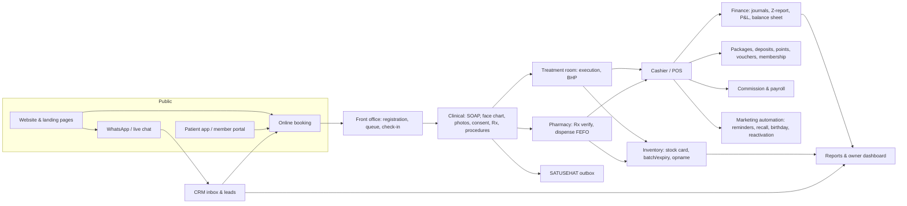
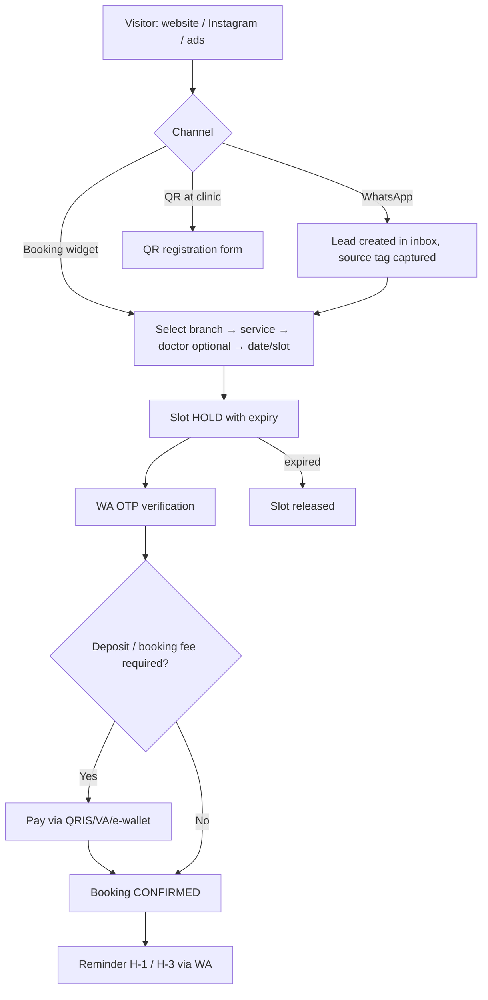
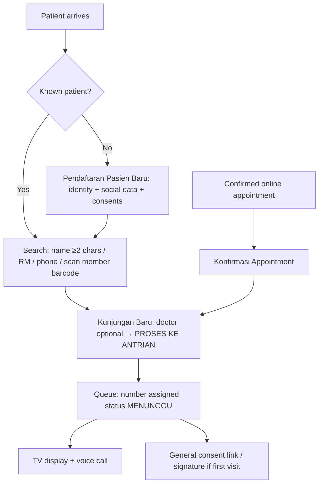
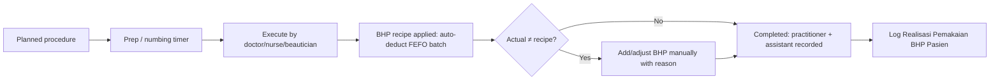
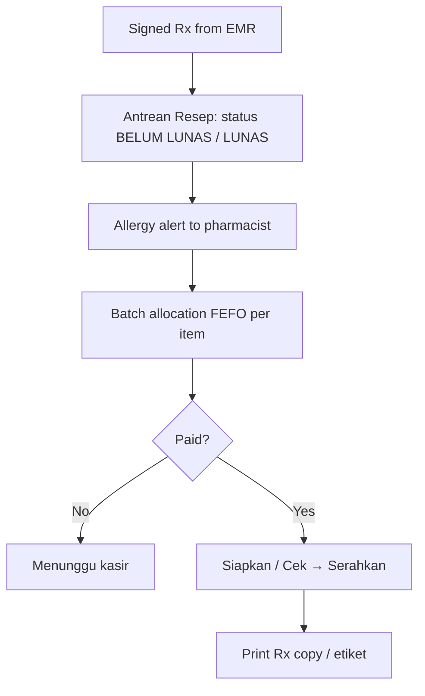
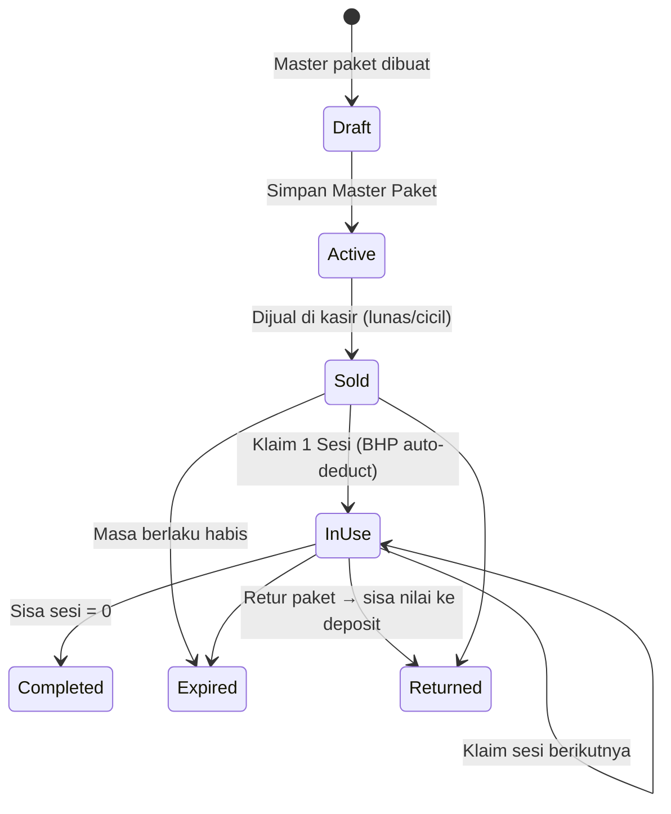

# Beauty Clinic Management System — Precise Blueprint (Indonesia)

**Flows · Menus · Screens · System** — consolidated and reconciled from all evidence gathered on 2026-10-29.

- Status: research blueprint (reference specification, not tied to any repository)
- Latest discovery checkpoint: [SESSION-HANDOFF-2026-10-30.md](SESSION-HANDOFF-2026-10-30.md) and scenario audit [OPERATIONAL-SCENARIO-AUDIT.md](OPERATIONAL-SCENARIO-AUDIT.md). Business decisions were calibrated on 2026-10-31 and are summarized in §0.4, which overrides conflicting vendor-derived flows below. This blueprint is still not an approved PRD, clinical SOP, or legal assessment.
- Location: `docs/research/`
- Supersedes for design use: `indonesia-beauty-clinic-system-ui-ux-research.md` (market and UI/UX), `indonesia-beauty-clinic-system-deep-dive.md` (screen-level detail), `beauty-clinic-admin-system-research.md` (first reverse-engineering pass). Those remain as evidence archives.
- Evidence labels: **[OBS]** seen in a real product screenshot, video frame or public client bundle · **[DOC]** vendor tutorial/help text · **[REG]** Indonesian regulation text · **[REC]** recommendation that resolves a gap or conflict (not observed as standard).

---

## 0. Evidence base and precision rules

### 0.1 Sources reconciled

| Source | What it proves | Depth |
|---|---|---|
| ICONIX official tutorials (93 real UI screenshots) + PDF manual for QR registration/online appointment | Legacy-standard workflow, field-level forms, cashier, packages, fees, promo/points/voucher, permissions, 60 report names | Authenticated screens |
| DocterIT BeautySoft video series (#03 RME, #04 Kasir, #05 Paket/BHP, #06 Akuntansi; ~31 frames each) | Modern-standard screens: SOAP + face chart, 4-angle photos, before/after slider, ICD-10, 3-party consent, POS terminal, package session claim, Rx dispensing with FEFO batch, BHP formula, Z-report, P&L, balance sheet, period lock | Authenticated screens (demo) |
| Assist.id help center + "Assist Klinik" EMR video + Aesta/Assist public bundle (558/775 endpoints) | Online appointment, statuses, EMR add procedure/package, deposit/booking-fee packs, general consent link, WA reminder timing, approvals, 89 report names | Docs + real UI + client code |
| Klinik Pintar help center | Registration fields, beauty RME required fields, payment status flow, commission and service master | Docs |
| Kasera public bundle (52 chunks, 45 UI routes, 235 API paths) | Modern salon/clinic SaaS: slot hold, deposits, no-show/restore, commission rules + test, payouts, staff self-service, attendance, expenses, P&L, booking funnel analytics | Client code |
| ClinicHub public bundle (250 API paths) + live demo | WA inbox/leads, AI, consent, proforma→invoice, void approval, UU PDP erasure/export, WebAuthn, Meta CAPI, GA4/GSC | Client code + marketing demo |
| Aoikumo product screenshots | Patient 360 tabs, POS split tender, package Dibeli/Ditukar/Sisa, staff commission profile, Google review management | Vendor screenshots |
| 20 clinic brand websites + booking flows (REA captures, 72 screenshots) | Public front-end patterns and gaps | Live captures |
| Permenkes 24/2022 (primary text) | Mandatory record fields, correction window, retention, confidentiality, e-signature | Regulation |

### 0.2 Precision rules applied
1. When products disagree, the **regulatory requirement** wins; then the **pattern used by ≥3 products**; then the **most controlled modern pattern** (marked [REC]).
2. Every field marked * is required either by regulation [REG] or by ≥2 observed products [OBS].
3. Statuses and numbers are only given where observed; otherwise marked [REC] as a default to be configured.

### 0.3 Trial accounts (permission given; execution boundary)
Sign-up pages were captured without submitting anything [OBS]:

| Vendor | Trial | Sign-up asks for | Note |
|---|---|---|---|
| ICONIX | 7 days ("Coba Gratis 7 Hari") | via order/WhatsApp flow | activation 5 min (work hours) |
| Kasera | 14 days | Nama usaha*, Jenis Bisnis*, then login (OTP/Google) | `app.kasera.id/register` |
| Bee Clinic | 14 days | Nama lengkap, email, nomor HP, password ×2 | `beeclinic.id/register` |
| ClinicHub | Free demo | Demo request form | `clinichub.id/demo` |
| Klinik Pintar | Mandiri free tier | register URL moved (404 at capture) | via "Coba Sekarang" |

Account creation needs a real owner identity, email/WhatsApp number and OTP receipt, which must not be fabricated. To complete authenticated walkthroughs: Paduka registers (or provides a dedicated test inbox/number); then a headed browser session is recorded (screens + HAR), analysed with REA `inspect-web-network-capture`, and appended to §14.

### 0.4 User-approved business rules (2026-10-31) — override conflicting sections

Source of each rule: the discovery checkpoint. Vendor evidence elsewhere in this document remains evidence, not policy. Items marked **[USER]** below take precedence.

**State separation.** One visit links separate records for: doctor recommendation · patient selection · consent · payment · material request/issue/consumption/return · treatment execution · package entitlement · commission entitlement · commission payout. A single `DONE` status never implies all are complete. Recommendation/selection never deducts stock; issue to room is a transfer, not consumption.

**Payment sequence [USER].** Initial selected treatment is paid before it starts. Additional treatment requires recorded agreement of the patient and authorized clinical personnel; it is paid from patient balance or by FO/cashier (including in-room EDC/QRIS); FO/cashier may let it start before payment without manager approval; no amount limit. Core controls: FO in-app alert on approval, repeat alert when treatment finishes unpaid, always-visible outstanding list, and visit cannot close with an unpaid bill. Fallback: manual WhatsApp bill, then patient receivable shown on next visit; owner write-off is recorded and earns no commission; no booking block.

**Consultation fee [USER].** Charged when nothing is purchased, including when a purchase happens on a later visit (no retroactive waiver), and when a contraindication prevents treatment. Waived on a visit with a product/treatment/package purchase; re-charged by deduction from a full refund of all qualifying purchases; stays waived after a partial refund. Not charged for package-session redemption or eligible controls unless a new unrelated complaint arises.

**Free control [USER].** Per treatment/product master: free-control count and validity. Default one doctor-scheduled control linked to the purchase, valid until the control date + 7 days. Package controls follow plan stages. Treatment-caused problems needing extra control are free; unrelated complaints are charged consultations.

**Packages, installments, balance [USER] — all first release.**
- Session value: equal split for same-treatment packages; proportional to normal prices for mixed packages.
- Before full payment, a session is redeemable only when cumulative payment covers its full value; patient chooses the order within paid value and the doctor's stages.
- Minimum DP: first-session value, or the greater of that and the optional per-package `Minimum DP (%)`.
- Installments enabled by default (can be disabled per package); no due schedule, interest, or late fee.
- Validity required per package, default 12 months from purchase.
- On expiry or pre-expiry cancellation: paid-but-unused value → patient balance; unpaid remainder cancelled (not debt); package closes. Cash refund only as an owner/manager-approved, recorded exception.
- No sharing between patients. Substitution only with doctor approval; unused value is credit, higher difference paid, lower difference to balance.
- Patient balance never expires and pays for treatment, products, packages, and installments.
- Booking DP optional per treatment (default off). Applied on arrival; patient cancel/reschedule ≥24 h → balance; no-show or <24 h → forfeited; clinic cancellation → balance or refund on request.

**Interrupted treatment [USER].** Medical stop (doctor-assessed) or clinic-caused stop: package session not used / single treatment rescheduled free or moved to balance. Patient-chosen stop: counts as used/completed, no refund. Actual materials are always recorded.

**Commission [USER].** Role default rules with individual override (replaces, never stacks); percentage or fixed nominal per scope; fixed nominal is a staff base commission, not a margin floor. Basis is actual allocated payment after discount excluding tax; fixed amounts need the item fully paid; performer commission needs the session/treatment to count as used. Contributions: guiding BC (all transactions under that care plan until completed/replaced), closing BC, new patient (first-visit registrar/referrer), performer (actual performer). Multi-role staff earn each actual contribution once. Partial invoice payments are allocated proportionally after discount. Paid monthly after owner/manager approval; no payroll. Refund reduces unpaid commission or becomes a deduction from next month's. Doctors have fixed salary (outside the system) plus commission; consultation commission is an optional per-service rule, default none, paid consultations only. Owner bonus is separate. Rule snapshots preserved.

**Still unvalidated.** Clinical authority/delegation, consent and signature requirements, RME corrections, pharmacy/BUD, SATUSEHAT, privacy, and tax treatment need clinical-lead and fresh authoritative verification. **[USER]** Product is a multi-tenant SaaS for beauty clinics with multiple branches per clinic; tenant isolation is mandatory. **[USER]** Within a tenant: patients, clinical history, balance, and packages are shared across branches; stock is per branch with recorded transfers; master data and prices are shared with optional owner-set branch price overrides. Staff may serve multiple branches; owner sees all, managers are scoped to selected branches, other staff to assigned branches, clinical history is visible to clinicians serving the patient; reports per branch and consolidated; cross-branch package sale revenue stays with the selling branch while execution, performer commission, and materials go to the executing branch. **[USER]** Per-clinic settings: consultation fee/waiver, free controls, package validity/minimum DP/installments, booking DP and cutoff, commission amounts, cash-refund approver; all other rules in §0.4 are fixed. No further settings until a real clinic needs one. **[USER]** New standalone project, separate from `~/Projects/kliniknuma`; nothing is reused or derived from it. Remaining: pilot clinic, MVP, and stack remain open; §12 tiers are not commitments.

---

## 1. System context



Actors: Patient · Receptionist · Beauty Consultant (BC/Sales) · Doctor (Dokter umum estetik / Sp.DVE) · Nurse (Perawat) · Beautician/Therapist · Pharmacist (Apoteker) · Cashier · Warehouse · Marketing/CS · Finance/Accountant · Clinic Manager · Owner · Admin/IT · DPO.

---

## 2. Core operational flows (precise)

### F1. Patient acquisition → booking


Evidence: QR registration + OTP activation + online appointment (ICONIX manual [DOC]); hold/OTP/deposit/expire-payment (Kasera [OBS]); booking fee pack used at payment (Assist [DOC]); reminders H-3/H-1 (ClinicHub [OBS]); Assist sends WA reminders at 05:00 daily for appointments within 24 h [DOC].
Rules [REC]: hold 10–15 min; reschedule cutoff configurable (Kasera "Batas waktu penjadwalan ulang" [OBS]); no-show after grace minutes marks NO_SHOW and counts per patient.

### F2. Arrival → registration → queue


Evidence: ICONIX Resepsionis flow, queue tabs "Antrian Hari Ini / Jadwal Besok (NON-PAKET) / Appointment (NON-PAKET) / Appointment (KHUSUS PAKET)" [OBS]; Assist general consent via copied link + code + digital signature of penanggung jawab [DOC]; Aesta/Klinik Pintar TV queue with voice call [DOC/OBS].

### F3. Consultation and clinical documentation (doctor)

```mermaid
flowchart TD
  Q[Doctor queue] --> OPEN[Open encounter: allergy banner, member tier, visit no.]
  OPEN --> S[S: Keluhan utama*, riwayat penyakit sekarang, harapan estetika]
  S --> O[O: vitals TD/Nadi/Suhu/RR, BB/TB/IMT auto, kondisi kulit / lesi]
  O --> FC[Face chart: pins by type Jerawat/Flek/Bopeng/Injeksi/Kerutan/Kemerahan]
  FC --> PH[Photos 4 angles before + after; video before/after]
  PH --> A[A: ICD-10 diagnosis* + clinical note]
  A --> P[P: recommended plan, Rx/skincare, home-care education, next control date — no stock deduction (§0.4)]
  P --> IC[Informed consent: procedure synced from plan, 3 signatures]
  IC --> SIGN[Simpan Rekam Medis (Finalize) → locked, sent to SATUSEHAT outbox]
  SIGN --> ROUTE{Rx?}
  ROUTE -->|Yes| PHARM[Pharmacy queue]
  ROUTE -->|No| CASH[Cashier queue]
  PHARM --> CASH
```
> §0.4 override: patient selection (via BC) and payment precede initial treatment; cashier is not only the end of the flow.
Evidence: DocterIT RME screens (S/O/A/P sections, face chart pin types, 4-angle photos, ICD-10 "Standar SatuSehat", BHP "Auto-deduct FEFO", consent "Legalitas Medis 3 Pihak", "Simpan Rekam Medis (Finalize)", SatuSehat status Pending) [OBS]; Klinik Pintar required fields [DOC]; ICONIX exam tabs [OBS].

### F4. Treatment execution and BHP


> §0.4 override: pharmacy issues materials to the room (transfer), staff confirm actual use and returns/waste; timer expiry never completes treatment or consumes stock.
Evidence: "Formula BHP Tindakan & Bahan Medis Habis Pakai" with BOM per procedure and "Log Realisasi Pemakaian BHP Pasien (Auto-Deducted)" [OBS DocterIT]; ICONIX "Edit Bahan/Kabin" recipe + "Cek Bahan" per visit [OBS]; Assist depot choice for BHP in package procedures [DOC].

### F5. Pharmacy / skincare dispensing


Evidence: "Antrean Resep Dokter & Dispensing Obat" KPIs Total Resep Menunggu / Lunas Kasir (Siap Serahkan) / Menunggu Kasir; per-item batch picker "Pilih Batch Fisik Obat (Stok Tersedia)" with expiry; allergy banner "PERHATIAN APOTEKER – RIWAYAT ALERGI PASIEN" [OBS DocterIT]; ICONIX Depo/Apotek Resep Dokter → Kasir [OBS].
Rule [REC]: dispense only after payment for retail; prescription items not shown in public catalog.

### F6. Cashier / POS

```mermaid
flowchart TD
  T[Terminal Kasir] --> SRC{Source}
  SRC -->|Finished-exam queue card| AUTO[Billing auto-loaded from EMR: consult + procedures + Rx]
  SRC -->|Walk-in / retail| MAN[Pelanggan Umum / scan barcode]
  AUTO --> CART[Cart: tabs Tindakan & Konsul · Paket Perawatan Sesi · Paket Bundling Produk · Skincare & Obat]
  MAN --> CART
  CART --> DISC[Member tier discount auto · extra discount (approval above limit) · voucher · points · PPN toggle]
  DISC --> TEND[Tenders: Tunai · QRIS · Kartu Debit/EDC · Transfer Bank · Potong Saldo Deposit · split]
  TEND --> PAY[Bayar → invoice number → receipt print/WA]
  PAY --> POST[Post journals · consume/credit package · accrue commission · deduct retail stock]
```
> §0.4 override: payment records allocated receipts; package redemption and performer commission wait for execution; payment may be partial (installments) or from patient balance.
Evidence: DocterIT "Terminal Kasir & Riwayat Billing" with KPIs Omset Kasir Hari Ini / Transaksi Hari Ini / Penerimaan Tunai / Non-tunai, "Billing otomatis EMR dokter dimuat", member chip "GOLD TIER (DISKON 10%)", "Saldo Deposit", payment methods incl. "Potong Saldo Deposit Pasien", "Uang Pas" quick cash buttons, "Nomor Referensi / Approval EDC / QRIS", "Catatan Struk" [OBS]; ICONIX cashier (discount password, points redeem min 10, deposit, 3 tenders) [OBS]; Assist multipayment with deposit/booking fee [DOC]; Aoikumo split tender detail [OBS].

### F7. Package lifecycle


> §0.4 override: sessions unlock by paid value; expiry also moves paid-unused value to balance and cancels unpaid remainder; no sharing; doctor-approved substitution.
Evidence: DocterIT "Paket Perawatan Berseri & Saldo Sesi Pasien" (catalog cards with normal vs promo price, sessions; table Pasien · Paket · Progress Sesi 1/5 · Sisa Sesi · Masa Berlaku · Status · Klaim 1 Sesi; master form: Pilih Tindakan Medis/Prosedur → auto BHP formula, Nama Paket, Kode, Total Jumlah Sesi, Harga Normal/Eceran, Harga Paket Promo, Masa Berlaku Paket (Hari), Deskripsi; claim dialog: Praktisi/Terapis Pelaksana, Catatan Prosedur Sesi, confirmation) [OBS]; ICONIX package expiry months, retur to deposit, receipt "Terpakai 1X & Sisa 3X" [OBS].

### F8. Deposit, membership, points, voucher

- Deposit: top-up at cashier → stored on patient (not visit) → used as a tender → default validity 90 days (Assist) → extension request with reason → approval [DOC]. **§0.4 override: patient balance never expires; no extension flow; booking DP is a separate instrument.**
- Membership: paid registration/renewal, 1-year validity, member price list and points; tiers with automatic discount at POS (Gold 10%) [OBS].
- Points: earn per spend threshold (separate for treatment and product), redeem minimum, members only [OBS].
- Voucher: batch issue (quantity, starting number, nominal, valid until), lists available/expired/used [OBS].

### F9. Closing, accounting and reporting

```mermaid
flowchart LR
  POS --> J[Auto double-entry journals]
  J --> Z[Tutup Kasir Harian (Z-Report): per kasir/shift]
  Z --> CL[Kunci Periode Akuntansi until date]
  J --> PL[Laba Rugi] & BS[Neraca] & GL[Buku Besar] & SEG[Laba Kotor per Segmen]
  OB[Setup Saldo Awal (cut-off date, equity account)] --> J
  MJ[Input Jurnal Manual] --> J
```
Evidence: DocterIT "Dashboard Keuangan & Jurnal Otomatis" (Total Aset, Kewajiban/Hutang, Ekuitas/Modal, Laba Bersih Bulan Ini; 6-month revenue vs operating expense chart; buttons Bagan Akun (COA), Jurnal Umum, Buku Besar, Input Jurnal Manual, Tutup Kasir Harian (Z-Report), Laba Kotor per Segmen, Setup Saldo Awal, Kunci Periode) [OBS]; Z-report sections "Rekonsiliasi Metode Pembayaran" and "Komposisi Omzet per Segmen", "Total Uang Fisik Kasir Disetor" [OBS]; ICONIX "Laporan Rekap Shift", "Laporan Laba/Rugi HPP" [OBS]; Assist CashBook jurnal/buku besar/laba rugi [DOC].

### F10. Retention and marketing automation
Triggers [OBS/DOC]: reminder H-3/H-1 · aftercare/follow-up · control date from plan ("Jadwal Kontrol Berikutnya") · package expiry · deposit expiry · birthday promo · dormant patient reactivation (>90 days, "Laporan Pasien Lama Tidak Aktif") · re-engagement with approved WA templates · referral rewards · review request.
Channel rules [REC]: official WhatsApp Business API with approved templates and opt-in; marketing opt-out never blocks clinical/transactional messages.

### F11. Supplier purchasing
PO → send → receive goods with batch, expiry, cost, storage → stock card → payable → pay (ClinicHub `purchase-orders/receive|pay` [OBS]; ICONIX Pembelian Obat/Bahan + Penerimaan Stok + Permintaan Stok ke Gudang + Mutasi [OBS]).

### F12. Commission and payroll
Commission rule (per service × role: doctor, nurse/beautician, sales/BC, admin; Rp or %; per price option; overrides) → accrue on completed service/sale → statement → payout batch → mark paid [vendor evidence; **§0.4 override: accrue on actual allocated payment, performer also needs counted-as-used execution, monthly approved payout, no payroll**]; payroll may import commission (Assist `calculateProcedureCommissionV2`, `calculatePacketCommission`, `generatePayrollOnClick`; Kasera rules/test/payout; ClinicHub payout-batch) [OBS].

### F13. Data-subject request (UU PDP)
Patient requests export or deletion in portal → system computes erasure impact (blocked by unpaid invoices; clinical records retained ≥25 years by law) → DPO approves → export delivered / marketing data erased / clinical data restricted (ClinicHub `data-export`, `data-deletion-request`, `erasure-impact` [OBS]; Permenkes 24/2022 Pasal 39 [REG]).

---

## 3. Status models (canonical)

| Object | Statuses | Source |
|---|---|---|
| Appointment | `PENDING` (unpaid/hold) → `CONFIRMED` → `ARRIVED`/`WAITING` → `ENGAGED` (with doctor) → `IN_TREATMENT` → `DONE` · `NO_SHOW` · `CANCELLED` · `RESCHEDULED` · `RESTORED` | Assist pending/confirmed/waiting/engaged/succeed/failed [OBS]; Kasera no-show/restore [OBS]; Sans Scheduled→Checked In→In Treatment→Completed/Cancelled [DOC] |
| Queue | `MENUNGGU` → `DIPANGGIL` → `DI RUANG` → `SELESAI` · `BATAL` | ICONIX Masuk/Batal [OBS]; [REC] names |
| Encounter / RME | `DRAFT` → `FINALIZED` (locked) → `AMENDED` (new version) ; SATUSEHAT `PENDING` → `SENT` → `VERIFIED`/`FAILED` | DocterIT "Simpan … (Finalize)", "SatuSehat: Pending", "0 Terverifikasi" [OBS]; Permenkes 2×24 h correction [REG] |
| Consent | `NOT_SIGNED` → `SIGNED` (patient/guardian + witness + doctor) | DocterIT 3-party; ClinicHub "Consent belum ditandatangani" [OBS] |
| Rx line | `MENUNGGU KASIR` → `LUNAS (SIAP SERAHKAN)` → `DISERAHKAN` | DocterIT [OBS] |
| Invoice | `DRAFT` (proforma) → `UNPAID` (Belum Bayar) → `PARTIAL` (cicil/DP) → `PAID` (Lunas) · `VOID_REQUESTED` → `VOID` | Klinik Pintar Belum Bayar/Sudah membayar [DOC]; ClinicHub proforma, void approval [OBS] |
| Owned package | `AKTIF` → `SELESAI` · `EXPIRED` · `RETUR` | DocterIT "Aktif" [OBS]; ICONIX retur [OBS] |
| Deposit | `ACTIVE` → `USED`/`PARTIAL` · `EXPIRED` → `EXTENSION_PENDING` → `EXTENDED`/`REJECTED` | Assist [DOC] — **superseded by §0.4: patient balance does not expire** |
| Stock batch | `AVAILABLE` · `NEAR_EXPIRY` · `EXPIRED` · `QUARANTINED` · `DEPLETED` | ICONIX/Aoikumo alerts [OBS]; [REC] |
| Lead/conversation | `NEW` → `CONTACTED` → `BOOKED` → `VISITED` · `LOST` ; conversation `OPEN` → `ASSIGNED` → `CLOSED` (auto-close) | ClinicHub leads/status, auto-close [OBS] |
| Accounting period | `OPEN` → `LOCKED` | DocterIT Kunci Periode [OBS] |

---

## 4. Navigation and menus (final)

### 4.1 Admin sidebar (desktop) — reconciled
Order follows the modern consensus (DocterIT, ClinicHub, Aoikumo) [OBS], grouped by job:

```
Dashboard
Pasien
Appointment            (calendar + list + online confirmations)
Antrean                (queue board + TV display settings)
RME / Konsultasi       (encounters, SOAP, face chart, photos, consent)
Paket Perawatan        (catalog + saldo sesi pasien)
Kasir & Pembayaran     (terminal, riwayat billing, deposit, retur)
Produk & Stok          (catalog, apotek/dispensing, formula BHP, kartu stok, PO, opname)
Laporan                (operational, clinical, finance & accounting)
── Engagement
Pengingat & Recall
Loyalitas & Member
WhatsApp Gateway / Inbox
Marketing (kampanye, promo, voucher, referral, review)
── Admin
Staf & Komisi
Pengaturan
Backup & Restore
Pusat Bantuan
```
Top bar: global search "Cari pasien, RM, produk… (Ctrl+K)" · branch selector · notifications · calendar shortcut · user (name, title, role) [OBS DocterIT].

### 4.2 Complete page tree with routes [REC route names; pages evidenced]

| Menu | Page | Route | Evidence |
|---|---|---|---|
| Dashboard | Owner/role home | `/dashboard` | all |
| Pasien | Daftar pasien | `/pasien` | all |
| | Profil 360° (tabs) | `/pasien/:id` | Aoikumo, ICONIX |
| | Pasien baru | `/pasien/baru` | ICONIX, Klinik Pintar |
| | Import/ekspor | `/pasien/import` | ClinicHub, ICONIX |
| | Gabung duplikat | `/pasien/merge` | [REC] |
| Appointment | Kalender (dokter/terapis/ruang) | `/appointment` | ICONIX, Aoikumo, Kasera |
| | Daftar & status | `/appointment/list` | Assist |
| | Konfirmasi online/app | `/appointment/konfirmasi` | ICONIX |
| | Booking requests | `/appointment/requests` | ClinicHub |
| | Waitlist | `/appointment/waitlist` | DIRO [DOC] |
| | Jadwal praktik, cuti, tutup | `/appointment/jadwal` | ClinicHub schedule/leaves/closures |
| Antrean | Papan antrean hari ini | `/antrean` | ICONIX, Assist |
| | Display TV | `/antrean/display` | Aesta, Klinik Pintar |
| RME | Daftar encounter + KPI | `/rme` | DocterIT |
| | Lembar pemeriksaan SOAP & face charting | `/rme/:encounterId` | DocterIT, Klinik Pintar |
| | Komparasi foto | `/rme/:patientId/foto` | DocterIT, Aoikumo |
| | Informed consent | `/rme/:encounterId/consent` | DocterIT, Assist |
| | Cetak resep / consent / resume | `/rme/:encounterId/print/*` | DocterIT |
| | Konsultasi online | `/rme/telekonsultasi` | ICONIX |
| | Master tipe pin wajah | `/rme/settings/pin-types` | DocterIT |
| | Master ICD-10 favorit | `/rme/settings/icd` | DocterIT "Tambah/Kelola ICD-10" |
| Paket | Katalog paket | `/paket` | DocterIT, ICONIX |
| | Saldo sesi pasien | `/paket/saldo` | DocterIT |
| Kasir | Terminal kasir | `/kasir/transaksi-baru` | DocterIT |
| | Riwayat billing | `/kasir` | DocterIT |
| | Deposit pasien | `/kasir/deposit` | DocterIT, ICONIX |
| | Member registrasi/perpanjangan | `/kasir/member` | ICONIX |
| | Retur paket | `/kasir/retur-paket` | ICONIX |
| | Void approval | `/kasir/void` | ClinicHub |
| | Tutup kasir (Z-report) | `/kasir/tutup` | DocterIT, ICONIX |
| Produk & Stok | Katalog inventaris | `/stok` | DocterIT |
| | Antrean resep & dispensing | `/stok/resep` | DocterIT |
| | Formula BHP tindakan | `/stok/formula-bhp` | DocterIT, ICONIX |
| | Kartu stok & alert | `/stok/kartu` | DocterIT, ICONIX |
| | Purchase order & penerimaan | `/stok/po` | ClinicHub, ICONIX |
| | Mutasi / permintaan gudang | `/stok/mutasi` | ICONIX, Aesta |
| | Stok opname | `/stok/opname` | all |
| | Supplier | `/stok/supplier` | ICONIX, ClinicHub |
| Laporan | Galeri laporan | `/laporan` | ICONIX, Aesta |
| | Dashboard keuangan & jurnal | `/laporan/keuangan` | DocterIT |
| | Laba rugi / Neraca / Buku besar / Jurnal | `/laporan/keuangan/*` | DocterIT, ICONIX, Assist |
| | Laba kotor per segmen | `/laporan/segmen` | DocterIT |
| Pengingat & Recall | Aturan & antrean pesan | `/recall` | DocterIT, ClinicHub |
| Loyalitas & Member | Tier, poin, voucher | `/loyalitas` | all |
| WhatsApp | Inbox, template, flows, kuota | `/whatsapp` | ClinicHub, Kasera |
| Marketing | Kampanye, segmen, promo, referral, ulasan | `/marketing` | ClinicHub, ICONIX, Aoikumo |
| Staf & Komisi | Staf, peran, jadwal, absensi | `/staf` | all |
| | Aturan komisi + simulasi | `/staf/komisi` | Kasera, ICONIX |
| | Payout komisi | `/staf/komisi/payout` | Kasera, ClinicHub |
| Pengaturan | Klinik & cabang, layanan, harga, pajak, metode bayar, template, penomoran, integrasi, approval, privasi | `/pengaturan/*` | all |
| Backup & Restore | Riwayat & permintaan backup | `/backup` | DocterIT, ClinicHub |
| Pusat Bantuan | Panduan, chat support | `/bantuan` | DocterIT, Assist |
| "Saya" (staff self-service) | Jadwal, pasien hari ini, komisi, absensi | `/saya/*` | Kasera, Aoikumo |

### 4.3 Role → menu visibility (default)

| Menu | Owner | Manager | Reception | BC/Sales | Doctor | Nurse | Beautician | Pharmacist | Cashier | Warehouse | Marketing | Finance |
|---|---|---|---|---|---|---|---|---|---|---|---|---|
| Dashboard | ● | ● | ● | ● | ● | ● | ● | ● | ● | ● | ● | ● |
| Pasien | ● | ● | ● | ● | ● | ● | ◐ | ◐ | ◐ | – | ◐ | – |
| Appointment / Antrean | ◐ | ● | ● | ● | ● | ● | ● | – | ◐ | – | ◐ | – |
| RME / Konsultasi | – | ◐ | – | ◐ (intake) | ● | ● | ◐ | ◐ (Rx) | – | – | – | – |
| Paket Perawatan | ● | ● | ● | ● | ◐ | ◐ | ◐ | – | ● | – | ◐ | ◐ |
| Kasir & Pembayaran | ● | ● | ◐ | ◐ | – | – | – | ◐ | ● | – | – | ● |
| Produk & Stok | ● | ● | – | – | ◐ | ◐ | ◐ | ● | ◐ | ● | – | ◐ |
| Laporan | ● | ● | ◐ | ◐ | ◐ | – | – | ◐ | ◐ | ◐ | ◐ | ● |
| Recall / Loyalitas / WA / Marketing | ● | ● | ◐ | ● | – | – | – | – | – | – | ● | – |
| Staf & Komisi | ● | ● | – | ◐ (own) | ◐ (own) | ◐ (own) | ◐ (own) | ◐ (own) | ◐ (own) | – | – | ● |
| Pengaturan / Backup | ● | ◐ | – | – | – | – | – | – | – | – | – | – |

● full · ◐ limited (own data or read-only) · – hidden. Clinical content is never visible to non-clinical roles even if the menu is visible [REG Pasal 29–32].

---

## 5. Screen specifications (precise)

> Vendor screen evidence below is preserved as observed. Where a screen auto-deducts stock at planning/claim time (S6, S11, S13), treats deposits as expiring, or accrues commission at sale, §0.4 overrides it.

### S1. Dashboard (owner/manager)
- Greeting "Selamat datang, {nama}" + branch filter "Semua Cabang" + date "Hari ini" [OBS DocterIT].
- KPI cards (with % vs previous period and sparkline): Pendapatan Total · Pasien (kunjungan) · Treatment & EMR · Total Paket Aktif · Rating & Feedback [OBS DocterIT]; Collection, Omzet (+ belum lunas), Pasien Baru vs Kembali, Reservasi [OBS ClinicHub].
- Charts: Grafik Pendapatan (Harian/Mingguan/Bulanan/Tahunan) · Kategori Treatment · Sumber Pasien Masuk (Member Gold, Member Reguler, …) · Notifikasi & Aktivitas feed [OBS DocterIT] · Top Treatment, Patient Acquisition [OBS ClinicHub] · Berdasarkan Umur / Waktu [OBS ICONIX].
- AI summary on demand ("Generate") [OBS ClinicHub].

### S2. Pendaftaran Pasien Baru
Required (*): Tgl daftar* · Nama lengkap* · No. RM* (auto) · **NIK*** (passport for foreigners) [REG Pasal 14] · Tempat/Tgl lahir* · Jenis kelamin* · No. WhatsApp* · Alamat* · Kota/Kab* (region codes) · **Agama, Pekerjaan, Pendidikan, Status perkawinan** (social data minimum) [REG Pasal 14(4)].
Optional: Email · Foto identitas (camera/upload) · No. member · Sumber info (marketing source) · Referral/reseller code · Alergi obat · Masalah kulit · Catatan · Tipe kulit (Oily/…) [OBS DocterIT "Tipe Kulit"].
Consents (separate checkboxes) [REC]: layanan kesehatan & RME (notice) · SATUSEHAT data opening (ICONIX checkbox [OBS]) · foto klinis internal · pemasaran WhatsApp · publikasi foto/testimoni.
Behaviour: duplicate check on phone/NIK/name+DOB before save [REC]; patient portal activation via WA OTP, never staff-set password [REC vs ICONIX OBS].

### S3. Appointment calendar
Resource columns (doctor/therapist/room/device), day/week/month, drag to move with conflict check, colour by status, chips show patient, service, staff, room, deposit/package icons; side panel for new booking; online-confirmation tab [OBS ICONIX, Aoikumo; Kasera space/staff].

### S4. Queue board and TV
Columns by status; card: queue no., patient, doctor, wait time, package badge; actions Masuk/Panggil/Batal/Detail paket [OBS ICONIX]; TV layouts landscape/portrait with video and voice call [OBS Aesta].

### S5. RME list ("Rekam Medis Elektronik (RME) & Face Charting")
KPIs: Total Kunjungan RME · Pemeriksaan Hari Ini · Tindakan Estetika · SatuSehat FHIR (n terverifikasi) · buttons Antrean Hari Ini · + Pemeriksaan SOAP Baru · filters (nama/RM/encounter, tipe kunjungan, tanggal) · table No. Encounter/Waktu · Pasien & No. RM · Dokter & Tipe · Diagnosa & Tindakan (ICD-10 chip) · SatuSehat status · Aksi (view/print) [OBS DocterIT].

### S6. Lembar Pemeriksaan Klinis (SOAP) & Face Charting
Header: Pilih Pasien* · Dokter Pemeriksa · Tipe Kunjungan (Konsultasi Estetika…) · Tanggal · Cabang · strip No. RM · Tipe Kulit · Member tier · **allergy banner** [OBS].
Left column:
- **S — Subjektif:** Keluhan Utama (Chief Complaint)* · Riwayat Penyakit Sekarang · Harapan Estetika Pasien (Aesthetic Goals).
- **O — Objektif:** Tekanan Darah (sistolik/diastolik) · Nadi · Suhu · Pernapasan · Berat Badan · Tinggi Badan · IMT/BMI (auto) · Catatan Kondisi Kulit/Lesi Dermatologi. (Klinik Pintar also requires Status Kesadaran* and vitals* [DOC].)
- **Dokumentasi Media Klinis:** tabs Foto Pra-Tindakan (Before) · Foto Pasca-Tindakan (After) · Dokumentasi Video; 4 standard angles **Frontal (0°) · Kiri (45°) · Kanan (45°) · Close-up**; capture from File · Kamera PC · HP/Tablet (QR handoff); per-angle note; "Preview Before–After Foto" (Split Slider / Berdampingan, filter by angle and date) and "Preview 2 Kolom Video"; video max 50 MB MP4/WebM [OBS].
- **A — Asesmen & Diagnosa (ICD-10 Standar SatuSehat):** Kode ICD-10 utama* (search + "Tambah/Kelola ICD-10") · Diagnosa klinis dokter/catatan diagnostik [OBS].
- **P — Plan (Tindakan & Rencana Terapi):** Tindakan yang dilakukan hari ini (from catalog; "Kelola Katalog Tindakan") · **Bahan Medis Habis Pakai (BHP otomatis tindakan, AUTO-DEDUCT FEFO)** with "Atur Resep BHP" and "+ Tambah BHP Manual" · Edukasi & Instruksi Perawatan di Rumah · Jadwal Kontrol Berikutnya [OBS].
Right column:
- **Peta Wajah Estetika (Interactive Face Chart):** pin types (default Jerawat, Flek/Melasma, Bopeng, Injeksi, Kerutan/Garis Halus, Kemerahan/Sensitif; managed in "Kelola Master Tipe Pin": label, hex colour, quick chips) · click to place pins · "Daftar Titik Penanda" list with type and note, edit/delete [OBS].
- **Resep Obat Digital / Krim Skincare:** Salin Resep Terakhir (date) · Kelola Satuan · + Baris Obat · quick pick from product master (auto stock check) · item, qty, unit (pot/tube/botol), signa/frekuensi, aturan pakai (suggestions), custom compound ("Resep Kustom / Racikan Bebas Dokter") [OBS].
Bottom:
- **Informed Consent Digital (Persetujuan Tindakan Medis)** — "Legalitas Medis 3 Pihak": procedure name auto-synced from plan · checkbox of understanding (indication, procedure, normal risks, aftercare, sunscreen) · Nama Penandatangan (Pasien/Wali)* · Hubungan dengan Pasien · Saksi/Perawat Pendamping · signature pads Pasien/Wali, Saksi/Perawat, Dokter Pemeriksa (Scan/File/Reset) [OBS].
- Footer: "Data EMR ini akan otomatis diarsipkan dan disinkronkan ke rekam medis pasien" · Batalkan · **Simpan Rekam Medis (Finalize)** [OBS].
Rules: finalize locks; corrections within 2×24 h by the author, later via amendment with approval [REG Pasal 30]; e-signature as verification [REG Pasal 31].

### S7. Patient photo comparison (in patient record)
Tabs Dokumentasi Foto & Before-After (count) · Dokumentasi Video (count) · + Foto Before · + Foto After · "Komparasi Foto Cerdas (Pilih Antar-Sesi & Tanggal)" with left/right date pickers, angle chips, Split Slider/Berdampingan, notes "Catatan Klinis" and "Hasil Evaluasi Pasca Tindakan" [OBS].

### S8. Printouts
- **Informed consent form** (PDF): clinic header, form code, encounter no., I. Identitas Pasien (nama, NIK, alamat, RM, jenis kelamin/usia), II. Pemberian Informasi & Penjelasan Medis table (Diagnosis/Kondisi Kulit, Tindakan Kedokteran, Indikasi, Tata Cara, Risiko & Efek Samping, Perawatan Pasca Tindakan, …) with paraf column, signatures [OBS].
- **Resep (Salinan Resep)**: clinic header, doctor, date, patient with age/sex/phone, allergy alert, R/ lines with qty and signa, doctor signature [OBS].
- **Resume/rekam medis print**: vitals, face chart with pins, diagnosis, plan/education, control date, prescription table [OBS]. Minimum content for patient copy [REG Pasal 26(6)].
- **Kwitansi** (thermal/A4): see deep-dive §3.13 [OBS ICONIX].

### S9. Terminal Kasir (Transaksi Baru / Billing Pasien)
- Banner when coming from EMR: "BILLING OTOMATIS EMR DOKTER DIMUAT — n item (Konsultasi, Tindakan, & Resep Obat)" + Reset/Kosongkan [OBS].
- Queue strip: "ANTREAN PASIEN SELESAI PERIKSA DOKTER HARI INI (n)" cards → Tarik [OBS].
- Customer: search (RM/phone) or "Pelanggan Umum/Walk-in"; chips: RM, tier + discount, points, deposit balance [OBS].
- Item area: barcode/search field (F2) · tabs Tindakan & Konsul · Paket Perawatan Sesi · Paket Bundling Produk · Skincare & Obat (with stock badge) · item cards with price/strike price/sessions [OBS].
- Bill list: Item/Layanan · Qty · Harga Satuan · Subtotal · remove; "+ Tambah Item Manual" [OBS].
- Summary: Tanggal Transaksi · Subtotal · Diskon Member (auto) · Diskon Tambahan (Rp) · PPN 11% toggle · **Total Tagihan** · Metode Pembayaran (Tunai, QRIS, Kartu Debit/EDC, Transfer Bank, Potong Saldo Deposit Pasien — shows available) · Uang Diterima with quick buttons (Uang Pas, 100.000, 200.000, 500.000, 1.000.000, 2.000.000) · Kembalian · Nomor Referensi/Approval EDC/QRIS · Catatan Struk [OBS].
- Warning toast when the cart contains a package ("Transaksi memuat Paket…") [OBS].
- Controls [REC]: extra discount above threshold → approver on own account; void after payment → approval; backdate → approval.
- PPN: show as configured per item tax class [REC]; DocterIT shows a manual 11% toggle [OBS] — keep configurable, not hard-coded.

### S10. Riwayat Billing
KPIs Omset Kasir Hari Ini · Transaksi Hari Ini · Penerimaan Tunai (Cash) · Non-tunai (QRIS/EDC/Transfer); filters invoice/patient, date, status; columns No. Invoice & Tanggal · Pasien/Customer · Kasir · Rincian Item · Metode Bayar · Grand Total · Status · Aksi; empty state "Belum ada data transaksi kasir" [OBS].

### S11. Paket Perawatan Berseri & Saldo Sesi Pasien
Catalog cards (code, sessions, auto-BHP badge, description, normal/promo price, validity days) · "Buat Paket Baru" form (see F7) · patient session table with Klaim 1 Sesi → dialog (Paket, Sisa Sesi, auto stock deduction list FEFO, Praktisi/Terapis Pelaksana, Catatan Prosedur Sesi, confirm "Ya, Potong 1 Sesi") [OBS].

### S12. Antrean Resep & Dispensing
KPI tiles (Total Resep Menunggu, Lunas Kasir – Siap Serahkan, Menunggu Kasir) · filters Semua/Lunas/Belum Lunas · table No. Encounter & Tgl · Pasien & RM · Dokter · Daftar Item Obat/Krim · Status Kasir · Aksi (Siapkan/Cek) · detail with allergy alert, FEFO batch picker per item, item not in catalog warning [OBS].

### S13. Formula BHP Tindakan
KPIs Tindakan Ber-Formula · Total Item Formula (BOM) · Pemakaian BHP Hari Ini; list "Daftar Standar Resep Bahan Habis Pakai (BOM Tindakan)" per procedure with items × qty; modal "Pengaturan Resep BHP": Nama Tindakan Medis · Bahan Medis Habis Pakai (from pharmacy items) · Jumlah default · Catatan; "Log Realisasi Pemakaian BHP Pasien (Auto-Deducted)": date, patient & doctor, procedure, item, batch, qty, status [OBS].

### S14. Inventory catalog and stock card
Item master: code, name, type (Apotek/retail vs Kabin/BHP), category, unit + conversions, BPOM no., storage, min/max, margin, price, active; stock per depot; batch list with expiry; stock card movements; alerts low stock and near expiry [OBS ICONIX, Aoikumo, DocterIT].

### S15. Finance dashboard and statements
See F9. Statements formats [OBS DocterIT]: **Laba Rugi** (1. Pendapatan Operasional Klinik: jasa konsultasi & tindakan dokter, penjualan farmasi & skincare retail, penjualan paket perawatan berseri, potongan penjualan & diskon promo → total pendapatan bersih; 2. Beban Operasional & HPP: HPP obat resep & BHP, HPP produk skincare retail, beban jasa medis dokter & komisi beautician, gaji karyawan & staf, listrik/air/telepon/internet, kalibrasi & servis alat, sewa gedung → laba bersih periode berjalan; signatures Dibuat oleh/Mengetahui). **Neraca**: Aset (kas & kas kecil, bank, piutang pasien & asuransi, persediaan obat & BHP, persediaan skincare, peralatan medis & mesin laser, akumulasi penyusutan) vs Kewajiban (hutang supplier, hutang pajak PPN, titipan saldo deposit pasien, hutang jasa dokter & komisi) + Ekuitas (modal disetor, laba ditahan, laba periode berjalan) with balance check. **Z-Report**: jumlah transaksi, penjualan kotor, diskon & potongan, total penerimaan net, rekonsiliasi per metode (tunai, QRIS, debit/EDC, kredit, transfer, potong deposit), komposisi omzet per segmen, total uang fisik kasir disetor, rincian struk.
Key accounting rule [REC, OBS evidence in balance sheet]: **patient deposits and unused package value are liabilities ("Titipan Saldo Deposit Pasien")**, recognized as revenue when consumed.

### S16. Report gallery (precise catalog)
Group reports by job; each card has description, filters, preview, export (Excel/PDF), schedule. Consolidated list from ICONIX (60) + Aesta (89) + Kasera/ClinicHub/DocterIT [OBS]:
- **Penjualan & kas:** Rekap pemasukan total · Transaksi per tanggal/periode · Penerimaan per kategori · Pemasukan per jenis bayar · Pembayaran split · Omzet harian/mingguan/bulanan/tahunan · Rekap shift / Tutup buku per shift (Z-report) · Transaksi dihapus/void · Pemakaian promo · Tren pendapatan · Pendapatan dari item promo.
- **Treatment & paket:** Per kategori treatment · Reguler vs paket · 10 tindakan & paket terlaris · Treatment tidak laku · Sisa tindakan paket · Paket expired · Laba kotor per segmen · Margin per treatment (HPP BHP).
- **Pasien:** Berdasarkan tanggal daftar · Baru vs lama per bulan · Lama tidak aktif (X bulan) · Belum pernah kunjungan · Paling sering belanja (> nominal) · Top spender/visitor · Sisa deposit · Member & expired member · Diagnosa pasien · Tingkat kembali · Tingkat tidak hadir (no-show).
- **Staf:** Rekap fee dokter · Pemakaian treatment per dokter · Fee beautician & nurse · Fee sales · Fee resep dokter · Total pasien/kunjungan per dokter · Berhalangan hadir · Absensi.
- **Stok & farmasi:** Pembelian per supplier · Penjualan obat/produk (resep vs bebas) · Keluar/masuk stok · Pemakaian BHP per obat / per pasien · Tidak laku · Kedaluwarsa · Di bawah minimum · Stok opname & selisih · Penerimaan stok · Mutasi · Nilai aset persediaan · Margin obat/BHP · Waktu tunggu apotek.
- **Keuangan:** Laba rugi (HPP) · Neraca · Buku besar · Jurnal · Arus kas · Pengeluaran · Piutang/hutang.
- **Marketing:** Sumber pasien · Efisiensi per channel · Kampanye/broadcast · Kunjungan halaman booking & konversi · Referral · Ulasan & rating · Survei kepuasan.
- **Klinis/regulasi:** Rekap EMR · Coret/amandemen · SATUSEHAT terkirim (% target) · Consent belum ditandatangani.
Performance rule [REC]: no hard 1-month limit (ICONIX restricts heavy reports by time window [OBS]); use pre-aggregation and async export.

### S17. Settings (complete list)
Klinik & cabang (identitas, NIB/izin, PJ, logo, rekening, jam operasional, hari tutup) · Pengguna & peran (permission matrix, 2FA/passkey, sesi, riwayat login) · Layanan/treatment (unit/kategori, kode, nama, jenis Tindakan/Jasa/Paket, durasi + prep + buffer, tarif umum/member/per cabang, fee per peran Rp/%, biaya modal, BHP recipe, consent template, foto & deskripsi untuk app/web, tax class, harga khusus app) · Paket · Produk · Metode pembayaran & biaya · Pajak · Member/poin/voucher rules · Template (struk, invoice, consent, resep, surat, pesan WA/email) · Penomoran (RM, invoice, PO) · Approval matrix & limits · Kebijakan (deposit, DP expiry, reschedule cutoff, no-show, refund/retur, package expiry) · Integrasi (SATUSEHAT, WA BSP, payment gateway, email, Google Business/Calendar, GA4/GSC, Meta CAPI, accounting, courier) · Privasi (consent purposes, retention, erasure config) · Backup.

---

## 6. Patient portal / app (final)

Bottom nav [OBS ClinicHub, NMW, ERHA]: **Home · Booking · Riwayat · Promo · Profil**.
Pages: login (WA OTP; passkey optional [OBS ClinicHub]) · Home (next appointment, active packages with remaining sessions, points/tier, deposit, promos) · Booking (branch → service/concern → doctor → slot → deposit) · Check-in (QR) · Riwayat (visits, treatments, invoices) · Paket & deposit · Poin, tier & voucher (redeem catalog, digital card) · Kemajuan kulit (approved photos, care plan, routine) · Resep & produk (reorder, courier tracking) · Konsultasi online · Promo & artikel · Referral · Notifikasi · Profil & keamanan · **Privasi: unduh data, ajukan penghapusan** [OBS ClinicHub] · Bantuan/chat.

---

## 7. Public website (final)

Sitemap and page contracts: see `indonesia-beauty-clinic-system-ui-ux-research.md` §10 (unchanged). Precision additions:
- Header nav consensus (from 18 sites): Perawatan · Produk · Promo · Dokter · Cabang/Lokasi · Artikel · Tentang · Kontak · Login · primary CTA "Booking/Reservasi".
- Mobile: bottom nav (Home · Layanan · Produk · Promo · Dokter/Booking) or sticky booking bar [OBS ERHA, NMW, Ella, Miracle].
- Booking entry from every treatment/doctor/branch/promo page with context prefilled; WhatsApp fallback with prefilled source tag [OBS SOZO].
- Measurement: consent-aware GA4/Ads/Meta CAPI/TikTok Events; booking page visit → conversion report [OBS Kasera].
- Trust: SIP/STR on doctor pages, BPOM numbers on products, transparent price ranges, verified reviews.

---

## 8. Data model (final entity list)

Organization · Branch · Room · Device · User · Role · Permission · StaffProfile (credentials, specialty, fee tier) · Schedule/Leave/Closure · Attendance · Patient · PatientConsent · FamilyLink · Lead · Conversation/Message · Appointment · AppointmentHold · Queue · Encounter (SOAP, vitals) · FaceChartPin (+PinType) · ClinicalMedia (photo/video, angle, timing) · Diagnosis (ICD-10) · ProcedureLine (ICD-9-CM optional, practitioner, assistant) · ConsentForm (+signatures) · Prescription (+lines, signa) · Dispense (+batch) · Service (+prices, fees, BHP recipe) · PackageTemplate (+items) · OwnedPackage (+session ledger) · Product (+units, BPOM) · Batch · StockMovement · Depot · PurchaseOrder/GoodsReceipt · Supplier · Proforma · Invoice (+lines, tenders) · Payment · Deposit (+ledger) · Membership/Tier · PointLedger · Voucher · Promo · CommissionRule · CommissionAccrual · Payout · Expense · Account (COA) · Journal (+lines) · Period (lock) · Campaign · Automation/Reminder · Referral · Review · SatusehatOutbox · AuditLog · DataSubjectRequest · Backup.

Key invariants [REC]:
1. Finalized encounters are immutable; corrections create versions with author and reason [REG].
2. Paid invoices are immutable; void/refund create reversing entries with approval.
3. Package sessions: purchased − used − expired − returned ≥ 0 per item; redeemed value ≤ actual payments (§0.4).
4. Deposits and unused packages are liabilities until consumed.
5. Every stock deduction references a batch (FEFO) and a source (procedure, sale, dispense, adjustment); room issue is a transfer, not consumption, and the same supply is never deducted twice (§0.4).
6. Every commission accrual references its contribution type, allocated actual payment, execution guard where applicable, and rule version (§0.4).

---

## 9. Integrations (final)

| Integration | Purpose | Evidence |
|---|---|---|
| SATUSEHAT (FHIR) | Encounter, condition (ICD-10), procedure, observation; send status per encounter; target ≥50% then 100% visits | DocterIT, Assist, ICONIX, Klinik Pintar [OBS/DOC] |
| WhatsApp Business API (BSP/WABA) | OTP, reminders, receipts, inbox, campaigns with approved templates | ClinicHub, Kasera [OBS]; avoid linked-device blasting [REC] |
| Payment gateway (QRIS, VA, cards, e-wallets) | Deposits, booking fee, pay-links, POS reference numbers | Kasera Pay, Assist DigitalPayments [OBS] |
| Email | Daily owner report, invoices, campaigns | ICONIX, Aoikumo [DOC] |
| Google Calendar | Staff calendar sync | Kasera [OBS] |
| GA4, Search Console, Meta CAPI | Marketing measurement | ClinicHub [OBS] |
| Accounting (Accurate/Jurnal) | Export journals | ICONIX add-on [DOC] |
| HR/payroll (e.g., Kerjaa) | Attendance, payroll | Assist [DOC] |
| Courier | Skincare shipping and tracking | NMW, ICONIX app [OBS/DOC] |
| Lab (e.g., Prodia) | Lab orders/results | Assist [OBS] |
| Video consultation | Teleconsult room | ICONIX [OBS] |

---

## 10. Security, privacy and compliance controls (final)

- Access by role × action × scope; clinical data only for clinical roles; facility head approves access policy [REG Pasal 30].
- Strong auth for staff (2FA/passkey), idle lock, session list; no shared accounts.
- Approvals: discount over limit, void, refund/retur, backdate, stock repair/adjustment, deposit extension, restock/return [OBS Aesta/Assist; REC].
- Audit log: who/what/when/before-after for clinical, financial and permission changes [OBS ClinicHub "Audit Log"].
- Retention ≥25 years for records; no automatic deletion of clinical data [REG Pasal 39].
- Data-subject requests: export, deletion with impact check, consent withdrawal [OBS ClinicHub; UU PDP].
- No session-replay tools on forms with health data; ad pixels never receive health data [REC from captured anti-patterns].
- Encrypted backups with restore tests; backup history visible [OBS DocterIT/ClinicHub].
- Separate staging and production assets [REC from captured anti-pattern].

---

## 11. UI/UX standards (final)

- **Layout:** left sidebar (grouped, labelled icons), top bar with Ctrl+K search; page header = small module label + title + one-line description + primary actions top-right [OBS DocterIT].
- **KPI strip** of 3–5 tiles at the top of every operational page (DocterIT pattern for RME, Kasir, Resep, Paket, Keuangan) [OBS].
- **Tables:** filters row (search, date, status, Filter, Reset), status pills, row actions visible, empty state with explanation and primary action ("Belum ada data transaksi kasir — mulai dengan tombol Buka Kasir") [OBS].
- **Forms:** sectioned cards with coloured section badges (S/O/A/P), inline auto-calculations (IMT, totals), required markers, no hidden per-row "+" saves [REC vs ICONIX trap].
- **Clinical visuals:** interactive face chart with typed coloured pins and a synchronized list; 4-angle photo slots; split-slider comparison [OBS].
- **Alerts:** allergy banner red at top of encounter, pharmacy and cashier [OBS].
- **POS ergonomics:** tabs by item type, barcode focus (F2), quick cash buttons, big total, tender chips with available deposit [OBS].
- **Printing:** branded PDF templates for consent, Rx, resume, receipt, Z-report, statements [OBS].
- **Language:** Indonesian first; consistent terms (pasien, kunjungan, tindakan, paket, sisa sesi, deposit, struk/kuitansi, komisi, stok, opname, kedaluwarsa, BHP).
- **Devices:** desktop (cashier, back office), tablet (doctor, consent, photos via QR handoff), phone (owner, staff self-service, patient app), TV (queue).

---

## 12. Build scope tiers (for planning)

| Tier | Pages (approx.) | Contents |
|---|---|---|
| **Launch (MVP)** | ~25 | Dashboard · Pasien (list, profile, new) · Appointment calendar + list · Antrean · RME list + SOAP/face chart/photos/consent/Rx · Paket catalog + saldo sesi · Terminal kasir + riwayat + deposit · Produk & stok (catalog, kartu stok, opname, formula BHP) · Antrean resep · Laporan (sales, treatment, stock, fee) · Z-report · Staf & komisi rules · Pengaturan (users/roles, services, payment, templates) · WA reminders · Patient portal basic (booking, history, packages) · Public site core |
| **Growth** | +30 | WA inbox & leads · campaigns/segments/referral/reviews · loyalty tiers/points/vouchers · PO & suppliers · finance (journals, P&L, balance sheet, period lock) · approvals & audit · TV queue · teleconsult · multi-branch & transfers · SATUSEHAT monitoring |
| **Scale** | +55 | AI summaries/scribe/agents · payroll & attendance · staff app · accounting export · courier & e-commerce · advanced analytics (scorecards, cohorts, portfolio) · data-subject request portal · franchise/branch league tables |

---

## 13. Reconciliation notes (conflicts resolved)

| Topic | Observed variants | Resolution |
|---|---|---|
| Diagnosis | Free text (ICONIX) vs ICD-10 (Klinik Pintar, DocterIT, Assist) | ICD-10 required + free-text note (SATUSEHAT) |
| Patient app password | Staff-set at registration (ICONIX) vs WA OTP / passkey (ClinicHub, Kasera) | OTP/passkey self-activation |
| Discount control | Shared password (ICONIX) vs approval workflow (Assist/ClinicHub) | Per-user approval with limits |
| Report limits | 1–3 month windows (ICONIX) | Pre-aggregation; no hard limit |
| WhatsApp | Linked-device blasting (ICONIX manual) vs official WABA (ClinicHub, Kasera) | Official WABA only |
| PPN | Manual toggle (DocterIT) | Per-item tax class, configurable |
| Package cancellation | Remainder to deposit only (ICONIX) | **[USER]** Paid-unused value to patient balance; unpaid remainder cancelled; cash refund only as approved exception |
| Deposit validity | 90 days default (Assist) | **[USER]** Patient balance never expires; no extension flow |
| Social data | ICONIX lacks pendidikan | Include agama, pekerjaan, pendidikan, status perkawinan [REG] |

---

## 14. Authenticated walkthrough log (to be appended)

Pending registration by the account owner (see §0.3). For each trial: date, vendor, plan, screens captured (path → screenshot), HAR file, REA Evidence ID, differences vs this blueprint.

---

## 15. Evidence index

- ICONIX tutorial screenshots: `vendor-img/iconix-tut/` (sheets `vendor-img/iconix-sheet-00..07.jpg`); report crops `vendor-img/ixlp1-3.png`; registration `vendor-img/ix-pasien.png`.
- Video frames: `video-frames/<videoId>/` and sheets `video-frames/sheet-*.jpg` — FhSmur0rEpk (DocterIT RME #03), EKFrZneUX30 (Kasir #04), Ud-Txd_mb9Y (Paket/BHP #05), otrqssHddv0 (Akuntansi #06), ZKmwo9QX-Ds (Assist EMR), VYJBAb7Rsz4 & WBq0XHoCgJw (ICONIX features/app).
- Bundles: `bundles/kasera-full/kasera-api.txt`, `kasera-labels.txt`; `bundles/clinichub-app/ch-labels.txt`; `aesta-endpoints.json`, `assist-endpoints.json`.
- REA captures: `rea/*.evidence.json`; trial sign-up pages `shots/t-*.png`.
- Regulation: Permenkes 24/2022 Pasal 3, 14, 16, 20, 26, 27, 29–37, 39 (https://jdih.kemkes.go.id/storage/documents/pdfs/2022permenkes024.pdf).
- Help centers: https://www.iconix.id/blog/2019/10/10/daftar-isi-tutorial-klinik-kecantikan/ · https://www.iconix.id/manual/beauty-v3/TUTORIAL_REGISTRASI_APPOINTMENT_ONLINE.pdf · https://tutorial.assist.id/ · https://bantuan.klinikpintar.id/books/panduan-aplikasi-klinik-pintar
- Videos: https://www.youtube.com/watch?v=FhSmur0rEpk · EKFrZneUX30 · Ud-Txd_mb9Y · otrqssHddv0 · ZKmwo9QX-Ds · VYJBAb7Rsz4 · WBq0XHoCgJw

---

## 16. Additional inputs from same-niche platforms (2026-10-29)

Source document: `other-platforms-benchmark.md` (Pabau, Zenoti, Boulevard, Mangomint, Aesthetic Record, Prospyr, Clinicminds, Consentz; KOS, AEON B; B4A, KireiPass; Aiyoucloud, Realmerit, Linkedcare; Flow Clinic, Keenix, ClinixMate, JERA; DSF Health, Faceworks; Plato). Numbers in brackets refer to items in that document.

### 16.1 Promote to MVP
| Addition | Blueprint location | Ref |
|---|---|---|
| Injectable pin carries product, units, zone, lot, expiry, provider; links to batch | S6 face chart, F4 | [1] |
| Compliance widget: incomplete charts, unsigned consent, missing photos | S1 dashboard, S16 reports | [5] |
| Pre-visit web questionnaire via QR/link after booking, prefilling S2/S6 | F1, F2, S6 | [6] |
| **Consultation workspace (Konsultan/BC):** concerns, proposed plan, quote, objections, outcome; conversion per consultant | New menu "Konsultasi & Penawaran", F14 | [13] |
| Booking rules: minimum interval per treatment, incompatible treatments window, skill eligibility | F16, S17 service master | [17][39] |
| Booking deposit separated from stored credit (top-up) | F8, S9 | [25] |
| Consumption variance report (actual vs BHP norm per staff/procedure) | S13, S16 | [32] |
| Margin per procedure (materials + doctor fee + assistant fees) | S16 | [35] |
| Commission roles: executor, assistant(s), seller, consultant | F12 | [37] |
| **Follow-up priority queue** with task types (near-expiry package, control due, booked-not-arrived, arrived-not-purchased, dormant, post-treatment day 1/7) | New page "Antrean Follow-up", F15 | [41][43] |
| Data residency statement and certified cloud | §10 | [57] |
| Onboarding & migration tooling (patients, packages, deposits, stock, images) | Pengaturan > Import | [60] |

### 16.2 Growth / Scale
Guided photo overlays [3] · energy-device templates [4] · consent at booking [7] · SOP per procedure with audit [8] · scheduled doctor orders [9] · quote→signed plan→auto appointment series [14] · financing/installments [15] · waitlist auto-fill [19] · marketplace/channel booking sync with chart merge [20] · QR check-in + digital patient card [21] · cancellation fee [22] · recurring memberships [28] · gift cards [29] · points for reviews/referrals [30] · room floor stock issue [33] · batch recall tracing [34] · RFM [42] · step messages [44] · omnichannel inbox WA+IG+FB+TikTok [45] · affiliate/KOL codes [46] · lead objections + CAPI [47] · reviews/MEO [48] · WhatsApp-first self-service (Flows) [49] · accountant login + BI connectors [54] · QMS [56] · AI receptionist [23], AI scribe [10], AI skin preview [11] with AI governance [59] · open API/MCP [58] · multilingual catalog/consent for medical tourism [53].

### 16.3 Menu delta
```
+ Konsultasi & Penawaran   (consultation records, quotes/proforma, plan approval, conversion)
+ Antrean Follow-up        (priority queue, kanban by reason, outcomes)
  Appointment              + Waitlist, + Aturan booking (interval, incompatibility)
  RME / Konsultasi         + Kuesioner pra-kunjungan, + Template alat (laser/RF/IPL/HIFU), + Dashboard kepatuhan
  Paket Perawatan          + Tipe: per sesi / unlimited periode / bundle / membership berlangganan, + Gift card
  Produk & Stok            + Stok ruang tindakan, + Lacak recall batch, + Selisih pemakaian vs norma
  Laporan                  + Margin per tindakan, + Konversi konsultasi, + RFM, + Waktu tunggu per tahap
  Pengaturan               + Import & migrasi data, + API & integrasi AI
```

### 16.4 Status additions
- Consultation: `OPEN` → `QUOTED` → `ACCEPTED` / `THINKING` (follow-up) / `LOST` (reason).
- Follow-up task: `QUEUED` → `CONTACTED` → `BOOKED` / `NO_ANSWER` (requeue) / `CLOSED` (reason).
- Quote/proforma: `DRAFT` → `SENT` → `SIGNED` → `CONVERTED_TO_INVOICE` / `EXPIRED`.
