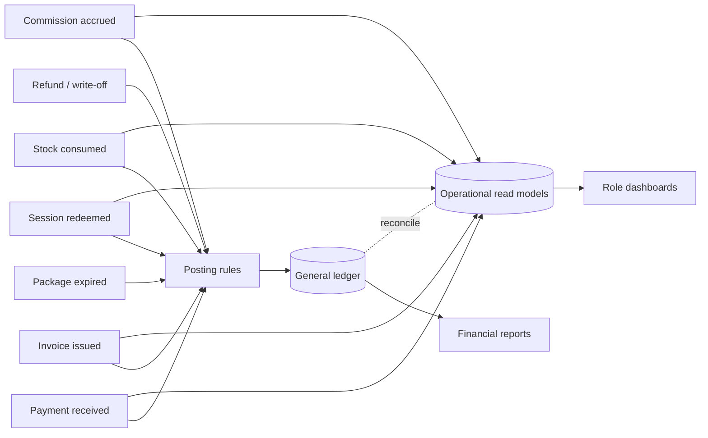
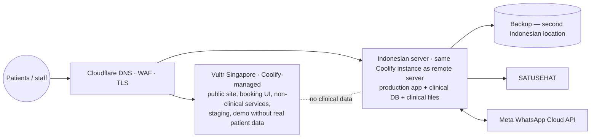

# Beauty Clinic SaaS — Needs and System Shape (Research)

- Date: 2026-11-02 (Asia/Jakarta)
- Status: **research only.** Not a PRD, not a build plan, not an implementation. No code, repository, or stack is chosen here.
- Builds on: `BIG-BRAND-DASHBOARD-CRM-REQUIREMENTS.md`, `INDONESIA-BEAUTY-CLINIC-MARKET-REA-REVIEW-2026-11.md`, `beauty-clinic-admin-system-research.md`, `SESSION-HANDOFF-2026-10-30.md`, `BEAUTY-CLINIC-SYSTEM-BLUEPRINT.md` §0.4.
- New black-magic evidence: `bundles/zap/`, `bundles/erha-eu-lounge/`, `bundles/oriskin/` (public files any visitor receives; passive read, no login, no API calls, no form submission).

Decisions are maintained in `DECISION-REGISTER.md` (authoritative from 2026-11-02).

Labels: **CONFIRMED** = user decision · **OBS** = observed in public code/data · **DOC** = official documentation · **PRESS** = dated article · **PROPOSED** = needs approval · **OPEN** = undecided.

---

## 0. Decisions recorded on 2026-11-02 (CONFIRMED)

| ID | Decision |
|---|---|
| D1 | One client = one brand. The brand may have multiple branches. No multi-brand tenant. |
| D2 | First target: mid-size clinics with **1–5 branches**. Big chains are reference evidence, not the first customer. |
| D3 | WhatsApp channel uses the **WhatsApp Business Platform (WABA / Cloud API)**. |
| D4 | Accounting module **if feasible**. Feasibility is assessed in §6; scope is still OPEN. |
| — | Research first. Do not develop. |

These replace the earlier deferral of "payroll/full accounting" only for accounting. Payroll stays out (CONFIRMED earlier: no payroll).

Added later on 2026-11-02 (CONFIRMED):

| ID | Decision |
|---|---|
| Q1 | One tenant = **one legal entity (one PT)**. One ledger per tenant; branches are profit centres. |
| Q5 | WABA: **we register as a Meta Tech Provider ourselves** (Embedded Signup), not through a BSP. |
| Q6 | WhatsApp numbers: **either per branch or per brand**, chosen per clinic. |

Research consequences: §5.5.

---

## 1. Black-magic findings from big brands (new in this pass)

### 1.1 ZAP — outlet master and booking engine (OBS `bundles/zap/booking.html`)

The public online-booking page embeds the full outlet master as a Livewire property (`:outlets`). It was parsed locally; no request was sent to any discovered endpoint.

| Fact | Value |
|---|---|
| Outlet records | 133 (121 active) |
| Cities | 50 (Jakarta Selatan 17, Jakarta Pusat 8, Tangerang 8, Surabaya 7, Bekasi 7) |
| Flags per outlet | `is_premiere` 14, `is_clinicplus` 6, `is_dermatologi` 4, `is_comingsoon` 0 |
| Booking engine | **119 outlets link to `go.booker.com/location/{accname_broker}/signin`**. ZAP's scheduling runs on Booker (Mindbody). This corrects the earlier review that marked it "not evidenced". |
| Outlet fields | `id`, `id_system`, `code`, `name`, `slug`, `category`, `accname_broker`, `address`, `city`, `phone`, `mobile`, `open_hours_mon_to_sat`, `open_hours_sun_and_holiday`, `geo_lat`, `geo_long`, `gmap_link`, `online_booking`, `is_active`, tier flags, `sort_order`, `publish_at`, `unpublish_at`, SEO fields, audit fields |
| Data quality | Opening hours stored as free text in at least 5 formats (`09.00-19.00`, `09:00 - 20:00`, `9am - 7pm`, …); 6 outlets have none |

**Lesson for our build:** the branch master is a first-class object with service-tier flags, a link to the scheduling system, publish windows, and **structured** opening hours. Free-text hours break "open now", slot generation, and directories.

### 1.2 ERHA Ultimate — Digital Lounge booking app (OBS `bundles/erha-eu-lounge/main.*.js`)

Every "Buat Jadwal" button leads here. The public bundle references `connect-api.aryanoble.co.id/api/digital-lounge/*` and a separate `self-payment.aryanoble.co.id` host.

| Capability | Endpoint names referenced in client code |
|---|---|
| Phone identity | `notification/whatsapp/send-otp`, `validate-otp`, `patient/by_phone_no`, `/login-with-another-phone-number`, `patient/v2`, `patient/v4`, `patient/integration/{id}` |
| Branch & service catalogue | `branch/city`, `branch/by_city`, `branch/by_location`, `branch/by_code`, `branch_product_service/master/list_branch/v1`, `branch_product_service/get_list_treatment`, `get_data_by_product_and_branch` |
| Doctor availability | `branch_staff_schedule/doctor_list`, `branch_staff_schedule/available/schedules_date` |
| Room scheduling | `service_activity_room_schedule/room_schedule/integration` |
| Appointment lifecycle | `appointment`, `appointment/cancel/{id}`, `appointment/reschedule/{id}`, `appointment/checkin`, `registration/from-appointment` |
| Queue | `registration/queue_summary`, `registration/client-care/queue_summary`, `registration/service-activity/queue_summary`, e-ticket `queueing-{no}.pdf` |
| Money guard | **`patient/check_unpaid_bill`** before booking |
| Other | `referral`, `referral-letter`, `category/interest`, `qiscus/message`, `registration_from_non_cis` (walk-in from outside the clinical system) |
| UI labels | "Konsultasi Kulit / Rambut / Umum", "Reguler Treatment", "Slot Terbatas", "Slot terdekat dari jam", "Silakan untuk melakukan Check In", "Hak dan Kewajiban Pasien" |

**Lessons:** (1) service availability is per branch (`branch_product_service`); (2) doctor schedule and room schedule are separate resources; (3) appointment → check-in → registration → queue is an explicit chain; (4) an unpaid-bill check runs before a new booking — consistent with our CONFIRMED "patient receivable shown on next visit" rule (we decided **no booking block**, so we show it, not block it); (5) referral letters exist as a first-class object.

### 1.3 Oriskin — patient web app (OBS `bundles/oriskin/`)

| Capability | Evidence |
|---|---|
| WhatsApp-session OTP login | `/api/otp/session/init`, `/session/verify-by-session`, `/session/status/{id}`, `/session/resend/{id}`, `/otp/auth/exchange`, `/otp/verify` |
| WhatsApp config served to client | `/api/config/whatsapp` |
| Rewards | `be-voucher.oriskin.co.id` — `/api/rewards/active`, `/api/rewards/{id}`, `/api/reward/claim/{id}` |
| Catalogue | `/api/oriskin/catalog/{packages,products}`, `/api/oriskin/clinics`, `/api/oriskin/feedback/branches` |
| Membership | "10+ pilihan membership" (page copy); components `MembershipCard`, `MembershipDetailModal`, `MembershipsTab` |
| Packages | "Paket treatment dalam satu pembelian", "Jadwal penggunaan paket fleksibel" |
| Feedback per branch | `/api/oriskin/feedback` |

**Lesson:** a mid-price chain runs rewards as a separate service and collects branch-level feedback. For our 1–5-branch target, rewards/membership stay deferred; branch feedback is cheap and useful (PROPOSED).

### 1.4 Re-used evidence from earlier passes (OBS, Oct 2026)

| Source | What it shows |
|---|---|
| NMW member portal | Routes: appointments, `consult-create`, `consult-pay`, `prescription-pay`, `point`, `voucher`, `voucher-point`, `transaction-history`, `invoice`, cart/checkout, courier coverage (`kiriminaja`), identity types including **passport** |
| Hepta CRS (Natasha/Naavagreen) | Booking fields: name, WA, member code, email, branch, date, time, complaint; slot check per outlet |
| ClinicHub admin labels | "Ringkasan Keuangan", "Liability", "Piutang jatuh tempo", "Total Deposit", "Potong deposit", "Histori Deposit", Collection vs Omzet split |
| Assist/Aesta admin | `KTxAccounts` (generate, transfer), `Ledgers/getList`, `getAccountBalance(ByDateRange)`, `getDebtCreditNew`, `generateFacilityIncome/Outcome`, tutup buku per shift, approvals for void/stock repair |
| Kasera merchant | slot hold, deposit rules, no-show/refund/restore, commission rule test, WhatsApp conversation take-over/hand-back |

### 1.5 What the evidence says about system shape

| Pattern | Big chains (ZAP, ERHA) | Mid clinics (vendor SaaS) | Implication for 1–5 branches |
|---|---|---|---|
| Scheduling | External engine (Booker) or in-house service | Built into clinic SaaS | Built-in scheduling; no external engine |
| Identity | WhatsApp OTP | WhatsApp/SMS OTP or staff-entered | WhatsApp OTP via our WABA (authentication template) |
| Back office | SAP (Arya Noble, DOC) | Ledger inside SaaS (Assist, ClinicHub, ICONIX "akuntansi otomatis" Enterprise) | Accounting inside the product is market-normal for this segment |
| Chat | Qiscus (ZAP, ERHA) | WA inbox in SaaS (Kasera, ClinicHub) | WABA inbox inside the product |

---

## 2. Needs for a 1–5-branch clinic (consolidated)

Ordering follows the visit flow. "Source" points to the confirmed rule or evidence.

### 2.1 Tenancy and organisation

| Need | Source |
|---|---|
| One tenant = one brand; branches inside; full tenant isolation | CONFIRMED |
| Shared patients, clinical history, balance and packages across branches | CONFIRMED |
| Stock per branch with recorded transfers | CONFIRMED |
| Shared master data and prices, owner branch overrides | CONFIRMED |
| Staff assigned to several branches; access scoped by branch | CONFIRMED |
| Branch master with structured hours, holidays/closures, services offered, WA number, map, publish window | ZAP/ERHA OBS → PROPOSED |

### 2.2 Front office and booking

| Need | Source |
|---|---|
| Booking by staff and by patient link; slot from performer schedule + required room | ERHA OBS; CONFIRMED "reserve only resources the service needs" |
| Phone identity with OTP; one phone → many patients; no family data leakage | OBS; CONFIRMED |
| Booking DP optional per treatment, 24 h rule | CONFIRMED |
| Check-in → visit → live queue with independent states | ERHA OBS; CONFIRMED state separation |
| Receivable shown at booking/check-in (not a block) | CONFIRMED |
| Source capture on every appointment (`source`, branch, campaign) | ERHA OBS → PROPOSED |
| Waitlist / slot-full lead capture | Kasera OBS → OPEN |

### 2.3 Clinical, room, pharmacy (already specified elsewhere)

BC intake, doctor plan, consent, treatment checklist, material issue/consume/return, automatic pharmacy list, min/target stock. See handoff §§3–5 and `BC-SCREEN-SPEC.md`. Not repeated here.

### 2.4 Cashier and money

| Need | Source |
|---|---|
| Pay before initial treatment; additions with in-room EDC/QRIS or balance | CONFIRMED |
| Packages, installments, DP, patient balance, booking DP — all first release | CONFIRMED |
| Consultation fee and waiver rules; free controls | CONFIRMED |
| Split tender; per-shift close | Vendor OBS → PROPOSED |
| Refund with approver (configurable owner / owner+manager) | CONFIRMED |
| Tax split per item: medical service vs cosmetic service vs product | DOC (§6.3) → PROPOSED |

### 2.5 CRM and WhatsApp (WABA)

| Need | Source |
|---|---|
| Shared inbox per tenant; routing by branch number or chosen branch; assignment | D3 + big-brand OBS |
| Lead object and lifecycle (new → contacted → booked → arrived → converted / lost) | PROPOSED |
| Follow-up queue from confirmed rules (controls, package stages, expiry, installments, receivables, unselected plans, no-shows) | CONFIRMED rules → PROPOSED triggers |
| Templates: appointment reminder, OTP, bill/receipt, control reminder (utility/authentication); promos (marketing, opt-in only) | DOC (§5) |
| Consent ledger per purpose; opt-out honoured | DOC + CONFIRMED photo/marketing separation |
| Source/campaign attribution, incl. Click-to-WhatsApp ad entry | DOC (§5.2) |

### 2.6 Commission, targets

Rules are CONFIRMED (handoff §4). Needs from them: contribution records, rule snapshots, monthly approval batch, refund adjustments, own-commission view. Payroll excluded.

### 2.7 Accounting (if feasible — §6)

General ledger fed automatically from operational events; contract liability for packages/balance/DP; receivables; cash and bank by payment method; materials cost; commission expense and payable; tax; period close; reports and exports.

### 2.8 Dashboards

Per-role dashboards and KPI dictionary: `BIG-BRAND-DASHBOARD-CRM-REQUIREMENTS.md` §§4–5. With an accounting module, K2 "completed service value" can be reconciled to recognised revenue (§6.2).

### 2.9 Platform and compliance

| Need | Source |
|---|---|
| Audit trail; corrections never delete history | CONFIRMED |
| EMR retention ≥ 25 years from last visit; correction rule within 2×24 h (Permenkes 24/2022 Ps. 30, 39) | DOC (verified text); interpretation still needs clinical/legal lead |
| UU PDP: consent, data-subject requests, breach procedure | Earlier research; not re-verified |
| SATUSEHAT obligations | OPEN (not re-verified) |
| No session replay or ad pixels on health inputs | OBS lesson |

---

## 3. System shape (conceptual, framework-neutral)

### 3.1 Context

```mermaid
flowchart LR
  Patient((Patient)) -- WhatsApp --> WABA[Meta WhatsApp Cloud API]
  Patient -- booking link --> Book[Public booking page]
  WABA <--> Msg[Messaging service]
  Book --> Core
  Msg --> Core
  subgraph Core[Clinic SaaS — one tenant per brand]
    Org[Org & branches]
    FO[Front office & scheduling]
    Clin[Clinical / RME]
    Room[Treatment room]
    Inv[Inventory & pharmacy]
    POS[Cashier & payments]
    CRM[CRM & follow-up]
    Com[Commission]
    Acc[Accounting]
    Rep[Dashboards & reports]
  end
  POS -- QRIS/VA --> PG[Payment gateway]
  Acc -- export --> Ext[Accountant / tax software]
  Clin -. OPEN .-> SS[SATUSEHAT]
```



### 3.2 Bounded contexts and what each owns

| Context | Owns (source of truth) | Emits events used by others |
|---|---|---|
| Org & access | Tenant, brand profile, branches, staff, roles, branch scopes, settings | branch changed, staff scope changed |
| Patient & identity | Patients, contact points (phone), guardians, consents | patient registered, consent changed |
| Scheduling & front office | Schedules, resources, appointments, visits, queue | appointment booked/cancelled/no-show, visit checked-in/closed |
| Clinical | Intake, examination, care plan versions, consent records, photos | plan authorized, plan changed |
| Commercial selection | Patient selections against plan, quotes | items selected |
| Cashier & payments | Invoices, payments, refunds, receivables, shift close | invoice issued, payment received, refund issued, receivable written off |
| Entitlements | Packages (session value, unlock), patient balance, booking DP | session redeemed, package expired/closed, balance moved |
| Treatment execution | Room checklist, start/stop, outcome (used / not used + reason) | treatment completed / interrupted |
| Inventory & pharmacy | Items, batches, stock per branch, requests, issues, consumption, returns, waste, counts, POs | stock received, issued, consumed, returned, adjusted |
| CRM & messaging | Leads, conversations, messages, templates, follow-up tasks, campaigns | lead converted, message sent/delivered/read |
| Commission | Rules, snapshots, contributions, entitlements, adjustments, payout batches | commission accrued, adjusted, approved, paid |
| Accounting | Chart of accounts, posting rules, journals, periods | (consumer of almost every event above) |
| Reporting | Read models only | — |

Rule: each record has exactly one owner. Accounting never edits invoices; it posts journals from them. Dashboards never hold numbers of their own.

### 3.3 One visit, many independent records (CONFIRMED principle)

```
Appointment ─► Visit ─┬─ Intake (BC) ─ Exam & Plan (doctor) ─ Selection ─ Consent
                      ├─ Invoice ─ Payments / Balance use / Receivable
                      ├─ Material requests ─ Issue ─ Consumption / Return / Waste
                      ├─ Treatment execution (used? reason)
                      ├─ Package redemption
                      ├─ Commission contributions
                      └─ Follow-up tasks
Visit closes only when: no unpaid bill (CONFIRMED) and every started execution has an outcome.
```

### 3.4 Event → accounting → dashboard flow (PROPOSED)



Two reporting paths stay distinct: operational KPIs from read models (fast, per branch) and financial statements from the ledger (period-locked). A reconciliation report shows where they differ.

### 3.5 Deployment shape under H-01/H-02 (see `DECISION-REGISTER.md` §6)



- Coolify can manage additional servers over SSH, so one control plane can deploy to Singapore and Indonesia (Coolify docs). Multi-server deploys of the same app exclude Docker Compose apps and apps with persistent storage; databases stay single-server.
- Simplest compliant layout (INF): run the **whole production application and database in Indonesia**, keep Singapore for non-production and public marketing. Splitting one production app across both countries adds latency and residency risk without benefit at 1–5-branch scale.
- Cloudflare: proxy, WAF and TLS only for clinical traffic; no R2/D1/KV or caching of authenticated responses for clinical data.

---

## 4. Tenancy model for "1 client = 1 brand, multi-branch"

| Level | Holds | Notes |
|---|---|---|
| Tenant (= brand) | Legal entity details, NPWP/PKP status, brand profile, WABA account, chart of accounts, master catalogue, prices, rules/settings | Isolation boundary |
| Branch | Address, structured hours, closures, rooms, devices, services offered, branch WA phone number (optional), stock, cash/bank accounts, price overrides | ERHA `branch_product_service` and ZAP flags show services/tiers vary per branch |
| Staff | Roles, branch scopes | One person may hold several roles (CONFIRMED) |

OPEN: one legal entity per tenant, or several entities (e.g. a branch owned by a different PT)? This changes accounting (one ledger vs one per entity). Default assumption for 1–5 branches: **one entity, branches as cost/profit centres**.

---

## 5. WhatsApp Business Platform (WABA) — research

### 5.1 Onboarding models

| Model | How | Fit |
|---|---|---|
| We become a Meta **Tech Provider** and use **Embedded Signup** | Each clinic connects/creates its own WABA inside our app; the clinic owns the WABA; we store WABA and phone-number IDs | Fits multi-tenant SaaS; requires business verification and app review (DOC/secondary: Meta docs via Postman, Gupshup) |
| Through a BSP (360dialog, Gupshup, Twilio, Qiscus, etc.) | BSP hosts onboarding and billing; we integrate the BSP API | Faster start; BSP fees on top of Meta rates |
| **Coexistence** | Existing WhatsApp Business **app** number connected to Cloud API; app keeps working on the same number (rollout via Embedded Signup from 6 May 2025) | Important for clinics already using the WA Business app on their branch phones; feature limits depend on provider |

Secondary-source note: one Tech Provider FAQ cites an onboarding cap of 200 new customers per rolling 7 days after verification. Not a constraint at our scale.

### 5.2 Pricing rules (DOC, Meta developer docs, read 2026-11-02)

- Per **delivered** message, by category and recipient country, since 1 Jul 2025. Templates: marketing, utility, authentication. Non-template: service (and Meta Business Agent from 1 Jul 2026, token-priced).
- **Customer service window**: 24 h from the user's last message or call. Free-form replies only inside it; templates otherwise.
- **Free entry point**: user arrives from a Click-to-WhatsApp ad (mobile apps) and the business replies within the window → messages free for up to 7 days.
- **From 1 Oct 2026**: service messages are charged after **1,000 free per business phone number per month**; utility templates inside the window are charged again. A payment method must be on file.
- Meta changes prices only on 1 Jan / 1 Apr / 1 Jul / 1 Oct.
- Indonesia list rates effective 1 Jan 2026 (secondary: Gupshup copy of Meta IDR rate card): marketing Rp586,33; utility Rp356,65; authentication Rp356,65 per message, before BSP fees. **Re-check after the 1 Oct 2026 rate update** before using for pricing.

Cost implication (INF): reminders, OTP and receipts are utility/authentication templates (paid); inbound conversations stay cheap until the 1,000 service-message tier is exceeded per number. One number per branch multiplies the free tier; one shared number simplifies the inbox. Which to choose is OPEN.

### 5.3 Policy constraints (DOC: WhatsApp Business Messaging / Acceptable Use policy)

- Contact only people who gave their number **and** agreed to receive messages; state what they will receive; honour opt-out.
- Do not use WhatsApp for telemedicine or to send/request health information where regulations require stronger protected channels; medical/healthcare products are restricted commerce categories.
- Practical rule (PROPOSED): templates carry no diagnosis, treatment details, or photos; link to an authenticated page for anything clinical. Promotional content only with marketing consent.

### 5.4 Needs derived

Templates catalogue per tenant and approval status; opt-in/opt-out ledger; per-message category and cost record (to show WA spend per branch); webhook handling for delivery/read; conversation assignment; window timer visible to staff; Click-to-WhatsApp ad source capture.


### 5.5 Consequences of "own Tech Provider" + "number per branch or per brand" (DOC, Meta developer docs read 2026-11-02)

**Becoming a Tech Provider (our company, once):**
1. Meta app with the WhatsApp use case, connected to our business portfolio.
2. **Business verification** of our company (name, address, phone, email, website; documents if Meta cannot find the business). Required before App Review.
3. **App Review** with app icon, privacy policy, category, and two videos: a message sent from our app arriving in WhatsApp, and a template created from our app.
4. **Advanced access** to `whatsapp_business_messaging` and `whatsapp_business_management`. Without the second, calls on client accounts fail with error `200`.
5. **Access Verification** after approval (secondary sources: Twilio, Infobip).
6. Then: Embedded Signup for each clinic, webhooks, and each clinic adds a **credit card** to its WhatsApp Business Platform account (Meta bills the clinic).

**Who owns what (INF from the Embedded Signup model):** each clinic connects its **own** business portfolio and WABA; we hold access tokens and IDs. Messaging limits, phone-number caps, quality rating, and Meta billing therefore belong to **the clinic's portfolio**, not ours.

**Limits that shape "per branch or per brand":**

| Rule | Value | Effect |
|---|---|---|
| Registered phone numbers per business portfolio | **2** for new portfolios; raised to **20** automatically after business verification or after reaching the 2,000 messaging limit | A clinic with up to 1 brand number + 1 branch number fits unverified. **3+ numbers (e.g. 5 branches per-branch mode) needs the clinic's own business verification first.** |
| Messaging limit (unique users reached with business-initiated messages outside the service window, rolling 24 h) | **250** new → 2,000 (scaling path: verify business, or partner verifies, or 2,000 high-quality delivered in 30 days) → 10,000 → 100,000 → unlimited (automatic: high quality and ≥ half the limit used in 7 days) | **Shared by all numbers in the portfolio.** Per-branch numbers do **not** multiply this limit; one busy branch can use the whole allowance. Reminders/broadcasts must be budgeted per tenant. |
| Free service messages (from 1 Oct 2026) | 1,000 per business phone number per month | Per-branch numbers **do** multiply this free tier. |
| Display name | Reviewed by Meta per number; brand name first, then location (e.g. "Klinik X – Bekasi"); location alone likely rejected (secondary: Klaviyo, Salesforce; WhatsApp onboarding PDF) | Per-branch names should follow `Brand – Branch`. |
| Number registration | Adding a number via Embedded Signup does not register it for Cloud API; a separate register call is required | Onboarding checklist per number. |
| Coexistence | Existing WA Business **app** number can stay on the app while connected to Cloud API (via Embedded Signup) | Lets clinics keep current branch numbers; feature limits depend on implementation. |

**Comparison of the two modes (INF):**

| Aspect | Per brand (1 number) | Per branch (N numbers) |
|---|---|---|
| Patient experience | One number to save | Familiar local number |
| Routing | Needs branch selection (ask, menu, or last-visited branch) | Number implies branch |
| Number cap | Fits 2-number cap | Needs clinic business verification if N + any extra > 2 |
| Messaging limit | Same shared portfolio limit | Same shared portfolio limit |
| Free service tier | 1,000/month | 1,000 × N/month |
| Display name reviews | 1 | N |
| Template approval | Per WABA (shared across numbers in the same WABA) | Same, if all numbers sit in one WABA |

**Needs derived:** the system must model the tenant's WABA, its phone numbers, each number's branch link (or "brand-wide"), display-name status, registration status, quality rating, and the portfolio-level messaging limit. Outbound scheduling (reminders, follow-ups) needs a tenant-level daily budget aware of the shared limit.

---

## 6. Accounting module — feasibility research

### 6.1 Standards and tax anchors

| Topic | Finding | Status |
|---|---|---|
| Revenue standard | PSAK 72 renumbered **PSAK 115** from 1 Jan 2024, substance unchanged (IAI). Prepayments for services not yet delivered are **contract liabilities**; revenue recognised as obligations are satisfied | DOC (IAI) |
| Framework for private entities | **SAK EP** effective 1 Jan 2025, replacing SAK ETAP; **SAK EMKM** remains for qualifying micro/small entities | DOC (IAI) — which one a given clinic uses is the clinic's/accountant's choice |
| VAT on services | Medical health services within PP 49/2022 are exempt; cosmetic/aesthetic services are taxable; PMK 131/2024 → 12% × DPP 11/12 (effective 11%) for general cases. Classification is **per treatment**, and disputes exist | DOC (Kemenkeu, DJP) + PRESS (DDTC) — needs tax adviser |
| Products | Retail skincare/products taxable if the clinic is PKP | INF from general VAT rules; confirm |

### 6.2 What "accounting" means for our product (PROPOSED scope ladder)

| Level | Contents | Fit for 1–5 branches |
|---|---|---|
| A. Operational ledger + export | Sub-ledgers (cash/bank by method, receivables, patient balance, package liability, commission payable), daily journal export to accountant software | Minimum; low risk |
| B. **Integrated general ledger** | Chart of accounts template, automatic posting from events, manual journals, period close/lock, trial balance, P&L, balance sheet, cash-flow summary, branch as profit centre | Matches market (Assist ledgers, ICONIX "akuntansi otomatis" Enterprise, ClinicHub liability/AR views) — **recommended target if feasible** |
| C. Full accounting suite | AP/purchasing invoices, fixed assets/depreciation, bank reconciliation with statement import, e-Faktur/Coretax, payroll | Too large for first release; payroll excluded |

### 6.3 Posting map draft (illustrative; accountant must validate)

| Event | Debit | Credit |
|---|---|---|
| Cash/QRIS/EDC payment for completed single treatment | Cash/Bank (by method) | Service revenue (+ VAT payable where taxable) |
| Package payment (installment or full) | Cash/Bank | **Contract liability – packages** |
| Session redeemed (counted as used) | Contract liability – packages (session value) | Service revenue (executing branch) |
| Patient balance top-up | Cash/Bank | **Contract liability – patient balance** |
| Balance used for purchase | Contract liability – balance | Revenue / receivable |
| Package expiry: paid-unused value to balance (CONFIRMED) | Contract liability – packages | Contract liability – balance |
| Booking DP received | Cash/Bank | Contract liability – booking DP |
| Booking DP forfeited (no-show/<24 h) | Contract liability – booking DP | Other income (classification OPEN) |
| Invoice unpaid at close | Receivable | Revenue |
| Write-off (owner) | Bad-debt expense | Receivable |
| Material consumed | Cost of materials | Inventory (branch) |
| Commission accrued | Commission expense | Commission payable |
| Commission paid | Commission payable | Cash/Bank |
| Refund | Revenue / liability (as originally posted) | Cash/Bank |

Notable consequence of CONFIRMED rules: because patient balance **never expires**, the clinic never releases balance as "breakage" revenue; the liability only reduces when used or refunded. Package unpaid remainders are cancelled (not receivables), so no receivable is posted for them.

Cross-branch package (CONFIRMED): sale at branch A, session at branch B. Ledger option (PROPOSED): liability at tenant level; revenue on redemption at branch B; sales KPI still credited to branch A. Inter-branch settlement entries are unnecessary with one legal entity.

### 6.4 Feasibility verdict (INF)

- **Technically feasible** because every money-moving event already exists as a record in the confirmed design; Level B is a posting layer over those events plus a chart of accounts, journals and period lock.
- **Risk is not code but correctness**: VAT classification per treatment, revenue timing choices, and framework (SAK EP vs EMKM) need an accountant and tax adviser before any posting rule is fixed.
- Market comparison: mid-segment SaaS already ships ledgers (Assist, ICONIX Enterprise, ClinicHub liability/AR). Shipping without at least Level A would be below market; Level B is competitive.
- Recommended research path: accountant review of §6.3, then decide A or B.

---

## 7. Dashboards with an accounting module

Adds to `BIG-BRAND-DASHBOARD-CRM-REQUIREMENTS.md` §5:

| View | Adds |
|---|---|
| Owner | Recognised revenue vs cash collected; contract liabilities (packages, balance, DP) from the ledger; gross margin after materials and commission from the ledger; branch P&L |
| Finance | Trial balance, P&L, balance sheet, AR aging, liability roll-forward (opening + sold − redeemed − moved − refunded = closing), period close checklist |
| Reconciliation | Operational KPI vs ledger differences by day and branch |

---

## 8. Open questions (research must close before PRD)

Tax, accounting framework, SATUSEHAT and PSE were researched on 2026-11-02 in `COMPLIANCE-TAX-ACCOUNTING-SATUSEHAT-PSE-RESEARCH.md` (prepared questions for accountant and tax adviser, vendor registration checklist).

| ID | Question | Who answers |
|---|---|---|
| Q1 | ~~One legal entity per tenant, or several?~~ **Answered: one PT.** | — |
| Q2 | Accounting Level A or B for first release? | Paduka Ongki after accountant review |
| Q3 | VAT classification of each treatment family; is the pilot clinic PKP? | Tax adviser |
| Q4 | SAK EP or SAK EMKM reporting? | Clinic's accountant |
| Q5 | ~~WABA via own Tech Provider or BSP?~~ **Answered: own Tech Provider.** | — |
| Q6 | ~~Number per tenant or per branch?~~ **Answered: either, per clinic.** Remaining: use Coexistence for existing branch app numbers? | Pilot clinic |
| Q10 | Which legal entity registers as Tech Provider (our company name, website, privacy policy must exist for Meta verification)? | Paduka Ongki — register S-04 |
| Q11 | Indonesian server provider for production clinical data | Paduka Ongki — register H-02b |
| Q7 | Forfeited booking DP: other income or service revenue? | Accountant |
| Q8 | SATUSEHAT and PSE obligations for the pilot clinic | Legal / clinic |
| Q9 | Lateness rule, second-visit window, dormant threshold, lead SLA, BC target metric | From `BIG-BRAND…` D5–D8 |

---

## 9. Evidence boundary and limits

- All new evidence comes from files the public pages send to every visitor; nothing behind login was accessed and no discovered endpoint was called.
- Endpoint names prove what client code references, not what the server allows or how it is configured.
- WABA pricing and policy change quarterly; figures are as read on 2026-11-02.
- Accounting and tax rows are research summaries, not professional advice.

## 10. Sources

- ZAP online booking page (outlet master, Booker links) — https://zapclinic.com/en/online-booking (saved `bundles/zap/booking.html`)
- ERHA Digital Lounge bundle — https://connect-digital-lounge.aryanoble.co.id/verify?sourceValue=Web%20EU&branchId=944 (saved `bundles/erha-eu-lounge/`)
- Oriskin web and app bundles — https://www.oriskin.co.id/id , https://app.oriskin.co.id/id/login (saved `bundles/oriskin/`)
- WhatsApp pricing — https://developers.facebook.com/docs/whatsapp/pricing ; https://developers.facebook.com/docs/whatsapp/pricing/updates-to-pricing
- Indonesia IDR rates Jan 2026 (secondary copy) — https://www.gupshup.ai/resources/wp-content/uploads/2025/12/IDR_Jan2026.pdf
- Embedded Signup — https://www.postman.com/meta/whatsapp-business-platform/documentation/du6gzjv/embedded-signup ; https://bizgate-docs.gupshup.io/docs/what-is-embedded-signup
- Coexistence — https://bizgate-docs.gupshup.io/docs/what-is-coexistence ; https://docs.360dialog.com/partner/onboarding/whatsapp-coexistence
- WhatsApp policy (archived copy) — https://github.com/OpenTermsArchive/vlopses-us-versions/blob/main/WhatsApp/Acceptable%20Use%20Policy.md
- PSAK renumbering — https://web.iaiglobal.or.id/Berita-IAI/detail/penomoran_psak_dan_isak_dalam_sak_indonesia
- PSAK 72/115 summary — https://web.iaiglobal.or.id/PSAK-Umum/83
- SAK EMKM / SAK EP — https://web.iaiglobal.or.id/SAK-IAI/Tentang%20SAK%20EMKM ; https://www.ifrs.org/use-around-the-world/use-of-ifrs-standards-by-jurisdiction/view-jurisdiction/indonesia/
- PP 49/2022 — https://jdih.kemenkeu.go.id/api/download/1ea00c90-4108-41a4-a72f-3032e865cbc8/49TAHUN2022PP.pdf
- PMK 131/2024 — https://www.pajak.go.id/id/node/113453
- Beauty-clinic VAT dispute — https://news.ddtc.co.id/literasi/putusan/1807828/sengketa-yuridis-pengenaan-ppn-atas-jasa-kecantikan
- Arya Noble RISE with SAP — https://news.sap.com/sea/2024/02/transforming-indonesias-skincare-in-the-cloud-arya-noble-embarks-on-a-digital-journey-with-rise-with-sap/
- ICONIX beauty features (Enterprise automatic accounting) — https://www.iconix.id/fcantik.html
- Permenkes 24/2022 Pasal 39 — https://api-law.crpg.info/peraturan/permenkes/24/2022/pasal/39
