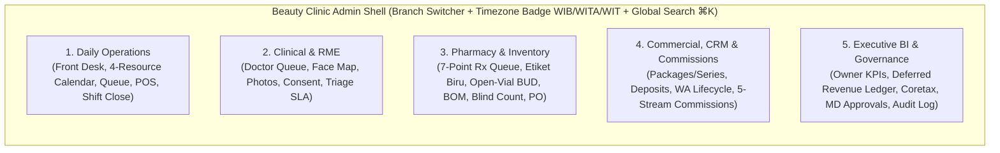

# Indonesian Beauty Clinic Admin Dashboard & Operator Console Standard — Deep Research

- **Date**: 2026-10-29
- **Scope**: End-to-end Information Architecture (IA), role-based operator consoles, executive KPI hierarchy, chart & table specifications, state/permission matrices, maker-checker governance, and Indonesian localization rules for **Aesthetic & Beauty Clinic Admin Dashboards** (*Klinik Pratama & Utama Kecantikan*).
- **Companion Documents**:
  - [beauty-clinic-research.md](beauty-clinic-research.md) (20-Brand Competitive Landscape)
  - [indonesia-clinic-management-system-standard.md](indonesia-clinic-management-system-standard.md) (SIMKlinik & RME Regulatory/Functional Standard)
- **Method**: Synthesis of Indonesian SIMKlinik admin modules (Aesta by Assist.id, ICONIX, ClinicHub OS, Aplikasi Klinik Pintar, Medeva), global enterprise med-spa BI platforms (Zenoti, Boulevard, Pabau), Indonesian healthcare/tax regulations (Permenkes 24/2022, UU 17/2023, PP 28/2024, Permenkes 34/2021, UU PDP 27/2022, DJP Coretax PMK 131/2024), and operator UX standards.

## Evidence Taxonomy

- **`[REGULATORY-GATE]`**: Required by Indonesian law or ministerial regulation (Permenkes, UU Kesehatan, UU PDP, BPOM, DJP).
- **`[INDUSTRY-STANDARD]`**: Shipped across leading Indonesian aesthetic clinic systems and global med-spa ERPs.
- **`[ARCHITECT-CONTRACT]`**: Best-practice operator UX and financial/clinical control pattern designed to prevent revenue leakage, medico-legal exposure, or dashboard clutter.

---

## 1. Executive Summary: Why a Single "Admin Dashboard" Fails in Beauty Clinics

A common mistake in clinic software is building one generic "Admin Dashboard" filled with decorative revenue cards and donut charts for every user. In an Indonesian beauty clinic, **seven distinct operator roles** work simultaneously under different time pressures, device postures, and legal boundaries (UU Kesehatan 17/2023 & UU PDP 27/2022):

1. **Owner / Executive Director** needs a **Strategic & Financial Health Console**: Cash Collected (*Omzet Kas*) vs. Earned Revenue (*Pendapatan Terealisasi*), Unearned Package/Deposit Liability (*Utang Layanan Paket*), Laser/Room Utilization, Rebooking Rate, and Branch P&L—without exposing raw patient clinical photos or private diagnoses.
2. **Medical Director (*Penanggung Jawab Medis*)** needs a **Clinical Governance & Maker-Checker Console**: approving clinical catalog protocols, co-signing >48h RME addenda (Permenkes 24/2022 Pasal 30), reviewing `RED`/`AMBER` post-procedure complication triage, and auditing Doctor-to-Nurse delegation (*Mandat* under PP 28/2024 Pasal 745).
3. **Branch / Operational Manager (*Kepala Cabang*)** needs an **Operational Exception & Resource Console**: today's 4-resource schedule bottlenecks, staff shift rosters (*jadwal dokter/terapis*), BHP stock variance approvals, package extension requests, and cashier shift-close discrepancies.
4. **Front Office / Receptionist & Beauty Consultant (FO/BC)** needs a **High-Speed Queue & Booking Workbench**: 4-resource calendar matrix (Doctor + Nurse/Terapis + Cabin/Bed + Laser Machine), walk-in/KYC check-in (16-digit NIK / SATUSEHAT MPI), waiting-room queue board, and expiring-package renewal leads.
5. **Doctor (GP Estetika / Sp.DVE) & Nurse (*Perawat*)** need a **Tablet/Desktop Clinical RME Workbench**: patient queue, layered assessment (Fitzpatrick, GAGS, mMASI), 5-angle Before/After photo comparison with ghost overlay, Interactive Face/Body Map, consented dose envelope check, and 1-click e-prescription.
6. **Pharmacist (*Apoteker* / TTK)** needs a **Dispensing, *Etiket Biru* & Vial Control Workbench**: 7-point prescription review queue, automated Blue-Label (*Etiket Biru*) + BUD printer, live **Open-Vial BUD countdown timers** (24h reconstituted Botox / 28d MDV), and daily blind stock count entry.
7. **Cashier & Finance Staff (*Kasir & Akuntansi*)** need a **POS Settlement, Package Ledger & Tax Workbench**: multi-tender checkout, pro-rata installment session unlocking, shift cash drawer reconciliation (*Tutup Kasir*), 5-stream staff commission ledger, and DJP Coretax 11/12 XML export.

---

## 2. Information Architecture (IA) & Navigation Hierarchy (`[ARCHITECT-CONTRACT]`)

Do not flatten daily operations, clinical charting, inventory, governance approvals, and executive analytics into a single ungrouped sidebar. Separate the admin system into **five top-level operational zones**, filtered strictly by Role-Based Access Control (RBAC) and branch scope:

### 2.1 Navigation & Role Visibility Matrix

| Sidebar Group & Screen | Owner | Medical Director | Branch Manager | Doctor (Sp.DVE/GP) | Nurse (*Perawat*) | Beautician (*Terapis*) | Pharmacist (*Apoteker*) | Front Office / Cashier |
|---|---|---|---|---|---|---|---|---|
| **1. Ringkasan Eksekutif (Executive BI)** | Full (All Branches) | Clinical KPIs only | Branch KPIs | Own KPIs | — | — | Pharmacy KPIs | — |
| **2. Antrean & Kalender 4-Resource** | Read | Read | Full | Own Schedule | Assigned | Assigned | — | **Primary Home** |
| **3. Registrasi & KYC Pasien (FO)** | — | — | Read/Override | Read (Header) | Read (Header) | Masked Name/Room | Read (Rx Header) | **Full** |
| **4. Workbench RME Estetika & Face Map** | **Blocked (UU PDP)** | **Full + Co-Sign** | **Blocked (UU PDP)** | **Primary Home** | Delegated Layer | Non-Invasive Task Only | Clinical Rx View | **Blocked** |
| **5. Triage Pasca-Tindakan (RED/AMBER/GREEN)** | Escalation Summary | **Full + Audit** | SLA Monitor | **Action Owner** | **First Responder** | — | — | Inbound Routing |
| **6. Instalasi Farmasi, Etiket Biru & Vial BUD** | Summary | Co-Approve BUD/BOM | Variance Review | E-Prescribe | Tray Draw (*Dapur Nampan*) | — | **Primary Home** | — |
| **7. Gudang, Kartu Stok FEFO & Purchasing (PO)** | Approve Disposal | — | Approve PO/Opname | — | Cabin Stock Count | Cabin Stock Count | **Full** | — |
| **8. Kasir (POS), Paket Series, Deposit & Tutup Kas** | Read / Audit | — | Approve Refund/Void | — | — | — | — | **Primary (Cashier)** |
| **9. Komisi Staf (5-Stream) & Piutang Cicilan** | **Full + Approve** | Own Fee Statement | Branch Review | Own Fee Statement | Own Fee Statement | Own Fee Statement | Own Fee Statement | Own BC Fee |
| **10. Kotak Persetujuan (Maker-Checker Inbox)** | Financial & Tier-2 | **Clinical & Catalog** | Operational & Refund | — | — | — | Pharmacy & Disposal | — |
| **11. Buku Besar, Pajak Coretax & SATUSEHAT Outbox** | **Full** | SATUSEHAT Clinical | SATUSEHAT Ops | — | — | — | — | — |
| **12. Audit Log & Keamanan** | **Read-Only Audited** | Clinical Access Log | — | — | — | — | — | — |

> **Critical Privacy Boundary (`[REGULATORY-GATE]` — UU PDP No. 27 Tahun 2022 Pasal 4(2) & Permenkes 24/2022)**:
> Owners, Branch Managers, Finance staff, and Receptionists **must never have default access to raw patient clinical photographs, anatomical Face Maps, or confidential doctor diagnosis notes**. Their dashboards aggregate financial, operational, and anonymized clinical metrics. Viewing a specific patient's RME requires an active clinical role (Doctor/Nurse/Pharmacist) or a logged medico-legal break-glass event.

---

## 3. Executive & Analytical Dashboard Standard (Owner & Branch Manager)

Following Stephen Few's and Shneiderman's hierarchy (*Overview first, zoom and filter, then details-on-demand*), the Executive Dashboard must separate **Real-Time Operational Exceptions** from **Financial & Utilization KPIs**.

### 3.1 Top Exception Banner (Operational Alert Tier)

Before showing any revenue chart, the top bar displays actionable exceptions requiring immediate intervention (combining icon + shape + text + high-contrast badge; hidden when zero):

1. **`RED` Clinical Triage Unacknowledged (`> 15 min`)**: Count of post-procedure emergency reports awaiting doctor contact.
2. **Open-Vial BUD Expiring / Lapsed Today**: Count of punctured Botulinum Toxin or multi-dose vials expiring within 4 hours or un-disposed past BUD.
3. **Blind Stock Count Variance / Unclosed Cashier Shift**: Branches where yesterday's daily injectable blind count or cashier *Tutup Kasir* had a variance above tolerance.
4. **SATUSEHAT Outbox Stuck (`> 14 days IDENTITY_PENDING` or API Error)**: Encounters blocked from national reporting.
5. **Maker-Checker Approvals Waiting**: Count of refunds, package extensions, >48h RME addenda, or disposal *Berita Acara* awaiting sign-off.

### 3.2 The 8 Canonical KPIs for an Indonesian Beauty Clinic (`[INDUSTRY-STANDARD]` + `[ARCHITECT-CONTRACT]`)

Never display vanity metrics without comparison context. Every KPI card must follow the strict anatomy: **Metric Label → Primary Value (`tabular-nums`) → Period Delta (`±% vs last period / target`) → Concrete Sub-caption**.

| # | KPI Card Title (ID / EN) | Formula & Accounting Basis | Why It Matters in Indonesian Beauty Clinics | Target / Benchmark Reference |
|---|---|---|---|---|
| 1 | **Omzet Kas Diterima (Cash Collected — Net)** | Total settled cash/QRIS/EDC/VA/Transfer inflows minus cash refunds in period | Shows actual liquidity entering the clinic's bank accounts today/this month (includes upfront package sales and deposit top-ups). | Tracked daily against monthly branch cash target. |
| 2 | **Pendapatan Terealisasi (Earned Revenue)** | Recognized revenue from single visits + **redeemed package sessions** + dispensed products + valid expired-package breakage | **Prevents the #1 med-spa bankruptcy trap**: stops owners from mistaking prepaid 10-session package cash for earned monthly profit. | Should track within $\pm 15\%$ of Cash Collected in a steady-state clinic; if Cash $\gg$ Earned, liability is piling up. |
| 3 | **Saldo Utang Paket & Deposit (Unearned Package & Deposit Liability)** | Cumulative unredeemed package session value + unspent patient deposit balances | Represents services the clinic legally owes patients. Also shows **"Expiring in <30 Days"** slice as an immediate WhatsApp reactivation opportunity. | Monitor burn-down velocity (monthly redemption rate of active package liability $\ge 15\text{--}25\%$). |
| 4 | **Gross Margin Setelah BHP & Komisi (Contribution Margin %)** | $(\text{Earned Revenue} - \text{HPP BHP/Obat} - \text{5-Stream Staff Commissions}) / \text{Earned Revenue}$ | High-ticket injectables (Rejuran, Filler, Botox) and discounted laser bundles can have high top-line revenue but thin margin if BHP cost and doctor/BC commissions are not deducted first. | Healthy Indonesian aesthetic clinics target **55%–70%** gross margin after BHP and direct commissions. |
| 5 | **Utilisasi Kabin & Alat Laser (Room & Energy-Device Utilization %)** | $\text{Booked & Executed Hours} / \text{Total Available Operating Hours}$ per cabin and per laser/HIFU unit | Pico lasers, HIFU, and RF machines carry heavy capex/lease costs. Low utilization signals scheduling bottlenecks or under-trained operators; $>85\%$ signals time to add a machine or extend hours. | Target **65%–80%** for treatment cabins; **50%–75%** for specialized energy devices; alongside **RevPARH** (Revenue Per Available Room-Hour). |
| 6 | **Konversi Konsultasi ke Tindakan (Consult-to-Treatment Conversion %)** | $\text{Consultations converting to same-day procedure or package} / \text{Total Doctor Consultations}$ | Measures how effectively doctors and Beauty Consultants turnRp150k–300k acne/anti-aging consultations into procedural care plans. | Benchmark: **60%–80%** for existing patients; **45%–65%** for new walk-in/ad-lead patients. |
| 7 | **Tingkat Rebooking & Retensi Kunjungan Kedua (Rebooking Rate & 2nd-Visit Retention)** | % of patients who book their next session before leaving (or within cycle window) + % completing visit #2 | Solves the **"First-Rebook Trap"** (Zenoti benchmark: up to 37% of initial bookings cancel/churn before visit #2; once visit #2 completes, long-term retention stabilizes). | Target **$\ge 65\%$** rebooking before checkout for series/acne patients. |
| 8 | **Rasio Penjualan Homecare / Resep per Kunjungan (Product Attach Rate & Retail Share)** | % of treatment visits that include a prescription (*etiket biru*) or BPOM skincare purchase + Retail % of total revenue | As seen in ERHA, Natasha, MS GLOW, and Ella, recurring homecare cream depletion (every 25–30 days) locks patients into the clinic ecosystem between procedural visits. | Target **25%–40%** of total clinic revenue from pharmacy/homecare products. |

### 3.3 Chart Selection & Analytical Visual Standards (`[ARCHITECT-CONTRACT]`)

Following the Financial Times *Visual Vocabulary* and strict anti-slop rules (no 3D charts, no gauges, no >4-slice pie charts, all bar baselines at zero):

1. **Cash Collected vs. Earned Revenue vs. BHP+Commission Cost (Time Trend)**:
   - **Chart Type**: **Multi-Series Line Chart** (daily/weekly over 30–90 days) or **Grouped Column Chart** (monthly over 12 months, starting at `Rp 0`).
   - **Title states the question/finding**: *"How much of this month's cash inflow was earned through completed treatments?"*
2. **Cabin, Bed & Laser Device Utilization by Hour of Day / Day of Week**:
   - **Chart Type**: **2D Calendar Heatmap** (X-axis: Operating Hours `09:00–21:00`, Y-axis: Cabins & Laser Devices; sequential color ramp from light neutral to deep brand/emerald).
   - **Decision supported**: Instantly reveals dead Tuesday mornings (for flash promos or staff training) vs. saturated Saturday `13:00–17:00` slots where walk-ins are turned away.
3. **Revenue & Margin Breakdown by Segment (Injectables, Lasers, Facials, Prescription/Etiket Biru, BPOM Retail)**:
   - **Chart Type**: **Horizontal Stacked or Grouped Bar Chart** showing Gross Earned Revenue alongside Net Margin after BHP & Commissions. (Never use a multi-slice donut chart here, because comparing margin efficiency across 6+ treatment families requires a shared zero baseline).
4. **Patient Cohort Retention & The "First-Rebook Trap" Funnel**:
   - **Chart Type**: **Cohort Retention Heatmap Table** or **Step Conversion Bar** (`New Lead / Ad Click` → `Arrived Visit #1` → `Rebooked Visit #2` → `Completed Visit #2` → `Active Package / Repeat >3 Visits`).
5. **Package Liability Aging & Expiry Forecast**:
   - **Chart Type**: **Stacked Column Chart by Expiry Bucket** (`Active >90d`, `Expiring 31–90d`, `Expiring 1–30d [H-30/14/7 Alert Window]`, `In Grace Period`, `Eligible for Breakage Release`).

---

## 4. Role-Based Operational Workbenches: Screen Contracts

### 4.1 Front-Office & 4-Resource Scheduling Workbench (*Meja Resepsionis & Kalender*)

- **Primary Job**: Register walk-ins/appointments in `<60 seconds`, resolve 4-resource scheduling conflicts without double-booking lasers or doctors, and manage the waiting room queue.
- **Screen Shape**: **Split-Pane Calendar & Live Queue Board** (`32px` compact or `40px` default row density).
  - **Left/Main Pane — 4-Resource Timeline Matrix**: Toggleable resource columns by **Doctor**, **Nurse/Beautician**, **Cabin/Bed**, or **Energy Device (Pico/HIFU/RF)**. Clicking a time slot runs an atomic availability filter across all 4 dimensions before allowing save.
  - **Right Rail — Live Clinic Status Queue**:
    - `BOOKED_TODAY` (with WhatsApp confirmation status badge)
    - `ARRIVED_CHECKED_IN` (waiting in lobby, showing wait-time counter in minutes; highlights amber if waiting `>15 min` past slot)
    - `IN_CONSULTATION` (with Doctor in exam room)
    - `IN_CABIN_TREATMENT` (showing Cabin #, Executor, and estimated completion countdown)
    - `AT_PHARMACY_OR_CASHIER` (ready for dispensing and checkout)
    - `RELEASED_NO_SHOW` (auto-flagged after `15 min` grace period; offers 1-click WhatsApp reschedule or slot release).
- **KYC & Shared-Phone Handling**:
  - Searching a WhatsApp number that belongs to a family displays a **Profile Picker Modal** (e.g., *Ibu Rina [Owner]*, *Putri [Anak, 16 thn — Butuh Konsen Wali]*).
  - Missing KTP/NIK sets a visible `IDENTITY_PENDING` chip without blocking check-in, holding SATUSEHAT FHIR sync in the outbox until verified.

### 4.2 Doctor & Nurse Clinical RME Workbench (*Ruang Konsultasi & Tindakan*)

- **Primary Job**: Review patient skin history, capture standardized assessments and comparable photos, lock informed consent, plot procedure details on the Face Map, and issue e-prescriptions without typing walls of free text.
- **Screen Shape**: **3-Zone Clinical Canvas** (optimized for iPad/Tablet touch `≥44px` hit targets and Desktop).
  - **Sticky Patient Clinical Header**: Patient name, age, sex, **Hard Contraindication Badges** in high-contrast red/amber (`HAMIL / MENYUSUI`, `ISOTRETINOIN <6 BLN`, `RIWAYAT KELOID`, `ALERGI LIDOCAINE`), Fitzpatrick Type (`III`–`V`), active care plans, and remaining package entitlements.
  - **Left Navigation Tabs (The 4 Clinical Layers)**:
    1. *Anamnesis & Skala Kulit*: Structured forms for **GAGS** (0–44 acne score calculator), **mMASI** (0–24 melasma calculator), and IGA (0–4).
    2. *Foto Klinis (5-Angle Protocol)*: Side-by-side Before/After viewer with ghost overlay alignment, capture checklist (Frankfurt plane, diffuse light, no makeup), and auto-computed badge (`COMPARABLE` / `LIMITED` / `NOT_COMPARABLE`).
    3. *Informed Consent & Envelope*: Displays the exact consented envelope (`Procedure + Area + Product Class + Max Units/ml`). Captures patient + health-worker witness e-signatures. Turns **RED (`RECONFIRMATION_REQUIRED`)** if the doctor enters a dose on the Face Map exceeding the consented maximum.
    4. *Face & Body Map + Resep*: Interactive vector canvas to tap injection points (auto-summing units/ml) or laser parameters (wavelength, fluence, shots), linked directly to the cabin's active open-vial batch/lot and *Dapur Nampan* BOM, plus 1-click e-prescription to Pharmacy.
- **Permenkes 24/2022 Pasal 30 Lock Indicator**:
  - Signed encounters show a countdown badge (`Dapat dikoreksi penulis: sisa 41j 12m`). Once `48 hours` elapse, all fields lock to read-only and the primary button changes to **"Buat Addendum Klinis (Butuh Co-Sign Medical Director)"**.

### 4.3 Pharmacy (*Instalasi Farmasi*), *Etiket Biru* & Inventory Workbench

- **Primary Job**: Verify e-prescriptions via the 7-point check, print legally compliant Blue Labels (*Etiket Biru*), monitor open-vial BUD timers, and prevent BHP/injectable stock shrinkage.
- **Screen Shape**: **Priority Work Queue + Live Vial BUD Monitor**.
  - **Tab 1 — Antrean Resep Elektronik (7-Point Check)**:
    - Shows incoming prescriptions sorted by check-in time.
    - Side-by-side **7-Point Pharmacist Checklist** (Administrative 1–2, Pharmaceutical 3, Clinical 4–6, Dispensing & Counselling 7).
    - **Refill Cooldown Alert**: Flags any prescription for an active compound where `<75%` of the previous supply duration has elapsed, requiring a logged doctor override reason.
    - **1-Click *Etiket Biru* Print**: Generates the thermal blue label with Clinic header, Apoteker name + SIPA, Rx #, Patient Name/DOB, composition, *"OBAT LUAR — TIDAK UNTUK DITELAN"*, storage temperature, and auto-computed **BUD** (14d fridge / 35d preserved / 180d anhydrous, capped by earliest ingredient batch expiry).
  - **Tab 2 — Monitor Open-Vial & Cold-Chain BUD (Critical Anti-Leakage Screen)**:
    - Live table of every currently punctured multi-dose vial (e.g., *Botox 100U Lot #X*, *Skin Booster MDV*).
    - Columns: `Item & Lot #` | `Lokasi Kulkas/Kabin` | `Waktu Buka` | `Sisa Waktu BUD (Countdown)` | `Unit Awal` | `Unit Terpakai (Face Map)` | `Sisa Unit Sistem` | `Status`.
    - When `BUD Countdown == 0` (e.g., 24h for reconstituted toxin), status flips to `BUD_LAPSED_LOCKED`, blocking doctors from selecting that vial in any RME and creating a mandatory **Disposal (*Berita Acara Pemusnahan*)** task.
  - **Tab 3 — Daily Blind Stock Opname (*Hitung Buta Harian*)**:
    - For high-value toxins, fillers, and psychotropics: the table shows `Item`, `Lot #`, and an **empty `Jumlah Fisik Dihitung` input**—intentionally hiding `Stok Sistem` until the staff member submits their count. Any variance $> \max(2\text{ units}, 2\%)$ automatically opens an audited variance investigation.

### 4.4 Cashier POS, Package Entitlement & Shift-Close Workbench (*Meja Kasir*)

- **Primary Job**: Settle multi-element visits (consult + cabin treatment + package redemption + prescription + retail skincare), enforce installment session limits, issue WhatsApp PDF receipts, and close the shift cash drawer accurately.
- **Screen Shape**: **2-Pane Transaction & Entitlement Settlement Screen**.
  - **Left Pane — Visit & Entitlement Lines**:
    - Automatically pulls completed clinical actions from RME and verified prescriptions from Pharmacy (cashiers cannot invent or delete clinical procedures without RME synchronization).
    - Shows available **Package Entitlements** (auto-selecting `soonest_expiry` first) and **Pro-Rata Installment Unlocking Status** (e.g., *"Paket Laser 6x — Lunas Termin 1/3 (Rp4jt/Rp12jt): 2 Sesi Terbuka, 1 Dipakai Hari Ini, Sisa 1 Sesi Terbuka / 4 Terkunci"*).
    - Displays per-line **Tax Classification Badges**: `BEBAS PPN (Kode 08 - Jasa Medis)` vs. `PPN 11% Efektif (Kode 04 - DPP 11/12)`.
  - **Right Pane — Multi-Tender Payment & Split Attribution**:
    - Supports combining Deposit Balance + QRIS (Midtrans/Xendit) + EDC + Cash + Voucher in one checkout.
    - Displays the **5-Stream Commission Attribution Preview** (Consulting Doctor, Executing Doctor, Assisting Nurse, Beautician, Closing BC) locked to the current rule version snapshot.
    - **1-Click Receipt**: Sends itemized PDF receipt to the patient's WhatsApp and queues the Coretax XML record.
- **Mandatory Shift Cash Close (*Tutup Kasir*) Modal/Screen**:
  - End-of-shift workflow: Cashier enters blind physical cash denomination counts and EDC settlement batch totals $\rightarrow$ System compares against POS expected ledger $\rightarrow$ Any discrepancy requires Manager approval note before closing the shift.

### 4.5 Medical Director & Manager Maker-Checker Governance Inbox

- **Primary Job**: Review and approve high-risk clinical, inventory, and financial actions that require **Two-Person Integrity (Maker $\neq$ Checker)**.
- **Screen Shape**: **Master-Detail Approval Queue** (with side-by-side diff view and mandatory decision note).
- **6 Gated Workflows in the Inbox**:
  1. **Catalog & Clinical Protocol Publication**: Approving new treatments, max consented doses, GAGS/mMASI scale versions, Doctor-to-Nurse delegation rules (`MANDAT`), and Permenkes 1787/2010 ad compliance checks (Approver: *Medical Director* + *Pharmacist* for drugs/BHP).
  2. **Late RME Addendum (`> 2×24 Hours`)**: Reviewing a doctor's proposed clinical addendum after the Permenkes 24/2022 48h window (Approver: *Medical Director*).
  3. **Partial Procedure Session Override**: When a treatment is aborted mid-session and the doctor marks *"Sesi paket tidak dihitung"* (Approver: *Medical Director* + *Branch Manager*).
  4. **Vial / Drug Disposal (*Berita Acara Pemusnahan*)**: Tiered sign-off for expired/damaged stock (`Pharmacist + Witness` always; `+ Branch Manager/MD` if injectable/narcotic or $\ge \text{Rp } 1,000,000$; `+ Owner` if $\ge \text{Rp } 10,000,000$).
  5. **Package Refund, Write-Off & Expiry Extension**: Reviewing pro-rata package refunds (with automatic loyalty point and commission clawback preview) or manual $+90\text{ day}$ package validity extensions (Approver: *Branch Manager* / *Finance*).
  6. **Patient Profile Merge & Account Recovery**: Merging duplicate patient records or recovering an account with active deposit/package balance after KTP + 2-of-3 KYC verification (Approver: *Branch Manager*).

---

## 5. UI Craft, Responsive Density & Indonesian Localization Rules (`[ARCHITECT-CONTRACT]`)

To ensure the admin system feels like a precision clinical and financial instrument—not an AI-generated template—every screen must follow these presentation standards:

### 5.1 Visual & Surface Discipline (Anti-Slop Contract)
- **Quiet Hierarchy**: Use `1px` borders, crisp typographic hierarchy (`24px/700` page title & KPI value, `16px/600` section title, `14px` table cell, `12px` meta/header label), and whitespace—never drop shadows on every card, gradients, glassmorphism, or decorative icon tiles.
- **Tabular Numerals & Alignment**: Every Rupiah figure, unit count, percentage, batch expiry date, and timer uses `font-variant-numeric: tabular-nums`, right-aligned in tables with matching right-aligned column headers.
- **Accessible Status Indicators**: Maximum 5 distinct status accents per screen. Every badge combines **Icon/Shape + Text + Color** with $\ge 3:1$ contrast so status survives grayscale printing and color-vision deficiency (e.g., Triage `RED` = `[!] DARURAT (RED)`, `AMBER` = `[▲] PANTAU (AMBER)`, `GREEN` = `[✓] NORMAL (GREEN)`).
- **Posted Financial & Signed Clinical Immutability**: Posted ledger rows and signed RME encounters never show `Edit` or `Delete` trash icons. They expose only `Buat Jurnal Balik / Nota Retur` (Finance) or `Buat Addendum` (RME).

### 5.2 Multi-Device Responsive Transformation
- **Desktop (`≥ 1024px`, tested at `1366px` and `1536px` laptop widths)**: Full expanded sidebar (`240px–256px`), 12-column analytical grids, and multi-pane workbenches (Calendar + Queue rail; RME Tabs + Face Map canvas).
- **Tablet (`768px–1023px`, Doctor/Nurse Cabin iPad Posture)**: Collapses navigation into a `48px` **Icon Rail** (keeping active location indicator visible); raises all interactive hit areas on the Face Map, photo checklist, and consent signature pad to **`≥ 44px × 44px`** (`@media (pointer: coarse)`).
- **Mobile Phone (`< 768px`, Owner On-the-Go & Doctor Triage Alert Posture)**:
  - Phone home is a **Task & Exception Subset**, not a shrunken 12-column desktop table: shows urgent `RED/AMBER` triage alerts, pending Maker-Checker approvals, and today's branch Cash/Earned summary cards.
  - Wide data tables keep a sticky header and locked first column (Patient/Item name) with priority column hiding and expandable row details; never allow swipe-to-delete on clinical or financial records.

### 5.3 Indonesian Currency, Tax & Multi-Timezone Rules
1. **Whole-Rupiah Formatting**: Format via `Intl.NumberFormat('id-ID')` (`Rp 1.250.000`), omitting `,00` decimals on standard whole-Rupiah displays. Negative values render as `-Rp 250.000` or `(Rp 250.000)`, never by red color alone.
2. **Explicit Indonesian Timezone Badges (`WIB` / `WITA` / `WIT`)**:
   - Multi-branch chains (e.g., Jakarta/Medan in `WIB UTC+7`, Bali/Makassar/Balikpapan in `WITA UTC+8`, Papua/Maluku in `WIT UTC+9`) must display the explicit timezone abbreviation on every appointment time, queue SLA countdown, open-vial BUD expiration timestamp, and audit log entry.
   - Store all timestamps in UTC in the database; render operational queues in the **facility's local timezone**, and state the timezone explicitly in CSV/Coretax/Audit exports.
3. **Print & Thermal Output Standards (`@media print`)**:
   - **Etiket Biru (Pharmacy)**: Formatted for thermal label printers (e.g., `50mm × 30mm` or `60mm × 40mm`) with high-contrast black-on-blue or explicit blue-header border, SIPA number, and bold **BUD date**.
   - **Struk Kasir & Faktur**: Supports both `58mm/80mm` thermal POS printouts and clean A4/mobile PDF invoices delivered via WhatsApp Cloud API, clearly separating `DPP Nilai Lain (11/12)`, `PPN 12% (Efektif 11%)`, and `Jasa Medis Bebas PPN`.

---

## 6. Audit Checklist: Evaluating a Beauty Clinic Admin Dashboard

Use this 10-point scorecard when auditing an existing clinic dashboard (or accepting a newly built one):

| # | Audit Check | Pass Criteria | Fail Symptom in Typical SaaS |
|---|---|---|---|
| 1 | **Cash vs. Earned Revenue Separation** | Executive dashboard shows *Cash Collected*, *Earned Revenue*, and *Unearned Package/Deposit Liability* side-by-side. | Shows only one "Total Omzet" number that mixes prepaid 10x packages with completed visits. |
| 2 | **Role-Scoped Privacy (UU PDP)** | Owner, Manager, Finance, and FO cannot open raw patient clinical photos or doctor diagnosis notes. | Every admin user can browse the full RME gallery of celebrity/VIP patients. |
| 3 | **4-Resource Conflict Detection** | Booking calendar locks Doctor + Nurse/Beautician + Cabin/Bed + Laser Machine atomically. | Front desk books two HIFU patients at 14:00 with two different doctors when the clinic only owns one HIFU machine. |
| 4 | **Non-Nakes Delegation Block** | System blocks assigning a *Terapis/Beautician* to injectables, lasers, or prescriptions (`UU 17/2023 Ps. 290`). | Dropdown allows selecting any staff member for Botox or Pico Laser. |
| 5 | **Permenkes 24/2022 2×24h Lock** | Signed RME locks after 48h and routes later changes through a co-signed Addendum workflow. | Admin or doctor can silently overwrite last month's clinical notes after a patient complaint. |
| 6 | **Open-Vial BUD & Blind Count** | Pharmacy dashboard shows live countdown timers for punctured vials and hides system stock during daily blind counts. | Staff manually adjust stock numbers in an editable table cell; expired reconstituted Botox stays selectable. |
| 7 | **Pro-Rata Installment Unlocking** | Cashier POS shows exact unlocked vs. locked sessions based on cumulative paid installments. | Patient pays 30% DP on a package and redeems 100% of the sessions before defaulting. |
| 8 | **5-Stream Snapshot Commissions** | Payroll dashboard previews split commissions per role and locks the rule snapshot at transaction time. | Editing a commission rate today changes last month's historical commission report. |
| 9 | **Triage SLA Escalation** | Post-care dashboard highlights `RED` (<15m) and `AMBER` (<2h) patient complication reports at the top of the screen. | Patient complications sit unread in a generic WhatsApp chat inbox. |
| 10 | **Coretax 11/12 & Shift Close** | Cashier workbench enforces blind shift cash close (*Tutup Kasir*) and exports Kode 08 vs. Kode 04 Coretax XML. | No shift reconciliation; PPN is calculated as a flat unsplit percentage across medical and cosmetic items. |

---

## 7. Deep Audit of Admin Management, ERP, Booking & Loyalty Systems Across 20 Indonesian Beauty Clinics

To ground the admin dashboard architecture in real Indonesian market operations, this section maps how the **20 leading beauty and aesthetic clinic brands in Indonesia** structure their back-office administration, booking/queue intake, pricing governance, membership/package ledgers, and supply-chain integration.

### 7.1 Five Operational Admin Archetypes Observed Across the 20 Brands

1. **Archetype 1 — Enterprise SAP / Cloud ERP + Proprietary Patient Super-App**:
   - *Players*: **ERHA Clinic (#4), ERHA Ultimate (#5), DermiesMAX (#16)** (PT Arya Noble), **ZAP Clinic (#2), ZAP Premiere (#3)** (ZAP Group).
   - *Admin Pattern*: Centralized corporate ERP (**RISE with SAP** at PT Arya Noble; **Booker/Mindbody + custom ERP** at ZAP) connected to a high-adoption patient app (`ERHA Buddy`, `ZAP Apps`). Features cross-branch digital RME portability, automated e-prescription-to-factory fulfillment, and centralized laser/cabin scheduling.
2. **Archetype 2 — Vertically Integrated Factory-to-Branch Regional ERP**:
   - *Players*: **Natasha Skin Clinic (#1), Naavagreen (#10)** (Natasha Group / PT Dion Farma Abadi), **Larissa Aesthetic Center (#8)**, **Ella Skin Care (#11)**.
   - *Admin Pattern*: Tight supply-chain coupling between an owned cGMP/CPKB pharmaceutical-cosmetic factory and 20–100+ clinic branches. Admin dashboards focus heavily on **regional price-tier matrices** (Java vs. outer islands), high-volume member card/point ledgers, and fast retail/compounded cream replenishment.
3. **Archetype 3 — Founder / Skincare-Brand Omni-Channel Funnel Admin**:
   - *Players*: **Athena Beauty Clinic (#6)**, **MS GLOW Aesthetic Clinic (#7)**, **Bening's Clinic (#9)**.
   - *Admin Pattern*: Built around converting massive social media and e-commerce skincare audiences into clinic foot traffic. Admin systems bridge marketplace/reseller CRM with clinic booking apps (`MS Glow Smart Clinic` app with live queue tracking; Bening's central WA & app ecosystem) and high-ticket laser package sales.
4. **Archetype 4 — Standardized Transparent-Price Chain CRM**:
   - *Players*: **SOZO Skin Clinic (#17)**, **DNI Skin Centre (#19)**.
   - *Admin Pattern*: Centralized performance-marketing lead intake (Click-to-WhatsApp / Web) routed by central CS agents into branch calendars, backed by uniform transparent pricing (SOZO) or dense single-province branch clustering (DNI in Bali).
5. **Archetype 5 — Specialist Doctor-Schedule & Procedural Care-Plan Admin**:
   - *Players*: **Miracle Aesthetic Clinic (#13)**, **Esther Aesthetic Clinic (#14)**, **NMW Clinic (#15)**, **Airin Skin Clinic (#18)**, **Gloskin Aesthetic Clinic (#20)**, **London Beauty Centre / LBC (#12)**.
   - *Admin Pattern*: Doctor-centric scheduling where patients book specific doctors by shift (`Airin`, `NMW`), combined with multi-tier digital wallets (`AirinPay` + Primary/Priority/VIP tiers), hospital-linked surgical workflows (`NMW` at RSIA PUSURA), or high-ticket injectable/hair-transplant care plans (`Gloskin`, `Miracle`).

---

### 7.2 Master 20-Brand Admin & Back-Office Management Matrix

| No. | Clinic Brand | Holding / Supply-Chain Backbone | Booking & Queue Admin | Pricing & Catalog Admin | Membership, Wallet & Package Admin | RME & Multi-Branch Governance |
|---|---|---|---|---|---|---|
| **1** | **Natasha Skin Clinic** | Natasha Group (dr. Fredi Setyawan) + **PT Dion Farma Abadi** (owned pharma/cosmetic factory) | Branch reservation + mobile member app + walk-in queue ticket | **Regional Price-List Matrix** (`natasha-skin.com/pricelist` requires selecting branch/region first) | Tiered Natasha Member Card & points; regional promo rules | Centralized patient history across 104+ listed branches (Aceh–Papua); high tier-2/3 autonomy |
| **2** | **ZAP Clinic** | PT Zulu Alpha Papa (ZAP Group) | **ZAP Apps** + Web Online Booking + **Booker/Mindbody** scheduling backbone | **Uniform Published National Pricing** + bundled entry packages (3-in-1 from Rp499k) | **ZAP Series** (prepaid multi-treatment credit ledger) + **ZAP Membership** (1-Yr / Lifetime) redeemable nationwide | 100% centralized cross-branch Digital Medical Record; strict laser shot & room utilization tracking |
| **3** | **ZAP Premiere** | PT Zulu Alpha Papa (ZAP Group — Premium Tier) | Integrated in **ZAP Apps** with mandatory **Sp.DVE / Dermatologist slot lock** | Transparent premium tier pricing (from Rp399k) + advanced device catalog | Cross-tier compatibility with ZAP Group ecosystem + high-ticket package tracking | Dermatologist-at-every-location RME governance; complex injectable & laser parameter charting |
| **4** | **ERHA Clinic** | **PT Arya Noble** + **Genero Pharmaceuticals** (factory) | **ERHA Buddy** mobile app + central call/WA center + walk-in | National clinical catalog with consultation-based prescription pricing | ERHA Buddy loyalty points, tier rewards, and digital voucher wallet | Backed by **RISE with SAP** enterprise cloud ERP; tele-dermatology + e-prescription drive-thru/delivery |
| **5** | **ERHA Ultimate** | **PT Arya Noble** (Upgraded "Intelligent DermaBeauty" format) | **ERHA Buddy** smart clinic booking + AI skin scan intake | Clinical program-based pricing (Acne, Anti-Aging, Brightening, Hair, Atopy) | Personalized multi-session clinical program tracking + ERHAStore integration | AI-assisted skin analysis integrated into centralized dermatologist RME across 61+ cities/regencies |
| **6** | **Athena Beauty Clinic** | dr. Richard Lee / Athena Group | Centralized WhatsApp CS routing to 50+ claimed branch calendars | Consultation-gated pricing (hidden on public web; quoted after skin assessment) | High-ticket treatment packages + bundled homecare skincare regimens | Founder-protocol clinical SOPs; tight link between clinic POS and `athena-shop.id` e-commerce |
| **7** | **MS GLOW Aesthetic Clinic** | **PT Kosmetika Klinik Indonesia (PT KKI)** / Kosmetika Global | **MS Glow Smart Clinic App** (real-time doctor schedule, booking, **live queue tracking**) | Tiered treatment + house-brand skincare pricing; app-integrated payment | App-based member profile, treatment history, and promo vouchers | Bridges massive MS GLOW skincare customer base into clinic RME; public web branch counts inconsistent (8–16) |
| **8** | **Larissa Aesthetic Center** | Larissa Group (owned "L" series BPOM/Halal product line) | **Larissa Aesthetic Center Mobile App** (Android/iOS) + web reservation | Affordable natural-tech pricing; transparent product catalog in app | In-app **Member Profile & Point Rewards** (earned from both treatments and "L" products) | Integrated clinic POS + mobile e-commerce (branch pickup or home delivery) across 50+ branches |
| **9** | **Bening's Clinic** | **PT Benings Pratama Grup** (dr. Oky Pratama) | Bening's Mobile App + centralized WhatsApp CS reservation | Laser-heavy promotional bundles + skincare package pricing | Member tier discounts + reseller/affiliate skincare ecosystem | Heavy capital-equipment tracking (MURI laser record); rapid branch rollout creates directory sync gaps (45 vs. 71–74 claimed) |
| **10** | **Naavagreen Natural Skin Care** | Natasha Group + **PT Dion Farma Abadi** (factory) | Web/WA branch booking + high-throughput walk-in queue system | **Ultra-low floor pricing** (treatments from Rp50k; sensitive facial Rp125k) | Physical/digital member ID required for member pricing & repeat cream reorders | High-volume, fast-turnaround outpatient RME & pharmacy dispensing across 75 listed branches |
| **11** | **Ella Skin Care** | Ella Group (Solo HQ; owned skincare line) | **Ella Channel** portal (online registration, pre-visit online consult, booking) | Affordable mass-market pricing (*"cantik & sehat nggak harus mahal"*) | Member loyalty points, birthday/seasonal promos, and online product reorder | Centralized **Ella Channel** connects online tele-consultation directly to branch RME across 20+ cities |
| **12** | **London Beauty Centre (LBC)** | LBC Group (Anton Yuwono; incl. *LBC Slimming Centre*) | Shifted from legacy offline reception to centralized **Linktree / WhatsApp** multi-branch booking | Regional package pricing (facial aesthetics + body slimming/shaping) | Legacy LBC member card & multi-session slimming/facial package tracking | Mature regional chain transitioning legacy branch databases into online reservation workflows |
| **13** | **Miracle Aesthetic Clinic** | Miracle Group (**16 MAC + 3 Miracle Ultimate**) | Web clinic locator + branch WhatsApp concierge reservation | Premium consultation-first pricing (hidden publicly; customized per facial assessment) | High-value rejuvenation packages & loyalty tiers across MAC and Ultimate | Dual-tier clinical governance (corporate + franchise/JV branches) with strong injectable/laser RME protocols |
| **14** | **Esther Aesthetic Clinic** | Esther Group (Surabaya HQ; **HAMC** concept) | Branch-routed WhatsApp reservation across 13 branches | Mid-to-premium top-to-toe care + BPOM homecare pricing | Member loyalty & bundled herbal-medical-cosmetic care plans | Combines herbal, advanced device, medical, and BPOM cosmetic inventory under one clinic ERP |
| **15** | **NMW Clinic** | NMW Group + **Aesthetic Surgery Center (RSIA PUSURA)** | Web booking with **explicit Doctor Selection** across 17 locations | Tiered non-invasive aesthetic pricing + hospital surgical quotes | NMW member loyalty + cross-referral from aesthetic clinic to surgical center | Dual-mode RME: standard outpatient aesthetic clinic RME + **hospital-grade surgical EMR/consent** in Surabaya |
| **16** | **Dermies by ERHA (DermiesMAX)** | **PT Arya Noble** (Youth / Entry Dermatology Tier) | Web/WA booking + walk-in mall queue (extended mall hours) | **Transparent Youth Pricing** published online (Rp275k–Rp1.2M per visit) | Entry-level acne/youth packages; acts as acquisition funnel into ERHA ecosystem | Shares PT Arya Noble's corporate SAP/clinical governance backbone with simplified, fast-turnaround mall workflows |
| **17** | **SOZO Skin Clinic** | SOZO Group (75+ claimed locations) | Centralized performance-marketing web/WA booking router | **Uniform National Transparent Pricing** promised across all branches | Treatment series packages (Pico, HIFU, RF, Hair, Slimming) | Strictly tracks **authorized injectable/device partnerships** (Jalupro, ASCE Plus, Pluryal, Sylfirm X) and Sp.DVE supervision |
| **18** | **Airin Skin Clinic** | Airin Group (*Airin Skin Clinic* / *Airin Beauty Care* / *Airin Skin Premier*) | **Public Doctor Schedule per Branch** + online booking (`airinskinpremier.com`) | Transparent mid-tier doctor-led pricing + e-commerce skincare catalog | **3-Tier Loyalty (Primary, Priority, VIP)** + **AirinPay** (proprietary clinic digital wallet/cashback) | Strong West Java/Jabodetabek multi-branch sync; separates clinic booking portal from `airinbeautycare.co` product mitra system |
| **19** | **DNI Skin Centre** | DNI Group (Bali regional leader: 14 Bali + 1 Bekasi) | Centralized Bali regional WA/web booking + walk-in queue | Affordable dermatology pricing tailored to local Bali residents | Regional member card portable across all 14 Bali regency/city branches | High-density regional ERP: optimizes doctor rotation and inventory distribution across a single island cluster |
| **20** | **Gloskin Aesthetic Clinic** | Gloskin Group (dr. Nanang Masrani, M.Biomed AAM) | High-touch concierge WhatsApp booking across 7 branches | High-ticket procedural & specialist program pricing | Multi-session procedural packages (injectables, hair restoration, medical weight loss) | Specialist procedural RME: tracks Botox/filler/thread vectors, hair transplant/PRP/exosome grafts, blepharoplasty, and clinical nutrition cohorts |

---

### 7.3 Detailed Per-Brand Admin Management Analysis (#1 to #20)

#### 1. Natasha Skin Clinic (`Natasha Group`)
- **Corporate & Supply-Chain Admin**: Vertically integrated with **PT Dion Farma Abadi** (owned pharmaceutical and cosmetic manufacturing plant). The central admin dashboard links clinic point-of-sale depletion directly to factory batch production.
- **Pricing & Catalog Architecture**: Operates a **Region-Scoped Price List Engine** (`natasha-skin.com/pricelist/`). Because Natasha operates in 104+ listed branches from Jakarta to tier-3 towns in Aceh and Papua, the admin system maintains one master clinical catalog by treatment code but assigns regional price tiers per branch.
- **Patient & Queue Management**: Combines a mobile member app (online booking, queue monitoring, treatment history) with high-volume walk-in ticket queues and regional member loyalty tiers.

#### 2 & 3. ZAP Clinic & ZAP Premiere (`ZAP Group`)
- **Enterprise Scheduling & POS Backbone**: Powered by an enterprise med-spa scheduling engine (**Booker / Mindbody** infrastructure integrated with proprietary **ZAP Apps** and web booking). Every appointment locks treatment room, laser machine, Doctor, and Nurse to deliver ZAP's core brand promise of *"on-time treatment"*.
- **Entitlement & Liability Engine (`ZAP Series` & `ZAP Membership`)**: ZAP's signature commercial engine is **ZAP Series**—patients buy pre-paid multi-session credit bundles (e.g., Rp499k+ bundles or multi-visit series) and redeem them **cashlessly across any of the 100+ outlets nationwide**. This requires a centralized **Deferred Revenue & Inter-Branch Clearing Ledger** on the finance dashboard: when a Series is sold at Branch A and redeemed at Branch B, the admin system transfers the earned revenue and deducts the BHP/laser shot cost at Branch B.
- **Tier Separation (`ZAP Clinic` vs. `ZAP Premiere`)**: The admin system enforces a strict clinical credential rule: `ZAP Premiere` schedules require a specialist dermatologist (**Sp.DVE / Sp.KK**) at every location and unlock higher-tier energy devices and injectable protocols.

#### 4, 5 & 16. ERHA Clinic, ERHA Ultimate & DermiesMAX (`PT Arya Noble`)
- **Enterprise Cloud ERP (`RISE with SAP`)**: PT Arya Noble runs **RISE with SAP** to unify manufacturing (**Genero Pharmaceuticals**), distribution, finance, and clinic operations across 109+ ERHA branches and DermiesMAX mall outlets.
- **Smart Digital Clinic Ecosystem (`ERHA Buddy`)**:
  - **AI Skin Analysis & Personalized Programs**: In `ERHA Ultimate`, clinical admin dashboards organize care into structured clinical programs (e.g., *Clinical Programs* vs. *Basic Programs*) supported by AI skin-scanner metadata stored inside the centralized RME.
  - **Omnichannel Pharmacy Fulfillment**: Unlike standalone clinics where prescriptions can only be picked up at the branch counter, ERHA's admin dashboard routes e-prescriptions to branch pharmacy counters, **drive-thru pickup**, or **home delivery** via `ERHA Buddy` / `ERHAStore`.
  - **Tier Funneling (`DermiesMAX`)**: `DermiesMAX` uses a simplified, transparent-price admin workflow (Rp275k–Rp1.2M packages, extended mall operating hours) designed for high-velocity youth/acne acquisition, while sharing the group's SAP inventory and regulatory compliance backbone.

#### 6. Athena Beauty Clinic (`dr. Richard Lee`)
- **Founder-Led Funnel & Consultation-Gated Pricing**: Marketing demand is generated through dr. Richard Lee's media channels and converted via centralized WhatsApp Customer Service teams who triage skin complaints and book slots across 50+ claimed locations.
- **Admin Focus**: High-margin consultation-to-package conversion and tight inventory control over house-brand skincare bundles sold both in-clinic and via `athena-shop.id`.

#### 7. MS GLOW Aesthetic Clinic (`PT Kosmetika Klinik Indonesia`)
- **Smart Clinic App (`MS Glow Smart Clinic`)**: MS GLOW built a dedicated mobile app that exposes **real-time doctor schedules, appointment reservations, live waiting-room queue numbers, and digital payments**—a standout feature among founder-led chains.
- **Admin Weak Spot Identified in Audit**: Content management across its web domains (`msglowclinic.id` vs. `ptkki.id`) shows inconsistent branch counts (8 vs. 14 vs. 16), indicating that public CMS branch directories are not dynamically driven from the single source-of-truth ERP facility master table.

#### 8. Larissa Aesthetic Center
- **Native Mobile App + E-Commerce Integration**: Despite being one of the oldest chains (founded 1984, 50+ branches), Larissa runs an integrated **Larissa Aesthetic Center Mobile App** (Android/iOS) connected to its clinic ERP.
- **Unified Loyalty & Omnichannel Stock**: The admin system unifies **treatment booking**, **member point accumulation**, and **BPOM/Halal "L" product e-commerce**—allowing patients to order skincare in the app and choose either **home delivery** or **in-branch pickup** (requiring branch-level stock reservation in the warehouse dashboard).

#### 9. Bening's Clinic (`PT Benings Pratama Grup`)
- **High-Capex Laser Utilization & Rapid Rollout Admin**: Bening's differentiates through aggressive laser hardware deployment (holding a MURI record for most lasers) and rapid branch expansion (45 listed on group site; 71–74 announced by founder).
- **Admin Requirement**: With dozens of expensive laser units per region, the critical executive KPI on a Bening's-style dashboard is **Laser Device Utilization % & Shot-Count Audit** (preventing unbilled laser shots by staff), alongside synchronizing fast-opening franchise/joint-venture branches into a single central directory.

#### 10. Naavagreen Natural Skin Care (`Natasha Group`)
- **High-Throughput Volume Admin**: Operating at the market's price floor (treatments from Rp50k, facials Rp125k) across 75 listed branches, Naavagreen's admin workbench is optimized for **maximum patient throughput per hour** and **high-volume prescription/skincare dispensing** supplied by PT Dion Farma Abadi.
- **Strict Member-ID Gate**: Discounts and repeat cream purchases are strictly gated behind an active Naavagreen Member ID, making fast front-desk member lookup and pharmacy queue speed the #1 operational priority.

#### 11. Ella Skin Care
- **Pre-Visit Tele-Triage (`Ella Channel`)**: Ella operates a centralized digital intake hub (**Ella Channel**) where new patients complete online registration and online skin consultation before arriving at a physical branch, alongside online product reorders across 20+ cities.
- **Admin Implication**: Decoupling initial consultation/registration from the physical front desk reduces lobby congestion and lets branch doctors review pre-filled anamnesis sheets before the patient walks in.

#### 12. London Beauty Centre / LBC (`LBC & LBC Slimming Centre`)
- **Hybrid Facial + Body Slimming Admin**: Founded in 1998, LBC combines facial aesthetics with **LBC Slimming Centre** body contouring. In 2024–2025, LBC modernized its legacy offline reception into centralized online services and multi-city WhatsApp routing via Linktree.
- **Clinical & Package Implication**: Slimming programs require tracking longitudinal body measurements (weight, BMI, waist/hip circumference cm, body fat %) alongside multi-session slimming package redemptions in the RME.

#### 13. Miracle Aesthetic Clinic (`16 MAC + 3 Miracle Ultimate`)
- **Dual-Tier & Franchise/JV Governance**: Miracle runs both standard **MAC** clinics and flagship **Miracle Ultimate** branches across East Java, Jakarta, Bali, and outer islands.
- **Admin Implication**: Requires a **Multi-Entity / Franchise Admin Console** that enforces standardized clinical facial-reshaping protocols and doctor certifications from Surabaya/Jakarta HQ while separating branch-level P&L, royalty/management fees, and local inventory ownership.

#### 14. Esther Aesthetic Clinic (`HAMC Concept`)
- **Four-Modality Catalog Governance (`HAMC`)**: Esther's **Herbal, Advanced, Medical, Cosmetic** model means a single patient visit combines herbal facials, medical devices, doctor prescriptions, and BPOM retail homecare—requiring the POS and commission engine to split revenue and staff fees cleanly across four distinct product/service tax and margin classes.

#### 15. NMW Clinic (`Outpatient Aesthetics + RSIA PUSURA Aesthetic Surgery Center`)
- **Doctor-Selection Booking & Surgical Escalation**: NMW's web booking lets patients filter and choose specific doctors across 17 locations. Furthermore, its Surabaya presence integrates an **Aesthetic Surgery Center inside RSIA PUSURA**.
- **Admin Implication**: The system must support **Cross-Facility Clinical Referral & Surgical EMR**—escalating a patient from an outpatient aesthetic consultation (e.g., thread lift or non-surgical nose reshaping) to a hospital-grade surgical procedure (blepharoplasty, rhinoplasty, facelift) with pre-op lab clearances, anesthesia records, and post-op inpatient/outpatient follow-up.

#### 17. SOZO Skin Clinic
- **Centralized Lead-to-Branch Conversion & Partner Authenticity Tracking**: With 75+ claimed locations and a promise of **transparent uniform national pricing**, SOZO's admin architecture centers on two pillars:
  1. **Centralized Digital Ad Attribution**: Tracking Meta/Google/TikTok leads from landing page $\rightarrow$ WhatsApp CS $\rightarrow$ Branch Check-In $\rightarrow$ Paid Procedure.
  2. **Authorized Consumable Lot Traceability**: Highlighting official partnerships (Jalupro, ASCE Plus, Pluryal, Sylfirm X) requires strict batch/lot tracking from authorized distributor GRN to patient Face Map so authenticity can be proven per syringe/tip.

#### 18. Airin Skin Clinic (`Airin Skin Clinic` / `Airin Premier` / `Airin Beauty Care`)
- **Best-in-Class Regional Loyalty & Wallet Architecture**: Among mid-sized regional chains (12 clinics centered in Bandung/West Java & Jabodetabek), Airin exhibits one of the most structured commercial admin setups:
  - **Public Doctor Shift Transparency**: Every branch page publishes exact doctor shift schedules.
  - **3-Tier Membership (`Primary`, `Priority`, `VIP`) + `AirinPay` Digital Wallet**: Patients accumulate tier benefits and hold stored value/cashback in `AirinPay`, requiring a full **Prepaid Wallet & Loyalty Liability Ledger** on the finance dashboard.
  - **Channel Separation**: Separates clinical booking (`airinskinpremier.com`) from retail/reseller distribution (`airinbeautycare.co`).

#### 19. DNI Skin Centre
- **Single-Province Density Optimization (Bali)**: Operating 14 branches across almost every regency in Bali (plus Bekasi), DNI's admin advantage is **regional cluster management**: rotating dermatologists and doctors across nearby branches within the `WITA (UTC+8)` timezone, sharing a unified Bali patient database, and running a single regional pharmacy distribution hub.

#### 20. Gloskin Aesthetic Clinic
- **High-Ticket Multi-Disciplinary Care-Plan Admin**: Across 7 branches, Gloskin focuses on high-ticket procedures: injectables, thread lifts, **hair transplant / PRP / exosome restoration**, surgical-adjacent **blepharoplasty & facelift**, and a **medical weight-loss program led by a clinical nutrition specialist**.
- **Admin Implication**: Requires specialized RME templates beyond standard facial acne charts—specifically **Trichology / Hair Follicle Graft Charts** (donor vs. recipient density), **Clinical Nutrition & Metabolic Progress Charts** (lab panels, weight/visceral fat trajectory, nutritionist + aesthetic doctor co-management), and high-value procedural installment tracking.

---

### 7.4 Synthesis: What an Ideal Indonesian Beauty Clinic Admin System Must Take from the Top 20

| Best Practice Module | Proven By (Benchmark Brands) | How to Implement It in the Admin Dashboard |
|---|---|---|
| **1. Cross-Branch Package & Wallet Clearing** | **ZAP** (`ZAP Series`), **Airin** (`AirinPay` + Primary/Priority/VIP) | Centralize package entitlements and wallet balances in an immutable double-entry ledger; automate inter-branch revenue/BHP clearing when a patient buys at Branch A and redeems at Branch B. |
| **2. Live Queue & Doctor-Shift Transparency** | **MS GLOW** (`Smart Clinic App`), **NMW**, **Airin** | Drive public web/app doctor schedules and live lobby queue numbers directly from the internal **Practitioner Shift Roster** and **Front-Desk Status Queue**—never maintain separate manual web pages. |
| **3. Pre-Visit Digital Intake & Tele-Triage** | **ERHA** (`ERHA Buddy`), **Ella** (`Ella Channel`) | Send a pre-arrival WhatsApp/web intake link after booking so new patients complete KYC, medical history, and optional tele-triage before stepping into the lobby. |
| **4. Factory / Warehouse-to-Cabin BOM & Lot Traceability** | **ERHA** (`SAP + Genero`), **Natasha/Naavagreen** (`Dion Farma`), **SOZO** (partner lots) | Link every Face Map injection unit, laser tip, and *Etiket Biru* prescription to a verified distributor/factory batch lot, enforcing FEFO, open-vial BUD timers, and daily blind counts. |
| **5. Centralized Master Protocol + Regional Price Matrix** | **Natasha** (regional pricelists), **ZAP** / **SOZO** (uniform tiers), **Miracle** (MAC vs. Ultimate) | Lock clinical rules (indications, max dose, consent envelope, nurse delegation) centrally under the Medical Director, while allowing commercial price lists to be scoped by brand tier or geographic region. |
| **6. Multi-Specialty RME Templates (Face, Hair, Body/Nutrition, Surgery)** | **Gloskin** (hair + nutrition + surgery), **NMW** (RSIA surgery), **LBC** (slimming) | Support modular clinical assessment templates per service line: Facial Dermatology (GAGS/mMASI/5-angle Face Map), Trichology/Hair Restoration, Body Slimming/Nutrition (BMI/circumference/metabolic), and Minor Aesthetic Surgery. |

---

## 8. Black-Magic (REA) Live Runtime Evidence & Clean-Room System Blueprint

To validate how leading Indonesian beauty clinics and aesthetic SaaS platforms actually work under the hood—beyond marketing claims—we executed read-only **Reverse Engineering Agent (`rea-agents@6.7.0` / `black-magic`)** browser and network scenario captures. All raw evidence bundles are stored on disk under [`docs/research/background/rea-scenarios-2026-10/`](rea-scenarios-2026-10/).

### 8.1 Authenticated REA Runtime & Network Evidence

| Target | REA Evidence ID & Local Artifact | Observed Tech Stack & Network / API Architecture | Actionable Takeaway for Our Admin & Clinic System |
|---|---|---|---|
| **1. ZAP Clinic (Home & Online Booking)** | `ev_e7cdea8d093fb0a4217e9a3c08c99ab1dc16d814d3c421a4a99d7aad6b6a1766` ([zap-home-scenario.json](rea-scenarios-2026-10/zap-home-scenario.json)) `ev_0aa8352f8891866ab99fd9e047080415b48e4c1edb46c3e88f723de21fff1138` ([zap-online-booking-scenario.json](rea-scenarios-2026-10/zap-online-booking-scenario.json)) | - **Stack**: Laravel + **Livewire** (`/livewire/livewire.js?id=90730a3b0e7144480175`, cookies `XSRF-TOKEN`, `zap_clinic_session`) + **Vite + Vue 3** bundles (`app-zap-fo11fx1k.js`, `axios-C6PD8uiY.js`, `sweetalert2.min-DpdFV__y.js`) behind Cloudflare. - **Outlet Selector API**: `GET https://www.zapclinic.com/data/list-city-outlet?limit=8&q=` populates the 2-step `Pilih Lokasi` $\rightarrow$ `Pilih Outlet` flow. - **Omnichannel CS**: Embeds **Qiscus Omnichannel Widget v4** (`qismo.qiscus.com/api/v2/app/config/public-widget/goqcg-emgpj9ffinotwfa/126903`) + WA hotline `6281901500310`. - **Enforced Booking SLA Rules**: Patient must arrive **15 minutes before** slot; arriving with $<5\text{ minutes}$ left forfeits the slot to walk-ins; cancel/reschedule requires $\ge 3\text{ hours}$ notice. | Build a fast 2-step **City $\rightarrow$ Branch Selector API** with live slot availability, enforce configurable **check-in cutoff (`-15m` arrival / `<5m` auto-forfeit to walk-in / `>=3h` reschedule lock)** in the Front-Office queue engine, and integrate an omnichannel WhatsApp/webchat router. |
| **2. ERHA Ultimate (`Find Clinic` & Booking Gateway)** | `ev_4ea57685488c3c855dc7094edcd6005a55ea7e97c3effa107837a0064a54c7c5` ([erha-find-clinic-scenario.json](rea-scenarios-2026-10/erha-find-clinic-scenario.json)) | - **Public Web Stack**: Laravel **Botble CMS** (`cookie: botble_session`, `tom-select.complete.min.js`). - **Decoupled Central Booking Microservice**: Every `"BUAT JADWAL"` button routes out of the CMS to PT Arya Noble's central booking gateway: `https://connect-digital-lounge.aryanoble.co.id/verify?sourceValue=Web%20EU&branchId=<id>` (e.g. `branchId=944` Bandung Cimanuk, `941` Kemanggisan, `962` Iskandarsyah, `847` Pondok Indah, `942` Kelapa Gading). - **AI Discovery Widget**: Loads **Sarana AI** (`erha-production.sarana.ai/widget.iife.js`), calling `/api/widget-embed-config` and `/api/search-prompts`. - **Taxonomy**: Splits clinical goals into `Heal Me` (dermatology) vs. `Uplift Me` (aesthetic contouring) and sub-brands (`erha-central`, `riserva`, `Erhair Clinic`, `revivederm`). | Decouple public marketing sites from the **Central Booking & Verification Gateway** using clean query parameters (`sourceValue` for ad attribution + `branchId` for ERP routing), and classify treatments by both **Clinical Modality (`Medical Dermatology` vs. `Aesthetic Contouring`)** and **Brand Tier**. |
| **3. Natasha Skin Clinic (`Pricelist` & Auth)** | `ev_5a0fff102bb3b9bf88bbb34f44b86e574587096c782bda8a7c09a383a3bb88c3` ([natasha-pricelist-scenario.json](rea-scenarios-2026-10/natasha-pricelist-scenario.json)) | - **Stack**: WordPress + **WooCommerce 11.0.1** (`samral` theme, `jquery.pjax.js`, `moment-timezone-with-data.min.js`). - **Phone-Number OTP Identity**: Uses `login-with-phonenumber.js` + `intlTelInput.min.js` + `session_storage.wa_landing_page` for WhatsApp/SMS OTP login instead of email/password. - **14-Region Pricelist Gate**: Forces selection of one of **14 regional pricing zones** (*Ambon, Bali, Banten, Jabodetabek, Jawa Barat, Jawa Tengah, Jawa Timur, Jayapura, Kalimantan, Nusa Tenggara, Sorong, Sulawesi, Sumatra, Yogyakarta*) before showing treatment prices. | Support **WhatsApp/Phone OTP authentication** as primary patient login (while handling `1 Phone -> N Family Profiles` inside the database) and build a **Multi-Region Price Book Matrix** (`price_book_id` scoped by geographic zone or clinic tier) on top of a single master treatment catalog. |
| **4. Aplikasi Klinik Pintar (Aesthetic Module)** | `ev_212429b15ded507eecb42d3db45e1392b0d48af3548a10dfbc19bfd578704579` ([klinikpintar-kecantikan-scenario.json](rea-scenarios-2026-10/klinikpintar-kecantikan-scenario.json)) | - **Captured SaaS Packaging**:   - *Mandiri (Rp0)*: 1 Poliklinik, 4 Akun, 2 Nakes, capped at 1,000 RME, 1,000 Kuitansi, 50 Inventori, SATUSEHAT.   - *Siap (Rp300k/mo)*: Unlimited RME/Nakes/Pasien/Inventori, Pembayaran, Laporan, Antrean, Reservasi Online, SATUSEHAT, BPJS.   - *Tumbuh Jaringan (Rp600k/mo)*: Unlocks **Integrasi Antarcabang**, **Modul Telekonsultasi**, **Modul Komisi**, and **Microsite Klinik**. | Confirms that **Multi-Branch Clearing**, **Automated Split Commissions**, **Tele-Consultation**, and **Branch Microsites** are the exact high-value capabilities that separate single-branch basic clinics from multi-branch growth networks. |
| **5. ClinicHub OS (Interactive Demo Dashboard)** | `ev_81b63ff5f386ccf6cf5479ccd4c091c19ba2c38b945d547ef6c891cb57a18820` ([clinichub-scenario.json](rea-scenarios-2026-10/clinichub-scenario.json)) | - **Captured Admin Sidebar IA**: `Dashboard`, `Pasien`, `Reservasi`, `Rekam Medis`, `Keuangan`, `Kasir & Invoice`, `Laporan`, `CRM`, `WhatsApp`, `Loyalty`. - **Top KPI Split**: Explicitly separates **Collection (Uang Masuk)** (`Rp 248 jt`, `+35%`) from **Omzet (Invoiced)** (`Rp 292 jt`, `+9%`, subtitle **`Rp 44 jt belum lunas`** — exposing installment/invoice receivables), alongside **Pasien Baru** (`47`, `312 pasien kembali`) and **Reservasi** (`128`, `konversi 68%`). - **On-Demand Token-Saving AI Summary**: *"Ringkasan & Rekomendasi AI, hemat token, hanya jalan saat diklik Generate"* — surfaces `51 pasien dormant >90 hari` and `Kirim promo ulang tahun ke 42 pasien, estimasi tambahan Rp 28 jt bila closing 30%`. - **Structured RME & Linked Invoice**: RME card displays `Tindakan (sesi 2/6)`, `Foto klinis Before/After`, **`Skin score 72/100 (+6)`**, `Tanda tangan dr. ..., Sp.KK`, directly linked to `#INV-2043` (`Subtotal`, `Bayar DP Deposit`, `Sisa tagihan (Piutang)`, `Metode QRIS`, `Komisi Dokter otomatis`). | Adopt **three critical UX patterns** directly into our Admin Dashboard: 1. Show **Cash Collected vs. Invoiced Omzet vs. Unpaid Receivable (`Piutang Belum Lunas`) vs. Unearned Package Liability** side-by-side. 2. Use an **On-Demand (`Click to Generate`) AI Action Brief** on the Executive/CRM console that calculates exact Rupiah ROI for dormant (`>90d`) and birthday cohorts without burning LLM tokens on every page load. 3. Include a composite **Skin Score (0–100) + Delta (`+6`)** on the RME summary card alongside GAGS/mMASI. |

---

### 8.2 Accreditation & Governance Admin Modules (*Siap Akreditasi Kemenkes Paripurna*)

Most commercial beauty clinic softwares focus only on POS and basic RME, leaving clinic owners scrambling with paper binders during **Kemenkes Clinic Accreditation (*Akreditasi Klinik — Permenkes No. 34 Tahun 2022 & KMK No. HK.01.07/MENKES/1983/2022*)** and environmental/Dinkes inspections. To make our system the undisputed industry standard, the Admin Dashboard must embed **four accreditation & facility-governance modules**:

#### 1. *Klinik Pratama* vs. *Klinik Utama* Competency & Catalog Gate (`KMK 1983/2022`)
- **Regulatory Rule**: Indonesian aesthetic clinics are licensed either as **Klinik Pratama** (led by a General Practitioner with certified aesthetic training — restricted to non-invasive and basic minimally invasive care) or **Klinik Utama** (led by a Specialist Doctor such as **Sp.DVE / Sp.KK** or **Sp.BP-RE** — required for advanced/deep structural injectables, surgical thread lifts, high-powered ablative lasers, and minor aesthetic surgery).
- **Admin Dashboard Implementation**:
  - Each branch stores `facility.clinic_classification` (`PRATAMA` | `UTAMA`).
  - Every catalog service carries `required_facility_class` (`PRATAMA` | `UTAMA`) and `required_practitioner_specialist` (`GP_AESTHETIC` | `SP_DVE` | `SP_BPRE`).
  - If a *Klinik Pratama* branch attempts to activate or book a `UTAMA`-only procedure, the system hard-blocks activation unless a verified *Klinik Utama* license and specialist SIP are on file.

#### 2. Practitioner Credential Watchdog (`STR`, `SIP`, `SIPP`, `SIPA` — *Bab I TKK*)
- **Regulatory Rule**: Under *UU Kesehatan 17/2023* and *Bab I Tata Kelola Klinik (TKK)*, every doctor, nurse, and pharmacist practicing at a specific branch must hold an active **STR** and a branch-specific **SIP / SIPP / SIPA**. Practicing with an expired SIP invalidates clinical delegation and exposes the clinic to criminal/administrative sanctions.
- **Admin Dashboard Implementation**:
  - **Credential Matrix Table**: Tracks practitioner name, role, SISDMK/SATUSEHAT `Practitioner` ID, `STR` number, branch-specific `SIP/SIPP/SIPA` number, and expiration date.
  - **Automated Escalation & Hard Block**: Triggers `H-90` (Info), `H-60` (Warning), and `H-30` (Critical) alerts to the Branch Manager and Medical Director; **automatically disables calendar booking, RME sign-off, and prescription verification (`SIPA`) at `00:00` on the expiration date**.

#### 3. MFK (*Manajemen Fasilitas dan Keselamatan*): Laser Shot-Counter Audit, Alkes Calibration & *Limbah B3* Ledger
- **A. Laser & Energy-Device Handpiece Shot-Counter Reconciliation (Anti-Fraud & Maintenance)**:
  - **The Industry Problem**: In Indonesian beauty clinics, one of the most common internal frauds is **"ghost laser/HIFU treatments"** (*tembak laser/HIFU tanpa masuk kasir*) where staff perform unauthorized treatments for friends or pocket cash using the clinic's expensive Pico/CO2/HIFU cartridges.
  - **Admin Solution**: At daily cabin closing, the nurse/branch manager inputs the machine's **Hardware Shot Counter Reading** (plus photo proof of the machine screen). The dashboard automatically computes:
    $$\text{Unbilled Shot Variance} = (\text{Counter}_{\text{Close}} - \text{Counter}_{\text{Open}} - \text{Calibration Test Shots}) - \sum \text{RME Billed Shots}$$
    Any variance beyond tolerance triggers an immediate **Red Flag Alert** in the Owner & Medical Director console, while total cumulative shots drive automated **Handpiece / Cartridge Replacement Alerts** (e.g., at 90% of rated 10,000-shot HIFU cartridge life).
- **B. Medical Equipment (*Alkes*) Calibration & Sterilization Log (`Bab I MFK`)**:
  - Tracks every medical/aesthetic device's **Kemenkes AKL/AKD registration number**, annual calibration certificate (*BPFK / LPK Terakreditasi*), preventive maintenance schedule, and daily **Autoclave Sterilization Cycle Logs** (biological/chemical indicator pass/fail for reusable comedone extractors, cannulas, and surgical instruments).
- **C. *Limbah B3 Medis* & TPS Manifest Ledger (`Permen LHK No. 56 Tahun 2015`)**:
  - Tracks daily generation weight (in kg) of **Infectious Waste** (blood-soaked gauze, swabs) and **Sharps / Pharmaceutical Waste** (used Botox/filler syringes, needles, expired ampoules) entering the clinic's temporary storage (*TPS Limbah B3*).
  - Monitors maximum legal storage duration (e.g., 2 days at room temp or up to 90 days in a $\le 0^\circ\text{C}$ medical freezer), tracks the expiration date of the tripartite agreement (**PKS Pengangkut & Pengolah Limbah B3 Berizin**), and archives digital waste handover manifests (*Festronik*).

#### 4. PMKP (*Peningkatan Mutu dan Keselamatan Pasien*): 4 Mandatory INM & IKP Dashboard (`Permenkes 30/2022`)
- **Regulatory Rule**: Under **Permenkes No. 30 Tahun 2022** (*Indikator Nasional Mutu Pelayanan Kesehatan*) and *Bab II PMKP Akreditasi Klinik*, every Indonesian clinic must measure, document, and report **4 Mandatory National Quality Indicators (INM)** plus an **Insiden Keselamatan Pasien (IKP)** register:
  1. **Kepatuhan Kebersihan Tangan (Hand Hygiene Compliance)**: Target $\ge 85\%$ (sampled via monthly nurse/doctor observation checklist).
  2. **Kepatuhan Penggunaan Alat Pelindung Diri / APD (PPE Compliance)**: Target $100\%$ during invasive/laser/chemical procedures.
  3. **Kepatuhan Identifikasi Pasien (Patient Identification Compliance)**: Target $100\%$ — **auto-measured by our system** via a mandatory 2-identifier verification checkbox (Full Name + Date of Birth / NIK) before opening any RME procedure or dispensing any *Etiket Biru* prescription.
  4. **Kepuasan Pasien (Patient Satisfaction Index / IKM)**: Target $\ge 76.61\%$ — **auto-measured by our system** via post-visit WhatsApp CSAT survey mapped to the Kemenkes IKM scale.
- **IKP (*Insiden Keselamatan Pasien*) Register**: Directly connected to our Post-Procedure Triage engine (`RED / AMBER / GREEN`), classifying any clinical incident into **KTD** (*Kejadian Tidak Diharapkan*, e.g., laser burn, vascular occlusion), **KTC** (*Kejadian Tidak Cedera*), **KNC** (*Kejadian Nyaris Cedera*, e.g., wrong cream caught by pharmacist 7-point check), or **KPC** (*Kondisi Potensial Cedera*), with 2×24h internal grading and Root Cause Analysis (RCA) workflow.

---

### 8.3 Clean-Room Master System Blueprint: 12 Bounded Contexts for Building Our Platform

To build a modern, regulation-proof, and high-converting **Beauty Clinic Management System & Admin Dashboard**, the platform should be architected around **12 modular bounded contexts**:

```mermaid
flowchart TB
    subgraph PUBLIC["1. Omnichannel Acquisition & Patient Portal"]
        WEB["Branch Microsites & 14-Zone Price Gate"]
        BOOK["Central Booking Gateway (sourceValue + branchId)"]
        WA["WhatsApp Cloud API + Omnichannel CS Router"]
    end

    subgraph FO["2. Front-Office & 4-Resource Queue Engine"]
        KYC["Patient MPI (1 Phone -> N Profiles, NIK / No-NIK)"]
        CAL["Atomic 4-Resource Lock (Doctor + Nurse + Cabin + Laser)"]
        QUEUE["Live Status Queue (-15m Check-In / <5m Auto-Forfeit)"]
    end

    subgraph CLINICAL["3. Aesthetic RME & Clinical Governance"]
        RME["Multi-Specialty RME (Face / Hair / Body / Surgery)"]
        MAP["Interactive Face Map + 5-Angle Ghost Photo + Skin Score"]
        DEL["Delegation Guardrail (UU 17/2023) + 2x24h Lock & Addendum"]
        TRIAGE["Post-Care Triage (RED <=15m / AMBER <=2h / GREEN <=1d)"]
    end

    subgraph PHARM["4. Pharmacy, BOM & MFK Asset Control"]
        EBIRU["7-Point Rx Check + Thermal Etiket Biru & USP <795> BUD"]
        VIAL["Fractional BOM + Live Open-Vial BUD Timer + Blind Count"]
        SHOT["Laser Shot-Counter Audit (Hardware vs Billed RME)"]
        MFK["Alkes Calibration + Autoclave + Limbah B3 TPS Ledger"]
    end

    subgraph FIN["5. Commerce, Pos, Tax & Double-Entry Ledger"]
        POS["Multi-Tender POS + Pro-Rata Installment Session Unlock"]
        LIAB["Deferred Package & Wallet Liability Ledger (Cross-Branch)"]
        COMM["5-Stream Split Commission Engine (Immutable Snapshot)"]
        TAX["DJP Coretax XML (Kode 08 Exempt vs Kode 04 PPN 11/12)"]
    end

    subgraph ADMIN["6. Executive BI, AI CRM & Accreditation Console"]
        KPI["Collection vs Omzet vs Piutang vs Unearned Liability"]
        AICRM["On-Demand Token-Saving AI Reactivation (>90d & Birthday)"]
        PMKP["Kemenkes Accreditation Hub (STR/SIP + 4 INM + IKP)"]
        SATU["SATUSEHAT FHIR R4 Outbox + UU PDP 5-Purpose Consent"]
    end

    PUBLIC --> FO
    FO --> CLINICAL
    CLINICAL --> PHARM
    CLINICAL --> FIN
    PHARM --> FIN
    FO --> ADMIN
    CLINICAL --> ADMIN
    PHARM --> ADMIN
    FIN --> ADMIN
```

| # | Bounded Context / Module | Key Database Entities | Differentiating Features Built Into Our System |
|---|---|---|---|
| **1** | **Identity, MPI & Multi-Branch Org** | `organizations`, `branches`, `practitioners`, `practitioner_credentials`, `patients`, `patient_guardian_links` | Supports `PRATAMA` vs. `UTAMA` clinic class, `WIB/WITA/WIT` per branch, `STR/SIP/SIPA` expiry auto-block, shared family phone numbers (`1 Phone -> N Patients`), and SATUSEHAT `IDENTITY_PENDING` outbox. |
| **2** | **Catalog, Protocol & Regional Price Book** | `services`, `service_protocols`, `service_bom_items`, `price_books`, `price_book_items` | Separates **Medical Director Protocol Approval** (indications, max dose, consent template, delegation class) from **Regional / Tier Price Books** (14-zone Natasha or ZAP/ERHA tier model). |
| **3** | **4-Resource Booking & Live Queue** | `practitioner_shifts`, `cabins`, `equipment_units`, `appointments`, `appointment_resource_locks`, `queue_tickets` | Atomic lock across `Doctor + Nurse/Therapist + Cabin + Shared Laser`; enforces `-15m` arrival reminder, `<5m` late forfeit to walk-in, and `>=3h` reschedule cutoff; drives live lobby TV & web doctor schedule. |
| **4** | **UU PDP 5-Purpose Consent & Clinical Intake** | `consent_envelopes`, `patient_consents`, `pre_visit_intakes` | Captures separate granular opt-ins for (1) RME healthcare, (2) high-risk procedure + consented dose envelope, (3) internal clinical photo, (4) WA marketing, and (5) public social media; supports pre-arrival WA intake. |
| **5** | **Multi-Specialty Aesthetic RME & Photo Studio** | `encounters`, `rme_assessments`, `face_map_annotations`, `clinical_photos`, `rme_addenda` | Modular templates for **Facial Dermatology** (Fitzpatrick, GAGS, mMASI, **Skin Score 0–100**), **Trichology/Hair Grafts**, **Body/Nutrition**, and **Minor Surgery**; 5-angle ghost overlay photo capture with `COMPARABLE` flag; strict **2×24h edit lock** + co-signed addendum. |
| **6** | **Clinical Delegation & Tray BOM (*Dapur Nampan*)** | `procedure_executions`, `bom_consumptions`, `equipment_shot_logs` | Hard-blocks *Terapis/Beautician* from injectables/lasers (`UU 17/2023 Ps. 290`); auto-deducts fractional units/ml per Face Map zone; reconciles **Hardware Laser Shot Counter** against billed RME shots. |
| **7** | **Pharmacy (*Instalasi Farmasi*), *Etiket Biru* & Open-Vial BUD** | `prescriptions`, `prescription_verifications`, `compounded_batches`, `open_vial_trackers`, `blind_stock_counts` | 7-point pharmacist (`SIPA`) check; thermal **Etiket Biru** printer with USP `<795>` BUD calculation; 75% days-supply refill cooldown; live **24h/28d Open-Vial BUD countdown**; daily blind stock opname for toxins/fillers. |
| **8** | **POS, Packages, Wallets & Pro-Rata Installments** | `invoices`, `invoice_lines`, `payment_tenders`, `package_entitlements`, `patient_wallets`, `cashier_shifts` | Handles cross-branch package redemptions (`ZAP Series` style) and digital wallets (`AirinPay` style); enforces **pro-rata installment session unlocking** (`floor(paid / unit_net_value)`); blind **Tutup Kasir**. |
| **9** | **Double-Entry Revenue, 5-Stream Commissions & Coretax** | `journal_entries`, `deferred_revenue_ledgers`, `commission_rules`, `commission_events`, `coretax_exports` | Separates **Cash Collected**, **Invoiced Omzet (`Piutang`)**, **Earned Revenue**, and **Unearned Liability**; computes 5-stream split commissions on **session redemption** with immutable rule snapshots; exports DJP Coretax XML (Kode 08 vs. Kode 04 `11/12`). |
| **10** | **Post-Procedure Triage, AI CRM & Ad Attribution** | `post_care_tickets`, `wa_automation_logs`, `ai_crm_recommendations`, `ad_conversion_events` | Routes `RED` ($\le 15\text{m}$ vascular occlusion/vision) alerts directly to Doctor + Medical Director; runs **On-Demand Token-Saving AI Reactivation** for dormant (`>90d`) & birthday cohorts; fires server-side Meta CAPI / Google / TikTok offline conversions. |
| **11** | **Accreditation Governance (*MFK & PMKP*)** | `alkes_calibrations`, `sterilization_logs`, `b3_waste_manifests`, `inm_monthly_metrics`, `ikp_incidents` | Built-in **Akreditasi Klinik Paripurna** readiness: tracks Alkes calibration, autoclave cycles, *Limbah B3* TPS weight & transporter PKS, the **4 Mandatory Kemenkes INMs** (`Permenkes 30/2022`), and IKP root-cause workflows. |
| **12** | **Maker-Checker Audit & SATUSEHAT Outbox** | `approval_requests`, `audit_logs`, `satusehat_fhir_outbox` | Enforces `Maker != Checker` on refunds, voids, stock write-offs, price overrides, and `>48h` RME addenda; guarantees eventual consistency to Kemenkes **SATUSEHAT FHIR R4** with exponential-backoff retry queues. |

---

## 9. Sources & References (Accessed 2026-10-29)

1. **Natasha Group & PT Dion Farma Abadi** — https://natasha-skin.com/pricelist/ ; https://dionfarmaabadi.com/ ; https://naavagreen.com/
2. **ZAP Group (`ZAP Apps`, `ZAP Series`, `ZAP Membership`, Booker/Mindbody integration)** — https://www.zapclinic.com/ ; https://www.zapclinic.com/online-booking ; https://premiereclinic.id/faq
3. **PT Arya Noble (`RISE with SAP`, `ERHA Buddy`, `ERHA Ultimate`, `Connect Digital Lounge`, `DermiesMAX`, Genero)** — https://erhaultimate.co.id/find-clinic ; https://connect-digital-lounge.aryanoble.co.id/ ; https://dermiesmax.co.id/
4. **MS GLOW Aesthetic Clinic (`MS Glow Smart Clinic` App & PT KKI)** — https://msglowclinic.id/ ; https://ptkki.id/
5. **Larissa Aesthetic Center Mobile App & Halal/BPOM E-Commerce** — https://larissa.co.id/
6. **Ella Skin Care (`Ella Channel` Online Registration & Consultation)** — https://ellaskincare.co.id/klinik
7. **London Beauty Centre (`LBC` & `LBC Slimming Centre`)** — https://linktr.ee/londonbeautycentreofficial
8. **Miracle Aesthetic Clinic (`MAC` & `Miracle Ultimate`)** — https://www.miracle-clinic.com/clinics
9. **Esther Aesthetic Clinic (`HAMC` System)** — https://esther.id/en/about/
10. **NMW Clinic & Aesthetic Surgery Center (RSIA PUSURA)** — https://www.nmwclinic.co.id/branches
11. **SOZO Skin Clinic (Authorized Partner & Uniform Pricing Model)** — https://sozoskinclinic.com/tentang-kami/
12. **Airin Skin Clinic (`Primary/Priority/VIP` Tiers, `AirinPay`, Doctor Schedules)** — https://airinskinclinic.com/our-location/ ; https://airinskinpremier.com/ ; https://airinbeautycare.co/
13. **DNI Skin Centre (Bali Regional Network)** — https://skincentrebali.com/cabang.html
14. **Gloskin Aesthetic Clinic (Injectables, Hair Restoration, Medical Weight Loss)** — https://gloskin.id/about/
15. **Indonesian SIMKlinik & Global Med-Spa Benchmarks** — Aesta by Assist.id (https://assist.id/), ICONIX (https://www.iconix.id/fcantik.html), ClinicHub OS (https://clinichub.id/software-klinik-kecantikan), Aplikasi Klinik Pintar (https://klinikpintar.id/aplikasiklinik/fitur/kecantikan/detail), Zenoti (https://www.zenoti.com/), Pabau (https://pabau.com/), Boulevard (https://www.joinblvd.com/).
16. **Kemenkes Clinic Accreditation & Facility Safety Regulations** — Permenkes No. 34 Tahun 2022 tentang Akreditasi Pusat Kesehatan Masyarakat, Klinik, Laboratorium Kesehatan, Unit Transfusi Darah, Tempat Praktik Mandiri Dokter, dan Tempat Praktik Mandiri Dokter Gigi; KMK No. HK.01.07/MENKES/1983/2022 tentang Standar Akreditasi Klinik; Permenkes No. 30 Tahun 2022 tentang Indikator Nasional Mutu Pelayanan Kesehatan; Permen LHK No. P.56/Menlhk-Setjen/2015 tentang Tata Cara dan Persyaratan Teknis Pengelolaan Limbah Bahan Berbahaya dan Beracun dari Fasilitas Pelayanan Kesehatan.
17. **Local REA (`black-magic`) Evidence Artifacts** — Stored in `docs/research/background/rea-scenarios-2026-10/` (`zap-home-scenario.json`, `zap-online-booking-scenario.json`, `erha-find-clinic-scenario.json`, `natasha-pricelist-scenario.json`, `klinikpintar-kecantikan-scenario.json`, `clinichub-scenario.json`).

