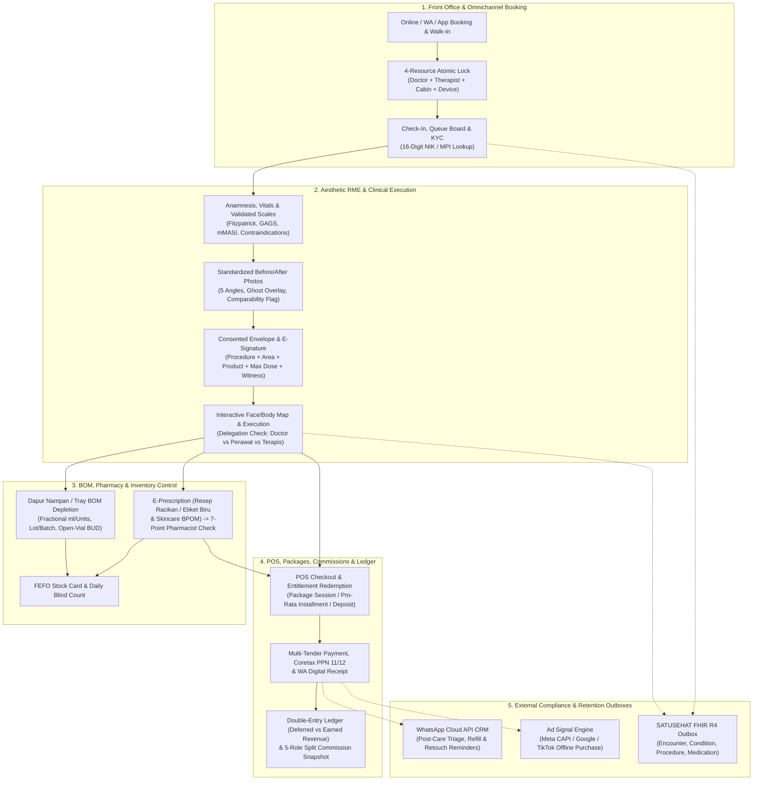

# Indonesian Clinic Management System Standard — Deep Research (Aesthetic & Beauty Clinics)

- **Date**: 2026-10-29
- **Scope**: National regulatory requirements, vendor landscape, functional architecture, clinical safety controls, inventory/pharmacy rules, and financial/commission standards for Clinic Management Systems (*Sistem Informasi Manajemen Klinik* / SIMKlinik and *Rekam Medis Elektronik* / RME) in Indonesia, specialized for **Aesthetic & Beauty Clinics (*Klinik Pratama & Utama Kecantikan*)**.
- **Companion Documents**:
  - [beauty-clinic-research.md](beauty-clinic-research.md) (20-Brand Competitive Landscape)
  - [indonesia-beauty-clinic-admin-dashboard-standard.md](indonesia-beauty-clinic-admin-dashboard-standard.md) (Admin Dashboard, Role Workbenches & KPI Standard)
- **Method**: Synthesis of primary Indonesian health/privacy/tax regulations, SATUSEHAT FHIR R4 specifications, Indonesian SIMKlinik vendor documentation (Aesta by Assist.id, ICONIX, ClinicHub, Klinik Pintar, Medeva, Aoikumo, Zenoti), and operational audit benchmarks.

## Evidence Taxonomy

- **`[REGULATORY]`**: Mandated by Indonesian statute, Ministerial Regulation (*Permenkes* / *PMK*), or official technical decree (*KMK* / *SE*). Verify local enforcement nuances with *Dinas Kesehatan* or legal counsel.
- **`[VENDOR-STANDARD]`**: Shipped as a baseline feature across leading Indonesian aesthetic clinic software vendors and major clinic chains.
- **`[ENTERPRISE-BEST-PRACTICE]`**: Implemented by top-tier multi-branch chains (ERHA, ZAP, SOZO, international med-spa ERPs like Zenoti) to prevent clinical liability, inventory shrinkage, or accounting distortion, though often missing in entry-level SaaS.
- **`[INFERRED]`**: Architect synthesis derived from operational constraints where vendors do not publish internal formulas.

---

## 1. Executive Summary: Why Beauty Clinic Systems Differ from Generic SIMKlinik

In Indonesia, an aesthetic or beauty clinic operates under a dual identity: legally, it is a regulated healthcare facility (*Fasilitas Pelayanan Kesehatan* / *Fasyankes* — either *Klinik Pratama* or *Klinik Utama*) bound by Ministry of Health (*Kemenkes*), BPOM, and Data Protection laws; commercially, it runs like high-frequency retail, hospitality, and subscription commerce.

Generic outpatient clinic software (built for BPJS *Fasilitas Kesehatan Tingkat Pertama* or general practice) fails in beauty clinics due to **six structural divergences**:

1. **Multi-Resource Scheduling vs. Single Queue**: A general clinic books a patient into a doctor's queue. A beauty clinic must atomically lock **four resources** per appointment: Attending Doctor + Executing Nurse/Beautician + Treatment Cabin/Bed + Shared Energy Device (e.g., Pico laser, HIFU, RF machine).
2. **Visual & Anatomical RME vs. Text SOAP**: Aesthetic care requires interactive anatomical Face/Body Maps (marking injection points, depths, neurotoxin units, filler ml, and laser fluences), validated skin severity scales (GAGS, mMASI, Fitzpatrick), standardized Before/After photography with comparability checks, and procedure-bound digital Informed Consent.
3. **Fractional BOM & Dual-Track Pharmacy**: One visit combines clinical consumables (*Bahan Habis Pakai* / BHP deducted down to fractional ml, units, or laser shots), open multi-dose vials with strict Beyond Use Dates (BUD), patient-specific blue-label compounded creams (*obat racikan beretiket biru*), and BPOM-registered retail skincare (*etiket putih* / OTC).
4. **Complex Entitlements, Packages & Deferred Revenue**: Beauty clinics sell multi-session treatment series (e.g., 6x Laser), mixed bundles, 0% in-house installments, and prepaid deposit wallets. Recognizing package cash as immediate revenue—instead of unearned liability redeemed per session—distorts clinic P&L and breaks refund/breakage accounting.
5. **Multi-Party Split Commissions**: A single invoice can trigger up to five distinct fee attributions: Consulting Doctor, Executing Doctor, Assisting Nurse, Facial Therapist (*Beautician*), and Closing Beauty Consultant/Front Office—calculated on list price, net after discount, or net of BHP cost.
6. **Strict Competency & Advertising Guardrails**: Under **UU No. 17 Tahun 2023** and **PP No. 28 Tahun 2024**, non-healthcare staff (*terapis/beautician*) cannot legally perform invasive procedures or operate medical energy devices. A compliant system enforces delegation limits in software rather than relying on front-desk memory.

---

## 2. Regulatory & Compliance Standard in Indonesia (`[REGULATORY]`)

Every clinic management system operating in Indonesia must satisfy seven overlapping regulatory regimes:

### 2.1 Electronic Medical Records — Permenkes No. 24 Tahun 2022 & KMK 1423/2022

| Requirement | Statutory Basis | System Implementation Standard |
|---|---|---|
| **Mandatory RME** | Permenkes 24/2022 Pasal 3; SE Menkes HK.02.01/MENKES/1030/2023 | 100% digital medical records. Non-compliance risks administrative sanctions from written warning to revocation of accreditation and operational license (*izin operasional*). |
| **PSE Registration** | Permenkes 24/2022 Pasal 10–11 | Software vendor or self-developing clinic must register as a *Penyelenggara Sistem Elektronik* (PSE) with Komdigi (formerly Kominfo) and register the RME system with Kemenkes. |
| **Standardized Variables & Metadata** | KMK No. HK.01.07/MENKES/1423/2022 | Must implement the national variable dictionary: 16-digit NIK patient identity, standardized outpatient clinical sheets, ICD-10 (diagnosis), ICD-9-CM (procedures), SNOMED-CT (clinical findings), LOINC (lab/observations), and KFA (*Kamus Farmasi dan Alat Kesehatan*). |
| **2×24-Hour Correction Lock** | Permenkes 24/2022 Pasal 30(6)–(7) | Clinical entries are editable **only by the original authoring clinician within 2×24 hours** of input. After 48 hours, signed clinical records must be immutable; any clinical amendment requires an append-only **Addendum Version** with reason code and Medical Director co-signature (`[ENTERPRISE-BEST-PRACTICE]`). Administrative data fixes after 48h require PMIK (*Perekam Medis dan Informasi Kesehatan*) or facility head approval. |
| ** Certified Electronic Signature (TTE)** | Permenkes 24/2022 Pasal 19, Pasal 29 | Clinical documents, prescriptions, and informed consents require legally valid electronic signatures/authentication tied to the practitioner's active credentials (STR/SIP). |
| **Minimum 25-Year Retention** | Permenkes 24/2022 Pasal 39 | Digital RME data must be retained for **at least 25 years** from the patient's last visit (`last_encounter + 25 years`). Automated deletion is prohibited; destruction after 25 years requires a formal *Berita Acara* approved by the Medical Director and Owner. |
| **Domestic Data Residency & Backup** | Permenkes 24/2022 Pasal 20(4)–(5), Pasal 22 | RME servers and off-site backups must be stored **inside Indonesian jurisdiction** with periodic restore testing documented in SOPs. |

### 2.2 National Interoperability — SATUSEHAT Platform (HL7 FHIR R4)

Under Permenkes 24/2022 Pasal 21, clinic systems must bridge to Kemenkes's **SATUSEHAT** platform via HL7 FHIR R4 APIs.

- **Required Master Identifiers**:
  - Facility `Organization` & `Location` (mapped to Kemenkes *Kode Fasyankes*).
  - `Practitioner` validated against **SISDMK** / **IHS Number** using NIK, active STR (*Surat Tanda Registrasi*), and facility-specific SIP (*Surat Izin Praktik*).
  - `Patient` resolved against the **Master Patient Index (MPI)** using 16-digit NIK (or the official SATUSEHAT No-NIK/infant/foreigner passport flow).
- **Mandatory Outpatient (*Rawat Jalan*) FHIR Resource Sequence**:
  1. **`Encounter`**: Sent at check-in (`arrived` → `in-progress`) and closed upon visit completion (`finished`).
  2. **`AllergyIntolerance`**: Drug, food, topical/cosmetic ingredient, or latex allergies recorded during intake.
  3. **`Observation`**: Vital signs (blood pressure, pulse, temperature) and structured physical findings.
  4. **`Condition`**: Primary and secondary diagnoses coded in **ICD-10** (e.g., `L70.0` Acne vulgaris, `L81.1` Chloasma/Melasma, `L57.8` Photoaging) linked to `Encounter.diagnosis`.
  5. **`Procedure`**: Medical procedures performed, coded in **ICD-9-CM** / SNOMED-CT.
  6. **`MedicationRequest` & `MedicationDispense`**: Prescriptions and pharmacy dispensing mapped to **KFA** (*Kamus Farmasi dan Alat Kesehatan*) codes.
- **Aesthetic Clinic Nuance — The Missing-NIK & Elective Privacy Edge Case (`[ENTERPRISE-BEST-PRACTICE]`)**:
  - High-profile aesthetic patients frequently hesitate to hand over their KTP/NIK at first check-in. A compliant clinic system never blocks care: it registers the visit locally under `IDENTITY_PENDING`, queues the FHIR payload in a durable **SATUSEHAT Outbox**, performs an MPI lookup by Name + Exact DOB + Sex, and releases the outbox payload once front-desk staff verify the physical ID.

### 2.3 Clinical Competency, Delegation & Informed Consent — UU No. 17 Tahun 2023 & PP No. 28 Tahun 2024

| Rule Area | Statutory Basis | Mandatory System Enforcement |
|---|---|---|
| **Clinical Delegation (*Mandat* vs. *Delegatif*)** | UU 17/2023 Pasal 290; PP 28/2024 Pasal 745 | Delegation of medical acts is legal **only between licensed *Tenaga Medis* (Doctors/Sp.DVE) and licensed *Tenaga Kesehatan* (Nurses/Pharmacists)**, and the facility head must formally define which services may be delegated. Under *Mandat*, medical responsibility remains with the ordering doctor. |
| **Non-Nakes (*Terapis / Beautician*) Hard Boundary** | UU 17/2023 Pasal 290; PP 28/2024 Pasal 745 | *Terapis kecantikan* / *beauticians* are **not** *Tenaga Kesehatan*. They may perform non-invasive cosmetic care (cleansing, facial massage, masks, basic prep) but **must be blocked by the system** from being assigned as executor on services flagged `invasive`, `injectable`, `energy_device` (medical lasers/HIFU), or `prescription`. |
| **Doctor-Only High-Risk Procedures** | Clinical governance standard | Botulinum toxin, dermal fillers, thread lifts (*tanam benang*), deep chemical peels, and ablative lasers must be locked to practitioners holding an active Doctor SIP at that branch. |
| **Written Informed Consent (*Persetujuan Tindakan*)** | UU 17/2023 Pasal 293(1)–(8) | Mandatory before any invasive or high-risk procedure. Must record explanation of diagnosis, procedure purpose, risks/complications, alternatives, and prognosis, signed by the patient (or legal guardian if `<18`) and **witnessed by a credentialed health worker**. |
| **Re-Consent Envelope (`[ENTERPRISE-BEST-PRACTICE]`)** | Derived from UU 17/2023 Pasal 293 | Consent should bind to an explicit clinical envelope: `Procedure + Anatomical Area + Product Class + Maximum Dose/Units`. If the doctor adds an area, switches product class, or exceeds the consented maximum dose during the visit, the system blocks sign-off until a re-confirmation signature is captured. |

### 2.4 Pharmacy, Blue-Label Compounding & Stock Control — Permenkes 34/2021, Permenkes 73/2016 & BPOM

1. **7-Point Prescription Verification (Permenkes 34/2021 Pasal 7–11)**:
   - Every electronic prescription (*resep elektronik*) must pass pharmacist (*Apoteker* with active SIPA) verification across: (1–2) Administrative checks (patient identity, doctor SIP, date), (3) Pharmaceutical suitability (dosage form, stability, incompatibility), (4–6) Clinical checks (allergy cross-check, dose/duration, duplication/interactions), and (7) Dispensing & documented patient counselling.
2. **Blue-Label (*Etiket Biru*) vs. BPOM Retail Skincare**:
   - **BPOM Regulation & Enforcement**: Compounded creams (*obat racikan*) prepared for an individual patient based on a doctor's prescription must carry a **Blue Label (*Etiket Biru*)** for external use (*"OBAT LUAR — TIDAK UNTUK DITELAN"*). They cannot be mass-produced, stocked on shelves for walk-in buyers without a prescription, or advertised publicly.
   - **Mandatory Blue-Label Fields**: Clinic name/address/phone, Pharmacist name + SIPA number, prescription number & date, prescribing doctor, patient full name + DOB/age, active composition/strength, morning/night instructions, storage condition, and **Beyond Use Date (BUD)**.
   - **BUD Calculation Standard (Kemenkes / USP `<795>` guidelines)**:
     - Non-preserved aqueous topical preparation: max **14 days** at refrigerator temperature ($2\text{--}8^\circ\text{C}$).
     - Preserved water-containing topical preparation: max **35 days** at controlled room temperature.
     - Nonaqueous / water-free topical formulation: max **180 days**.
     - *Hard invariant*: BUD can never exceed the earliest factory expiration date of any component batch.
3. **Open-Vial & Injectable Safety (CDC / USP `<797>` / ASDS / IFU Standards)**:
   - **Reconstituted Botulinum Toxin**: Label IFU specifies **24 hours** at $2\text{--}8^\circ\text{C}$ (any clinic policy extending beyond 24h under ASDS consensus requires explicit Medical Director + Pharmacist maker-checker sign-off and daily blind unit audits).
   - **Preserved Multi-Dose Vials (MDV)**: Max **28 days** after first needle puncture, never past factory expiry, and never stored inside open patient treatment rooms.
   - **Single-Dose Vials, HA Fillers, Skin Boosters & PDO Threads**: Strictly single-patient, single-session; any unused residual must be discarded at the end of the session.
4. **Stock Cards (*Kartu Stok*), FEFO & Witnessed Disposal**:
   - Permenkes 73/2016 requires item-level stock cards tracking batch/lot number, factory expiry, quantity in/out, and running balance with strict **FEFO** (*First Expired, First Out*).
   - Expired, cold-chain compromised, or broken vials cannot be silently adjusted to zero; they require a formal **Berita Acara Pemusnahan** signed by the Pharmacist and a licensed witness (plus Dinkes/BPOM witnessing for psychotropics/narcotics under Permenkes 5/2023).

### 2.5 Personal Data Protection & Medical Advertising — UU PDP No. 27 Tahun 2022 & Permenkes 1787/2010

- **UU No. 27 Tahun 2022 (UU PDP)**:
  - Health data and identifiable clinical facial/body photographs are **Specific Personal Data (*Data Pribadi Spesifik*, Pasal 4(2))**.
  - A compliant system separates patient consent into **five distinct, auditable purposes**:
    1. `RME_HEALTHCARE_SERVICE`: Mandatory notice acknowledgement (lawful basis: statutory obligation under Permenkes 24/2022 + healthcare contract; not withdrawable for erasure before 25 years).
    2. `MEDICAL_PROCEDURE_EXECUTION`: Per-procedure written *Informed Consent* (UU 17/2023 Pasal 293).
    3. `INTERNAL_CLINICAL_PHOTO`: Explicit opt-in for clinical progress photos inside the RME.
    4. `WHATSAPP_CRM_MARKETING`: Explicit, default-OFF opt-in for promotional broadcasts (withdrawable anytime under UU PDP Pasal 43 without affecting clinical reminders).
    5. `PUBLIC_MEDIA_TESTIMONIAL`: Explicit, separate release for social media/website publication.
- **Permenkes No. 1787/MENKES/PER/XII/2010 (Healthcare Advertising Rules)**:
  - Prohibits publishing patient testimonials, misleading before/after comparisons in mass media, using healthcare workers (*tenaga kesehatan*) as advertising models, advertising prescription/compounded (*etiket biru*) drugs, or using superlative guarantees (*"terbaik"*, *"dijamin sembuh permanen"*).

### 2.6 Indonesian Tax & Accounting Compliance — PMK 131/2024, PER-11/PJ/2025, PP 49/2022 & Coretax

- **Medical Exemption vs. Taxable Aesthetic/Retail Supplies**:
  - Under **PP No. 49 Tahun 2022 Pasal 11**, medical health services (*jasa pelayanan kesehatan medis*) provided by licensed medical practitioners are **exempt from PPN (*dibebaskan dari pengenaan PPN*, Coretax Kode 08)**.
  - However, the Directorate General of Taxes (*DJP / Kring Pajak*) classifies non-medical cosmetic treatments and all skincare/cosmetic product sales in beauty clinics as **Taxable Goods/Services (*BKP/JKP*, Coretax Kode 04)**.
  - **PMK No. 131 Tahun 2024 & PMK No. 11 Tahun 2025**: Non-luxury taxable goods and aesthetic services use the **DPP Nilai Lain (11/12)** mechanism against the 12% statutory PPN rate, yielding an **11% effective PPN rate**. Because DJP's **Coretax** portal does not automatically multiply by $11/12$ on XML import, the clinic POS must compute `DPP = round_half_up(11/12 * TaxBase)` and `PPN = round_half_up(12% * DPP)` to whole Rupiah per **PER-11/PJ/2025 Pasal 129**.
  - **Mixed Bundles**: When a clinic sells a package combining doctor medical consultations (`bebas_medis`) with aesthetic facials and retail creams (`kena_pajak`), the POS must allocate installment and bundle payments **pro-rata by frozen line value** so tax-exempt and taxable bases remain auditable.

### 2.7 Clinic Accreditation (*Akreditasi Klinik*), MFK & National Quality Indicators (INM) — Permenkes 34/2022, KMK 1983/2022, Permenkes 30/2022 & Permen LHK 56/2015

To achieve and maintain **Akreditasi Klinik Kemenkes (*Paripurna*)** and pass Dinkes/environmental audits, an Indonesian beauty clinic management system must also enforce:

1. **Klinik Pratama vs. Klinik Utama Competency Boundary (`KMK No. HK.01.07/MENKES/1983/2022`)**:
   - **Klinik Pratama** is led by a General Practitioner (*Dokter Umum* with verified aesthetic training) and is limited to basic medical and non-invasive/minimally invasive aesthetic care.
   - **Klinik Utama** is led by a Specialist Doctor (**Sp.DVE / Sp.KK** or **Sp.BP-RE**) and is required for specialist-level invasive aesthetic procedures (deep structural fillers, surgical thread lifts, high-powered ablative lasers, blepharoplasty, liposuction).
   - **System Enforcement**: The service catalog must bind high-risk procedures to `required_facility_class = UTAMA` and active specialist `SIP` credentials (`Bab I TKK`), plus auto-block any practitioner whose `STR`, `SIP`, `SIPP`, or `SIPA` has expired.
2. **MFK (*Manajemen Fasilitas dan Keselamatan*) & *Limbah B3 Medis* (`Bab I MFK` & `Permen LHK No. 56 Tahun 2015`)**:
   - **Alkes Calibration & Laser Shot-Counter Audit**: Tracks Kemenkes AKL/AKD numbers, annual calibration certificates (*BPFK / LPK Terakreditasi*), autoclave sterilization logs, and daily **Hardware Laser/HIFU Handpiece Shot Counter vs. Billed RME Shots** reconciliation (`unbilled_shot_variance = hardware_delta - rme_billed_shots`) to prevent unauthorized staff "ghost treatments".
   - **Limbah B3 Medis & TPS Manifest Ledger**: Tracks daily infectious and sharp waste weight (used Botox/filler syringes, needles, ampoules, blood swabs) entering *TPS Limbah B3*, maximum storage day limits, licensed 3rd-party B3 transporter PKS expiry, and manifest handovers (*Festronik*).
3. **PMKP (*Peningkatan Mutu dan Keselamatan Pasien*) & 4 Mandatory INMs (`Permenkes No. 30 Tahun 2022`)**:
   - Tracks the **4 Mandatory Clinic National Quality Indicators (INM)**: (1) *Kepatuhan Kebersihan Tangan* ($\ge 85\%$), (2) *Kepatuhan Penggunaan APD* ($100\%$), (3) *Kepatuhan Identifikasi Pasien* ($100\%$ — auto-verified via dual-identifier check before RME/Rx execution), and (4) *Kepuasan Pasien / IKM* ($\ge 76.61\%$), alongside the **Insiden Keselamatan Pasien (IKP: KTD, KTC, KNC, KPC)** register.

---

## 3. Indonesian Clinic Management System Vendor Landscape (`[VENDOR-STANDARD]`)

Beauty clinics in Indonesia choose from three tiers of software providers: local specialist SaaS platforms, regional/global enterprise med-spa ERPs, and proprietary in-house systems built by the top national chains.

### 3.1 Vendor Comparison Matrix

| Vendor / Platform | Category & Origin | Target Clinic Scale | Published Pricing (IDR) | SATUSEHAT & PSE Status | Key Aesthetic & Operational Strengths | Known Limitations / Gaps |
|---|---|---|---|---|---|---|
| **Aesta by Assist.id** (*Aesta Lite / Pro*) | Indonesian Specialist SaaS (Assist.id ecosystem) | Single clinic to mid/large multi-branch chains | Custom quote (*Hubungi Kami*; base Assist.id tiers start from hundreds of thousands to millions/mo) | Live SATUSEHAT bridge, BPJS PCare, PSE registered | Dedicated aesthetic RME, automatic BHP stock deduction per treatment, package session tracking, multi-role commissions, BI dashboard, patient portal. | Custom enterprise pricing; advanced accounting (deferred revenue/breakage) and strict open-vial BUD timers require custom SOPs. |
| **ICONIX** (*Software Klinik Kecantikan*) | Indonesian Specialist SIMKlinik (est. 2007) | Single to multi-branch aesthetic & dental clinics (650+ clinics claimed) | Custom quote (subscription or license tiers) | Verified SATUSEHAT RME & Komdigi PSE registered | Mature multi-level doctor/beautician commission engine, package/membership tiers, before-after photo storage, WhatsApp booking reminders, lab & pharmacy modules. | Legacy UI patterns in older modules; clinical photo comparability checks are manual. |
| **ClinicHub OS** | Indonesian Specialist Aesthetic SaaS | Growing aesthetic clinics wanting branded digital presence | Custom quote | SATUSEHAT integrated | **White-label mobile app** under the clinic's own brand, AI-powered WhatsApp CRM & automated follow-ups, online booking, aesthetic RME, POS, inventory. | Focused on growth/CRM and standard operations rather than deep hospital-grade clinical governance. |
| **Aplikasi Klinik Pintar** (*Modul Kecantikan*) | Indonesian Cloud SIMKlinik | Solo practices, *Klinik Pratama*, and growing chains | **Mandiri**: Rp0 (free, 1 poli, 4 users) **Siap**: Rp300k/mo **Tumbuh**: Rp600k/mo (multi-branch) | Live SATUSEHAT & BPJS PCare bridge, PSE registered | Transparent low pricing, anatomical face/body charting, before/after photos, deposit & package balance tracking, automated doctor/therapist commissions. | Entry-level commerce rules; does not natively enforce complex mixed-bundle installment unlocking, loyalty clawback ledgers, or strict vial BUD timers. |
| **Medeva** | Indonesian Cloud RME & SIMKlinik | *Klinik Pratama / Utama*, aesthetic & dental | Custom quote (demo-based) | Live SATUSEHAT & BPJS bridge | Customizable aesthetic RME & face maps, package tracking, pharmacy/inventory integration, multi-branch support. | Requires configuration per clinic for complex commission splits. |
| **Aestech** | Indonesian Niche Beauty Clinic SaaS | Small-to-mid beauty clinics | Rp300k – Rp2.5M/mo | Claims RME compliance | Tailored for local skincare/facial clinics: POS, packages, therapist commissions, stock. | Smaller ecosystem than Assist.id or Klinik Pintar. |
| **Aoikumo** | Regional SEA Aesthetic ERP (Malaysia) | Mid-to-premium aesthetic clinics in SEA | Tiered USD/MYR SaaS subscription | Requires local bridge/middleware for SATUSEHAT | Purpose-built for medical aesthetics: interactive skin charting, course/package redemptions, laser shot tracking, multi-branch inventory, companion tablet app. | Not natively built around Indonesian SATUSEHAT FHIR, BPOM blue-label formatting, or DJP Coretax 11/12 XML exports. |
| **Zenoti** | Global Enterprise Med-Spa ERP | Tier-1 chains (10–100+ branches) | Enterprise USD contract | No native SATUSEHAT bridge (requires custom integration) | Industry benchmark for **Guided Photo Manager** (ghost overlays), enterprise package/membership accounting, complex 70/30 split commissions, and multi-center inventory. | High USD cost; lacks native Indonesian regulatory modules (SATUSEHAT, KFA, Coretax, Permenkes 24/2022 2×24h lock). |

### 3.2 How Top Indonesian Beauty Clinic Chains Run Their Systems (`[VENDOR-STANDARD]`)

Cross-referencing the 20 brands in [beauty-clinic-research.md](beauty-clinic-research.md) reveals how market leaders deploy technology as a competitive moat:

1. **ERHA Group (`ERHA Buddy` + Intelligent DermaBeauty System)**:
   - Operates a proprietary patient super-app (`ERHA Buddy`) connected to its internal clinic ERP across 109+ branches. Patients book doctor consultations or treatments, join tele-dermatology sessions, view digital skin histories, and buy prescribed (*resep dokter*) or OTC skincare with automated refill cycles.
2. **ZAP Group (`ZAP Apps` + Centralized Outlet ERP)**:
   - Built around high-throughput laser and routine care across 100+ outlets. Its signature operational feature is **national cross-branch package portability** (*ZAP Series* and *Membership* balances redeemable at any ZAP Clinic) backed by strict laser shot/consumable reconciliation and transparent uniform pricing.
3. **MS GLOW Aesthetic Clinic (`MS Glow Smart Clinic` App)**:
   - Provides mobile reservation, live doctor schedule lookup, **real-time queue visibility**, and in-app payment—solving the walk-in waiting room bottleneck common in founder-led clinics.
4. **Natasha Skin Clinic**:
   - Uses a branch-segmented ERP architecture across 104+ listed branches where clinical histories are centralized, but **price lists and promotions are dynamically scoped by regional tier** (Java vs. outer islands / Tier-2 and Tier-3 cities).
5. **NMW & Airin Skin Clinic**:
   - Expose **branch-specific doctor schedules and doctor selection** directly on their public web booking flows, reducing trust friction for doctor-led injectable and procedural visits.

---

## 4. Deep Functional Architecture: The 8 Core Modules of an Indonesian Beauty Clinic System

Below is the comprehensive architectural specification for a production-grade Indonesian beauty clinic management system, combining regulatory compliance (`[REGULATORY]`), vendor table stakes (`[VENDOR-STANDARD]`), and leak-proof enterprise controls (`[ENTERPRISE-BEST-PRACTICE]`).

### Module 1: Front-Office, Identity (KYC) & 4-Resource Scheduling

1. **Omnichannel Appointment & Walk-In Registration**:
   - Supports online web/app booking, WhatsApp chat booking, and front-desk walk-in registration for new and returning patients.
   - **Shared-Phone & Family Profiles**: In Indonesia, one WhatsApp number often manages appointments for a spouse, teenage child, or parent. The system models `1 Phone Login -> N Patient Profiles`, requiring parent/guardian co-signing for patients under 18 (`UU PDP Pasal 25`, `UU 17/2023 Pasal 293(7)`) and blocking clinical record leakage across adult family members sharing a commercial package.
2. **4-Resource Atomic Scheduling Engine**:
   - Prevents double-booking by simultaneously reserving:
     1. **Consulting / Executing Doctor** (checked against active shift roster and branch SIP).
     2. **Assisting Nurse or Executing Beautician** (checked against shift roster and competency matrix).
     3. **Treatment Room / Cabin / Bed** (e.g., VIP Cabin, Laser Room, Facial Bed 1–10).
     4. **Shared Medical Device** (e.g., single Pico Laser or Ultherapy/HIFU unit shared across multiple rooms).
3. **Practitioner Roster (*Jadwal Praktik*) & Queue Display**:
   - Maintains weekly/monthly shift schedules, leave overrides, and room assignments for doctors, nurses, and therapists.
   - Drives waiting-room queue boards (*nomor antrean poli/kabin*) and public doctor-schedule pages.
4. **No-Show & Late-Arrival Governance**:
   - Configurable grace window (default **15 minutes**), after which the slot transitions to `RELEASED_NO_SHOW` to free the cabin and laser machine for walk-ins, while incrementing `no_show_count`. Repeat no-shows (`>= 2`) automatically trigger a front-desk confirmation or booking deposit requirement (`[ENTERPRISE-BEST-PRACTICE]`).

### Module 2: Aesthetic Electronic Medical Record (*RME Estetika*)

1. **Layered Clinical Charting**:
   - Separates internal clinical reasoning from patient-portal summaries:
     - **Layer 1 — Anamnesis & Contraindication Screening**: Chief complaint, skincare regimen history, allergies (`AllergyIntolerance`), and hard aesthetic contraindication flags (pregnancy, breastfeeding, recent isotretinoin use, keloid history, herpes simplex, pacemaker/metal implants for RF, autoimmune conditions).
     - **Layer 2 — Structured Skin Assessment**: Clinician-assessed **Fitzpatrick Skin Type (I–VI)** (critical for laser fluence safety in Indonesian skin types III–V), plus versioned severity scales such as **GAGS** (*Global Acne Grading System*, 0–44) and **mMASI** (*modified Melasma Area and Severity Index*, 0–24).
     - **Layer 3 — Care Plan & Consented Envelope**: Multi-visit treatment roadmap linking target skin conditions to recommended procedures and homecare regimens.
     - **Layer 4 — Procedure Execution Log**: Exact parameters delivered during the session.
2. **Interactive Anatomical Face & Body Map**:
   - Vector-based multi-angle canvas (Frontal, Left/Right Oblique, Left/Right Lateral, Neck/Body) where clinicians plot:
     - **Injectables (Botox, Fillers, Skin Boosters)**: Exact injection points/vectors, anatomical zone, depth (intradermal, subdermal, supraperiosteal), instrument (needle gauge vs. cannula), units or ml per point, and linked batch/lot number.
     - **Energy Devices (Laser, IPL, HIFU, Microneedling RF)**: Handpiece/wavelength (e.g., 1064nm, 755nm, 532nm), fluence ($J/cm^2$), pulse duration, spot size (mm), pass count, total shots delivered, and cooling/topical anesthesia duration.
     - **Threads (*Tanam Benang*)**: Entry point, vector direction, thread type (PDO/PLLA/PCL, cog/mono), length, and thread count.
3. **Standardized Clinical Photography Protocol**:
   - Enforces a 5-angle capture checklist (frontal, $45^\circ$ oblique R/L with full body turn, $90^\circ$ lateral R/L; hair tied back, no makeup, Frankfurt plane horizontal, fixed diffuse lighting, ghost overlay alignment).
   - Automatically computes a comparability badge (`COMPARABLE`, `LIMITED`, or `NOT_COMPARABLE`) so doctors and patients never misinterpret lighting or angle shifts as clinical progress.
4. **Immutable Sign-Off & 2×24h Addendum Workflow**:
   - Enforces Permenkes 24/2022 Pasal 30: once signed by the doctor, edits within 48 hours are logged as author revisions; after 48 hours, changes require a co-signed clinical addendum.

### Module 3: Clinical Delegation Guardrails & Tray BOM Depletion

1. **System-Enforced Delegation Matrix (`UU 17/2023 Pasal 290` & `PP 28/2024 Pasal 745`)**:
   - Each catalog service carries a regulatory classification (`NON_INVASIVE_COSMETIC`, `NURSING_MANDATE_ALLOWED`, `DOCTOR_ONLY_INVASIVE_OR_ENERGY`).
   - The system physically blocks assigning a *Terapis/Beautician* to any service flagged `invasive`, `injectable`, `energy_device`, or `prescription`, and requires an active Doctor order (*Mandat*) and on-site supervision record whenever a *Perawat* executes a delegated clinical step.
2. **Bill of Materials (BOM) & *Dapur Nampan* (Treatment Tray) Accounting**:
   - Every treatment defines a standard BOM (e.g., *Facial Acne*: 1x cleanser 5ml, 1x peel solution 2ml, 1x comedone needle, 2x sterile gauze, 1x mask; *Botox Masseter*: 40 units toxin from reconstituted vial, 1x insulin syringe, 2x alcohol swabs).
   - When the clinician signs off the treatment, the system deducts exact fractional quantities from the cabin/tray sub-inventory. Any variance between planned BOM and actual usage (e.g., extra syringe or spilled serum) requires a reason code, preventing silent BHP shrinkage.

### Module 4: Pharmacy (*Instalasi Farmasi*), Compounding & Inventory Control

1. **End-to-End Purchasing & Multi-Location Stock**:
   - Supports the complete supply chain: `Supplier Master` → `Purchase Order (PO)` → `Goods Receipt Note (GRN)` (capturing supplier invoice, batch/lot number, factory expiry date, and cold-chain check) → `Main Warehouse` → `Internal Transfer` to `Pharmacy Dispensing` or `Treatment Cabin Tray (Dapur Nampan)`.
2. **E-Prescription & Automated Blue-Label (*Etiket Biru*) Engine**:
   - Doctors prescribe directly from the RME exam screen (selecting ready-made BPOM skincare, ethical drugs, or custom compounded formulas).
   - Pharmacists execute the mandatory **7-point review** (Permenkes 34/2021) and print compliant **Blue Labels** with auto-calculated BUD (14d / 35d / 180d capped by component batch expiry) and storage rules.
   - **Refill Cooldown Guardrail**: Prevents premature re-dispensing of active prescription topicals (e.g., tretinoin/hydroquinone compounds) before $75\%$ of the estimated days' supply has elapsed unless overridden by a doctor with a clinical reason.
3. **Open-Vial BUD Timer & Daily Blind Stock Opname**:
   - Puncturing a multi-dose vial (e.g., 100-unit Botulinum Toxin vial) starts a live countdown timer (`opened_bud_hours`, default 24h for toxin at $2\text{--}8^\circ\text{C}$, max 28d for preserved MDVs). Once the timer lapses, the system locks the remaining units from being assigned to any patient and routes the vial to disposal.
   - High-value injectables and psychotropics require **Daily Blind Counts** (staff enter physical count before seeing system balance); variances beyond tolerance trigger a manager/pharmacist investigation.

### Module 5: POS, Aesthetic Commerce, Packages & Tax Engine

1. **Treatment Packages (*Paket Series*), Mixed Bundles & Installments**:
   - Tracks patient entitlements with purchase date, validity period (e.g., 12 months), frozen unit price, and remaining session balance.
   - **Pro-Rata Installment Unlocking (`[ENTERPRISE-BEST-PRACTICE]`)**: When a patient buys a Rp12,000,000 6-session laser package on a 3-term 0% clinic installment and pays Term 1 (Rp4,000,000), the system unlocks `floor(4,000,000 / 2,000,000) = 2 sessions`—preventing patients from consuming all 6 sessions after paying only a down payment.
   - **Shared & Multi-Branch Packages**: Allows an adult package owner to authorize named family beneficiaries (for commercial redemption only, never exposing clinical RME) and supports cross-branch redemption with inter-branch clearing journals.
2. **Prepaid Deposit Wallet & Loyalty Points**:
   - Tracks patient cash deposits (*Saldo Deposit*) by funding lineage (fresh cash vs. converted package refund).
   - Loyalty points and sales commissions are credited **only when deposit value is spent on an eligible service/product**, not at top-up—eliminating loyalty/commission abuse via deposit top-up and refund cycles.
   - **UU No. 8 Tahun 1999 Pasal 13(2) Guardrail**: Loyalty points and promotional freebies are restricted to non-medical cosmetic retail items and blocked on medical prescriptions/indications.
3. **Multi-Tender Checkout, Shift Close (*Tutup Kasir*) & Digital Receipts**:
   - Supports split payments across Cash, QRIS, EDC Debit/Credit, Virtual Account, Bank Transfer, Deposit Balance, and Vouchers.
   - Generates itemized PDF/WhatsApp receipts and **DJP Coretax XML exports** (separating Kode 08 exempt medical services from Kode 04 taxable aesthetic services/skincare with $11/12$ DPP Nilai Lain and PER-11/PJ/2025 half-up rounding).
   - Requires mandatory **Cashier Shift Close (*Tutup Kas / Cash Drawer Reconciliation*)** at shift handover, reconciling physical cash and EDC settlement slips against POS system totals.

### Module 6: Multi-Role Commission & Payroll Attribution Engine

In Indonesian beauty clinics, staff compensation is heavily performance-driven and represents one of the highest sources of back-office manual spreadsheet errors. A standard system automates **five distinct commission streams**:

| # | Commission Stream | Eligible Roles | Standard Trigger | Calculation Basis Options | Indonesian Market Practice & Anti-Leakage Rules |
|---|---|---|---|---|---|
| 1 | **Consultation Fee (*Jasa Medis Konsultasi*)** | Attending Doctor (GP / Sp.DVE) | Paid Encounter | Flat IDR per consult or % of consultation fee | Paid upon signed RME encounter + settled invoice. |
| 2 | **Medical Procedure Fee (*Komisi Tindakan Medis*)** | Executing Doctor + Assisting Nurse | **Session Executed / Redeemed** | `LIST_PRICE`, `NET_AFTER_DISCOUNT`, or `NET_MINUS_BHP_COST` | Often split (e.g., 80% Executing Doctor / 20% Assisting Nurse) or flat IDR per unit/shot (e.g., per unit of Botox or per cc of filler). Deducting BHP cost before applying % protects clinic margin on expensive injectables. |
| 3 | **Aesthetic Treatment Fee (*Komisi Terapis / Beautician*)** | Beautician / Facial Therapist + Nurse | **Session Executed / Redeemed** | Flat IDR per treatment tier (e.g., Rp15k–Rp50k) or % of service value | Triggered only when the session is clinically completed in the cabin, never when a package is merely sold at the front desk. |
| 4 | **Prescription & Retail Skincare Fee (*Komisi Produk & Resep*)** | Prescribing Doctor, Pharmacist, Beauty Advisor / FO | Paid & Dispensed Invoice | % of net product revenue (tiered by house brand vs. third-party brand) | Separate rates for doctor prescriptions vs. front-desk Beauty Advisor retail upsells. |
| 5 | **Package Closing Fee (*Komisi Penjualan Paket*)** | Beauty Consultant (BC) / Front Office / Sales | Package Payment Settled (or Redeemed) | Small % on cash collected (e.g., 1–3%) or tiered monthly quota bonus | **Critical rule**: Keep upfront closing commissions small and pay the bulk of clinical/therapist commissions at **session redemption**. If a package is refunded, the system automatically computes pro-rata commission clawback or offsets future payroll. |

- **Rule Versioning Invariant (`[ENTERPRISE-BEST-PRACTICE]`)**: Commission rules must be **snapshotted on each paid/redeemed transaction**. Updating a doctor's or therapist's commission rate in October must never retroactively alter historical August or September payroll reports.

### Module 7: Post-Care Triage, Retention CRM & Marketing Signal Engine

1. **Clinical Post-Procedure Triage (3-Tier SLA)**:
   - Aesthetic procedures carry real medical risks (e.g., dermal filler vascular occlusion, vision changes, severe allergic reaction, chemical peel burns).
   - Patient follow-up messages (via WhatsApp or patient portal) route into a 3-tier clinical triage queue:
     - **`RED` (Emergency, target $\le 15\text{ min}$ human contact)**: Vision changes, blanching/white/grey-blue skin, severe escalating pain, facial droop, difficulty breathing. Immediately alerts on-duty Doctor + Nurse and displays emergency/IGD instructions.
     - **`AMBER` (Urgent, target $\le 2\text{ hours}$)**: Blistering, worsening swelling, pus, localized warm erythema.
     - **`GREEN` (Routine, target $\le 1\text{ working day}$)**: Expected mild redness/flaking per care plan.
2. **Automated Lifecycle Retention Flows (WhatsApp Cloud API)**:
   - **H-1 / H-3 hours**: Appointment confirmation & preparation instructions.
   - **H+1 / H+3 days**: Post-treatment downtime check & aftercare guide.
   - **Day 21–25**: Skincare depletion / prescription refill reminder.
   - **Day 21–28**: Monthly facial / laser series next-session booking prompt.
   - **Month 4–5**: Neurotoxin (Botox) or skin-booster retouch reminder.
   - **H-30 / H-14 / H-7 before package expiry**: Mandatory entitlement expiry warnings (required before recognizing expired package breakage).
3. **Closed-Loop Ad Attribution (Meta CAPI / Google Ads / TikTok Events API)**:
   - Most Indonesian clinics run Click-to-WhatsApp (CTWA) or landing-page ads on Meta, Google, and TikTok. Connecting the clinic POS to fire server-side **Offline Purchase / Qualified Visit** signals (with hashed phone/email and transaction value) when the patient actually pays at the cashier trains ad algorithms on real high-ticket buyers rather than cheap WhatsApp chat clickers.

### Module 8: Financial Accounting, Deferred Revenue & Multi-Branch Governance

1. **Deferred Revenue (*Pendapatan Diterima di Muka*) vs. Earned Revenue**:
   - The single biggest financial mistake in Indonesian beauty clinics is recording cash from a 10-session package or deposit top-up as immediate monthly revenue.
   - **Standard Double-Entry Flow**:
     - **At Package / Deposit Sale**: `Debit Cash/Bank` $\rightarrow$ `Credit Unearned Revenue Liability (Pendapatan Diterima di Muka)` + `Credit PPN Keluaran` (tax point follows cash receipt under UU PPN Pasal 11).
     - **At Session Redemption**: `Debit Unearned Revenue Liability` $\rightarrow$ `Credit Earned Treatment Revenue`, while simultaneously booking `Debit COGS (HPP BHP)` $\rightarrow$ `Credit Inventory` and `Debit Commission Expense` $\rightarrow$ `Credit Commission Payable`.
     - **At Package Expiry (Breakage)**: After valid H-30/14/7 reminders have been logged and grace period lapses, remaining unearned liability is released to `Other Income — Expired Package Breakage (Pendapatan Kedaluwarsa Paket)`.
2. **Multi-Branch Catalog & Pricing Governance**:
   - Separates **Clinical Protocol Approval** (indications, contraindications, max dose, consent template, delegation rules — approved centrally by the Medical Director) from **Regional Commercial Pricing** (allowing Tier-1 Jakarta branches and Tier-2/3 regional branches to hold distinct price lists, as practiced by Natasha and ERHA).

---

## 5. Gap Matrix: Typical Local SaaS vs. Enterprise Aesthetic Standard

When evaluating or building a clinic management system in Indonesia, the table below highlights where standard off-the-shelf SaaS (Rp300k–Rp1.5M/month) stops and where enterprise-grade clinic architecture begins:

| Capability Dimension | Typical Local SIMKlinik SaaS (`[VENDOR-STANDARD]`) | Enterprise Aesthetic Clinic Standard (`[ENTERPRISE-BEST-PRACTICE]`) | Operational Risk if Missing |
|---|---|---|---|
| **Booking Resource Lock** | Locks Doctor or Polyclinic queue only | Atomic 4-resource lock (Doctor + Nurse/Therapist + Cabin/Bed + Shared Laser Device) | Double-booked laser machines and idle cabins during weekend peak hours. |
| **Delegation Compliance** | Any staff role can be selected on any service | Hard role-service guardrail (`UU 17/2023 Ps. 290` / `PP 28/2024 Ps. 745`) blocking Beauticians from injectables/lasers | Severe legal/criminal liability and license revocation if a non-nakes performs an invasive act. |
| **RME Edit Lock** | Unrestricted editing by staff or admin | Strict **2×24h lock** (`Permenkes 24/2022 Ps. 30`) + append-only co-signed clinical addendum | Fails Kemenkes RME audit; compromises medico-legal defense in patient disputes. |
| **Before/After Photos** | Simple file upload attachment | Guided 5-angle capture, ghost overlay alignment, lighting metadata, auto comparability flag, 5-purpose UU PDP consent | Unusable photos due to different angles/lighting; UU PDP violation if used in marketing without separate opt-in. |
| **Injectable & Open-Vial Stock** | Deducts whole box/vial at purchase or manual stock adjustment | Fractional unit/ml BOM deduction + live **Open-Vial BUD Timer** (24h toxin / 28d MDV) + daily blind count | High shrinkage/theft of expensive Botox/fillers (*suntik kosong* or unauthorized staff use) and expired-vial infection risk. |
| **Blue-Label Pharmacy** | Generic prescription text printout | 7-point pharmacist verification + compliant **Etiket Biru** generator with auto-calculated USP `<795>` BUD & refill cooldown | BPOM enforcement sanctions during clinic inspection (*razia etiket biru*). |
| **Package & Installment Finance** | Cash basis POS report; unlocks all package sessions immediately on DP | Double-entry **Deferred Revenue** ledger + **pro-rata installment session unlocking** + automated refund cap math | Owner overstates profit, spends unearned cash, and suffers losses when installment patients default after consuming treatments. |
| **Commission Engine** | Single % rate per item; recalculates historical reports if rate is edited | 5-stream split attribution, net-of-BHP basis option, redemption-triggered payout, **immutable rule snapshot per event** | Payroll disputes, margin erosion on discounted packages, and unrecovered commissions on refunded packages. |
| **Taxation (Coretax 2025/2026)** | Flat 11% or 12% text on receipt | Per-item tax classification (`bebas_medis` Kode 08 vs. `kena_jasa_estetika`/`kena_produk` Kode 04), $11/12$ DPP Nilai Lain, PER-11/PJ/2025 half-up rounding, Coretax XML export | Tax audit penalties for mixing exempt medical consultations with taxable aesthetic services/skincare. |
| **Laser Shot-Counter & Kemenkes Accreditation (MFK / PMKP)** | No machine counter tracking; manual paper binders for accreditation | Daily **Hardware Laser Shot Counter vs. Billed RME Shots** reconciliation (`unbilled_shot_variance`), `PRATAMA` vs. `UTAMA` catalog gate, `STR/SIP/SIPA` auto-block, *Limbah B3* TPS ledger, and 4 Mandatory INM (`Permenkes 30/2022`) + IKP tracker | Unbilled staff "ghost treatments" on expensive laser/HIFU cartridges, expired SIP malpractice exposure, and failure to achieve *Akreditasi Klinik Paripurna*. |

---

## 6. Sources & Regulatory References (Accessed 2026-10-29)

### Indonesian Laws & Regulations
1. **Permenkes No. 24 Tahun 2022** tentang Rekam Medis — https://keslan.kemkes.go.id/unduhan/fileunduhan_1662611251_882318.pdf
2. **KMK No. HK.01.07/MENKES/1423/2022** tentang Pedoman Variabel dan Meta Data pada Penyelenggaraan Rekam Medis Elektronik — https://kemkes.go.id/
3. **SE Menkes No. HK.02.01/MENKES/1030/2023** tentang Penyelenggaraan Rekam Medis Elektronik di Fasyankes.
4. **SATUSEHAT Platform Documentation (HL7 FHIR R4 & MPI Pasien No-NIK)** — https://satusehat.kemkes.go.id/platform/docs/id/master-data/master-patient-index/pasien-no-nik/
5. **UU No. 17 Tahun 2023** tentang Kesehatan (Pasal 4, Pasal 290 Pelimpahan Wewenang, Pasal 293 Persetujuan Tindakan) — https://pasal.id/peraturan/uu/uu-no-17-tahun-2023
6. **PP No. 28 Tahun 2024** tentang Peraturan Pelaksanaan UU No. 17 Tahun 2023 (Pasal 745 Mandat dan Delegatif) — https://pasal.id/peraturan/pp/pp-28-tahun-2024/pasal-745
7. **Permenkes No. 34 Tahun 2021** tentang Standar Pelayanan Kefarmasian di Klinik — https://pasal.id/peraturan/permen/permenkes-no-34-tahun-2021
8. **Permenkes No. 73 Tahun 2016** tentang Standar Pelayanan Kefarmasian di Apotek (Etiket Putih vs. Biru, Kartu Stok FEFO, Pemusnahan) — https://iaijatim.id/wp-content/uploads/2019/11/Permenkes-73-2016-Standar-Pelayanan-Kefarmasian-Di-Apotek.pdf
9. **Kemenkes Beyond Use Date (BUD) Guidelines (USP `<795>` reference)** — https://keslan.kemkes.go.id/view_artikel/3147/beyond-use-date-berdasarkan-sediaan-obat
10. **BPOM Enforcement on Blue-Label Skincare (*Skincare Beretiket Biru*)** — https://www.pom.go.id/siaran-pers/penertiban-skincare-beretiket-biru-yang-tidak-sesuai-ketentuan
11. **UU No. 27 Tahun 2022** tentang Pelindungan Data Pribadi (UU PDP) — https://peraturan.bpk.go.id/Download/224884/UU%20Nomor%2027%20Tahun%202022.pdf
12. **Permenkes No. 1787/MENKES/PER/XII/2010** tentang Iklan dan Publikasi Pelayanan Kesehatan — https://pasal.id/peraturan/permen/permenkes-no-1787-menkes-per-xii-2010-tahun-2010
13. **UU No. 8 Tahun 1999** tentang Perlindungan Konsumen (Pasal 13(2), Pasal 18(1)(c)).
14. **PP No. 49 Tahun 2022**, **PMK No. 131 Tahun 2024**, **PER-11/PJ/2025**, & DJP Kring Pajak Explanation on Beauty Clinic PPN — https://news.ddtc.co.id/berita/nasional/1796606/jasa-klinik-kecantikan-kena-ppn-begini-penjelasan-kring-pajak ; https://pajak.go.id/id/artikel/pmk-1312024-tarif-ppn-sebelas-dua-belas
15. **Permenkes No. 34 Tahun 2022** & **KMK No. HK.01.07/MENKES/1983/2022** tentang Standar Akreditasi Klinik (Bab I TKK/MFK, Bab II PMKP, Bab III PKP).
16. **Permenkes No. 30 Tahun 2022** tentang Indikator Nasional Mutu (INM) Pelayanan Kesehatan (4 Mandatory Clinic Indicators).
17. **Permen LHK No. P.56/Menlhk-Setjen/2015** tentang Tata Cara dan Persyaratan Teknis Pengelolaan Limbah B3 dari Fasilitas Pelayanan Kesehatan.

### Clinic Management Software Vendors & Brand Digital Stacks
18. **Aesta by Assist.id** (Software Klinik Kecantikan) — https://assist.id/
19. **ICONIX** (Fitur Software Klinik Kecantikan) — https://www.iconix.id/fcantik.html
20. **ClinicHub OS** (Software Klinik Kecantikan) — https://clinichub.id/software-klinik-kecantikan
21. **Aplikasi Klinik Pintar** (Fitur Klinik Kecantikan & Harga) — https://klinikpintar.id/aplikasiklinik/fitur/kecantikan/detail
22. **Medeva** (SIM Klinik & Estetika) — https://medeva.tech/
23. **Aoikumo** (Aesthetic Clinic & Medi-Spa Management System) — https://www.aoikumo.com/
24. **Zenoti** (Enterprise Med-Spa Platform: Packages, Commissions, Photo Manager) — https://www.zenoti.com/platform/photo-manager ; https://help.zenoti.com/
25. **ERHA Buddy, Connect Digital Lounge & Intelligent DermaBeauty Clinic** — https://erhaultimate.co.id/find-clinic ; https://connect-digital-lounge.aryanoble.co.id/
26. **ZAP Clinic Online Booking & Series System** — https://www.zapclinic.com/online-booking
27. **MS Glow Smart Clinic** — https://msglowclinic.id/
28. **Local REA (`black-magic`) Runtime Evidence Artifacts** — `docs/research/background/rea-scenarios-2026-10/`
