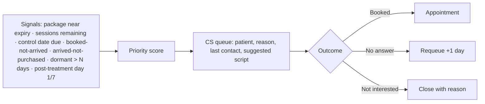

# Same-Niche Platform Benchmark — Additional Inputs for the Beauty Clinic System Blueprint

- Date: 2026-10-29
- Purpose: add features, flows and UI patterns from aesthetic/beauty-clinic platforms **outside the Indonesian set**, then map what is new to `BEAUTY-CLINIC-SYSTEM-BLUEPRINT.md`.
- Method: vendor pages and buyer guides (fetched 2026-10-29), REA screenshot captures of landing pages (`shots/x-*.png`, sheet `sheet-other-platforms.jpg`). Passive only.
- Labels: **DOC** vendor/guide text · **OBS** visible on captured page · **INF** inference. Prices are as published by vendors or third-party guides on the stated dates and change often; comparison guides written by competitors (Pabau, Prospyr, Palyri, Consentz, Kasera, DIRO) are biased toward their authors.

---

## 1. Platforms covered

| Region | Platform | Segment | Pricing seen (DOC) | Why it matters |
|---|---|---|---|---|
| UK/Global | **Pabau** | Aesthetic clinics, med spas | from $62/mo (1 user, ≤100 patients); all features in every plan; scale by users/locations | Quote→plan→auto-appointments, AI scribe, AI skin-result preview, recall tracing on stock |
| US/Global | **Zenoti** | Med spa chains | Custom | Injectable charting depth, guided photo capture, compliance dashboard, AI receptionist/scribe |
| US | **Boulevard** | Appointment-heavy med spas | Essentials $143–179/mo; Premier $234–293; Prestige $328–410; Forms +$65; eRx +$45/prescriber | AI receptionist "Beau", fee-offset model, deposits/no-show protection |
| US | **Mangomint** | Boutique spas | $120/location + $10/user; Phone +$70/line; Marketing +$30; Payroll +$50 + $8/worker | Waitlist auto-fill, booking without account, add-on pricing model |
| US | **Aesthetic Record** | Injector-led practices | $15–19/user/mo + $399 onboarding; ChartSmart AI $30–75/mo; eRx $31–45/mo | Structured injectable documentation, lead sync add-on |
| US | **Prospyr** | Med spas | Quote | Unit-level tox/filler shrinkage tracking, Instagram DM inbox, patient financing, good-faith exams |
| US | **PatientNow, AestheticsPro, Vagaro, Fresha, Meevo, GlossGenius, Calysta, Symplast, 4D EMR, Nextech, ModMed, Moxie, Portrait Care, BoomerangFX** | Various | See guide sources | Financing, insurance, franchise, business-in-a-box models |
| UK/EU | **Clinicminds**, **Consentz** | Aesthetic clinics | Clinicminds from €149/mo; Consentz quote | Quality management (QMS), gift cards, questionnaire builder, "Memory Jog", academy |
| US | **Lobbie, Salus EMR, FlowEHR, Swipe Savvy** | Med spa EMR | FlowEHR from $349/provider/mo | Injection grid overlays, energy-device templates, GoHighLevel bookings |
| Korea | **KOS** (by Gangnam Unni / Healingpaper) | Dermatology & plastic surgery | Quote; 4 weeks new / ≤8 weeks migration | Consultation-centric roles, foreign-patient tax refund, multilingual products, channel price sync, open API + MCP |
| Korea | **AEON B** | Dermatology & plastic surgery | Free application | Role-based "cube" dashboard, full-funnel to consultation, AI CRM, ISO 42001 prep |
| Korea | Gangnam Unni marketplace CRM integration | Marketplace→CRM | — | Marketplace bookings auto-create/merge charts in clinic CRM (Vegas, SmartDoctor, Motion Chart, KOS) |
| Japan | **B4A** | Self-pay/aesthetic clinics | Quote; 600+ clinics | Patented real-time booking, booking-interval and incompatible-treatment rules, service-entitlement tickets, LINE step messages |
| Japan | **KireiPass Connect by GMO** | Self-pay/aesthetic clinics | ¥9k trial / ¥40k Standard / ¥60k Customize / ¥90k Premier per month; ¥0 initial; images 50 GB free | Web pre-questionnaire→EMR, QR check-in with digital patient card, multi-marketplace booking sync, AI voice charting, cancellation-fee partner |
| Japan | **Medical Force, RIPICLE, Kalonade, Kwin Choice** | Self-pay clinics | Kwin from ¥19,800/mo | Room/device/staff resource calendar, QR questionnaire, review/MEO management, LINE booking |
| China | **Aiyoucloud (艾优云)** | Plastic & aesthetic hospitals | Quote; micro-clinic discounts | Consultation SOP, triage, online/phone department, treatment SOP audit trail, mini-program, flash sales & lucky draws, finance-tax compliance |
| China | **Realmerit (睿美云)** | Aesthetic institutions | Quote | AI consultation simulation, smart employee badge (recorded consultations), AI outbound calling, channel distribution |
| China | **Qique (企雀)**, **Linkedcare 悦容**, **Hongmai (宏脉)**, **Yilemei (医乐美, DingTalk)** | Aesthetic | Quote | CA signatures, follow-up task types (booked-not-arrived, arrived-not-purchased), doctor order push by recall cycle, MCP/AI with staff permissions, PDCA process management |
| Thailand | **Flow Clinic** | Thai aesthetic clinics | Demo via LINE | HN/OPD model, course "2 of 6 used", issue stock to treatment room, PromptPay, TH/EN/ZH customer pages, PDPA data in Thailand |
| Thailand | **Keenix** | Beauty/dental/vet clinics | Pro: unlimited branches | Course units, deposit vs top-up credit, doctor fee + assistant fees, RFM, branch BI |
| Thailand | **ClinixMate** | Thai beauty clinics | Demo | Follow-up priority queue from remaining courses, buffet courses, family quota sharing, RFM, cost/profit per procedure, before-after drawing for consultation, digital aftercare link |
| Thailand | **JERA Cloud** | Thai beauty clinics | Standard/Elite/Ultra | Face chart, membership card, online gift vouchers, LINE OA patient self-service, omnichannel chat (LINE/FB/IG) |
| Vietnam | **DSF Health** | Spa/aesthetic/clinic | 99k–399k VND/mo | Per-session consumption quota "per drop of serum", 1-touch technician commission per *tour*, Zalo Mini App loyalty, omnichannel inbox |
| Vietnam | **Faceworks**, **iSpa**, **DYCA**, **Myspa/BeautyX**, **SpaAI** | Spa/aesthetic | Quote / trials | Treatment protocols (phác đồ), affiliate/KOL codes, inter-branch transfer slips, e-invoices, churn-risk AI, QR check-in |
| Singapore/APAC | **Plato** | Specialist & aesthetic clinics (4,000+ providers) | Quote | Credit packages as deposits with liability tracking, accountant login + Xero, BI connectors, Shopify store, lab/radiology results |

---

## 2. Features new or stronger than the current blueprint

Each item: what it is → evidence → where it fits in the blueprint → priority (**M** add to MVP, **G** growth, **S** scale).

### 2.1 Clinical documentation

1. **Injectable record per point: product, units, zone, lot, expiry, provider.** Zenoti, Prospyr, Lobbie, FlowEHR (DOC). → Blueprint S6 face chart: pin type "Injeksi" must carry product, units, lot, expiry; links to batch stock. **M**
2. **Unit-level injectable shrinkage tracking** (units purchased vs units charted vs units billed). Prospyr (DOC). → Inventory + report "Selisih unit injeksi". **G**
3. **Guided photo capture** (overlays, gridlines, face/body guides, predefined sequences, ghost image of previous visit). Zenoti, PatientNow/RxPhoto (DOC). → S6 photo slots get an overlay mode. **G**
4. **Energy-device templates** (laser/RF/IPL/HIFU: wavelength, fluence, spot size, pulses, passes, cooling, skin response) and **injection grid overlays**. Salus, FlowEHR (DOC). → Treatment templates per device. **G**
5. **Compliance dashboard** flagging incomplete charts, missing consent, unsigned notes. Zenoti (DOC); ClinicHub "Consent belum ditandatangani" (prior OBS). → New manager widget + report. **M**
6. **Pre-visit web questionnaire** linked to the booking via QR, answers flow into EMR "0 s transcription". KireiPass, Medical Force, RIPICLE, B4A (DOC). → F1/F2: send intake form after booking; S2/S6 prefill. **M**
7. **Consent sent at booking and signed at home.** Zenoti, Plato, Prospyr (DOC). → F1: consent link in confirmation for procedures needing consent. **G**
8. **Treatment protocols / SOP per procedure with audit trail.** Aiyoucloud (consultation SOP + treatment SOP), Faceworks "phác đồ" (DOC). → Service master gets protocol steps; treatment room checklist records each step. **G**
9. **Doctor orders pushed to patient on recall cycle** (医嘱 by follow-up schedule). Linkedcare (DOC). → F10: aftercare instructions scheduled per protocol. **G**
10. **AI voice charting / scribe** with clinician review. Pabau Scribe, Zenoti, PatientNow, Prospyr, KireiPass (Jul 2026) (DOC). → S6 optional "Rekam suara → draft SOAP"; never auto-finalize. **S**
11. **AI skin analysis / outcome preview** on patient photos (credit-based). Pabau AI Studio (from Aug 2026), Realmerit "AI 面诊模拟" (DOC). → Consultation aid only; label as simulation; consent for photo use. **S**
12. **Good-faith exam / medical director oversight workflows** (US-specific). Prospyr, Moxie (DOC). → Indonesian analogue: supervising doctor sign-off for delegated procedures (already in blueprint principles). —

### 2.2 Consultation and sales (biggest gap)

13. **Consultation as its own stage and role** — Korea: 상담실장 (consultation manager), 코디 (coordinator), 콜상담사 (call counselor) roles; China: 咨询 department with consultation SOP; funnel Exposure → Reservation → Visit → **Consultation** → Payment with **consultation performance** reports. KOS, AEON B, Aiyoucloud (DOC). → Add **Konsultan/BC workspace**: consultation record (concerns, proposed treatments, quote, objections, outcome won/lost/pending), conversion rate per consultant. **M**
14. **Quote → treatment plan → signed & paid online → appointments auto-created.** Pabau (DOC); ClinicHub proforma (prior OBS). → New flow F14 (below). **G**
15. **Patient financing / installments at checkout** (US: third-party financing). Prospyr, PatientNow (DOC). → Indonesia analogue: in-house cicilan + paylater/kartu kredit cicilan via gateway. **G**
16. **Before-after drawing used during consultation** to explain plan. ClinixMate (DOC). → S7 photo comparison gets annotate mode in consultation. **G**

### 2.3 Booking and front office

17. **Booking interval rules and incompatible-treatment rules** (e.g., no laser within X days of peel; minimum interval between sessions). B4A (DOC). → Service master: `min_interval_days`, `incompatible_with[]`; booking validation. **M**
18. **Multi-treatment booking in one slot chain** with auto staff assignment. B4A (DOC). → F1 booking. **G**
19. **Waitlist auto-fill** of cancelled slots. Mangomint, Pabau, Consentz (DOC). → Appointment waitlist (already listed) with automatic offer. **G**
20. **Multi-marketplace booking sync** (own site, LINE, SNS, marketplaces) with cross-channel double-booking prevention; **marketplace booking auto-creates or merges patient chart by phone**. KireiPass, Gangnam Unni CRM integration (DOC). → Indonesian analogue: bookings from website, WA, Instagram, and marketplace/aggregators (e.g., beauty booking apps) into one calendar. **G**
21. **QR check-in + digital patient card** showing bookings, course consumption, points; privacy-safe calling by reception number. KireiPass (DOC). → Patient portal "Kartu digital" + kiosk QR. **G**
22. **Cancellation-fee collection** (card on file / partner). KireiPass+Payn, Boulevard, Mangomint (DOC). → Indonesia: deposit forfeiture policy via booking fee (already) + pay-link for late cancellation. **G**
23. **AI receptionist** answering calls/chats 24/7, booking and capturing leads. Boulevard "Beau", Zenoti, Prospyr, Vagaro "Vera" (DOC). → WhatsApp AI assistant with human handoff (Kasera/ClinicHub pattern already). **S**
24. **Patient arrival-to-treatment wait metrics** (reception→prep→consult→treatment gaps). B4A reports 24 s average under its definition (DOC). → Report "Waktu tunggu per tahap". **G**

### 2.4 Packages, credits, loyalty

25. **Deposit vs top-up credit as separate instruments**; deposit to secure a doctor booking. Keenix (DOC). → F8: distinguish *booking deposit* (refundable per policy) from *stored credit*. **M**
26. **Buffet / unlimited courses and custom bundled courses; family quota sharing.** ClinixMate (DOC). → Package types: per-session, unlimited-within-period, bundle; shareable flag. **G**
27. **Credit packages tracked as liabilities**. Plato (DOC). → Already in finance rule; add liability report. **M**
28. **Memberships with recurring billing** (weekly/monthly/yearly) showing remaining benefits and expiry on client card. Pabau, Boulevard, Mangomint (DOC). → Membership type "subscription" with auto-debit (gateway recurring). **G**
29. **Gift cards / online gift vouchers** sold online or in clinic with unique codes. Clinicminds, JERA, Vagaro, Zenoti (DOC). → Voucher module: gift card type (liability). **G**
30. **Loyalty earning on non-purchase actions** (reviews, referrals). Pabau (DOC). → Points rules by event type. **G**
31. **Service-entitlement tickets / rebooking management** (役務管理). B4A (DOC). → Same as package sessions; confirms model. —

### 2.5 Inventory and cost

32. **Per-session consumption quota "per drop of serum"** with variance alerts; saves 15–25 M VND/month claim. DSF Health (DOC); Faceworks consumption norms. → Formula BHP already; add variance report actual vs norm per staff. **M**
33. **Issue stock to treatment room** (room floor stock) with remaining-after-issue. Flow Clinic (DOC). → Depot "Ruang tindakan" + requisition. **G**
34. **Recall tracing** (which patients received a batch). Pabau (DOC). → Batch → patients report. **G**
35. **Cost and profit per procedure** (materials + doctor fee + assistant fee). ClinixMate, AEON B, Keenix (DOC). → Report "Margin per tindakan". **M**
36. **Weighted average cost** (prior OBS Aoikumo) — confirm costing method setting (FEFO for picking, WAC for valuation). **G**

### 2.6 Commission and people

37. **Doctor fee + multiple assistant fees per service**; drill-down per person to bill. Keenix, ClinixMate "DF" (DOC). → Commission rule roles: executor, assistant(s), seller, consultant. **M**
38. **Technician commission per turn ("tour")** with real-time phone view. DSF Health (DOC). → Rule basis "per tindakan selesai" + staff self-service view. **G**
39. **Skill-set management** used for booking assignment. B4A (DOC). → Staff competencies → service eligibility. **M**
40. **Smart employee badge** recording consultations for coaching. Realmerit (DOC). → Not recommended without explicit consent and UU PDP basis (INF). —

### 2.7 CRM, marketing and growth

41. **Follow-up priority queue** ranked by remaining courses near expiry, procedure group, recency. ClinixMate (DOC). → New CS workspace "Antrean Follow-up" (see F15). **M**
42. **RFM segmentation** with drill-down. Keenix, ClinixMate (DOC). → Marketing segments. **G**
43. **Follow-up task types**: booked-not-arrived, arrived-not-purchased, post-op, repurchase. Linkedcare, Aiyoucloud (DOC). → F15 task generator. **M**
44. **Step messages** (sequenced) by treatment history and visit gap; e.g., "had Dermapen, no visit 3+ months". KireiPass, B4A (DOC). → Automation builder with conditions. **G**
45. **Omnichannel inbox** (WhatsApp + Instagram DM + Facebook + TikTok) linked to patient record. JERA Chat, DSF, Faceworks, Prospyr (DOC). → WhatsApp inbox extended to IG/FB. **G**
46. **Affiliate / KOL referral codes** with per-code leads, bookings, revenue, auto commission. Faceworks (DOC). → Referral module with partner types (patient, staff, KOL, reseller). **G**
47. **Lead pipeline with objections and visit outcome; Meta CAPI feedback**. Palyri, Prospyr (DOC). → Lead entity fields: source, stage, objection, outcome; CAPI events. **G**
48. **Review/MEO management** (Google reviews, internal interception of negative feedback). RIPICLE, Aoikumo (DOC). → Reviews module; do not suppress public reviews deceptively (INF). **G**
49. **Mini-program style patient app inside the dominant messenger** (Zalo Mini App in VN, WeChat mini-program in CN, LINE OA in TH/JP). DSF, Aiyoucloud, JERA, B4A (DOC). → Indonesia analogue: **WhatsApp Flows / WhatsApp-first self-service** (check packages, book, points) instead of forcing app install. **G**
50. **Flash sales and lucky-draw campaigns.** Aiyoucloud (DOC). → Campaign types; mind Permenkes 1787 advertising limits for medical procedures (INF). **S**
51. **Booking-page traffic → conversion analytics; revenue by acquisition channel.** KireiPass, Kasera (DOC/prior OBS). → Marketing reports. **G**

### 2.8 Multi-branch, finance and compliance

52. **Channel price/product sync** across own site and marketplaces. KOS (DOC). → Catalog publish to channels. **S**
53. **Foreign patient support**: multilingual product names, tax refund slips, multilingual consent. KOS, Flow Clinic (TH/EN/ZH) (DOC). → Bali/Jakarta medical tourism: multilingual catalog and consent; Indonesia VAT refund for tourists (PPN refund) applies to goods, not services — verify before building (INF). **S**
54. **Accountant login + Xero/accounting link; BI connectors (Power BI, Tableau).** Plato (DOC). → Finance role + exports/API. **G**
55. **E-invoice and digital signature integrations.** Faceworks (DOC). → Indonesia: Coretax e-Faktur export (already) + PSrE signature (optional). **G**
56. **Quality management system (QMS)** for clinics. Clinicminds (DOC). → Incidents, SOP versions, audits, training records. **G**
57. **Data residency statement** (Flow Clinic: Google Cloud Thailand, PDPA). → Indonesia: state data location; Permenkes 24/2022 requires certified cloud; UU PDP cross-border rules. **M**
58. **Open API + MCP server + `llms.txt` for clinics' own AI agents.** KOS, Qique (MCP with staff permissions) (DOC). → Platform: scoped API keys, audit, permission-respecting AI access. **S**
59. **AI governance**: NIST AI RMF, ISO 42001 preparation. AEON B (DOC). → If AI features exist: model risk register, human review, logging. **S**
60. **Implementation playbook**: 2–4 weeks new, ≤8 weeks with migration; data migration of patients, charts, images. KOS, KireiPass (DOC). → Add onboarding/migration module (import templates, image bulk upload). **M**

---

## 3. New flows to add to the blueprint

### F14. Consultation → quote → plan → booking (Korea/China/UK pattern)

```mermaid
flowchart TD
  A[Lead / walk-in / booked consultation] --> C[Consultation room: consultant or doctor]
  C --> R[Record: concerns, photos, skin assessment, budget, objections]
  R --> Q[Quote / proforma: treatments, sessions, package, price, validity]
  Q --> D{Patient decision}
  D -->|Accept| S[Sign plan + consent (in clinic or link)]
  S --> P[Pay full / DP / installment]
  P --> AUTO[Auto-create appointment series per protocol intervals]
  D -->|Think| F[Follow-up task: call in N days]
  D -->|Decline| L[Lost reason recorded]
  F --> D
```
KPIs: consultation→purchase conversion per consultant, average ticket, lost reasons, time to decision.

### F15. Follow-up priority queue (Thailand/China pattern)


Rules: clinical follow-ups (post-treatment) go to clinical staff; marketing follow-ups respect opt-out.

### F16. Booking rules engine (Japan pattern)
Validation at booking: practitioner skill/eligibility → room/device availability → minimum interval since last same treatment → incompatible treatments within window → package entitlement available → deposit requirement → slot hold.

---

## 4. UI patterns observed (OBS, `sheet-other-platforms.jpg`)

- **KOS:** dense resource-column calendar (rooms × time) with colour-coded booking blocks and a left navigation of clinic workflow (booking, reception, consultation, procedure, payment, statistics).
- **KireiPass:** calendar + EMR on desktop/tablet/phone; "AI 搭載" badge; price chips on landing.
- **B4A:** dashboard with charts and calendar on laptop/phone; award/market claims.
- **ClinixMate:** **kanban follow-up board** (columns of remaining-course states) beside customer list — a concrete pattern for F15.
- **Faceworks:** KPI tiles (appointments today, return rate, leads from Facebook/Zalo, branches realtime) and AI chat entry.
- **Flow Clinic:** minimalist narrative landing "Every clinic moment. In one place." walking a clinic day; TH/EN toggle.
- **Pabau:** patient booking widget embedded on landing ("Choose consultation: On site / Online") — booking-first marketing.
- **AEON B:** role-based "cube" dashboard by workflow stage (Reservation → Reception → Waiting → Treatment → Billing) with instant per-role navigation.

---

## 5. Pricing benchmarks (for business modelling)

| Model | Examples | Range |
|---|---|---|
| Per user | Aesthetic Record $15–19/user; Mangomint $10/user + $120/location | Low entry, scales with staff |
| Per location tiered | Boulevard $143–410/location | Predictable for chains |
| All-features per user band | Pabau from $62 | Simple packaging |
| Flat tiers with add-ons | ICONIX Rp475k–775k; KireiPass ¥40k–90k; DSF 99k–399k VND | Common in Asia |
| Free base + payment take rate | Calysta (2.95% card), Fresha marketplace 20% first visit | Monetize payments |
| Business-in-a-box | Moxie, Portrait Care | Software + services |
| Add-on monetization | eRx, SMS/WA credits, AI notes (ChartSmart $30–75), phone lines, payroll | Usage-based upsell |

---

## 6. Changes applied to the blueprint

Appended to `BEAUTY-CLINIC-SYSTEM-BLUEPRINT.md` §16 "Additional inputs from same-niche platforms":
- MVP additions: injectable lot/units per point, compliance widget, pre-visit questionnaire, consultation workspace & conversion KPI, booking interval/incompatibility rules, deposit vs credit split, consumption variance report, margin per procedure, doctor + assistant fees, skill-based eligibility, follow-up priority queue + task types, data residency statement, migration/onboarding tooling.
- Growth/scale additions: guided photo overlays, device templates, consent at booking, SOP audit, quote→plan→auto-series, financing, waitlist auto-fill, marketplace sync, digital patient card, cancellation fees, recurring memberships, gift cards, RFM, step messages, omnichannel inbox, affiliate/KOL codes, reviews, WhatsApp-first self-service, accountant/BI access, QMS, AI receptionist/scribe/skin preview with governance, open API/MCP.

---

## 7. Sources

Global: https://pabau.com/blog/best-aesthetic-clinic-software/ · https://www.zenoti.com/medical-spa-software/injectables-and-filler-clinics · https://prospyrmed.com/compare/best-med-spa-software · https://palyri.com/en/blog/best-med-spa-software-compared · https://www.consentz.com/features/ · https://www.clinicminds.com/ · https://salusemr.com/aesthetic-emr-software · https://www.flow-ehr.com/specialties/aesthetics-medspas · https://www.lobbie.com/our-solutions/emr/med-spa
Korea: https://kos-solution.com/ · https://aeon-b.com/ · https://docs.channel.io/unni/ko/articles/CRM-%EC%97%B0%EB%8F%99-%EA%B0%80%EC%9D%B4%EB%93%9C--063e06fa · https://blog.gangnamunni.com/post/saas-prologue
Japan: https://www.b4a.co.jp/ · https://connect.kireipass.jp/ · https://ripicle.com/beauty-clinic/ · https://service.kalonade.com/ · https://kwin.co.jp/service/kwin_choice/
China: http://www.aiyoucloud.com/ · https://realmerit.com.cn/ · https://yimei.qique.cn/open_back/page/yimeiruanjian?industry=yimeiruanjian · https://www.hmcsoft.cn/product/product-4.0.html · http://www.yilemei.com.cn/
Thailand: https://www.flowclinic.tech/en · https://www.keenix.app/th/beauty · https://clinixmate.com/program-beauty-clinic-management/ · https://www.jeracloud.com/
Vietnam: https://dsfhealth.vn/ · https://faceworks.vn/phan-mem-quan-ly-spa/ · https://ispa.vn/ · https://dyca.vn/ · https://myspa.vn/
Singapore/APAC: https://platomedical.com/aesthetic-practice
Captures: REA Evidence IDs x-kos `ev_c453c2cbce85`, x-aeonb `ev_39c43c34f5ce`, x-kireipass `ev_1fb45c51be98`, x-flowclinic `ev_c5a597320e81`, x-b4a `ev_82d9ffe578b1`, x-keenix `ev_88453104aa56`, x-clinixmate `ev_73b71f116b90`, x-faceworks `ev_46072d4445ea`, x-pabau `ev_81a9e890c0d5`.
