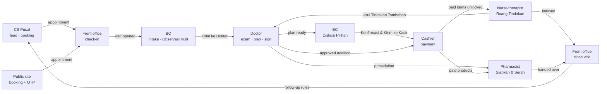

# Proposal — Vendor console, role connection map, patient public site

- Date: 2026-11-02 (Asia/Jakarta). Author: AI planning agent. Owner: Paduka Ongki.
- Status: **Proposal, not merged.** Written outside the kit because another session was revising `~/Documents/work/prd/clinic-dashboard/` (v0.2 re-review with agents, PR-55 added 12:50) at the same time. Merge into the kit after that session finishes; renumber the provisional IDs then.
- Scope: documents only. No repository, code, deploy or DNS work is authorized.
- Owner decisions behind it (chat 2026-11-02):
  1. "Admin" on the vendor side = **our team (vendor)**, who help each clinic run the system, including its branches.
  2. "Public site" = **the patient-facing site of each clinic tenant**.
  3. **Domain is set up last**; it may become adaptive (subdomain or custom domain) later.
  4. Planning only; development has not started.
  5. **No subscription plans.** The system is sold through tenders (contract per client). The vendor charges each client a **monthly server fee, starting at Rp1,000,000**, editable per tenant from the vendor console, and collected through **our own AutoLaris account** (vendor → client only; clinics keep their own gateway for patient payments, H-09).
  6. **Billing starts when the system is installed/active for that clinic** (go-live), not at contract signing.
  7. **Hierarchy confirmed:** our super admin (vendor) controls Clinic A, Clinic B, … (different brands, each its own tenant); each clinic has its own branches and a full staff set inside.
  8. **One multi-tenant platform for the future:** a new client is onboarded as a tenant, never a new build.
  10. **Three control levels:** Super admin (vendor) → Admin (Klinik Pusat / head office of one brand) → Klinik Cabang (branches).
  9. **Patient → clinic payments:** prepare a gateway-neutral payment port ("container") in the Midtrans style; the real payment-gateway partner is decided later; start with a **dummy (mock) gateway**.

Provisional IDs below (`VC-*`, `RM-*`, `PS-*`) are not suite namespaces. At merge they become `PR-*`, `UX-*`, `IAM-*`, `TEN-*`, `DATA-*`, `UI-*` numbers that follow the kit's last IDs at that time.

### 0. Structure at a glance

```text
Vendor (our team) — vendor console
├─ Platform owner (super admin) · onboarding · support · vendor finance · auditor
│
├─ Tenant: Clinic A  (brand A = one PT, own accent/logo, own public site /a, own WABA, own gateway)
│   ├─ Branch A1 ─ staff: manager, FO/cashier, BC, doctor, nurse, therapist, pharmacist
│   ├─ Branch A2 ─ staff ...
│   └─ Tenant-wide staff: owner, finance, central CS, facility head, records officer
│
└─ Tenant: Clinic B  (brand B, fully isolated from A)
    ├─ Branch B1 ─ staff ...
    └─ Tenant-wide staff ...
```

- Vendor → tenants: control at platform level (lifecycle, onboarding, server fee, health); clinic data only in support sessions (§2.1).
- Tenant → branches: owner/manager configure; staff are scoped to branches (TEN-11 memberships with allowed branches).
- Clinic A and Clinic B never see each other (PR-1, TEN-1). One person may work at both only as two memberships (IAM-3).
- This matches P-02 (one tenant = one brand) and P-03 (one tenant = one PT): no change to the decided model.

### 0.0 Three control levels (decision 10)

```text
Level 1  SUPER ADMIN (vendor, our team)          — vendor console, all tenants, platform only
   │
Level 2  ADMIN KLINIK PUSAT (one per brand/tenant) — head office: all branches of that brand
   │
Level 3  KLINIK CABANG (each branch)             — daily operation of one branch
```

| Level | Who (roles) | Controls | Does not control |
|---|---|---|---|
| 1 Super admin | Platform owner, onboarding, support, vendor finance, auditor (§2.2) | Create tenant (brand), lifecycle, onboarding checklist, server fee, platform health, support sessions | Clinic money approvals, clinical records, prices after go-live (only in a support session the owner sees) |
| 2 Admin Klinik Pusat | **Owner** (top), **Admin Pusat** (new, delegated by owner), finance, central CS, facility head (Penanggung Jawab), records officer | Branches (create, hours, rooms, services), shared catalog and branch prices, staff and roles for all branches, PR-38 settings, commission rules, approvals, consolidated dashboards and books, public site, WABA and gateway settings | Other brands (tenants); vendor platform |
| 3 Klinik Cabang | **Manager Cabang**, FO/cashier, BC, doctor, nurse, therapist, pharmacist | Own branch: schedule, visits, cashier and shift close, stock and transfers requests, branch staff schedules, branch dashboard, branch-level approvals the owner delegates | Other branches' data (except tenant-shared patient identity/packages), catalog master, money rules |

- L-1: **Admin Pusat** is a new tenant-wide role (recommendation, adopted): same configuration scope as the owner for branches, catalog, staff, settings drafts and the public site, but owner-only stays owner-only — branch price overrides, cash-refund approval (unless delegated), write-off, commission batch approval, tenant data export, vendor-access approval. Merge target: role column in `07` role matrix, IAM-9+.
- L-2: If the head office also treats patients, it is **also a branch** ("Cabang Pusat") with its own staff, stock and cashier; Level 2 is the management layer, not a place.
- L-3: Staff scope = membership `allowed_branch_ids` (TEN-11): Level 2 roles hold all branches; Level 3 roles hold their branch(es); a doctor rotating between branches holds several.
- L-4: Navigation follows the level: Level 2 opens on Ringkasan with a branch switcher "Semua Cabang / <cabang>"; Level 3 opens on its role home (Hari Ini, Antrean, Ruang …) for its active branch (17 tabs).
- L-5: Patients, packages and balances are tenant-wide (one patient across all branches of the brand); visits, stock, cash shifts are branch-scoped (06 policy kinds) — no change.

#### 0.0.1 Extra admin roles checked against research (2026-11-02)

Compared the kit's 12 clinic roles with the stakeholder tables in `indonesia-beauty-clinic-system-ui-ux-research.md` §4.2 and `beauty-clinic-admin-system-research.md` §2.2. Segment = 1–5 branches (P-04), so a person may hold several roles (IAM-3); a new role is added only when its access boundary differs.

| Research role | Kit today | Recommendation | Level |
|---|---|---|---|
| Warehouse / purchasing | Stock and PO split between manager and pharmacist | **Add "Purchasing / Gudang Pusat"**: suppliers, PO, goods receipt, inter-branch transfers, stock reports for all branches; no clinical data, no cashier (Should; may be held by a pharmacist) | 2 |
| Marketing | None (campaigns in 1.1, public site new) | **Add "Marketing"**: promos, public-site content (PS-UX-1/4), lead-source and campaign reports, templates; sees patients only as consented contacts; no clinical data, no money approvals (Must, because the public site and promos are in Release 1) | 2 |
| Internal auditor | None; maker-checker exists (PR-37, SEC-9) | **Add "Auditor Internal" (read-only)**: audit log, suspicious-activity report, approvals history, stock variance, refunds/write-offs; no edits; no clinical content (Should) | 2 |
| IT / system admin (clinic side) | — | **No new role**: covered by Admin Pusat (users, roles, integrations status); platform IT is the vendor (Level 1) | — |
| DPO / compliance (UU PDP) | PRIV-12, PR-50 | **No new role**: a "Petugas Pelindungan Data" duty assigned to Owner or Admin Pusat, giving access to data-subject requests and the breach register | 2 |
| Medical director | Facility head (Penanggung Jawab) | Already covered | 2 |
| HR / payroll | Non-goal (A-09); staff schedules PR-48 | **No** (payroll stays out of scope) | — |
| Area / regional manager | Branch manager with several `allowed_branch_ids` | **No** for 1–5 branches; revisit for larger tenants | — |
| Supervisor PIN for void | Approvals by manager (PR-44) | Covered | 3 |

Merge targets: three columns in `07` role matrix + IAM rows; tabs in `17` (Marketing: Promo · Situs · Lead · Saya; Purchasing: Stok · PO · Transfer · Saya; Auditor: Audit · Laporan · Saya); PRD §3 actors.

### 0.1 Multi-tenant platform — new client = onboarding, not a new build (decision 8)

The kit is already multi-tenant (P-01, PR-1, ADR-2 shared database with `tenant_id` + RLS, 06 TEN-1–TEN-11). Decision 8 adds rules so it stays that way:

| ID | Rule | Why |
|---|---|---|
| MT-1 | **One codebase, one deployment, many tenants.** Clinic C goes live through VC-UX-3 onboarding; no fork, no per-client branch, no per-client code | Tender clients would otherwise each become a separate product to maintain |
| MT-2 | **Differences between clinics live in data, not code:** branches, catalog, prices, staff and roles, PR-38 settings, branding (UI-8), public-site content, WABA numbers, gateway account, SATUSEHAT credentials, server fee | All already tenant-scoped records; adding a clinic adds rows |
| MT-3 | A new requirement from one tender is built as a **general feature behind a tenant setting** (default off) only when the platform owner accepts it into the product; otherwise it is refused or quoted as separate work | Prevents per-client code paths |
| MT-4 | **Platform core vs clinic domain** as separate module groups: core = tenants and lifecycle, memberships/IAM, vendor console, server-fee billing, audit, notifications, outbox, files, public-site engine; domain = patients, clinical, treatment, inventory, cashier, commission, CRM, accounting, SATUSEHAT | Core can serve a second vertical later; build only the clinic domain now (no speculative second vertical) |
| MT-5 | Tenant onboarding is repeatable: templates for catalog and settings, CSV import with dry-run (MIG-3), checklist (§2.5) | Go-live of tenant N costs configuration time only |
| MT-6 | **Deployment mode** (option, later): if a tender requires its own server, run the **same image** as a separate instance with one tenant; never a code fork. Records which instance serves which tenant in the vendor registry | Some tenders demand dedicated hosting or local residency |
| MT-7 | Isolation proven per release: cross-tenant negative tests per endpoint, job and export (NFR-6) stay in CI | The risk of shared infrastructure is data leakage |

### 0.2 Domain guard — a beauty clinic, not an online shop

Earlier projects were e-commerce stores. This product is a **beauty and aesthetic clinic** system. Agents must not carry store patterns over.

| Topic | Online shop (earlier projects) | Beauty clinic (this product) |
|---|---|---|
| What is sold | Goods shipped to a buyer | **Treatments performed on a patient**, packages of sessions, consultation; products mostly handed over at the clinic |
| Core flow | Browse → cart → checkout → ship → deliver | **Booking → arrival → BC intake → doctor exam and plan → consent → pay → treatment in room → dispensing → follow-up/control** |
| Customer | Buyer, guest checkout | **Patient** with identity (NIK or official alternative), guardian for minors, medical history, allergies |
| Who acts | Admin, CS, warehouse | FO/cashier, BC, **doctor, nurse, therapist, pharmacist**, manager, owner, finance, central CS |
| Record | Order | **Visit + electronic medical record (RME)**, signed, versioned, kept ≥ 25 years, sent to SATUSEHAT |
| Permission | Who may edit the order | **Clinical authority**: valid STR/SIP, competence, delegation, consent per procedure |
| Money | Pay then ship; refund on return | Prepaid **packages that unlock by paid value**, patient balance, booking DP, additions in the room, receivables, commission to BC/performer |
| Stock | SKU stock, shipped | Materials consumed per treatment (vials, opened-vial limit, batches, FEFO), prescriptions, compounded items |
| Data sensitivity | Personal data | **Health data = specific personal data** (UU PDP), clinical photos, no health content in WhatsApp templates or ad pixels |
| Marketing claims | Consumer advertising (EPI) | Plus **health-service advertising rules**: no promised results, before/after only with consent and legal review |
| Public site | Storefront with cart | **Clinic site**: treatments (who performs, duration, downtime), doctors, branches, booking; **no cart, no checkout, no shipping** |

Rules:

- DG-1: No cart, checkout, shipping, courier or marketplace flow anywhere in Release 1. Skincare products are sold at the cashier (PR-19) and handed over by the pharmacist (PR-18); prescription and compounded items are never sold online.
- DG-2: The public `/produk` page (Phase 4) is a catalog display with "tanyakan di klinik" / booking, not a shop. Online product sales stay a non-goal (PRD §5 "e-commerce delivery").
- DG-3: AutoLaris is used **only** for the vendor's monthly server-fee payment (QRIS/VA, non-physical). Its shipping endpoints (`ongkir`, `order`, `lacak`, `pickup`) are not used.
- DG-4: Skill routing for this product: `admin-product-ux` + `admin-dashboard` (staff app), `design-taste` with the *Booking* surface and *local services* / *skincare* niche notes (public site), `application-security`, `postgres-drizzle`, `seo-website-builder` (clinic structured data). **Not** `storefront-ux`, `storefront-development`, `headless-shopify` or `mengantar-api`.
- DG-5: Words in UI and docs follow the clinic glossary (10): Pasien, Kunjungan, Perawatan/Tindakan, Paket, Saldo Pasien, Kasir — not Pembeli, Pesanan, Keranjang, Checkout, Pengiriman.

Merge target: `03-TECHNICAL-DESIGN.md` (module groups, ADR-7 "one codebase, tenants by data"), `15-DEVOPS-CICD-MIGRATIONS.md` (deployment mode), `01-BRD.md` (BR-1 wording: sell through tenders on one platform).

---

## 1. Kit baseline read (v0.2, 12:41–12:51)

| Area | What exists | Gap this proposal fills |
|---|---|---|
| Vendor side | PR-53 (provision tenants, time-limited support sessions), PR-55 (vendor profile), UX-34 "Konsol Vendor" (one row), TEN-6 (`platform_operator`, break-glass ≤ 2 h), IAM-1 (TOTP), ARCH-8, TEN-9 routing tables | No vendor roles, no screen set, no onboarding workflow, no tenant lifecycle, no subscription view (BILL-20 OPEN), no platform health, no rule for what vendor may change in a clinic and when |
| Clinic roles | 12 roles, role matrix (07), tabs per role (17), visit flow (03 §5), approvals/requests/complaints inboxes, notifications PR-54 | Connections are spread over 03, 07 and 17; no single hand-off map |
| Public site | UX-24 public booking, PR-39 no pixels, PR-40 "Could, Phase 4" placeholder, UI-8 tenant branding, ARCH-3 booking host, TEN-9 `public_hosts(slug/host)` | No requirements, sitemap, content model, editing screens, design direction, claims rules |
| Domain | `public_hosts(slug/host → tenant_id)`; `custom-domain` overlay "Not applicable" | Record the decision "path slug first, domain last" |

---

## 2. Vendor console (super admin = our team)

### 2.1 Principle

The vendor operates the **platform**, not the clinic. Two access levels, never mixed:

| Level | What the vendor sees | How | Clinic data |
|---|---|---|---|
| **Platform level** | Tenant registry, onboarding checklist, server-fee invoices and AutoLaris payment status, usage counts, integration status codes, platform health, vendor audit | Vendor console, always on | **None.** Counts and status codes only; no patient names, phones, clinical or message content |
| **Inside a tenant** | What the support task needs | **Support session** (PR-53/TEN-6): reason, time limit, scoped to tenant + branches + purpose, visible to the clinic owner | Only within the session purpose; clinical content needs an extra grant |

Why: the clinic is controller and the vendor is processor for clinic data (PRIV-13). A vendor admin who browses clinic data without a recorded purpose breaks that boundary.

### 2.2 Vendor roles (provisional IAM)

| Role | Job | Platform level | Inside tenant |
|---|---|---|---|
| **Platform owner** (super admin) | Run the business; appoint vendor staff; approve risky actions | Everything, incl. vendor staff and roles | Same as support, plus approves clinical-data grants |
| **Onboarding specialist** | Set up new clinics until go-live | Tenant registry, onboarding checklist | Onboarding grant (§2.4) before go-live; support session after |
| **Support operator** | Answer clinic tickets, fix configuration | Tenant registry, health, integration status | Support session; may not approve money, sign clinical records or change commissions |
| **Vendor finance** | Bill the monthly server fee | Server-fee settings, vendor invoices, AutoLaris payments | None |
| **Auditor** (read-only) | Review vendor behaviour | Vendor audit log, session log | None |

Rules (provisional):

- VC-IAM-1: Vendor accounts are separate from clinic memberships; one person may hold both only with the platform owner's approval, and every action records which identity acted.
- VC-IAM-2: All vendor roles need TOTP; vendor console reachable only from the app host with an IP allowlist (as Coolify, H-05).
- VC-IAM-3: Requester ≠ approver for: clinical-data grant, tenant suspension, tenant deletion/hand-over, server-fee change, refund or waiver of a vendor invoice.
- VC-IAM-4: Inside a tenant a vendor never acts *as* a clinic staff member; actions show "Vendor — <name>" in the clinic audit log.

### 2.3 Tenant lifecycle (vendor-owned)

```text
lead → contract → provisioning → onboarding → pilot/live → (suspended ↔ live) → exit (export + hand-over) → closed
```

| State | Entered by | Clinic can use | Notes |
|---|---|---|---|
| provisioning | Platform owner / onboarding | No | Tenant + legal entity + first branch created (PR-1) |
| onboarding | Onboarding specialist | Owner and invited staff, synthetic or imported data | Checklist §2.5; onboarding grant active |
| live | Platform owner after checklist passes | Yes | Onboarding grant ends automatically |
| suspended | Platform owner (reason) | Read-only + export; no new bookings | Unpaid server fee or abuse; never automatic; clinical records stay accessible to the clinic (Permenkes 24/2022 access duty, verify) |
| exit | Owner request or contract end | Export (PR-52) | Hand-over of records the clinic must keep (TEN-8) |

### 2.4 Who changes clinic and branch settings

| Change | Before go-live | After go-live |
|---|---|---|
| Branches (create, hours, rooms, devices, services offered) | Onboarding specialist under onboarding grant, owner sees every change | Owner/manager in the clinic app; vendor only in a support session the owner can see |
| Catalog and prices, staff invitations | Same | Same |
| Money rules (PR-38 settings), commission rules | Owner only, vendor may prepare drafts the owner confirms | Owner only |
| WABA onboarding, SATUSEHAT credentials | Vendor with owner present (Embedded Signup needs the clinic's Meta login) | Support session |
| Clinical records, signatures, approvals of money | Never vendor | Never vendor |
| Tenant suspend / exit | Platform owner | Platform owner, with reason and notice to owner |

- VC-1: An **onboarding grant** is a tenant-scoped grant created with the tenant, valid until go-live or 30 days, visible to the owner, limited to configuration objects (branches, catalog, staff invitations, imports, branding), never clinical rows.
- VC-2: Every vendor change inside a tenant writes the clinic audit log and appears in the owner's "Perubahan oleh Vendor" list.

### 2.5 Onboarding checklist (per tenant, per branch)

| Item | Source | Blocks go-live |
|---|---|---|
| Legal entity, NPWP, PKP status | PR-1, PR-24 | Yes |
| Branches with hours, rooms, devices, services | PR-2 | Yes |
| Catalog published, branch prices | PR-41, PR-42 | Yes |
| Staff invited, credentials verified for clinicians | PR-3, IAM-4 | Yes |
| Money settings confirmed by owner | PR-38 | Yes |
| Payment gateway account (clinic is merchant) | H-09, TD-40 | Yes if online payment used |
| WABA connected per branch or brand | PR-27, TD-20 | Yes if WhatsApp used |
| SATUSEHAT credentials per branch tested in sandbox | PR-35, TD-30 | Yes for live clinical use |
| Data import dry-run accepted (patients, packages, balances) | MIG-3 | If migrating |
| Public site published (§4) | PS-* | No |
| Processor agreement signed | PRIV-8 | Yes |

### 2.6 Vendor console screens (provisional UX)

Desktop-first (vendor works at a desk); same tokens as the staff app, sidebar navigation, data tables allowed (this is the one surface where dense tables fit).

| ID | Screen | Pattern | Actor | Primary action |
|---|---|---|---|---|
| VC-UX-1 | Tenant | List (state, monthly fee, branches, go-live date, payment status, health dot) → tenant detail | All vendor roles | Buat Tenant |
| VC-UX-2 | Tenant detail | Header (state, contract/tender reference, monthly fee, owner contact) + tabs: Ringkasan · Cabang · Onboarding · Integrasi · Tagihan · Sesi Dukungan · Audit | Vendor | Buka Sesi Dukungan |
| VC-UX-3 | Onboarding | Checklist per tenant and per branch (§2.5) with owner, status, blocker | Onboarding specialist | Tandai Siap Live |
| VC-UX-4 | Integrasi | Per tenant/branch: WABA status, quality, messaging limit; SATUSEHAT outbox backlog and error codes; gateway webhook status — codes only | Support | Buka Sesi Dukungan |
| VC-UX-5 | Tagihan Server | Per tenant: monthly fee (default Rp1.000.000, editable with reason and effective month), invoices by month, AutoLaris payment status, reminders | Vendor finance | Terbitkan Tagihan |
| VC-UX-6 | Sesi Dukungan | Active and past sessions: tenant, operator, reason, scope, start/end, clinic-visible link | All | Akhiri Sesi |
| VC-UX-7 | Kesehatan Platform | Uptime, worker heartbeat, outbox backlog per provider, backups, error rate (OBS-2–OBS-4) | Platform owner, support | — |
| VC-UX-8 | Tim Vendor | Vendor staff, roles, TOTP status | Platform owner | Undang |
| VC-UX-9 | Audit Vendor | Every vendor action, filterable | Platform owner, auditor | Ekspor |
| VC-UX-10 | Profil Vendor | PR-55 fields | Platform owner | Simpan |

Clinic side (new):

| ID | Screen | Actor | Content |
|---|---|---|---|
| VC-UX-11 | Saya › Akses Vendor | Owner | Active/past support sessions and onboarding grant; "Akhiri sesi" button; list of vendor changes |
| VC-UX-12 | Saya › Tagihan Server | Owner, finance | Monthly server-fee invoices, pay via QRIS/VA (AutoLaris), status, receipt |

### 2.7 Requirements to add (provisional → `PR-*` at merge)

| Prov. ID | Requirement | Priority |
|---|---|---|
| VC-PR-1 | The vendor shall manage tenant lifecycle states (provisioning, onboarding, live, suspended, exit, closed) with reason and owner notice on suspend and exit | Must |
| VC-PR-2 | An onboarding grant (VC-1) lets onboarding specialists configure branches, catalog, staff invitations, imports and branding until go-live or 30 days, never clinical rows | Must |
| VC-PR-3 | Go-live requires every blocking checklist item (§2.5) to pass; the platform owner confirms | Must |
| VC-PR-4 | Vendor roles (§2.2) with TOTP and requester ≠ approver for clinical-data grant, suspension and exit | Must |
| VC-PR-5 | Platform-level views show counts and status codes only; any clinic data needs a support session | Must |
| VC-PR-6 | The clinic owner sees every vendor session and change (VC-UX-11) and can end a session | Must |
| VC-PR-7 | Monthly server-fee billing (§2.8): one fee per tenant (default Rp1,000,000, editable from the vendor console with reason and effective month), monthly invoice, payment through the vendor's AutoLaris account, reconciliation by AutoLaris Advice | Must |
| VC-PR-8 | Platform health view (VC-UX-7) from existing OBS metrics | Should |

Data (provisional `DATA-*`): `vendor_staff`, `vendor_roles`, `tenant_lifecycle_events`, `onboarding_checklists`, `onboarding_grants`, `support_sessions` (extends `operator_grants`), `tenant_contracts` (tender/contract reference, start date, notes), `server_fee_versions` (tenant, amount, effective month, reason, changed_by, approved_by), `vendor_invoices` (tenant, period, amount, `reff_id`, state), `vendor_payments` (AutoLaris `transaction_id`, `trx_id`, channel, amount, advice snapshots). Policy kind: `platform` (06), never joined to tenant rows except through security-definer functions (ARCH-8).

### 2.8 Monthly server fee through AutoLaris (vendor → client)

Owner decision 5. This is the **vendor's** money domain (BILL-20), fully separate from the clinic's patient payments (clinic is merchant of record with its own Midtrans/Xendit account, H-09, TD-40).

| Item | Rule |
|---|---|
| What is charged | One monthly server fee per tenant; tender/contract value is recorded as a reference only, not billed by the system |
| Amount | Default **Rp1,000,000** per tenant per month; vendor finance proposes a change, platform owner approves; versioned by effective month; past invoices keep their amount |
| Start | Billing starts on the tenant's **go-live date** (state `live`, VC-PR-3), not at contract or provisioning; onboarding and pilot set-up before go-live are not billed |
| Invoice | First invoice is prorated by days from go-live to month end (VC-D7); afterwards one invoice per calendar month (in advance or arrears, VC-D4); integer rupiah; vendor identity from PR-55; VAT only if the vendor entity is PKP (S-04 open) |
| Suspended / exit | A suspended month is still billed unless the platform owner waives it with reason; billing stops at exit date (prorated) |
| Payment | Vendor's AutoLaris account, server side only. Create the payment with a stable local `reff_id` per invoice persisted first: `POST /api/h2h/create_payment`, or `POST /api/h2h/submit` with the non-physical `courir_id: 1` profile **only if AutoLaris has approved it for our account**. Channels and fees from `GET /api/h2h/list_payment` at runtime (QRIS/VA), never hardcoded |
| Reconciliation | `POST /api/h2h/advice` with the provider `transaction_id`, bounded and idempotent; an invoice becomes paid only under the settlement status confirmed with AutoLaris for our account; pending or generic wording is not paid |
| Clinic view | Owner sees Saya › Tagihan Server: invoices, pay link (QRIS/VA), status, receipt |
| Overdue | Reminder to the owner at due date, +7 and +14 days; suspension is a manual platform-owner action with reason (VC-PR-1), never automatic, and never blocks access to clinical records |
| Secrets | AutoLaris API key in the vendor's secret store; never in a tenant key vault, browser, log or repository (SEC-6) |
| Skill | `autolaris-h2h` (no live call, credential read or callback change without owner approval) |

Consequences: BR-4 changes from "subscription" to "tender contract + monthly server fee"; BILL-20 and PRD Q-09 close; VC-D3 resolved.

---

## 2.9 Patient → clinic payment port (gateway decided later)

Owner decision 9. Applies to the **clinic's** money (patient pays the clinic). Separate from the vendor's server fee (§2.8, AutoLaris).

Today's kit names Midtrans first, Xendit second (TD-40, BILL-17, 15 §2, CTX-6). Change: **no provider is chosen yet**; the product ships a stable port and a dummy adapter.

| ID | Rule |
|---|---|
| PG-1 | One internal **payment port** used by cashier (PR-19), packages (PR-20), booking DP (PR-22) and receivables: `createCharge(invoice or deposit, amount, channel, expiry) → {providerRef, payUrl or QR or VA}`, `getStatus(providerRef)`, `cancel(providerRef)`, `refund(providerRef, amount)` where supported, `listChannels()`, `verifyWebhook(headers, raw body) → normalized event` |
| PG-2 | **Normalized states** (unchanged from TD-41): `created → pending → paid \| expired \| failed`, plus `refunded`/`partially_refunded`. Business code reads only these; provider codes stay inside the adapter and are logged as raw reference |
| PG-3 | **Adapters** behind the port: `mock` (Release 1 default), then one real provider after the partnership decision (Midtrans-style first candidate; Xendit, DOKU, AutoLaris or others possible). Adding a provider = one adapter + contract tests, no change in cashier code (MT-1/MT-2) |
| PG-4 | **Per tenant configuration** in the vendor console and owner settings: provider = `mock` \| `<provider>`, environment = sandbox \| production, credentials in the tenant key vault (TEN-7), enabled channels. Clinic stays merchant of record with its own account (H-09) |
| PG-5 | **Mock gateway**: issues fake QR/VA/payment-link screens, lets staff or tests trigger paid / expired / failed, sends signed webhooks to our own endpoint, and replays duplicates and late webhooks. Mock is only available in demo/staging tenants and in production tenants that have no provider yet; receipts and invoices show "SIMULASI" and never count as cash (K1) |
| PG-6 | Webhook endpoint per provider under `/api/v1/webhooks/payment/{provider}` (booking host, API-4): signature check, idempotent by provider event ID, tenant resolved via `payment_routes` (TEN-9) |
| PG-7 | Cash, EDC card and manual transfer keep working without any gateway; the gateway is only needed for QRIS / VA / payment links sent by WhatsApp |
| PG-8 | Generic item descriptions to any provider ("Layanan klinik", "Produk") — no treatment names (SEC-15) |
| PG-9 | Contract tests every adapter must pass: duplicate webhook → one payment (PLAN scenario 18), paid after expiry → recorded and flagged, amount mismatch → rejected and audited, signature invalid → 401 and audited |

Merge targets: `18-INTEGRATION-CONTRACTS.md` TD-40/TD-41 rewritten provider-neutral + TD-43 mock adapter; `11-BILLING-PAYMENTS.md` BILL-17 "gateway via port, provider OPEN"; `15` stack row "Payments: port + mock adapter; provider TBD"; `CONTEXT-RECORD.md` CTX-6 "patient payment gateway: OPEN, mock in Release 1"; `PLAN.md` M4 uses mock, M7 adds the real adapter after the decision; PRD Q-14 "Patient payment gateway partner" (owner, before Phase 2 pilot if online payment is wanted).

## 2.10 Gap check: research feature inventory vs kit v0.2 (2026-11-02)

Source: `indonesia-beauty-clinic-system-ui-ux-research.md` §4.2 (stakeholder needs), §5.2 (menu tree, ~110 pages), §6 (dashboards); `beauty-clinic-admin-system-research.md` §2.2, §3.3. Checked by keyword and requirement reading against `02`, `05`, `07`, `11`, `17`, `18`. Items already covered, or decided out (payroll A-09, loyalty/membership/gift card, teleconsult, AI scribe, e-commerce DG-1), are not listed.

**Add to Release 1 (Must):**

| ID | Gap | Evidence | Proposed requirement |
|---|---|---|---|
| GAP-1 | **Appointment reminders and confirmation** (H-1 / same-day WhatsApp template with "Konfirmasi / Ubah Jadwal") | Research §4.1, §5.2 "Otomasi reminder H-1/H-3"; table stakes in every vendor; reduces K12 no-show | Utility template sent per booking per branch rule; reply updates appointment state; respects budget (PR-31) |
| GAP-2 | **Aftercare instructions** after treatment (per catalog item, WhatsApp/printed) and a separate complication channel | Research §4.1 "patient after treatment", §5.2 "aftercare H+1" | Catalog field `aftercare_text` (clinical-reviewed, PR-41); sent at visit close as care message (not marketing); reply → complaint flag (PR-43) |
| GAP-3 | **Walk-in registration and queue number** (non-booked patients, call next, optional TV display) | Research §5.2 Front Office (Antrian consensus), receptionist dashboard §6 | Walk-in path in Hari Ini (UX-6); daily queue number per branch; TV display = Should |
| GAP-4 | **Manual discount control** (who may give how much; above limit needs approval) | Research §2.2 cashier "void with supervisor", §5.2 Audit "diskon manual"; kit has discounts in K3/BILL-2 but no rule | Discount limit per role (tenant setting); above limit → approval (PR-44); report in suspicious-activity (SEC-9) |
| GAP-5 | **Credential expiry alerts** (STR/SIP/SIPP 60/30/7 days before) | Research §4.2 Medical director, §5.2 "expiry alerts"; kit blocks expired credentials (IAM-4) but gives no warning | Notifications to facility head and staff; dashboard "Perlu Ditangani" |
| GAP-6 | **Templates for consent, receipts and medical letters** (surat keterangan, rujukan, resume medis) | Research §5.2 Klinis "Surat", Pengaturan "Template"; kit lists "letters" in TD-4 without a requirement | Tenant templates with version; letters signed by doctor, become part of RME (PR-13) |
| GAP-7 | **Return to supplier** and supplier master | Research §5.2 Apotek "Retur ke supplier", §2.2 purchasing | Add to PR-17 lifecycle: supplier return with reason, batch, credit note |
| GAP-8 | **Global search** (patient by name, phone, RM number, invoice number) | Research §5.1 global shell | Search field in every role home; results scoped by role projection |

**Add as Should (Release 1.1):**

| ID | Gap | Note |
|---|---|---|
| GAP-9 | Promo / voucher codes with quota, period, eligible items, usage stats | Needed by the new Marketing role and public promos (PS-UX-4); priced as discount lines |
| GAP-10 | Satisfaction survey after visit and Google review request (internal low score → manager task first) | Research §5.2 "Ulasan Google & survei kepuasan"; Aoikumo pattern |
| GAP-11 | Operational expenses / petty cash per branch (kas kecil) | Research §5.2 Keuangan "Biaya operasional"; needed for real branch margin; feeds accounting step 2 |
| GAP-12 | Daily owner digest (WhatsApp/email): cash, completed service, exceptions | Research §6 Owner "send digest" |
| GAP-13 | Waitlist when no slot (today only a note in J1) | Research §5.2 Jadwal "Waitlist" |
| GAP-14 | Device/room maintenance, sterilization and calibration logbooks | Research §5.2 Ruang Tindakan logbook; kit marks LATER; needed for accreditation |
| GAP-15 | Clinical incident register (KTD/KNC) beyond complaint tasks | Research §2.2 Medical director "incident review"; patient-safety reporting duty to verify with clinical lead |

**Deliberately not added:** membership tiers, points, gift cards (non-goal), payroll/attendance (A-09), teleconsultation and patient app (Phase 4), AI scribe, kiosk check-in, online product shop (DG-1), corporate group booking.

Merge target: PR-56+ (GAP-1–8 Must with scenarios), Should rows for GAP-9–15, screens in `17` (walk-in in UX-6, Template settings, Promo), `05` tables (`reminder_rules`, `aftercare` field, `queue_tickets`, `discount_limits`, `document_templates`, `supplier_returns`).

## 3. Role connection map (how clinic roles hand work to each other)

### 3.1 One visit, nine roles



### 3.2 Hand-off table (state → who acts next → how they learn)

| Visit state | Done by | Next role | Signal | Blocks |
|---|---|---|---|---|
| Booked | CS / FO / public site | FO | Hari Ini list | — |
| Checked in | FO | BC | Pasienku list + notification | — |
| Intake done | BC (Kirim ke Dokter) | Doctor | Antrean + notification | Doctor cannot sign without verifying intake |
| Plan signed | Doctor | BC | Pasienku: "Rencana siap" | — |
| Selection confirmed | BC | Cashier | Kasir queue | Treatment cannot start unpaid (initial items) |
| Paid | Cashier | Nurse/therapist, pharmacist | Ruang list; Siapkan list | — |
| Addition proposed | Room / BC | Doctor | Permintaan + notification | Addition cannot start without clinician + patient agreement |
| Addition approved | Doctor | FO/cashier | Alert (PR-54) | Visit cannot close unpaid |
| Treatment finished | Room | FO | VisitTrack segment | — |
| Dispensed | Pharmacist | FO | VisitTrack segment | Close blocked while pending |
| Closed | FO | CS / BC | Follow-up tasks (PR-30) | — |
| Complaint flagged | Any inbox role | Doctor/clinician on duty | Keluhan task | — |
| Exception (refund, write-off, variance) | Requester | Owner / manager | Persetujuan inbox | Requester ≠ approver |

### 3.3 Cross-cutting connections

| Connection | Mechanism | Owner doc |
|---|---|---|
| One patient record across roles, each role sees its projection | Policy kinds (06), role matrix (07) | 06, 07 |
| One VisitTrack on every patient screen | Component (10) | 10, 17 |
| Inboxes: Persetujuan, Permintaan Klinis, Keluhan, Pesan | PR-44, PR-45, PR-43, PR-28 | 02, 17 |
| Notifications with acknowledgement | PR-54 | 02 |
| Dashboards read the same records (drill-down) | PR-33, K1–K19 | 02 App. A |
| Vendor ↔ owner | Support sessions, Akses Vendor | §2 |

Merge target: a new section "Role hand-off map" in `17-UX-FLOWS-SCREEN-CONTRACTS.md`.

---

## 4. Patient public site (per clinic tenant)

### 4.1 Recommendation on timing

PR-40 is "Could, Phase 4". Research shows WhatsApp is the main conversion channel and booking already exists (UX-24). **Recommend:** a small **Release 1 "Situs Klinik Dasar"** built from data the clinic already maintains (branches, catalog, doctors), and the rich content (articles, testimonials, before/after, quiz, products) stays Phase 4. Reason: a generated site costs little once branch master and catalog exist, gives every pilot clinic a correct, current page, and fixes the drift seen in the market (Larissa 404 branch page, Ella directory 6 of 38, Esther template text — research §9.2).

Needs owner decision **PS-D1** (Release 1 basic site: yes/no).

### 4.2 Sitemap

Release 1 (basic, generated from master data):

```text
/{slug}                          Beranda
/{slug}/perawatan                Treatments list (filter: concern, category)
/{slug}/perawatan/{item}         Treatment detail
/{slug}/cabang                   Branch list + map
/{slug}/cabang/{branch}          Branch detail
/{slug}/dokter                   Doctors (only those who consented to be listed)
/{slug}/dokter/{doctor}          Doctor profile
/{slug}/promo, /promo/{id}       Promotions (optional, owner-published)
/{slug}/booking                  UX-24 (existing)
/{slug}/kebijakan-privasi, /syarat-ketentuan, /kebijakan-pembatalan
```

Phase 4: `/artikel`, `/testimoni`, `/before-after`, `/skin-quiz`, `/paket`, concern landings `/masalah-kulit/{slug}` (research §10.1), and `/produk` as a **display-only** catalog (DG-2: no cart, checkout or shipping).

### 4.3 Content model (reuse, no second CMS)

| Page | Source of truth | New fields needed |
|---|---|---|
| Treatment | Catalog PR-41 | `publish_web`, public name, short description, who performs it (role), duration, downtime, sessions/interval, "mulai dari" price or "harga saat konsultasi", contraindication summary, medical-review stamp (reviewer + date) |
| Branch | Branch master PR-2 | `publish_web` (exists as publish window), photos, facilities, map link, WhatsApp number (exists) |
| Doctor | Staff + credentials IAM-4 | Listing consent, public photo, titles, SIP number display choice, focus areas, branches and schedule from PR-48 |
| Promo | New small object | Title, price, period, quota, T&C, eligible branches, treatments |
| Clinic identity | Tenant + UI-8 branding | Legal name, NIB, address, licence (izin klinik) number, contact, privacy policy text |

- PS-1: Every public page is generated from these records; there is no free page builder in Release 1.
- PS-2: Price shown only when the owner publishes it; otherwise "Harga dijelaskan saat konsultasi". The shown price comes from the branch-effective price (PR-42) with the branch named.
- PS-3: Doctor appears only with recorded listing consent; licence data shown as the clinic chooses.
- PS-4: Treatment content publishes only after clinical-lead review (same gate as PR-41 clinical fields).

### 4.4 Editing screens (staff app)

| ID | Screen | Actor | Primary action |
|---|---|---|---|
| PS-UX-1 | Saya › Situs Klinik: status (draft/published), preview link, sections on/off | Owner, manager | Terbitkan |
| PS-UX-2 | Catalog item › tab "Situs": web fields, preview | Owner, manager; clinical lead reviews | Minta Review |
| PS-UX-3 | Staf › profil publik dokter + consent | Owner; doctor confirms | Simpan |
| PS-UX-4 | Promo list + sheet | Owner, manager | Terbitkan |

### 4.5 Design direction (public site)

Evidence: 20 brand sites captured 2026-11-02 (`sheet-public-desktop.jpg`, `sheet-public-mobile.jpg`, research §9). Observed: carousels, model-face heroes, floating WhatsApp bubble, hamburger menus, hidden prices; best mobile patterns are bottom nav (ERHA, NMW) and sticky booking bar (Ella, Miracle); best discovery is concern-first (ERHA, Naavagreen).

| Decision | Direction | Why |
|---|---|---|
| Template | **One template, clinic-branded** (accent, logo, hero photo per UI-8); no custom CSS/scripts | Safety (no third-party scripts, D-12), maintainability, all tenants get fixes |
| Feel | **Clinical clarity**: white space, real clinic photos, readable facts (who performs, duration, downtime, price basis) | Research §1 "price transparency + who performs it" is an open opportunity; skincare niche default (pastel, serif, model face) avoided |
| Type | System font stack as staff app; tenant cannot change fonts in Release 1 | Same tokens; no font files |
| Hero | Clinic name + one line + branch/concern entry (chips) + one action "Buat Janji"; real clinic photo if uploaded; no carousel | Carousels dominate the market and hide content (research §9.2) |
| Mobile | Sticky bottom bar: "Buat Janji" + "WhatsApp" (labelled, not an icon bubble) | Ella/Miracle pattern; WhatsApp is the main channel |
| Proof | Only real data: branch count from master, doctors with consent, licence number; no invented counters or ratings | EPI 2020 claims rules; Permenkes on health-service advertising (verify) |
| Accent | Tenant accent validated (UI-2) | D-16 |

Claims guard (copy owned by `copywriting`): no "terbaik", "nomor 1", "100%", guaranteed results, or before/after without consent and legal review; health-service advertising rules to be confirmed by health-law counsel (Permenkes 1787/2010 on health-service advertising — **verify current text and status**).

### 4.6 Technical constraints

| ID | Constraint |
|---|---|
| PS-T1 | Public pages are served from the **booking host** (ARCH-3, Cloudflare proxied). Content pages contain no personal data and may be cached; booking and OTP routes stay `no-store` |
| PS-T2 | No session replay or ad pixels on any page before consent; none ever on booking, intake or complaint routes (PR-39, D-12) |
| PS-T3 | Structured data: `MedicalClinic` per branch with opening hours, `Physician`, `Service`/`MedicalProcedure` with `Offer` when price is published, `BreadcrumbList` (owner: `seo-website-builder`) |
| PS-T4 | Core Web Vitals good at p75 (LCP ≤ 2.5 s, INP ≤ 200 ms, CLS ≤ 0.1); `dotuiux check` floor gates (UI-10) |
| PS-T5 | Unpublished or suspended tenant → public pages return 404 with no tenant data; booking closed message for suspended tenants |

### 4.7 Domain — set up last (owner decision)

| Phase | Address | Notes |
|---|---|---|
| Release 1 | Path on the shared booking host: `https://<booking-host>/{slug}` | TEN-9 `public_hosts(slug → tenant)` already planned; no DNS work per tenant |
| Later (adaptive) | Subdomain `{slug}.<booking-host>` and/or clinic custom domain | Activates the `custom-domain` overlay → `08-DOMAIN-ROUTING.md` (DOM-*): verification, TLS, redirect from the path, canonical URL |

- PS-D2 (record as decision): domain strategy deferred; the slug path is the canonical public address until `08` is activated. URLs are generated through one helper so the switch does not change content.

### 4.8 Requirements to add (provisional → `PR-*` at merge)

| Prov. ID | Requirement | Priority |
|---|---|---|
| PS-PR-1 | Each tenant shall have a public site generated from branch master, catalog and staff profiles (§4.2 Release 1 pages), published by the owner | Must if PS-D1 = yes, else Could |
| PS-PR-2 | Treatment pages show who performs it, duration, downtime, sessions and a published price or "harga saat konsultasi"; clinical text publishes only after clinical-lead review | Same |
| PS-PR-3 | Doctors appear only with listing consent; withdrawal hides them within one publish cycle | Same |
| PS-PR-4 | Every page offers booking with context prefilled (treatment, branch, doctor) and a WhatsApp link with source tag | Same |
| PS-PR-5 | The public site loads no third-party script before consent and none on booking routes (extends PR-39) | Must |
| PS-PR-6 | Rich content (articles, testimonials, before/after, quiz, products) | Could, Phase 4 (replaces PR-40) |

---

## 5. Merge plan (after the other session finishes)

| Kit file | Change |
|---|---|
| `02-PRD.md` | Add VC-PR-1–8 and PS-PR-1–6 as PR-56+ (Proposed); rewrite PR-40 as PS-PR-6; add vendor roles to §3 actors; scenarios for each Must; Q-12 (PS-D1); close Q-09 with decision 5 (tender + monthly server fee) |
| `07-IAM-RBAC-ABAC.md` | Vendor roles table and VC-IAM-1–4 as IAM-9+ |
| `06-TENANT-ISOLATION.md` | Onboarding grant + support session scope as TEN-12+; tenant lifecycle effect on access |
| `05-DATA-MODEL.md` | Vendor and public-site tables as DATA-46+ |
| `17-UX-FLOWS-SCREEN-CONTRACTS.md` | VC-UX-1–11, PS-UX-1–4 as UX-35+; role hand-off map (§3); public sitemap |
| `10-DESIGN-SYSTEM-WHITELABEL.md` + `DESIGN.md` | Public template direction (§4.5) and vendor-console density note |
| `04-SYSTEM-ARCHITECTURE.md` | PS-T1 caching rule on the booking host; vendor console allowlist |
| `11-BILLING-PAYMENTS.md` | Rewrite BILL-20 as the monthly server fee via AutoLaris (§2.8); add vendor-invoice rules as BILL-28+ |
| `01-BRD.md` | BR-1: tenders on one multi-tenant platform; BR-4: tender contract + monthly server fee (default Rp1,000,000, editable), billed from go-live |
| `03-TECHNICAL-DESIGN.md` | Platform core vs clinic domain module groups (MT-4); ADR-7 one codebase, tenants by data (MT-1–MT-3) |
| `15-DEVOPS-CICD-MIGRATIONS.md` | Optional dedicated-instance deployment mode (MT-6) |
| `18-INTEGRATION-CONTRACTS.md` | Vendor AutoLaris adapter (TD-42): create payment, list channels, Advice reconciliation |
| `CONTEXT-RECORD.md` | `custom-domain`: keep Not applicable, reason "deferred by owner decision PS-D2" |
| `DECISION-REGISTER.md` | Record owner statements 1–3 above; PS-D1 when answered |
| `README.md`, `PLAN.md` | Counts; M0 gets vendor console core, M1 public basic site if PS-D1 = yes |

Validation after merge: `python3 ~/dotfiles/skills/local/development-spec-suite/scripts/check-traceability.py ~/Documents/work/prd/clinic-dashboard` must stay PASS.

## 6. Owner decisions (accepted 2026-11-02: "rekomendasimu boleh kau terapkan")

| ID | Decision |
|---|---|
| PS-D1 | Basic public site (generated from branch master, catalog, consenting doctors) is in **Release 1**; rich content stays Phase 4 |
| PS-D2 | Domain deferred: slug path on the booking host is canonical until `08-DOMAIN-ROUTING.md` is activated |
| VC-D1 | Onboarding grant lasts until go-live, max 30 days |
| VC-D2 | Support sessions notify the owner; owner approval required before any clinical-data scope |
| VC-D3 | No subscription: tender contract + monthly server fee per tenant, default Rp1,000,000, editable from the vendor console, paid via the vendor's AutoLaris account |
| VC-D4 | After go-live, billed monthly in advance, due on the 10th |
| VC-D5 | Flat default per tenant; the vendor sets a higher amount per tenant when the tender says so |
| VC-D6 | Use AutoLaris `create_payment` until AutoLaris confirms the non-physical `courir_id: 1` profile for our account |
| VC-D7 | First month prorated by days from go-live (rounded down to the rupiah) |
| VC-D8 | A dedicated instance per tender is allowed later, same image, priced in the tender |
| MT | One multi-tenant platform; new client = onboarding, never a new build (MT-1–MT-7) |
| DG | Beauty-clinic domain guard (DG-1–DG-5): no store patterns |
| L | Three control levels: super admin → admin klinik pusat (owner + new Admin Pusat role) → klinik cabang (L-1–L-5) |
| L-ROLES | Add Marketing (Must), Purchasing/Gudang Pusat (Should), Auditor Internal read-only (Should); IT admin and DPO are duties of Admin Pusat/Owner; no HR or area manager (§0.0.1) |
| GAP | Add GAP-1–GAP-8 to Release 1 (Must) and GAP-9–GAP-15 as Should (§2.10) |
| PG | Patient payments through a gateway-neutral port with a mock adapter first; real gateway partner decided later (PRD Q-14) |
