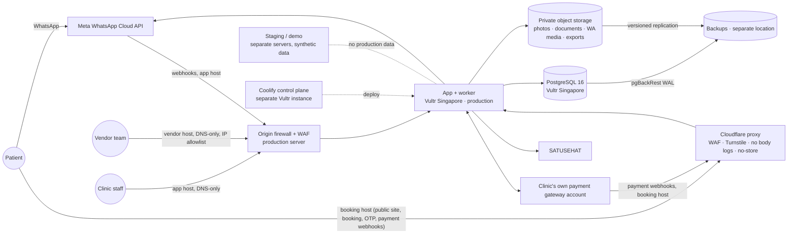

# System Architecture — Clinic Dashboard

## Document Control

| Field | Value |
|---|---|
| Accountable owner | Engineering owner |
| Status | In Review |
| Version / updated | kit v0.7 / 2026-11-02 (history: review rounds 1–5, `docs/research/reviews/`) |

## 1. Context

All locations above are configuration (ARCH-9). Moving to an Indonesian provider changes configuration and runs the migration runbook; no code changes.

## 2. Architecture Requirements

| ID | Requirement | Owner | Review | Status |
|---|---|---|---|---|
| ARCH-1 | Production app, worker, database, object storage, error tracking and logs run on Vultr Singapore servers dedicated to production; backups go to a separate location | Engineering owner | Checked against DECISION-REGISTER H-02b (owner decision, risk accepted) | Proposal |
| ARCH-2 | Staging and demo run on separate Vultr servers, databases, buckets and credentials with synthetic data only | Engineering owner | Checked against H-02a | Proposal |
| ARCH-3 | Three hostnames per environment (app, booking, vendor — vendor per ARCH-11/SEC-21): the **app host** (staff, clinical, API, Meta webhooks) is DNS-only to the origin with firewall, rate limits and WAF on the origin; the **booking host** (public booking, OTP, webhooks) is Cloudflare-proxied with WAF, Turnstile, DDoS protection, no request-body logging or Logpush, cache bypass and `Cache-Control: private, no-store`; the booking-host vhost accepts only Cloudflare Authenticated Origin Pulls (mTLS); Turnstile tokens verified server-side; origin WAF (Coolify/Traefik with a named WAF middleware, chosen in M0) and rate limits apply to both vhosts; staff/clinical routes are never served on the booking host | Engineering owner | Checked against H-02c | Proposal |
| ARCH-4 | One app container and one worker container from the same image; Traefik (Coolify default) as proxy; scale by adding app containers | Engineering owner | — | Proposal |
| ARCH-5 | All external effects go through the transactional outbox; payloads carry references only; the worker builds provider bodies at send time inside the bound tenant transaction | Engineering owner | Review-2 P2-3 | Proposal |
| ARCH-6 | Coolify control plane on its own instance is **tier-0**: compromising it equals compromising production, including the KEK (Coolify has root SSH reach). Controls: IP allowlist + MFA, no other workloads, OS/Coolify patch SLA 7 days for critical, auditd on KEK file access feeding the OBS-4 alert, Coolify built-in database backups disabled (pgBackRest only), non-root deploy user where supported; KEK never in Coolify env; move KEK to a KMS when available | Engineering owner | Checked against H-05 | Proposal |
| ARCH-7 | Key custody: one KEK per environment as a sealed file on the host owned by the application user, mode 0400, bind-mounted read-only (or a KMS if available), with an offline escrow copy held by the owner; per-tenant data keys wrapped by it; yearly rotation drill (rotation tooling later; DEC-031 D10) | Security owner | Checked against H-06 | Proposal |
| ARCH-8 | Requests without tenant context (webhooks, public slugs, worker claims, operator actions) resolve tenant through platform routing tables read by narrow security-definer functions returning IDs only (06 TEN-9) | Engineering owner | Review-2 P1-5 | Proposal |
| ARCH-9 | Residency portability: database host, object-storage endpoints, backup targets, hostnames and region labels are environment configuration; the vendor profile declares current locations; a rehearsed runbook migrates the whole environment (dump/restore + object sync + KEK transfer + DNS) to another provider or region within one day | Engineering owner | Checked against H-02b mitigation 1 | Proposal |
| ARCH-10 | Go-live gate: while the H-02d residency-opinion flag (vendor profile, PR-55) is unset or records an adverse or inconclusive outcome and any deployed location (database, object storage, backups, logs, error tracking — read from configuration) is outside Indonesia, the system refuses tenant activation, patient creation (including MIG-3 imports) and public booking in production; only the product owner sets the flag, with the opinion file checksum, audited | Engineering owner | Checked against H-02b mitigation 2 | Proposal |
| ARCH-11 | The vendor console runs from the same image on its own vendor hostname (SEC-21), reachable only from an IP allowlist with TOTP; it reads tenant data only through support-session grants (TEN-14) | Engineering owner | P-16 | Proposal |
| ARCH-12 | Public site pages are served from the booking host; content pages carry no personal data and may be cached at the edge with purge on publish; booking, OTP and webhook routes stay `no-store` (PR-64, ARCH-3) | Engineering owner | P-17 | Proposal |
| ARCH-13 | External payment providers sit behind one payment port with adapters (`mock` in Release 1); the vendor's AutoLaris account is a separate vendor-billing adapter and never handles patient payments (PR-61, PR-68) | Engineering owner | H-10, P-14 | Proposal |

## 3. Containers

| Container | Runtime | Location (configuration) | Data |
|---|---|---|---|
| app | Node.js LTS (verify), Next.js standalone | Vultr Singapore (prod and staging, separate) | Stateless |
| worker | Same image | Vultr Singapore (prod) | Claims outbox across tenants, binds tenant per row |
| postgres | PostgreSQL 16 + pgBackRest | Vultr Singapore (prod) | All tenant data |
| object storage | S3-compatible, versioned, private | Vultr Object Storage (prod bucket) | Photos, signed PDFs, inbound WhatsApp media, exports (24 h TTL) |
| backups | S3-compatible, separate location | Different region or provider from prod | Encrypted WAL + base backups, replicated objects |
| error tracking | Self-hosted (e.g. GlitchTip) or logs only | Production environment | Scrubbed errors |
| Coolify | Coolify v4 | Separate Vultr instance | Deployment metadata; env without KEK |

## 4. Trust Boundaries

1. Internet → Cloudflare (booking host only) → origin; app host direct to origin firewall.
2. Booking host → app public endpoints (rate-limited, no clinical reads).
3. App → database as non-owner role without BYPASSRLS; tenant context per transaction.
4. Worker → external providers with per-tenant credentials decrypted at send time.
5. Coolify → servers over SSH; Coolify UI behind allowlist + MFA.
6. Vendor operator → tenant data only via time-limited, reasoned, tenant-visible support sessions (PR-53).

## 5. Open Items

H-02d legal opinion (gate before real patient data); counsel on XFER-1/XFER-2.
