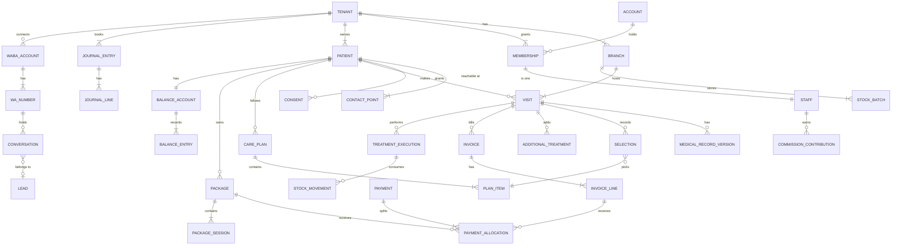
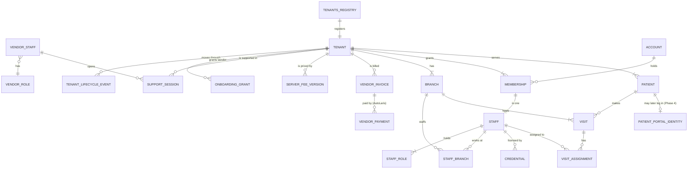

# Data Model — Clinic Dashboard

## Document Control

| Field | Value |
|---|---|
| Accountable owner | Engineering owner |
| Status | In Review |
| Version / updated | kit v0.7 / 2026-11-02 (history: review rounds 1–5, `docs/research/reviews/`) |
| Reference | Kliniknuma schema is a reference for naming and lessons only; nothing is migrated or copied |

## 1. Principles

| ID | Principle | Owner | Status |
|---|---|---|---|
| DATA-1 | Every tenant row carries `tenant_id`; branch-scoped and ledger rows also carry `branch_id`; scope kind per table in 06 | Engineering owner | Proposal |
| DATA-2 | Signed clinical rows and versions are append-only; corrections create versions; no hard delete of clinical data | Engineering owner | Proposal |
| DATA-3 | Money in integer rupiah (`bigint`); payments, allocations and journals append-only; corrections are reversing or adjusting rows | Engineering owner | Proposal |
| DATA-4 | Quantities are `numeric` with an explicit unit; no sums across units | Engineering owner | Proposal |
| DATA-5 | Every command moving money, stock, sessions or commission carries a unique idempotency key (`idempotency_records`) | Engineering owner | Proposal |
| DATA-6 | Sale-time snapshots on invoice lines and package sessions: price (branch-effective), discount, tax category and rate, session value, commission rule version, `sold_branch_id` | Engineering owner | Proposal |
| DATA-7 | IDs are UUIDv7; timestamps `timestamptz` in UTC; business day evaluated in the branch timezone | Engineering owner | Proposal |
| DATA-8 | Sensitive identifiers encrypted with tenant data keys plus a blind index for lookup (NIK, passport/KITAS number, staff NIK) | Engineering owner | Proposal |

## 2. Conceptual Model

## 2.1 Platform hierarchy — how every level connects (P-11, P-12)

One database, one schema, all tenants. Every level hangs off the one above by a foreign key; tenant data carries `tenant_id`, branch data also `branch_id`; the vendor layer sits above tenants and never joins tenant rows except through security-definer functions (TEN-16).

| Level | Who | Tables (DATA) | Key | Scope kind (06) | Sees |
|---|---|---|---|---|---|
| 1 Super admin (vendor) | Vendor team | `vendor_staff`, `vendor_roles`, `tenants_registry`, lifecycle, onboarding, `support_sessions`, `server_fee_versions`, `vendor_invoices`, `vendor_payments` (DATA-10, DATA-47–DATA-49) | `vendor_staff.id`; tenant referenced by `tenant_id` | platform | All tenants as rows of the registry; clinic data only inside a support session |
| 2 Admin Klinik Pusat (brand) | Owner, Admin Pusat, finance, central CS, facility head, records officer, marketing, purchasing, auditor | `tenants` (brand = one PT), `memberships` with `allowed_branch_ids = all`, tenant-wide `staff_roles` (DATA-10, DATA-12) | `tenant_id` | tenant-shared / tenant-ledger | Every branch of its own brand |
| 3 Klinik Cabang | Manager, FO/cashier, BC, doctor, nurse, therapist, pharmacist | `branches`, `staff_branches`, branch-scoped rows (visits, stock, cash shifts, schedules) (DATA-11, DATA-16, DATA-17, DATA-25, DATA-35) | `(tenant_id, branch_id)` | branch-scoped | Its branch(es) |
| User | Any person who logs in | `accounts` (one per email, global) → `memberships` (one per tenant) → `staff` (one per tenant) (DATA-12) | `account.id` | platform → tenant | Only tenants where a membership exists |
| Staff | A person's work identity in one tenant | `staff`, `staff_roles` (role set), `staff_branches`, credentials (DATA-12) | `(tenant_id, staff.id)` | tenant-shared | Projection by role, branch, assignment, purpose (IAM-5) |
| Patient | Data subject of one brand | `patients`, `contact_points`, `guardians`, `consents` (DATA-13, DATA-14) | `(tenant_id, patient.id)`, MRN unique per tenant | tenant-shared (identity), clinical (records) | No login in Release 1 (IAM-2); OTP-verified booking only |

Rules:

- DATA-55 below fixes the identity chain; the same human may be a vendor user, a staff member of two brands, and a patient of a third brand — each is a separate row in its own layer, never merged.
- A patient belongs to one tenant. The same person visiting brand A and brand B is two patient records (no cross-brand sharing, P-02); inside a brand one patient record serves all branches (L-5).
- Staff of brand A never see brand B (TEN-1); a doctor working for both brands has two memberships and switches tenant explicitly.
- Everything a patient does links back to the branch and staff that did it: visit → branch, visit assignments → staff, executions → performer staff, invoices → selling branch, commission → staff (DATA-17, DATA-24, DATA-27, DATA-36).
- Deleting is never the way to leave: a tenant exits through export and hand-over (TEN-8); staff leave by ending the membership (`effective_to`), history stays; patients are never hard-deleted while records must be retained (PRIV-3).

## 3. Entity Dictionary (key columns; full DDL is written in the first migration task)

| ID | Entity | Key columns and constraints | Scope (06) | Owner |
|---|---|---|---|---|
| DATA-10 | tenants, tenants_registry | legal_name, npwp, is_pkp, pkp_effective_from, sak_framework (emkm/ep), accent_hex, logo_ref | platform | Engineering owner |
| DATA-11 | branches | code (unique per tenant), timezone, address, hours (structured weekly + exceptions), closures, satusehat_org_id, facility_code, publish_from/until | tenant-shared | Engineering owner |
| DATA-12 | accounts, memberships, staff, staff_roles, staff_branches | account email unique global; membership(account, tenant) unique; staff: nik_enc + nik_bidx, ihs_practitioner_id; roles as set; licences (str, sip/sipp/sipa, expiry) | platform / tenant-shared | Engineering owner |
| DATA-13 | patients, contact_points, guardians | mrn (unique per tenant), identity_type (nik/passport/kitas/newborn_via_guardian), identity_enc + identity_bidx (unique per tenant), ihs_patient_id, religion, occupation, education, marital_status; phone in contact_points (not unique) | tenant-shared | Engineering owner |
| DATA-14 | consents | purpose (care_notice, procedure, clinical_photo, marketing_wa, publication), version, granted_at, withdrawn_at, channel, actor | tenant-shared | Engineering owner |
| DATA-15 | catalog_items, catalog_versions, branch_prices | kind (service/product/package/material), version, tax_category + basis, normal_price, control_count, control_validity_days, booking_dp_enabled + amount, min_dp_pct, installments_allowed, validity_days, material_formula, commission_scope, clinical fields + review state; branch_prices(branch, version, price, effective_from) | tenant-shared | Engineering owner |
| DATA-16 | appointments, resource_reservations, schedules, leave | source, campaign, channel, branch, performer, room, device; reservations exclusion constraint on overlapping ranges | branch-scoped | Engineering owner |
| DATA-17 | visits, visit_states | branch, patient, independent state columns (intake, doctor, selection, consent, payment, preparation, treatment, dispensing, closure), closed_at | branch-scoped | Engineering owner |
| DATA-18 | intakes, skin_observations | BC-authored, provenance, chips/text only (no score columns) | clinical | Engineering owner |
| DATA-19 | medical_records, medical_record_versions, face_map_marks, care_plans, plan_items, plan_versions, condition_assessments, procedure_consents, clinical_media, clinical_letters | provenance, signed_by, signed_at, version, correction_reason, approval for late correction; icd10 codes; plan item: catalog_version, qty, unit, stage | clinical | Engineering owner |
| DATA-20 | selections | plan_item, patient agreement (signature ref), guiding_bc_staff_id, closing_bc_staff_id | tenant-shared | Engineering owner |
| DATA-21 | additional_treatments | visit, catalog_version, authorized_by, patient_agreed_at, released_before_payment_by, collector_staff_id, state | branch-scoped | Engineering owner |
| DATA-22 | clinical_requests | type (addition, plan_change, substitution), requester, decided_by, decision, reason | clinical | Engineering owner |
| DATA-23 | complaint_tasks | source (message, visit note, pharmacist), patient, assigned_clinician, status, due_at | clinical | Engineering owner |
| DATA-24 | treatment_executions | performer_staff_id (actual), assisting_staff_id, started_at, finished_at, outcome (completed, medical_stop, clinic_stop, patient_stop), counted | branch-scoped | Engineering owner |
| DATA-25 | items, stock_batches, opened_vials, stock_requests, stock_issues, stock_movements (consume/return/waste/transfer/adjust), stock_counts, suppliers, purchase_orders, goods_receipts | per branch; moving_avg_cost per item per branch; batch expiry; FEFO; one consumption per execution item (unique) | branch-scoped | Engineering owner |
| DATA-26 | prescriptions, prescription_items, dispensings, labels | kfa_code, pharmacist checks, external-use label print state | clinical | Engineering owner |
| DATA-27 | invoices, invoice_lines, receipts | sold_branch_id, frozen price, discount, tax snapshot, `vat_recognised_amount`, `vat_recognised_at`, tax-document reference, receipt number per branch per month (unique) | tenant-ledger | Engineering owner |
| DATA-28 | payments, payment_allocations (gateway charges and events are DATA-51 only; no separate gateway tables) | method, amount, provider, provider_account, environment and `is_simulated` copied immutably onto payments and allocations; allocation target exactly one of {invoice_line, package, booking_deposit, balance_top_up, receivable}, gateway status, provider event id unique | tenant-ledger | Engineering owner |
| DATA-29 | packages, package_sessions, package_substitutions | sold_branch_id, price, paid_value, validity_end, min_dp; session: allocated_value, tax snapshot, `vat_recognised_amount`, `vat_recognised_at`, state (available/reserved/redeemed/closed); substitution with doctor approval | tenant-shared | Engineering owner |
| DATA-30 | balance_accounts, balance_entries | entry types: top_up, use, from_expiry, from_cancel, from_interrupted_treatment, from_substitution, from_refund, dp_transfer, cash_refund, opening_balance (import, no sale, tax or commission); `vat_settled` flag per entry; never negative | tenant-shared | Engineering owner |
| DATA-31 | booking_deposits | appointment, amount, state (held/applied/forfeited/moved_to_balance/refunded) exactly one terminal | tenant-shared | Engineering owner |
| DATA-32 | receivables, write_offs | origin visit, originating invoice-line allocations (immutable; revenue, VAT and commission stay with the line), amount, collected amount, created_by, write-off approved_by (owner self-write-off allowed with reason, BILL-23), reason, `opening` flag for imported receivables | tenant-ledger (06 table corrected) | Engineering owner |
| DATA-33 | refunds | source exactly one of invoice line, package, booking deposit, destination (balance/cash), state (requested/approved/paid/failed/unknown — unknown resolved by gateway reconciliation), approver | tenant-ledger | Engineering owner |
| DATA-34 | consultation_fee_states, controls | visit, charged/waived/recharged; control: source purchase, due date, valid_until, used | tenant-shared | Engineering owner |
| DATA-35 | cash_shifts | branch, cashier, opened/closed, expected by tender, counted, variance, approval | branch-scoped | Engineering owner |
| DATA-36 | commission_rules, commission_rule_versions, commission_contributions, commission_entitlements, commission_adjustments, payout_batches, guiding_bc_assignments, staff_targets | contribution unique (staff_id, type, source); adjustment references original; carry-forward balance | tenant-ledger | Engineering owner |
| DATA-37 | accounts_chart, posting_rules, journal_entries, journal_lines, periods | branch dimension; balanced per entry; locked periods reject postings | tenant-ledger | Engineering owner |
| DATA-38 | waba_accounts, wa_numbers (encrypted registration PIN, TD-20), wa_templates, token_vault, meta_webhook_receipts (raw event id unique, received_at, processed state), conversations, messages, message_media, message_costs | waba ownership, onboarding state, display-name state, quality, portfolio limit; token encrypted; messages body/media treated as possibly specific personal data (W-10) | tenant-shared + platform route | Engineering owner |
| DATA-39 | leads, lead_events, followups, campaigns | source, campaign, branch, assignee, first_response_at, status, lost_reason | tenant-shared | Engineering owner |
| DATA-40 | satusehat_credentials, integration_outbox, integration_resource_links, code systems (icd10, icd9cm, kfa, snomed subsets) | per branch env, client_id, secret_ref; outbox reference-only payload; error detail in `satusehat_errors` (clinical policy kind; code and path visible to non-clinical roles, full provider body only to clinical roles) | branch-scoped / clinical | Engineering owner |
| DATA-41 | approvals | type, subject ref, requester, approver (≠ requester except types whitelisted for an owner self-action, e.g. owner write-off BILL-23, which require reason and audit), state, reason | tenant-shared | Engineering owner |
| DATA-42 | notifications | recipient, type, subject ref, acknowledged_at | tenant-shared | Engineering owner |
| DATA-43 | audit_events, data_subject_requests, exports, operator_grants | append-only; exports with TTL and manifest | tenant-shared / platform | Engineering owner |
| DATA-44 | settings, setting_versions | registry per B-24 (SET-1–SET-49): key, scope (tenant/branch), value, type, bounds, effective_from, changed_by, reason, approval ref for drafts | tenant-shared | Engineering owner |
| DATA-46 | rooms | branch, name, kind (consultation/treatment/pharmacy), satusehat_location_id | branch-scoped | Engineering owner |
| DATA-47 | vendor_profile | legal name, NIB, PSE number, NPWP, Meta business ID, website, privacy URL, support contacts, declared storage locations, vendor tax profile (is_pkp, pkp_effective_from, evidence ref), residency_opinion_ref/date/outcome/set_by/checksum, placeholder flags (PR-55) | platform | Engineering owner |
| DATA-48 | vendor_staff, vendor_roles, tenant_lifecycle_events, onboarding_checklists, onboarding_grants, support_sessions (extends operator_grants with scope, owner_approval_ref) | lifecycle state, reason, actor; checklist item, owner, status, blocker; grant expiry | platform | Engineering owner |
| DATA-49 | tenant_contracts, server_fee_versions, vendor_invoices, vendor_payment_attempts, vendor_payments, vendor_credit_notes | tender reference; fee amount, effective month, reason, proposed_by, approved_by; invoice period, issue and due date, service dates, applied fee version, proration snapshot (days, days in month, formula result), amount (integer rupiah, VAT-exclusive), tax totals, state issued/paid/waived/credited; attempt: invoice, reff_id unique (persisted before the call), channel, amount, expires_at, AutoLaris transaction_id and trx_id unique, state created/pending/paid/expired/failed/unknown, Advice snapshots; payment: settled amount, withholding slip ref; credit note: reason, requested_by, approved_by, amount, applied_to_invoice; waiver is a credit note covering the full amount; unresolved attempts (unknown create result without transaction_id) block a new attempt until reconciled with AutoLaris support or Advice by reff_id if the provider supports it | platform | Engineering owner |
| DATA-50 | public_site_settings, public_profiles (doctor listing consent, public photo, titles, focus areas), catalog web fields (publish_web, public name, short description, performer role, duration, downtime, sessions, interval, price_published, clinical_review_ref), promos | publish state and version; consent ref; promo period, quota, eligible branches and items | tenant-shared | Engineering owner |
| DATA-51 | payment_port_configs, payment_charges, payment_webhook_events | per tenant provider (mock or named), environment, channels, credential ref (vault); canonical chain charge → webhook event → payment → allocation with FKs; external IDs unique per (tenant, provider, provider_account, environment); normalized state, simulated flag; event id unique per provider | tenant-ledger (charges and events written by the payment-port service, payments and allocations by the cashier/posting service) | Engineering owner |
| DATA-52 | reminder_rules, outbound_care_messages (reminder, aftercare), queue_tickets | branch rule (H-1, same day); message type care vs marketing; ticket number unique per branch per day | tenant-shared / branch-scoped | Engineering owner |
| DATA-53 | discount_limits, document_templates (receipt, consent, letter) with versions, medical_letters | limit per role percent and rupiah; template version immutable once used; letter signed, part of medical record | tenant-shared / clinical | Engineering owner |
| DATA-54 | suppliers, supplier_returns, credential_alerts, surveys, waitlist_entries, device_logbooks (sterilization, calibration, maintenance, B3 waste), clinical_incidents | return reason, batch, credit note ref; alert schedule 60/30/7 days | tenant-shared / branch-scoped | Engineering owner |
| DATA-55 | Identity chain | `accounts` (global, email unique, password hash, TOTP) → `memberships` (account, tenant, unique pair; `allowed_branch_ids`; `effective_from/to`; `level` derived: tenant-wide or branch) → `staff` (exactly one per membership: `staff.membership_id NOT NULL UNIQUE`, `staff.tenant_id` = membership tenant enforced by a composite FK `(membership_id, tenant_id)`; staff is created in the same transaction as the membership) → `staff_roles` (set) and `staff_branches` (FK `(tenant_id, branch_id)` to branches so a staff can never be assigned to another tenant's branch); `vendor_staff` is a separate table linked to `accounts` but never to `memberships`; `visit_assignments` (visit, staff, role, from/to) drive clinical access (TEN-1, IAM-3, IAM-9) | platform / tenant-shared | Engineering owner |
| DATA-56 | Patient link points | `patients.tenant_id` (no global patient table); `patient_portal_identity` reserved for Phase 4 (phone-verified, per tenant); booking OTP challenges (`otp_challenges`: tenant, phone hash, code hash, ttl, attempts) create or match a patient only inside that tenant (IAM-2) | tenant-shared | Engineering owner |
| DATA-57 | Platform routing | `waba_routes(phone_number_id, waba_id → tenant_id, branch_id)`, `payment_routes(provider, provider_account, environment, merchant_ref → tenant_id)`, `public_hosts(slug or host → tenant_id)`; unique across tenants (TEN-9) | platform | Engineering owner |
| DATA-58 | Opening-data import (first client and every later client) | `import_batches` (tenant, source system, started_by owner, state staged/validated/approved/applied/rolled_back, reconciliation totals), `import_rows` (batch, row no, entity, source external id, mapped id, error code), `source_id_map` (tenant, source system, entity, external id → local id, unique); opening records: patients, open packages (original sold branch, price, paid value, validity end) and remaining sessions, patient balances (`opening_balance` entry), receivables (`opening` flag), opening journal entry per account; opening records never create sales, VAT, commission or stock movements; vendor sees counts and error codes only (TEN-13) | tenant-shared / tenant-ledger | Engineering owner |
| DATA-59 | Domain events and consumers | `domain_events` (event id, tenant, branch, type per TD-50, fact reference, occurred_at, origin command id) written in the same transaction as the fact (shared outbox; `integration_outbox` is a consumer of it); `event_receipts` (consumer, event id, unique) for journals, stock, sessions and commission; `journal_entries.source_event_id` unique per posting rule | tenant-ledger | Engineering owner |
| DATA-60 | Audit attribution | every command and `audit_events` row carries: account id, membership id, staff id, **acting role**, tenant, branch (active or source), vendor session id (nullable), vendor staff id (nullable), command/correlation id, object kind and id, outcome; set server-side from the session, never from the client; async workers copy the origin attribution from the event and record their own service identity separately | tenant-shared / platform | Engineering owner |
| DATA-61 | Clinic money fields not elsewhere | `invoice_lines.discount_kind` (manual/promo), `discount_approval_id`; `product_handovers` and `product_returns` (line, staff, time, batch); `supplier_credit_expectations` (return, amount, state); `tax_advice_records` (tenant, category, advice ref, effective from) gating VAT (PR-24) | tenant-ledger | Engineering owner |
| DATA-62 | Service master detail (PR-88) | `catalog_versions` add prep_min (0–120), treatment_min (5–480), buffer_min (0–120), online_bookable, clinical_review_ref, materials_review_ref; `service_resources` (version, room kind or device type, required), `service_staff_eligibility` (version, role or staff, delegation mode); bookings store the catalog version used so later edits never change existing reservations | tenant-shared | Engineering owner |
| DATA-63 | Depots (PR-89) | `depots` (branch, name, kind gudang/ruang/apotek), `batch_holdings` (depot, batch, quantity ≥ 0), `depot_transfers` (from depot, to depot, lines, state, idempotency key) whose posting writes two linked `stock_movements` legs (out of source, into destination) in one transaction; availability checked on the source depot with a row lock so two concurrent transfers cannot overdraw it; a replayed transfer key returns the original result; quantity and value are conserved | branch-scoped | Engineering owner |
| DATA-64 | Supplier payables (PR-90) | `supplier_invoices` (type purchase or expense; supplier/payee, number unique per supplier, date, due date, lines matched to goods-receipt lines or to one `expenses` row, total, state), `supplier_payments` (amount, method, date), `supplier_payment_allocations` (payment → invoice), `supplier_credit_notes` (supplier, number, amount, tax breakdown, source return or invoice, available balance, state, reversal ref), `supplier_credit_applications` (credit note → invoice; available credit and invoice outstanding checked atomically); branch attribution | tenant-ledger | Engineering owner |
| DATA-65 | Access and duties (PR-91) | sessions from the auth provider exposed through a tenant view (membership-scoped; revoking ends sessions of that membership only, never the global login of other tenants); `duty_assignments` (tenant, staff, duty: data_protection / it_admin, effective from/to, assigned_by) | tenant-shared | Engineering owner |
| DATA-66 | Privacy workspace (PR-92) | `consent_texts` (purpose, version, text, effective_from; immutable once any consent references it) with `consents.consent_text_id`; `processors` (name, service, data, location, agreement ref); `breaches` (awareness_at, deadline_at = +72 h, description, affected count, state open → assessed → notified / not_notifiable (reason) → closed, every transition audited) and `breach_notices` (recipient, sent_at, immutable evidence file ref with checksum) | tenant-shared | Engineering owner |
| DATA-67 | Family sharing and instalment schedules (PR-93, PR-96) | `packages.sharing_allowed` snapshotted from the template at sale; `package_beneficiaries` (package, patient, granted_by, from/to); `package_session_redemptions` add `beneficiary_patient_id` (the treated patient; clinical records stay with the treated patient; clinical eligibility and consent are checked for the beneficiary, not the owner); reserving a session locks the package row so two beneficiaries cannot reserve beyond paid value; `instalment_schedules` (target exactly one of package or receivable via CHECK, version, state active/cancelled; cancelled automatically when the target closes, expires or is fully paid, cancelling pending reminders) and `instalment_rows` (due date, amount, linked payments); schedules post nothing | tenant-shared / tenant-ledger | Engineering owner |
| DATA-68 | Promo codes (PR-77) | `promo_codes` (stable identity, code unique per tenant, quota shared across versions), `promo_code_versions` (code, version unique per code, period, eligible items and branches, discount; immutable once used), `promo_usages` (code version, invoice line unique, patient, state reserved/consumed/released) | tenant-ledger | Engineering owner |
| DATA-69 | Expenses (PR-79) | `expenses` (branch, category/account, business date, amount, funding cash/bank/petty cash/unpaid, receipt ref, state, journal event; unpaid → one linked `supplier_invoices` row of type expense) | tenant-ledger | Engineering owner |
| DATA-70 | Automation (PR-94) | `automation_scenarios` (key, version, offsets, cap), `automation_occurrences` (scenario version, patient, trigger fact, scheduled_at; unique (scenario version, patient, trigger fact, offset step) so H+7, H+14 and H+21 of one trigger are distinct occurrences), `delivery_attempts`; per-patient daily cap counted atomically; consent and relevance rechecked before send; obsolete occurrences cancelled | tenant-shared | Engineering owner |
| DATA-71 | Compliance register (PR-97) | `evidence_items` (scope platform or tenant, obligation key, owner role, state draft/submitted/approved/rejected/expired/revoked, valid_until), `evidence_files` (version, checksum, uploaded_by), `evidence_approvals` (approver, decision, reason, approved **evidence file version** and, where applicable, the configuration version it covers — e.g. posting-map version, residency locations snapshot; a new file version or configuration change re-opens the gate until re-approved), `feature_gates` (gate key → required obligation keys); gates evaluated server-side on every gated action; expiry or revocation closes the gate again; residency (DATA-47), tax advice (DATA-61) and posting-map sign-off are evidence items | `platform` rows for vendor-level obligations (vendor staff only, tenant sees status via security-definer view); `tenant-shared` rows for tenant obligations | Engineering owner |
| DATA-72 | Report sources (PR-95) | `cash_shifts` linked on payments; `dispensings.queued_at/handed_at` for pharmacy wait; KPI definitions table (id, version, formula text, basis) used by the KPI dictionary page | tenant-ledger / read model | Engineering owner |
| DATA-45 | idempotency_records | namespace (tenant id or `platform`), key, command, request fingerprint (hash of normalized body), status (in_progress/succeeded/failed), result reference, created_at; unique (namespace, command, key); same key with a different fingerprint → rejected (TD-51); covers money, stock, sessions, commission, clinical sign/amend, consent and vendor-platform commands | tenant-shared / platform | Engineering owner |

## 3.1 Relationship and constraint contract (DDL guide for the first migration tasks)

Every tenant table has `tenant_id NOT NULL`; every referenced tenant table exposes `UNIQUE (tenant_id, id)`; every foreign key between tenant tables is **composite** `(tenant_id, x_id) → (tenant_id, id)` so a row can never point into another tenant. Branch-scoped tables add `branch_id` with `(tenant_id, branch_id) → branches(tenant_id, id)`.

| Link | Constraint | Extra rule |
|---|---|---|
| membership → staff | 1:1, `staff.membership_id UNIQUE NOT NULL`, composite tenant FK | created in one transaction (DATA-55) |
| staff_roles, staff_branches | composite FK to staff and branches | allowed branches stored in `staff_branches` (no free array); Level 2 roles use the wildcard (IAM-9) |
| visit → patient, branch | composite FKs | — |
| visit_assignments → visit, staff | composite FKs | same tenant; role recorded |
| treatment_executions, selections, additional_treatments, prescriptions, medical_records → visit | composite FK to visit | the referenced patient equals the visit's patient (check via `(tenant_id, visit_id, patient_id)` key) |
| invoices → visit (nullable for counter sales), patient (nullable) | composite FKs | invoice patient = visit patient when both set |
| payment_allocations → payment and exactly one target | composite FKs + CHECK exactly one | target's patient = payment's patient (same-patient key); simulated payments only to simulated allocations |
| packages, package_sessions → patient | composite FKs | redemption at another branch of the same tenant is allowed (cross-branch rule BILL-*) |
| balance_entries → balance_account → patient | composite FKs | never negative |
| stock_movements → batch, branch; optional execution | composite FKs | execution branch = movement branch except transfers |
| journal_lines → journal_entries → domain_events | composite FKs; `source_event_id` unique per rule | — |
| commission_contributions → staff, source fact | composite FKs | unique (staff, type, source) |
| vendor tables → tenants_registry | plain FK on `tenant_id` (platform kind) | never joined to tenant rows except via security-definer functions |

Deletion: `ON DELETE RESTRICT` everywhere for business rows; soft-end via `effective_to` or state; no cascade deletes across tenant data.

## 4. Integrity Rules

- Package: `redeemed_value + reserved_value + selected_value ≤ paid_value`; reservations released on package cancellation or expiry; redemption only on counted outcome.
- Balance: entries sum to balance; never negative.
- Booking DP and refunds: exactly one terminal state.
- Visit closure: no open invoice amount (unless converted to receivable), no pending dispensing, no unfinished execution.
- Stock: batch balance never negative; one consumption per execution item.
- Commission: one contribution per (staff, type, source); adjustments reference originals.
- Journal: debit = credit per entry; posted entries immutable; locked periods reject postings.
- Payment allocation targets exactly one of invoice line, package, booking deposit, balance top-up or receivable, belonging to the same patient as the payment.
- Simulated value never reaches gates, balances, receivables, sub-ledgers or commission (BILL-29).
- Opening (imported) records never create sales, VAT, commission or stock movements (DATA-58).

## 5. Retention

Clinical ≥ 25 years from last visit (Permenkes 24/2022 Pasal 39); financial ≥ 10 years (verify with accountant); leads never treated deleted on request; WhatsApp messages and media of patients follow the clinical retention when linked to a patient, otherwise 24 months after last contact (pending counsel); audit of clinical access kept with clinical data; operational logs 30 days.

## 6. Migration and Fixtures

Expand-contract only. Canonical fixture: tenant A with 3 branches across WIB and WITA, tenant B with 1 branch, every role, a doctor member of both tenants, a patient without NIK, a minor with guardian; injectable clock for 24 h, 2×24 h, expiry and SLA rules; recorded provider fixtures (Meta webhooks, SATUSEHAT sandbox, gateway sandbox).
