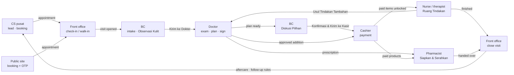

# UX Flows and Screen Contracts — Clinic Dashboard

## Document Control

| Field | Value |
|---|---|
| Owner | Design owner |
| Status | In Review |
| Version / updated | kit v0.7 / 2026-11-02 (history: review rounds 1–5, `docs/research/reviews/`) |
| Visual system | `DESIGN.md`, `10-DESIGN-SYSTEM-WHITELABEL.md` |
| Rationale and sketches | `UX-CONCEPT-APPLE-STYLE.md` |
| Inputs | `BC-SCREEN-SPEC.md`, `BIG-BRAND-DASHBOARD-CRM-REQUIREMENTS.md`, reviews 1–3, Kliniknuma DESIGN.md (reference; its UX-1–UX-17 numbering is unrelated to the IDs here) |

## Research and Decision Frame

- Apple HIG patterns (rules already captured in `DESIGN.md` and `UX-CONCEPT-APPLE-STYLE.md`; the external apple-design-skill is optional, pinned @ff4ebdd): tab bar for top-level navigation, sidebar on regular width, sheets for short tasks, full-screen modal for long tasks, one prominent action, inset grouped lists with swipe actions, inline feedback.
- Market evidence (REA 2026-11-02): WhatsApp-first conversion; central booking with source + branch; vendors ship dense desktop admins — the product deliberately differs by being phone/iPad-native.
- Do not copy: desktop ERP density, session replay on forms, KPI tiles without decisions, AI skin scores.

## Navigation

The complete menu tree, page inventory with content per page, and the Pengaturan settings registry are in `19-NAVIGATION-PAGE-CATALOGUE.md`; the tab sets below are the compact-width shortcuts into that tree (NAV-2).

Compact (< 700 px): bottom tab bar ≤ 5 tabs. Regular (≥ 700 px): same tabs as a leading sidebar; Saya sub-sections appear as a second level. Tabs are never hidden or disabled; empty sections explain why. Tab labels ≤ 2 words, ≤ 13 characters; unselected labels in `--label-2`.

Control levels (P-12): Level 2 roles (owner, Admin Pusat, finance, central CS, facility head, records officer, marketing, purchasing, internal auditor) open on a tenant-wide home with a branch switcher "Semua Cabang / <cabang>"; Level 3 roles open on their role home for the active branch. Every role home with patient-identity access has the patient search field (PR-76).

Branch and brand switching (PR-84): Saya › Ganti Cabang appears only with more than one allowed branch; Saya › Ganti Klinik only with more than one membership; the active brand and branch show under the large title with the acting role.

Multi-role staff (B-19, B-20): a person with several roles picks an active role in Saya › Ganti Peran. The tab bar shows that role's tabs; the active role is shown under the large title ("Sebagai Dokter") and recorded as the acting role on every action (IAM-3). The last choice is remembered per device. Single-role staff never see the switcher.

Tab sets and landing pages per role are owned by `19` §2.18 (single source); vendor roles use the separate desktop console (UX-34, UX-40–UX-48).

Saya (all roles) and the Pengaturan menu follow `19` §2.16–§2.17; masters (Pemasok, Template WhatsApp, Master Layanan) live in their own menu groups, not in Saya.

## Screen Inventory and Requirements

| ID | Screen | Pattern | Actor | Primary action | Requirement | Owner | Status |
|---|---|---|---|---|---|---|---|
| UX-1 | Onboarding klinik | Full-screen step flow | Owner | Lanjut | PR-1, PR-2, PR-27, PR-35 | Design owner | Proposal |
| UX-2 | Cabang (Pengaturan › Klinik & Cabang) | Inset grouped form | Owner | Simpan | PR-2, PR-88 (resources) | Design owner | Proposal |
| UX-3 | Staf & undangan | List + sheet; segments Staf · Undangan · Kredensial · Akses | Owner, Admin Pusat (Level 3 roles); facility head (verify credentials); manager (view own branch) | Undang | PR-3, PR-91 | Design owner | Proposal |
| UX-4 | Pasien baru | Sheet (large) form | Front office | Daftarkan | PR-5, PR-4 | Design owner | Proposal |
| UX-5 | Jadwal | Day list (compact), week grid (regular); views by doctor, room or device; appointment states | FO, CS | Buat Janji | PR-6, PR-83 | Design owner | Proposal |
| UX-6 | Hari Ini | List with VisitTrack + outstanding section; split view on regular | Front office | Check-in | PR-7, PR-15, PR-33c | Design owner | Proposal |
| UX-7 | Pendampingan (BC flow) | Full-screen 4-step flow | BC | Kirim ke Dokter / Konfirmasi & Kirim ke Kasir | PR-9, PR-15, PR-30 | Design owner | Proposal |
| UX-8 | Lembar Pemeriksaan (toolbar: Resep, Buat Surat) | Full-screen; 3 panes ≥ 1180 | Doctor | Tanda Tangani | PR-10, PR-11, PR-13, PR-74 | Design owner | Proposal |
| UX-9 | Ruang Tindakan | Checklist + outcome sheet | Nurse, therapist, doctor | Selesai Tindakan | PR-82 (logbook), PR-14, PR-16 | Design owner | Proposal |
| UX-10 | Siapkan & Serahkan | List + detail | Pharmacist | Serahkan | PR-16, PR-18 | Design owner | Proposal |
| UX-11 | Stok | List + detail; segments Item · Kartu · Batch · Depot · Hitung; PO and receipt sheets | Pharmacist, manager, purchasing | Buat PO / Terima Barang | PR-17, PR-46, PR-89 | Design owner | Proposal |
| UX-12 | Kasir | Full-screen modal + tender sheet | Cashier | Terima Rp… | PR-19, PR-20, PR-21, PR-12 | Design owner | Proposal |
| UX-13 | Paket & Saldo | Patient-scoped list | Cashier, FO | Pesan Sesi | PR-20, PR-21, PR-22, PR-93, PR-96 | Design owner | Proposal |
| UX-14 | Piutang & Refund | List + detail | Cashier, owner | Kirim Tagihan / Ajukan | PR-15, PR-21, PR-96, PR-37 | Design owner | Proposal |
| UX-15 | Tutup Kasir | Sheet | FO/cashier; manager approves | Tutup Kasir | PR-19, PR-33c | Design owner | Proposal |
| UX-16 | Komisi | List by month; batch detail | Owner, finance | Setujui Batch | PR-23 | Design owner | Proposal |
| UX-17 | Pesan | Conversation list + thread (Messages pattern); segments Percakapan · Templat · Nomor | CS, FO/cashier, BC, manager; owner (read) | Balas / Pilih Template | PR-28, PR-31, PR-43, PR-27 | Design owner | Proposal |
| UX-18 | Lead & Tindak Lanjut | Segmented list | CS, BC | Hubungi | PR-29, PR-30 | Design owner | Proposal |
| UX-19 | Kampanye & Segmen — built in Release 1, sending switched off until counsel clears Q-15 | List | Marketing | Jadwalkan | PR-31, PR-94 | Design owner | Proposal |
| UX-20 | Ringkasan (owner) | Scroll summary | Owner | Lihat yang perlu ditangani | PR-33a | Design owner | Proposal |
| UX-21 | Ringkasan (manager) | Scroll summary | Manager | Lihat yang perlu ditangani | PR-33b | Design owner | Proposal |
| UX-22 | Keuangan | Segmented: Ringkasan · Mutasi · Kewajiban · Rekon · Pajak · Biaya · Buku Besar · Ekspor | Finance | Ekspor | PR-25, PR-26, PR-34, PR-79, PR-98, PR-33f | Design owner | Proposal |
| UX-23 | SATUSEHAT | Status list + error detail | Owner, manager | Kirim Ulang | PR-35 | Design owner | Proposal |
| UX-24 | Booking publik | 4-step flow | Patient | Konfirmasi Jadwal | PR-6, PR-22, PR-39 | Design owner | Proposal |
| UX-25 | Katalog & Harga | List + detail; branch price tab | Owner, manager | Simpan / Minta Review | PR-88, PR-41, PR-42 | Design owner | Proposal |
| UX-26 | Persetujuan | Inbox with type filter; plain row buttons, prominent Setujui only in detail | Owner, manager, facility head | Setujui (detail) | PR-44, PR-37 | Design owner | Proposal |
| UX-27 | Permintaan Klinis | Inbox of cards | Doctor, clinician | Setujui / Tolak | PR-45 | Design owner | Proposal |
| UX-28 | Keluhan (Klinis · Layanan · Insiden segments) | Task list + detail | Clinicians (Klinis), branch manager (Layanan) | Tangani | PR-43, PR-82 | Design owner | Proposal |
| UX-29 | Profil Pasien (with Pasien search for Doctor, Records officer; Gabung Data Ganda for records officer; Buat Surat for doctor) | Inset grouped sections | FO, clinicians (scoped), records officer | Salinan Rekam Medis | PR-49, PR-4, PR-85 | Design owner | Proposal |
| UX-30 | Privasi & Permintaan Data Pasien (segments Privasi · Permintaan) | List + detail | Owner | Tutup Permintaan | PR-50, PR-92 | Design owner | Proposal |
| UX-31 | Log Audit | Filterable list | Owner, facility head, records officer, auditor (masked) | — (read only) | PR-51 | Design owner | Proposal |
| UX-32 | Ekspor Data | Sheet + job list | Owner | Mulai Ekspor | PR-52 | Design owner | Proposal |
| UX-33 | Jadwal Staf | Week grid (regular), day list (compact) | Manager | Simpan Jadwal | PR-48 | Design owner | Proposal |
| UX-34 | Konsol Vendor › Profil Vendor (badan usaha, NIB, PSE, lokasi data; placeholder ditandai) | Separate app | Vendor operator | Buka Sesi Dukungan · Simpan Profil | PR-53, PR-55 | Design owner | Proposal |
| UX-35 | Pasienku (BC home) | List: my patients by next step; follow-ups due; own K19 attainment and K17 | BC | Hubungi | PR-33d, PR-47, PR-30 | Design owner | Proposal |
| UX-36 | Ringkasan CS | Scroll summary: new/unassigned/overdue conversations (K14), K13 by source | Central CS | Lihat yang perlu ditangani | PR-33e | Design owner | Proposal |
| UX-37 | Cabang | Branch list (league) → branch detail with the PR-33a branch KPIs | Owner | Buka Cabang | PR-33a | Design owner | Proposal |
| UX-38 | Laporan | List of reports and exports: K-reports, roll-forwards, commission per recipient, sub-ledger CSV | Finance, owner | Unduh | PR-25, PR-33f, PR-95 | Design owner | Proposal |
| UX-39 | Persetujuan Tindakan | Full-screen signable consent from plan items and doses; re-consent when dose increases; signature pad ≥ 320×160 px with Ulangi | Doctor (capturing role pending Q-07), patient | Tanda Tangani | PR-11 | Design owner | Proposal |
| UX-40 | Konsol Vendor › Tenant | Table (state, monthly fee, branches, go-live, payment status, health) → tenant detail with tabs Ringkasan · Cabang · Onboarding · Integrasi · Tagihan · Sesi Dukungan · Audit (vendor actions on this tenant only) | Vendor team | Buat Tenant | PR-56, PR-1 | Design owner | Proposal |
| UX-41 | Konsol Vendor › Onboarding | Checklist per tenant and branch with owner, status, blocker | Onboarding specialist | Tandai Siap Live | PR-58, PR-59 | Design owner | Proposal |
| UX-42 | Konsol Vendor › Integrasi | Per tenant/branch status codes: WABA quality and limit, SATUSEHAT backlog and error codes, payment-port webhooks | Support | Buka Sesi Dukungan | PR-60 | Design owner | Proposal |
| UX-43 | Konsol Vendor › Tagihan Server | Fee per tenant with versions, monthly invoices, AutoLaris status, reminders | Vendor finance, platform owner | Terbitkan Tagihan / Setujui Biaya | PR-61 | Design owner | Proposal |
| UX-44 | Konsol Vendor › Sesi Dukungan | Active and past sessions: tenant, operator, reason, scope, start/end | Vendor team | Akhiri Sesi | PR-53, PR-60 | Design owner | Proposal |
| UX-45 | Konsol Vendor › Kesehatan Platform | Uptime, worker heartbeat, outbox backlog per provider, backup age, error rate | Platform owner, support | — (read only) | PR-62 | Design owner | Proposal |
| UX-46 | Konsol Vendor › Tim Vendor | Vendor staff, roles, TOTP state | Platform owner | Undang | PR-57 | Design owner | Proposal |
| UX-47 | Konsol Vendor › Audit Vendor | Every vendor action, filterable, exportable | Platform owner, vendor auditor | Ekspor | PR-57 | Design owner | Proposal |
| UX-48 | Saya › Akses Vendor | Owner view of onboarding grant, support sessions and vendor changes | Owner | Akhiri Sesi / Setujui Akses Klinis | PR-58, PR-60 | Design owner | Proposal |
| UX-49 | Saya › Tagihan Server | Monthly server-fee invoices, QRIS/VA pay, status, receipt | Owner, finance | Bayar | PR-61 | Design owner | Proposal |
| UX-50 | Situs Klinik | Publish status, preview, sections on/off; a compliance checklist per publish (no testimonial, no discount, no superlative, reviewed clinical text) | Owner, Admin Pusat, marketing | Terbitkan | PR-64, PR-77 | Design owner | Proposal |
| UX-51 | Situs publik (patient) | Generated pages: Beranda, Perawatan, Perawatan detail, Cabang, Cabang detail, Dokter, Profil dokter, kebijakan (no promo page, no testimonials — Permenkes 1787/2010) | Patient | Buat Janji | PR-64–PR-67 | Design owner | Proposal |
| UX-52 | Pembelian | Suppliers, POs, goods receipt, supplier returns, transfers across branches | Purchasing | Buat PO / Retur | PR-17, PR-75, PR-90 | Design owner | Proposal |
| UX-53 | Audit Internal | Read-only lists: suspicious activity, manual discounts, approvals, refunds and write-offs, stock variance | Internal auditor, owner | Ekspor | PR-63, PR-72 | Design owner | Proposal |
| UX-54 | Templat Dokumen | Versioned templates for receipts, consent and letters; preview | Admin Pusat, facility head | Simpan Versi | PR-74 | Design owner | Proposal |
| UX-55 | Pengingat & Aftercare | Reminder rules per branch (H-1, same day), aftercare text per catalog item, delivery log | Admin Pusat, marketing; facility head (aftercare text); manager (proposals); CS (log) | Simpan | PR-69, PR-70, PR-94 | Design owner | Proposal |
| UX-56 | Simulasi Pembayaran | Mock gateway page for QRIS/VA/link with buttons Lunas · Kedaluwarsa · Gagal · Kirim Ulang Webhook; banner SIMULASI | Staff (demo/staging), test runner | Tandai Lunas | PR-68 | Design owner | Proposal |
| UX-57 | Ringkasan (Admin Pusat) | Scroll summary: setup completeness per branch, pending configuration, items waiting for owner | Admin Pusat | Lengkapi | PR-33g | Design owner | Proposal |
| UX-58 | Kepatuhan & Pendapat Ahli | List by obligation with status chips; detail with file, checksum, approver, validity, gated features | Owner, facility head, finance | Unggah Bukti / Tandai Disetujui | PR-97 | Design owner | Proposal |
| UX-59 | Kamus KPI | List of K1–K27 with formula, basis, source, version; definition-change markers | Every role with dashboards | — (read only) | PR-95 | Design owner | Proposal |
| UX-60 | Ringkasan per peran (Klinis, Marketing, Apotek, Pembelian, Audit, Ruang Saya) | Scroll summary per `19` §2.1; same component as UX-20/21 with role widgets | Facility head, marketing, pharmacist, purchasing, auditor, nurse/therapist | Lihat yang perlu ditangani | PR-33, PR-86 | Design owner | Proposal |

Tab → screen: Promo (Marketing) UX-50 · Situs UX-50 · Pembelian/Transfer UX-52 · Katalog UX-25 · Staf UX-3 · Ringkasan (Admin Pusat) UX-57 · Audit (Internal auditor) UX-53 · Hari Ini UX-6 · Jadwal UX-5 · Kasir UX-12/13/14/15 · Pesan UX-17 · Pasienku UX-35 · Tindak Lanjut UX-18 · Target Saya › Target · Antrean UX-8 · Pasien UX-29 · Permintaan UX-27 · Keluhan UX-28 · Ruang UX-9 · Siapkan/Serahkan UX-10 · Stok UX-11 · Lead UX-18 · Ringkasan UX-20/21/36 · Persetujuan UX-26 · Cabang UX-37 · Keuangan UX-22 · Komisi UX-16 · Laporan UX-38 · Audit UX-31 · Koreksi UX-26 (filter: koreksi rekam medis).

Also: Target Saya (PR-47) and Notifikasi (PR-54) are sections of Saya; settings are the Pengaturan menu (PR-38, `19` §2.17). Walk-in registration and queue numbers (PR-71) are actions in UX-6 Hari Ini; manual-discount approval (PR-72) arrives in UX-26 Persetujuan; credential alerts (PR-73) appear in Perlu Ditangani and Notifikasi.

## Key Screen Contracts

### Contract for UX-6 — Hari Ini

- Large title "Hari Ini", branch chip with zone label; segmented filter (Semua · Menunggu · Belum Bayar).
- First section "Belum dibayar" (always first when non-empty): unpaid additions and bills; tap → Kasir with the visit loaded.
- Rows: time, name, VisitTrack, blocker text. Swipe left: Panggil, Tagih. Pull to refresh; new rows appear under "Baru (n)" instead of reordering under the finger.
- Closing a visit (detail): enabled only with no unpaid bill and no pending dispensing or execution; otherwise the disabled button names the blocker.
- No diagnosis or photos.

### Contract for UX-7 — Pendampingan (from BC-SCREEN-SPEC)

- One full-screen flow per patient with step header: Intake & Foto → Dokter → Diskusi Pilihan → Konfirmasi.
- History column (regular) or "Riwayat Singkat" sheet (compact).
- Observasi Kulit: chips and text only.
- Diskusi Pilihan: toggle per plan item; summary capsule "Bayar sekarang Rp… · Saldo Rp… · Sesi siap dipakai n"; actions "Pasien Tidak Membeli", "Minta Dokter Ubah Rencana".
- Konfirmasi: patient purchase agreement with signature (separate from procedure consent), then "Konfirmasi & Kirim ke Kasir"; tracker shows progress afterwards.
- Additional treatment proposal: sheet → goes to UX-27.
- Labels "BC Pembimbing", "BC Closing".

### Contract for UX-8 — Lembar Pemeriksaan

- ≥ 1180: Antrean | Lembar | Riwayat. 700–1179: Lembar + Riwayat as medium-detent sheet keeping edit state. Compact: Lembar only, Riwayat via toolbar button.
- Intake rows: swipe "Benar" / "Koreksi" (no retyping).
- Face map: segmented control Keluhan · Pemeriksaan · Tindakan.
- Plan: staged items with price preview and consent requirement.
- One prominent "Tanda Tangani"; after signing the sheet shows the locked badge; corrections per PR-13.

### Contract for UX-9 — Ruang Tindakan

- Header: room, timer, patient, treatment, VisitTrack.
- "Sebelum mulai" checklist (identity, consent, materials, performer) with 52 px rows; "Mulai" enables only when complete.
- Quick actions: Bahan Tambahan, Usul Tindakan Tambahan (→ UX-27), Jeda.
- "Selesai Tindakan" opens a medium sheet: four outcomes as large options, then material deviations only. Timer end never completes anything.

### Contract for UX-12 — Kasir

- Full-screen modal: lines with frozen price and tax badge; package and balance context.
- Tender sheet: keypad, chips Tunai · QRIS · EDC · Transfer · Link · Saldo; remaining in Title 1.
- Prominent button names the amount ("Terima Rp350.000"). Success shows receipt actions (Cetak, Kirim WhatsApp link).

### Contract for UX-20 — Ringkasan (owner)

1. "Perlu ditangani": approvals, unpaid visits older than today, low clinical stock, leads past the SET-20 SLA, SATUSEHAT errors, compliance evidence expiring (hidden when empty).
2. K1 (Title 1) with delta ▲▼ and words and time basis; K2, K4, K5 (package-expiry slice).
3. Line chart K1 vs K2 by week on a card; title states the finding; data table available.
4. Cabang list (league) → branch detail; treatment mix bar; channel funnel K13; prepaid aging in one sequential hue.

### Contract for UX-27 — Permintaan Klinis

- Cards: type (Tindakan Tambahan, Ubah Rencana, Tukar Treatment), patient, requester, reason, price impact.
- Actions in the list: plain Setujui / Tolak buttons; the prominent Setujui appears only in the card detail. Tolak requires a reason. Approval of an addition opens patient agreement and alerts FO (PR-54).

Contract template for every remaining Must screen: **sections · primary/secondary actions · blocked-with-reason states · role visibility (07 row) · drill-down targets**. Contracts below are binding; a Must screen without a contract may not get an implementation task (gate before M0.5/M1 task writing).

### Contracts for remaining Must screens (sections · actions · blocked · visibility · drill-down)

| Screen | Sections | Primary / secondary actions | Blocked-with-reason | Visibility (07) | Drill-down |
|---|---|---|---|---|---|
| UX-1 Onboarding klinik | Steps: Data Klinik (PT, NPWP, PKP) → Cabang → Katalog (import or template) → Staf → Pengaturan Uang (Pengaturan › Uang & Kasir) → WhatsApp → SATUSEHAT → Ringkasan | Lanjut / Simpan Draf, Lewati (optional steps only) | "Perjanjian pengolahan data belum ditandatangani" blocks Staf and import steps (TEN-12) | Owner; onboarding specialist under grant (drafts only) | Each step → UX-2, UX-25, UX-3, Pengaturan |
| UX-2 Cabang | Identitas, Jam Buka (weekly + exceptions), Ruang & Alat, Layanan Tersedia, Nomor WhatsApp, Lokasi & Peta, Situs (publish window) | Simpan / Tambah Ruang, Tambah Libur | "Cabang belum punya kredensial SATUSEHAT" on clinical go-live | Owner, Admin Pusat (edit); manager (view own) | Ruang → UX-11 stock location |
| UX-3 Staf & undangan | List by branch and role; detail: roles, branches, credentials (STR/SIP with expiry), membership dates | Undang / Ubah Peran, Akhiri Keanggotaan | "Peran ini butuh persetujuan Owner" (IAM-11); "Kredensial belum diverifikasi" for clinical roles | Owner, Admin Pusat (Level 3 roles), manager (own branch, view) | Staff → UX-33 Jadwal Staf |
| UX-4 Pasien baru | Identitas (nama, HP, tgl lahir, jenis identitas + nomor, data Permenkes), Wali (minor), Persetujuan | Daftarkan / Cari Dulu (PR-76) | "Nomor HP dipakai pasien lain — pilih atau buat baru" (no auto-merge) | FO, CS (create); clinical roles view | After save → UX-6 visit or UX-5 booking |
| UX-10 Siapkan & Serahkan | Segments Siapkan · Serahkan; rows by patient with items, batch suggestion (FEFO), pharmacist checks | Siapkan / Serahkan (7 checks, label print) | "Resep belum ditandatangani", "Batch kedaluwarsa", "Belum dibayar" | Pharmacist; FO sees status only | Row → prescription detail; → UX-28 Keluhan Klinis flag |
| UX-15 Tutup Kasir | Expected per tender vs counted, variance, notes | Tutup Kasir / Hitung Ulang | Any non-zero variance → "Menunggu persetujuan manager" (UX-26); above SET-13 also escalates to Owner | Cashier own shift; manager all shifts of branch | → shift detail list of payments |
| UX-17 Pesan | Conversation list (Belum Ditugaskan, Milikku, Semua), thread with 24 h window timer, patient chip | Balas / Pilih Template, Tugaskan, Tandai Keluhan (Klinis/Layanan) | "Jendela 24 jam habis — pilih template"; "Pasien tidak setuju promosi" disables marketing templates | CS, FO, BC (own branch or tenant-wide for CS); no clinical roles | Patient chip → UX-29 (projection by role); → UX-5 Buat Janji |
| UX-18 Lead & Tindak Lanjut | Segments Lead (new→lost) · Tindak Lanjut (due today, overdue, by reason) | Hubungi (opens UX-17) / Ubah Status, Tunda | "Tidak ada persetujuan promosi" on marketing follow-ups | CS, BC (own), manager | → UX-17 thread, → UX-5 |
| UX-26 Persetujuan | Inbox filtered by type (refund, write-off, diskon, void, koreksi, selisih kas, stok, komisi, peran); detail with requester, reason, impact | Setujui (detail only) / Tolak (reason) | "Anda pengaju — tidak dapat menyetujui"; "Di atas batas Anda — diteruskan ke Owner" | Owner, manager, facility head, records officer by type | → subject record |
| UX-22 Keuangan | Segments Ringkasan (K1, K4, K5), Mutasi (payments by method), Ekspor | Ekspor / Filter Cabang | "Periode terkunci" for edits | Finance, owner | → UX-38 Laporan |
| UX-23 SATUSEHAT | Per branch: queued, sent, accepted, rejected with error code; resend | Kirim Ulang / Lihat Kode | "Kredensial cabang belum aktif" | Owner, manager, facility head, records officer (codes only for non-clinical) | Rejected item → record (clinical roles only) |
| UX-30 Permintaan Data Pasien | List with right, due date, state | Tutup Permintaan / Tugaskan | "Identitas pemohon belum diverifikasi" | Owner, data-protection duty holder | → UX-29 patient copy |
| UX-31 Log Audit | Filter by actor, acting role, object, time, vendor session | Ekspor | — | Owner, facility head, auditor (masked) | → object |
| UX-32 Ekspor Data | Job list with state, size, expiry, checksum manifest | Mulai Ekspor | "Ekspor penuh hanya untuk Owner" | Owner | — |
| UX-41–UX-47 Konsol Vendor | See contract UX-40–UX-49 above; each page = table + detail panel, no charts in Release 1 | Per inventory row | Maker-checker messages ("Butuh persetujuan platform owner") | Vendor roles per IAM-10 | → tenant detail |
| UX-50 Situs Klinik | Status, preview, sections, compliance checklist | Terbitkan / Pratinjau | Checklist failures block publish with the item named | Owner, Admin Pusat, marketing | → UX-25 web fields |
| UX-52 Pembelian | Segments Pemasok · PO · Penerimaan · Retur · Transfer | Buat PO / Terima Barang, Retur | "Batch tanpa tanggal kedaluwarsa tidak dapat diterima" | Purchasing, pharmacist, manager | → UX-11 |
| UX-53 Audit Internal | Lists: aktivitas mencurigakan, diskon manual, void, refund & write-off, selisih stok | Ekspor | — | Internal auditor, owner (masked patient refs) | → subject (read-only) |
| UX-54 Templat Dokumen | Types: struk, persetujuan tindakan, surat, halaman legal situs; versions | Simpan Versi / Pratinjau | "Versi sudah dipakai — buat versi baru" | Admin Pusat, facility head (clinical templates) | — |
| UX-55 Otomasi, Pengingat & Aftercare | Scenarios (PR-94) with on/off, offsets, per-patient cap; reminder rules per branch; aftercare text per catalog item; delivery log | Simpan / Ajukan (drafts) | "Teks aftercare belum direview klinis"; "Batas pesan per pasien tercapai" | Admin Pusat (change), marketing (draft), facility head (aftercare), manager (proposal), CS (log) | → UX-25 item |
| UX-57 Ringkasan Admin Pusat | See inventory row | Lengkapi | — | Admin Pusat | → UX-2, UX-3, UX-25 |
| UX-11 ▸ Depot | Depots per branch, holdings per batch, transfer sheet | Transfer / Terima | "Stok depot asal tidak cukup" | Pharmacist, purchasing | → Kartu Stok |
| UX-52 ▸ Utang | Supplier invoices matched to receipts, due dates, balance, payments, credit applications | Catat Faktur / Bayar | "Nomor faktur sudah ada untuk pemasok ini" | Purchasing, finance | → receipt, → payment |
| UX-22 ▸ Kewajiban · Rekon · Pajak · Biaya · Buku Besar | Liabilities roll-forward; KPI vs ledger differences; PKP status, tax per item, Coretax export; expenses with receipt; chart, journals, periods, statements | Ekspor / Kunci Periode / Catat Biaya | "Bukti saran pajak belum disetujui" (Pajak, Coretax); "Posting map belum ditandatangani" (journal export) | Finance, owner | → source documents |
| UX-28 ▸ Insiden | Incident list and detail per PR-82 | Catat Insiden / Tutup | "Investigasi belum selesai" | Facility head, clinicians (own reports) | → patient (clinical roles) |
| UX-9 ▸ Logbook | Sterilization, calibration, maintenance, B3 waste entries | Catat | "Alat lewat jatuh tempo kalibrasi" | Nurse, manager | — |
| UX-3 ▸ Akses | Permission matrix (read-only), sessions with revoke, duty assignments, change log | Cabut Sesi / Tugaskan | "Peran ini butuh persetujuan Owner" | Owner, Admin Pusat | — |
| UX-30 ▸ Privasi | Consent texts and versions, consent ledger, processors, breach register with deadline and notices | Tambah / Catat Kebocoran | "Batas 3×24 jam: {sisa waktu}" | Owner, data-protection duty holder | → patient consents |
| UX-58 Kepatuhan & Pendapat Ahli | Obligations with status, files, approvals, validity, gated features | Unggah Bukti / Setujui | "Fitur {x} terkunci sampai bukti {y} disetujui" | Owner; facility head (clinical); finance (tax/accounting) | → gated feature |
| UX-59 Kamus KPI | KPI list with formula and version | — | — | Dashboard roles | → reports |
| UX-60 Ringkasan per peran | Widgets per `19` §2.1 | Per widget | — | Named roles | → source pages |

### Contract for UX-13 — Paket & Saldo

- Family sharing (PR-93): Penerima Manfaat section appears only when the package's template enabled sharing at sale (snapshot); add/remove beneficiary with reason; sessions show who redeemed; refunds and expiry value always go to the owner's balance.
- Instalment schedule (PR-96): optional rows with dates and amounts, labelled "Pengingat saja — tidak membuka sesi"; missed rows create a follow-up task, never debt.

- Sections: active packages (paid value, redeemed, reserved, available sessions, expiry), balance with entries by type, booking deposits.
- Actions: Pesan Sesi (reserve; blocked "Perlu bayar RpX lagi" when `redeemed + reserved + selected > paid`), Bayar Cicilan, Top Up Saldo; secondary Batalkan Paket (owner/manager).
- Wording: "Dipesan" (reserved) vs "Terpakai" (redeemed only after counted outcome).
- Visibility: cashier, FO, owner, manager; drill-down to the payment and visit.

### Contract for UX-14 — Piutang & Refund

- Receivable reminder schedule (PR-96): optional rows (date, amount) labelled "Pengingat saja"; each due row creates a follow-up task and a WhatsApp reminder within the automation cap; payments are matched to rows for display only; the schedule cancels itself when the receivable is paid or written off.

- Sections: receivables aged (K4 buckets) with source visit and collector; refund requests with destination (Saldo default, Tunai exception).
- Actions: Kirim Tagihan (WhatsApp link, no treatment names), Terima Pembayaran, Ajukan Refund; owner-only Hapus Buku with mandatory reason (owner may act alone, B-14).
- Blocked: cash refund without approval; refund above paid amount.

### Contract for UX-16 — Komisi

- Sections: month batches by state (draft, approved, paid), per-recipient lines with contribution type, adjustments and carry-forward.
- Actions: Setujui Batch (approver ≠ requester), Tandai Dibayar, Ekspor per penerima.
- Staff see only their own lines in Saya › Komisi Saya.

### Contract for UX-25 — Katalog & Harga

- Sections: item detail (type, tax category with basis, materials class, clinical fields, ICD-9-CM/KFA codes), versions, branch price tab (PR-42).
- Actions: Simpan (new version); Minta Review for clinical fields (clinical lead).
- Blocked: deleting an item used in an open plan or package; price change does not alter frozen sale lines.

### Contract for UX-28 — Keluhan Klinis

- Sections: open tasks by urgency with time since report and response target (SET-31), source message, patient, last treatment.
- Actions: Tangani (assign to me), Catat Respons, Jadwalkan Kontrol, Selesaikan with outcome.
- Notifications to the responsible clinician and manager when the target is passed.

### Contract for UX-29 — Profil Pasien

- Sections: identity (NIK masked), allergies banner, visits, plans, packages and balance summary, consents with purpose, date and Tarik Persetujuan, photos (role-scoped).
- Actions: Salinan Rekam Medis (records officer/doctor, audited), Ubah Data.
- Visibility: clinical sections hidden for non-clinical roles; every open of a clinical section is audited.

### Contract for UX-33 — Jadwal Staf

- Sections: week grid per branch and role; leave and closures.
- Actions: Simpan Jadwal; conflicts with booked appointments block saving and list the affected appointments.

### Contract for UX-35, UX-36, UX-37, UX-38

- UX-35 Pasienku: sections Perlu Dihubungi, Menunggu Dokter, Belum Memilih, Paket Hampir Habis; target attainment card (K19).
- UX-36 Ringkasan CS: Perlu ditangani (unassigned, past the SET-20 SLA), K14 trend, K13 by source; drill-down to UX-17.
- UX-37 Cabang: league sortable by K1, K2, K7, K8, K9, K10, K11, K12, K16, K17; detail shows the same cards as UX-20 for one branch.
- UX-38 Laporan: each report shows period, branch filter, last generated, Unduh; exports expire after 24 h.

### Contract for UX-24 — Booking publik (OTP state)

- Steps: layanan → cabang & waktu → data diri → kode OTP.
- OTP sent from the tenant's WhatsApp; when the tenant has none, the screen says "Kode dikirim dari nomor layanan [nama brand]".

### Contract for UX-39 — Persetujuan Tindakan

- Content generated from the authorized plan (items, doses, risks); the signer is the patient or guardian; the capturing staff role is recorded.
- Re-consent required when an item is added or a dose increases; old consent stays in history.

### Contract for UX-6 additions — walk-in and queue (PR-71)

- Toolbar action "Pasien Datang" opens a sheet: search existing patient (PR-76) or "Pasien Baru" (UX-4); on save a visit opens with the next queue number of the day ("A-012"), shown large on the row.
- Optional TV display per branch (paired device): current and next numbers with room; never patient names (fixed rule).

### Contract for UX-40–UX-49 — vendor console and owner view

- Tab exemption: the vendor console is a desktop sidebar app; UX-40 tenant detail may hold 7 tabs because the ≤ 5 tab-bar rule applies to compact staff navigation only.

- Desktop-first (vendor works at a desk); dense tables allowed here only; same tokens.
- Platform pages never show patient names, phones, clinical text or message bodies (PR-60); a tenant's data opens only inside a support session, shown as a coloured banner "Sesi dukungan — <tenant> — berakhir 14:30" with Akhiri.
- Server fee (UX-43): change form needs reason and effective month; approval by a different platform role; invoice amounts never change after issue.
- UX-48 lists every vendor change and every record read in a support session, grouped by session, plus infrastructure access (SEC-20) and any dual vendor/clinic identity; owner approval is requested in the app before any clinical-scope session.

### Contract for UX-51 — patient public site

- Breakpoints 390 / 820 / 1180; hero image 3:2, treatment card image 1:1; `<title>` = "{Perawatan} — {Klinik} {Kota}", meta description from the reviewed short description; privacy, terms and cancellation pages generated from vendor templates (UX-54) with tenant fields.

- One template per tenant, tenant accent/logo/hero photo only (UI-8); no carousel; first screen: clinic name, one line, concern/branch chips, primary "Buat Janji"; mobile sticky bar "Buat Janji" + "WhatsApp" with labels.
- Treatment detail order: what it is for, who performs it, duration, downtime, sessions and interval, contraindication summary (clinical-lead reviewed), tariff or "Harga dijelaskan saat konsultasi" with what changes the price, branches offering it, doctors (with consent), Buat Janji.
- Doctor profile: name, practice schedule and branches, focus areas; titles and SIP number only as counsel allows (Q-15).
- Structured data per `seo-website-builder`: `MedicalClinic` per branch with opening hours, `Physician`, `MedicalProcedure`; no `Offer` with discounts, no `Review`/`AggregateRating`.
- No cart, checkout, shipping or product purchase (P-13); no invented counters, ratings, superlatives, testimonials or advertised discounts (PR-65, Permenkes 1787/2010 Pasal 5); doctors shown as information, never as endorsers (PR-66); no third-party scripts before consent and none on booking routes (PR-39).

### Contract for UX-56 — payment simulation

- Reachable only for tenants whose payment port is the mock adapter; every page, receipt and invoice shows "SIMULASI"; amounts never enter K1.

### Contract for UX-5 — Jadwal (appointment states, PR-83)

- Segmented views: Hari Ini · Minggu; filter by doctor, room or device; slot colours by state with word labels (UI-3).
- Row actions: Ubah Jadwal (sheet with valid slots), Batalkan (reason, DP rule shown before confirming), Tandai Tidak Datang (enabled after start time + lateness setting).
- Reminder replies: "Konfirmasi" sets confirmed; "Ubah Jadwal" creates a task in Tindak Lanjut for CS/FO with the patient's message.

### Contract for UX-11 additions — stock count

- "Hitung Stok" sheet: blind count option (system quantity hidden), count per batch; variance above threshold goes to UX-26 Persetujuan.

## Role Hand-off Map

One visit moves across roles; each hand-off has a signal and a blocker. Source rules: PR-7, PR-9–PR-19, PR-43–PR-45, PR-54.



| Visit state | Done by | Next role | Signal | Blocks |
|---|---|---|---|---|
| Booked / walk-in registered | CS, FO, public site | FO | Hari Ini row, queue number | — |
| Checked in | FO | BC | Pasienku + notification | — |
| Intake sent | BC | Doctor | Antrean + notification | Doctor signs only verified intake |
| Plan signed | Doctor | BC | Pasienku "Rencana siap" | — |
| Selection confirmed | BC | Cashier | Kasir queue | Treatment cannot start with initial items unpaid |
| Paid | Cashier | Room, pharmacist | Ruang list, Siapkan list | Consent and credentials checked at start |
| Addition proposed | Room or BC | Doctor | Permintaan + notification | Needs clinician and patient agreement |
| Addition approved | Doctor | FO / cashier | Alert (PR-54) | Visit cannot close unpaid |
| Treatment finished | Room | FO | VisitTrack segment | — |
| Dispensed | Pharmacist | FO | VisitTrack segment | Close blocked while pending |
| Closed | FO | CS, BC | Aftercare (PR-70), follow-up tasks (PR-30) | — |
| Complaint flagged (Klinis) | Any inbox role | Clinician on duty | Keluhan › Klinis task, response ≤ SET-31 (triase) | — |
| Complaint flagged (Layanan) | Any inbox role | Branch manager | Keluhan › Layanan task, Perlu Ditangani, response ≤ SET-31 (layanan) | — |
| No-show | FO (Tandai Tidak Datang) | CS / BC | Follow-up task (PR-30) | DP forfeited per PR-22 |
| Reschedule / cancel | Patient reply, CS, FO or clinic | FO / CS | Jadwal update; Tindak Lanjut task for reply | DP moves to balance or is forfeited per PR-22 |
| Treatment stopped — medical | Room | Doctor | Permintaan / Keluhan if adverse | Session not used; free reschedule (PR-14) |
| Treatment stopped — clinic cause | Room | FO / cashier | Hari Ini blocker | Session not used; reschedule or value to balance (PR-14) |
| Treatment stopped — patient choice | Room | FO | VisitTrack | Session counted (PR-14) |
| Control visit | CS / BC from PR-30 task | FO → doctor | Jadwal + Antrean | Consultation fee waived until control date + 7 days (PR-12) |
| Consultation only | BC ("Pasien Tidak Membeli") | Cashier | Kasir queue | Consultation fee charged (PR-12) before close |
| Package session visit | FO (session reserved at booking/check-in) | BC only if the plan stage changes; otherwise room | Ruang list | Session redeemed only on counted outcome (PR-20) |
| Counter sale without visit | Cashier | Pharmacist for regulated items | Serahkan list | Hand-over required for regulated items (PR-19) |
| Exception (refund, write-off, discount over limit, variance) | Requester | Owner, manager | Persetujuan | Requester ≠ approver |

Level links: Level 2 sees every branch's hand-offs as counts on Ringkasan and Cabang; Level 1 sees none of them (platform counts only).

## Public Sitemap (PR-64, PR-40)

```text
Release 1 (generated)        /{slug} · /{slug}/perawatan · /{slug}/perawatan/{item} · /{slug}/cabang · /{slug}/cabang/{branch}
                             /{slug}/dokter · /{slug}/dokter/{doctor} · /{slug}/booking
                             /{slug}/kebijakan-privasi · /{slug}/syarat-ketentuan · /{slug}/kebijakan-pembatalan
Phase 4 (PR-40)              /artikel · /testimoni · /before-after · /skin-quiz · /paket · /masalah-kulit/{slug} · /produk (display only)
```

Domain: the slug path on the booking host is canonical until a `08-DOMAIN-ROUTING.md` is written when P-17 is reopened (not in the kit yet); URLs are built by one helper so a later subdomain or custom domain needs no content change.

## State and Permission Matrix (summary)

| Action | Allowed roles | Blocked when | Feedback |
|---|---|---|---|
| Start treatment | Doctor; nurse/therapist within delegation | Initial items unpaid; consent missing; credentials invalid | Disabled with reason |
| Release addition before payment | Front office/cashier | Not approved by clinician and patient | Records releaser and collector |
| Close visit | Front office | Unpaid bill; pending dispensing; open execution | Disabled with blocker |
| Reserve session | Cashier, front office | Paid value insufficient; outside plan stage | Shows amount needed |
| Redeem session | System on counted outcome | Medical or clinic stop | Session returns to available |
| Approve cash refund | Owner (or manager if tenant setting) | Requester = approver | Refused |
| Write-off receivable | Owner | — | Reason required |
| Correct signed record | Author within 2×24 h; afterwards with records officer/facility head approval | — | New version |
| Free-form WhatsApp reply | CS, FO, BC | Window closed | Template picker |
| Approve clinical request | Doctor/authorized clinician | Not assigned to the branch | Refused |
| Manual discount above role limit | Owner, manager | Requester = approver | Waits in Persetujuan |
| Change server fee | Vendor finance proposes, platform owner approves | Same person | Refused |
| Open tenant data | Vendor support in a session | Clinical scope without owner approval | Refused, audited |
| Publish public site | Owner, Admin Pusat, marketing | Clinical text not reviewed; doctor without listing consent | Item excluded with reason |

## Responsive and Input Contract

- Size classes: compact < 700 · regular ≥ 700 · regular-wide ≥ 1180 (DESIGN.md › Layout).
- Clinical-room screens (UX-7–UX-10, UX-27, UX-28) designed iPad-first, 52 px rows, gloved-hand targets.
- Sticky action bars above the on-screen keyboard; safe-area insets on bars and sheets.
- Text to 200%: horizontal pairs stack; no essential truncation.

## Traceability and Validation

Each UX-* is accepted when its browser check (loading, first-run empty, filtered empty, error, success, blocked; keyboard; 390/820/1180/1440; 200% text) is recorded as TEST/EVID in the repository after implementation.
